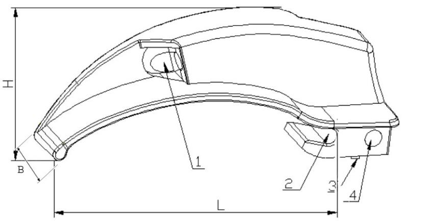
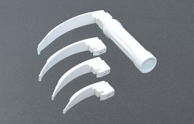

# 麻醉咽喉镜注册技术审查指导原则（2026年修订版）

麻醉咽喉镜注册技术审查指导原则

（2026年修订版）

本指导原则旨在指导注册申请人准备及撰写麻醉咽喉镜注册申报资料，同时也为技术审评部门审评注册申报资料提供参考。

本指导原则是对麻醉咽喉镜的注册申报资料的一般性要求，注册申请人应根据产品的具体特性，判断指导原则中的具体内容是否适用，不适用内容应详述理由及相应的科学依据。并依据产品的具体特性对注册申报资料的内容进行充实和细化。

本指导原则是供注册申请人和技术审评人员的指导性文件，但不包括注册审批所涉及的行政事项，亦不作为法规强制执行，应在遵循相关法规的前提下使用本指导原则。

如有能够满足法规要求的其他方法，也可以采用，但应提供详细的研究资料和验证资料。本指导原则是在现行法规和标准体系以及当前认知水平下制定的，随着法规和标准体系的不断完善和科学技术的不断发展，本指导原则相关内容也将适时进行调整。

一、适用范围

本指导原则适用于麻醉咽喉镜产品，包括重复使用的麻醉咽喉镜和一次性使用麻醉咽喉镜，参考《医疗器械分类目录》，该类设备按第二类医疗器械管理，分类编码为08—05—06。对于仅包括窥视片、不包括手柄的产品，本指导原则也可参照执行。

本指导原则不适用于带有视频功能的喉镜产品和与之配套的喉镜片。

二、技术审查要点

（一）监管信息

1.产品名称

产品名称应遵循《医疗器械通用名称命名规则》《呼吸、麻醉和急救器械通用名称命名指导原则》等规范性文件的要求。产品名称应以体现产品的工作原理、技术结构特征、功能属性为基本准则，如“麻醉咽喉镜”“一次性使用麻醉咽喉镜”。

2.注册单元划分的原则和实例

依据《医疗器械注册单元划分指导原则》的相关要求，原则上以产品的技术原理、结构组成、性能指标和适用范围为划分依据。由于一次性使用麻醉咽喉镜与可重复使用麻醉咽喉镜的原材料、生产工艺（含灭菌方式）存在明显差异，导致产品安全有效性存在差异时，应划分为不同的注册单元；分体和连体的麻醉咽喉镜，如区别仅为窥视片与手柄是否分离，可以划分为同一注册单元。

综述资料

1.器械及操作原理描述

1.1工作原理

麻醉咽喉镜一般由窥视片和手柄组成，当电源接通后，窥视片插入患者的口腔中并压住舌部，挑起患者会厌部暴露声门，光束可集中照射于咽喉部位。供临床喉部检查、协助插管用。

描述产品的工作原理、主要功能及其组成部件（关键组件）的功能，以及区别于其他同类产品的特征等内容。

1.2结构及组成

麻醉咽喉镜一般由窥视片和手柄组成。

按照结构的不同，分为连体式和分体式；按照光源不同，分为LED光源式、灯泡光源式；按照导光方式不同，分为直接照明式和纤维导光束照明式；窥视片可按照形式的不同，分为弯型、直型、弯钩型等；按照使用次数可以分为可重复使用和一次性使用产品。

说明麻醉咽喉镜的结构，提供产品结构示意图及实物图（如图1、图2）。

1—光源；2—铰链槽；3—电接触点；4—锁定表面；

B—窥视片的宽度；H—窥视片前部尖端至镜片最高处的距离；L—窥视片的有效长度

图1 窥视片示意图

图2 典型麻醉咽喉镜实物图

1.3型号规格

需明确申报产品的型号规格及其划分说明，如同一个注册单元包含多个型号规格，需提供产品型号规格区分列表或配置表。

1.4包装说明

申请人应详细描述申报产品中注册单元所有产品组成的包装情况，说明包装清单和包装方式，提供包装图示。

1.5研发历程

应描述申报产品的研发背景和目的，如申报产品的研发历史概述。

1.6与同类和/或前代产品的参考和比较

对于研发参考的同类产品或前代产品，应说明选择其作为研发参考的原因。同时列表说明申报产品与研发参考产品在工作原理、结构组成、性能指标及适用范围等方面的异同。

2.产品的适用范围、适用人群、禁忌证

2.1适用范围：供临床喉部检查、急救及麻醉手术时协助插管用。

2.2适用人群

需临床喉部检查、急救及麻醉手术时协助插管用的患者

2.3预期使用环境

明确该产品预期使用的地点、可能影响其安全性和有效性的环境条件。应明确对设备使用地点和使用环境的要求。使用环境条件一般包括：温度、湿度、大气压、移动、振动、海拔等。

2.4禁忌证：暂无已知禁忌证。

非临床资料

1.产品风险管理资料

注册申请人需对产品全生命周期实施风险管理，依据GB/T 42062 《医疗器械 风险管理对医疗器械的应用》，提供产品风险管理报告。

申请人需重点说明：申报产品的研制阶段已对其有关可能的危险（源）及产生的风险进行了估计和评价，并有针对性地实施了降低风险的技术和管理方面的措施，在产品性能测试中部分验证了这些措施的有效性，达到了通用和相应专用标准的要求。对所有剩余风险进行了评价。全部达到可接受的水平。产品风险分析资料需为申请人对产品的安全性的承诺提供支持。

风险管理报告的内容至少包括：

1.1产品的风险管理组织。

1.2产品的组成

1.3产品符合的安全标准。

1.4产品的预期用途，与安全有关的特征的判定。

1.5对申报产品的可能危险作出判定（见附表）。

1.6对所判定的危险采取的降低风险的控制措施。

1.7对采取控制措施后的剩余风险进行估计和评价。

1.8对风险管理计划的实施情况进行评审。

1.9对生产和生产后活动收集与评审信息。

同时，因申报产品含有光源，申请人应参照《医疗器械光辐射安全注册审查指导原则》光辐射安全进行风险分析。

2.安全和性能的基本原则

参考《医疗器械安全和性能基本原则符合性技术指南》的要求，根据《医疗器械安全和性能的基本原则》中的各项要求明确适用性。对于不适用的要求，应当逐项说明不适用的理由。对于适用要求，应逐项说明为符合要求所采用的方法，以及证明其符合性的文件。关于证明各项要求符合性的文件，如果包含在产品注册申报资料中，应当说明其在申报资料中的具体位置。对于未包含在产品注册申报资料中的文件，应当注明该证明文件名称及其在质量管理体系文件中的编号。

3.产品技术要求及检验报告

3.1产品适用标准情况

产品适用及引用标准的审查可以分两步来进行。首先对引用标准的齐全性和适宜性进行审查，也就是在编写注册产品技术要求时，是否引用了与产品相关的国家标准、行业标准，以及引用是否准确。应注意所引用标准是否为有效版本。其次对引用标准的采纳情况进行审查。即，所引用的标准中的条款要求，是否在注册产品技术要求中进行了实质性的体现和条款引用。这种引用通常采用两种方式，文字表述繁多内容复杂的可以直接引用标准及条款号，比较简单的也可以直接引述具体内容。如表1列出麻醉咽喉镜主要涉及的现行有效的国家/行业标准；

表1 产品适用标准

| 标准编号 | 标准名称 |
| --- | --- |
| GB/T 191 | 包装储运图示标志 |
| GB/T 2828.1 | 计数抽样检验程序第1部分：按接受质量限（AQL）检索的逐批检验抽样计划 |
| GB/T 2829 | 周期检验计数抽样程序及表（适用于对过程稳定性的检验） |
| GB 9706.1 | 医用电气设备第1部分：基本安全和基本性能通用要求 |
| GB/T 14710 | 医用电器环境要求及试验方法 |
| GB/T 16886.1 | 医疗器械生物学评价第1部分：风险管理过程中的评价与试验 |
| GB/T 16886.5 | 医疗器械生物学评价第5部分：体外细胞毒性试验 |
| GB/T 16886.10 | 医疗器械生物学评价第10部分：皮肤致敏试验 |
| GB/T 16886.23 | 医疗器械生物学评价第23部分：刺激试验 |
| GB/T 19633.1 | 最终灭菌医疗器械包装第1部分：材料、无菌屏障系统和包装系统的要求 |
| GB/T 19633.2 | 最终灭菌医疗器械包装第2部分：成形、密封和装配过程的确认的要求 |
| YY/T 0313 | 医用高分子产品包装和制造商提供信息的要求 |
| GB/T 42062 | 医疗器械 风险管理对医疗器械的应用 |
| YY/T 0466.1 | 医疗器械 用于制造商提供信息的符号第1部分：通用要求 |
| YY 0499 | 麻醉和呼吸设备 气管插管用喉镜 |
| YY 9706.102 | 医用电气设备 第1—2部分：基本安全和基本性能的通用要求 并列标准：电磁兼容要求和试验 |
| YY 9706.112 | 医用电气设备 第1-12部分：基本安全和基本性能的通用要求 并列标准：预期在紧急医疗服务环境中使用的医用电气设备和医用电气系统的要求 |
| YY/T 0681系列标准 | 无菌医疗器械包装试验方法 |
| YY/T 0698系列标准 | 最终灭菌医疗器械包装材料 |
| YY/ T 1474 | 医疗器械可用性工程对医疗器械的应用 |
| YY/T 1844 | 麻醉和呼吸设备 导气管和相关设备的通用要求 |

3.2产品技术要求应包括的主要性能指标

申请人应根据产品的实际情况，拟定产品技术要求应符合《医疗器械注册与备案管理办法》等相关规定，应不低于产品适用的强制性国家标准/行业标准，按照《医疗器械产品技术要求编写指导原则》要求编写。

3.2.1一次性使用的麻醉咽喉镜因其材质与重复使用的产品不同，性能指标与YY 0499、GB 9706.1、YY 9706.102（如适用）中具体要求可能存在不适用的情况，在制定技术要求时，应充分考虑产品自身特点，对于不适用的内容，应在性能研究资料中详细说明原因，提供有关证据。可考虑根据产品实际特点增加相关指标要求，如环氧乙烷灭菌的一次性使用的麻醉咽喉镜应制定无菌、环氧乙烷残留量性能指标要求。

3.2.2电磁兼容性应按照YY 9706.102的要求检验。对于仅包含光纤，无光源的窥视片产品，可不要求电磁兼容检验。安规检验报告和电磁兼容检验报告应具有关联性。

3.2.3手柄

3.2.4喉镜窥视片

3.2.5铰链组合

3.2.6单件式喉镜

3.2.7若非无菌供应，应规定微生物限度指标

3.2.8若无菌供应，应规定无菌性能指标，采用环氧乙烷灭菌，还应规定环氧乙烷残留量指标。

企业对宣称的所有其他技术参数和功能，均应在产品技术要求中予以规定。

3.3检验报告

检验报告可以是申请人按照《医疗器械注册自检管理规定》出具的自检报告，也可以是委托有资质的医疗器械检验机构出具的检验报告。

3.4同一注册单元内注册检验代表产品确定原则和实例

同一注册单元内所检验产品应当是本注册单元内能够代表申报的其他型号产品性能要求的产品，若不能完全覆盖，还应选择其他型号进行差异性检验。例如：不同光源的型号间不可相互覆盖，应分别检验。分体与连体，可选择分体型为典型型号，同时需提供型号间差异性检验。

注册申请人应提供典型性检验样品的选择说明，典型性产品的确定可以通过比较同一注册单元内所有产品的技术结构、性能指标和预期用途等相应资料，说明其能够代表本注册单元内其他产品的安全性和有效性。原则上应选取结构最复杂、功能最齐全、风险最高的型号规格作为典型性产品。若一个型号规格不能覆盖所有产品，除选择典型性产品进行全性能检验外，还需选择其他型号规格产品进行未覆盖项目的检验。

4.研究资料

4.1化学和物理性能研究

应详述产品技术要求中主要性能指标及检验方法的确定依据，提供采用的原因及理论基础，提供涉及的研究性资料、文献资料和标准文本。如适用的国家标准、行业标准中有不采纳的条款，应将不采纳的条款及其理由予以阐明。

麻醉咽喉镜的性能指标及试验方法应参考引用YY 0499，如有不适用条款（包括国家标准、行业标准要求），注册申请人应在申报资料中说明理由。若未采用YY 0499中给出的试验方法，应提供所使用的试验方法的来源依据或方法学验证资料。

若产品带有配合使用的附件，应分别列出附件的材料、尺寸、性能要求。

建议注册申请人对产品使用时，特别是急救时，对喉镜片折断的风险进行评估，提供产品抗折断方面的研究资料，应参照YY 0499中7.1.5强度、7.2.2刚度、7.2.3强度性能要求进行验证。

应提供产品的主要原材料选择依据等信息。

对于采用新材料制造的产品以及具有其他特殊性能的产品，申请人应根据产品特点制定相应的性能要求，设计验证该项特殊性能的试验方法，阐明试验方法的来源或提供方法学确认资料。

4.2联合使用

如申报产品预期与其他医疗器械、药品、非医疗器械产品联合使用实现同一预期用途，应当提供证明联合使用安全有效的研究资料，包括互联基本信息（连接类型、接口、协议、最低性能）、联合使用风险及控制措施、联合使用上的限制，兼容性研究等。

4.3电气系统安全性研究

应当提供电气安全性、机械和环境保护以及电磁兼容性的研究资料，说明适用的标准以及开展的研究。

4.4辐射安全研究

应参考《医疗器械光辐射安全注册审查指导原则》相关规定提交光辐射安全研究资料。

4.5生物学特性研究

窥视片和手柄在临床使用时需组合后使用，会与口腔及咽喉黏膜组织接触，因此，应评价包括窥视片和手柄在内的整体产品的生物学风险。申请人应按GB/T 16886.1的要求进行评价并提交资料。其中应描述产品采用的材料、粘接剂（如适用），以及在使用过程中与口腔及咽喉黏膜组织接触的性质和时间，应确定的生物相容性评价项目及要求等内容，提交相应的生物学评价资料的支持。由于本产品属于短期表面器械接触黏膜器械，一般应评价的项目至少包括细胞毒性、致敏和粘膜刺激等。

加工助剂的研究：明确生产过程中各种加工助剂的使用情况及对杂质（如残留单体、小分子残留物等）的控制情况，如粘结用环己酮的配方及限量，应对环己酮的配方和限量的安全性进行分析评价，并提供安全证明材料。

4.6清洁、消毒、灭菌研究

4.6.1以无菌形式供应的产品，应明确灭菌工艺（方法和参数）及其选择依据和无菌保证水平（SAL），并提供灭菌确认报告。麻醉咽喉镜的无菌保证水平（SAL）应达到1×10-6。提供灭菌确认报告，报告内容应符合GB 18279《医疗保健产品灭菌 环氧乙烷》系列标准、GB 18280《医疗保健产品灭菌 辐射》系列标准等的规定。灭菌确认应考虑产品与灭菌过程的适应性、包装和标签与灭菌过程的适应性等内容。

4.6.2残留毒性：若灭菌使用的方法容易出现残留，如环氧乙烷灭菌，应当参考GB/T 16886.7《医疗器械生物学评价第7部分：环氧乙烷灭菌残留量》等标准明确残留物信息（如EO（环氧乙烷）、ECH（2-氯乙醇）、EG（乙二醇））及采取的处理方法和条件，并提供研究资料。

4.6.3对于重复使用的产品，应提供终端用户灭菌或消毒方面的研究资料，注册申请人应明确终端用户灭菌或高水平消毒工艺及确定依据，提交灭菌耐受性研究资料。

4.7可用性

麻醉咽喉镜应参照《医疗器械可用性工程注册审查指导原则》，按照中、低使用风险医疗器械要求提交使用错误评估报告，包括基本信息、使用风险级别、核心要素、同类医疗器械上市后使用问题分析、使用风险管理、结论等内容。若前期已开展可用性工程工作，亦可提交可用性工程研究报告，用于替代使用错误评估报告。

4.8稳定性研究

4.8.1货架有效期

一次性使用麻醉咽喉镜产品有效期的验证报告（包括产品物理、化学稳定性和包装密封稳定性的验证资料），不同包装的产品需分别提供，且应符合相应标准要求。有效期的确定可使用加速老化试验进行验证。如采用加速老化试验，应评估产品是否适用于加速老化，若适用，可采用加速老化研究资料作为货架有效期的支持性资料。在稳定性研究中应监测整个有效期内确保产品安全性和有效性的关键参数。加速老化研究试验的具体要求可参照YY/T 0681系列标准。

产品有效期验证试验宜采用与常规生产相同的终产品进行。验证项目需评估产品随时间老化的相关性能，包括产品自身性能验证和包装系统性能验证两方面。前者需选择与医疗器械有效期密切相关的物理、化学、微生物测试项目，涉及产品生物相容性可能发生改变的，需进行生物学评价。后者包括包装完整性、包装强度和微生物屏障性能等验证项目。其中，包装完整性验证项目可包括在设定的时间间隔点目力检测产品包装（是否污染、破损等）及标签（完整性、粘附牢固度、印刷内容清晰度等）、采用染色液穿透法测定透气包装的密封泄漏试验和气泡法测定软性包装泄漏试验等；包装强度测试项目包括软性屏障材料密封强度试验、无约束包装抗内压破坏试验等。

4.8.2使用稳定性

申报产品如为重复使用，应明确储存方式和最长储存时间，并提供按照该程序处理后仍能满足相关性能要求的验证资料。

4.8.3需提交运输稳定性验证资料，证明在规定的运输条件下，运输过程中环境条件（例如：震动、振动、温度和湿度的波动）不会对医疗器械的特性和性能，包括完整性和清洁度，造成不利影响。有源产品还需提供在宣称的运输条件下，符合GB/T 14710《医用电器环境要求及试验方法》中运输试验要求的验证资料；

包装研究：包装研究资料中应包括包装材料、包装方法、验证过程和结论。注册申请人应明确产品包装材料；并提供在宣称贮存条件下，保持包装完整性的依据。

4.9其他资料

对于列入《免于进行临床评价医疗器械目录》的麻醉咽喉镜、一次性使用麻醉咽喉镜、一次性使用麻醉窥视片产品可免于进行临床评价。注册申请人应当按照《列入免于临床评价医疗器械目录产品对比说明技术指导原则》的要求，从基本原理、结构组成、性能、安全性、适用范围等方面，证明产品的安全有效性。

临床评价资料

与《免于进行临床评价医疗器械目录》，以下简称《目录》）中麻醉咽喉镜、一次性使用麻醉咽喉镜、一次性使用麻醉窥视片产品产品，可免于进行临床评价。注册申请人应按照《列入免于临床评价医疗器械目录产品对比说明技术指导原则》的要求，从基本原理、结构组成、性能、安全性、适用范围等方面，证明产品的安全有效性。若无法证明申报产品与《目录》产品具有等同性，则应按照《医疗器械临床评价技术审查指导原则》其他要求开展相应工作，提供符合要求的临床评价资料。

（五）产品说明书和标签

1.麻醉咽喉镜产品说明书、标签的编写要求应符合《医疗器械说明书和标签管理规定》、YY 0466.1、YY/T 0313、GB 9706.1、YY 9706.102、YY 0499等相关标准的要求。同时应注意以下要求。

2.麻醉咽喉镜的产品说明书应包括以下内容：

2.1适用范围

应列出具体的适用范围，并说明麻醉咽喉镜的适用人群。

2.2产品的主要结构及性能指标

性能指标应与产品技术要求保持一致。

2.3注意事项、警示以及提示性内容

2.3.1某些可充电电池的输出功率可能在使用过程中迅速降低、导致照明迅速失效的警告;

2.3.2电池的规格和使用说明;

2.3.3针对不同目标患者人群的尺寸编号

2.3.4使用前通过点亮照明器来检查电池状态的说明;

2.3.5“只有受过培训的人员或正在接受培训的人员才能使用喉镜进行插管”的警告;

2.3.6有关手柄和喉镜窥视片兼容性/互配性的信息。

2.3.7组装完成后，如发现窥视片与手柄连接出现松动，不得使用。

2.3.8一次性使用产品

（1）如适用,在工作位置应可见“一次性使用”或等效标识。灭菌方式也应注明；

（2）产品使用后需要处理的，应当标明相应的处理办法；

（3）使用前检查包装是否完好。

（4）货架有效期;

2.3.9重复使用产品

若是重复性使用的麻醉咽喉镜产品要提供清洗、消毒或灭菌的推荐方式、重复使用的最大次数和/或最长时间（与制造商研究资料一致，并以制造商宣称为主）；

如适用,在清洗、消毒或灭菌前应先取出电池的警告;

（3）喉镜的常规保养和使用前状态检查的说明,包括任何可更换部件的规格说明;

2.3.10  YY 0499《麻醉和呼吸设备 气管插管用喉镜》9章节规定的其它内容。

（六）质量管理体系文件

1.生产工艺过程及过程控制点

应当根据麻醉咽喉镜的实际情况，可以流程图的形式对生产工艺过程进行详细描述，明确产品生产的工艺过程，以及各关键工艺的控制点。注明关键工艺和特殊过程，说明过程控制点及控制标准。

2.研发和生产场地

注册申请人应当对与麻醉咽喉镜有关的研制场地和生产场地情况进行概述，如地址、位置、面积、生产环境条件、生产设备、工艺装备、监视和测量装置、人员等。

三、参考文献

[1]中华人民共和国国务院.医疗器械监督管理条例:中华人民共和国国务院令第739号[Z].

[2]国家市场监督管理总局.医疗器械注册与备案管理办法:国家市场监督管理总局令第47号[Z].

[3]国家食品药品监督管理局.医疗器械说明书和标签管理规定:国家食品药品监督管理总局令第6号[Z].

[4]国家食品药品监督管理局.医疗器械分类规则:国家食品药品监督管理总局令第15号[Z].

[5]国家食品药品监督管理局.医疗器械通用名称命名规则:国家食品药品监督管理总局令第19号[Z].

[6]国家药品监督管理局.呼吸、麻醉和急救器械通用名称命名指导原则:国家药监局通告2021年第48号[Z].

[7]国家食品药品监督管理局.医疗器械分类目录:国家食品药品监督管理总局公告2017年第104号[Z].

[8]国家药品监督管理局.医疗器械注册申报资料要求及说明:国家药监局公告2021年第121号[Z].

[9]国家食品药品监督管理局.医疗器械注册单元划分指导原则:总局通告2017年第187号[Z].

[10]国家药品监督管理局.有源医疗器械使用期限注册技术审查指导原则:国家药品监督管理局通告2019年第23号[Z].

[11]国家药品监督管理局医疗器械审评中心.医疗器械软件注册审查指导原则(2022年修订版):国家药监局器审中心通告2022年第9号[Z].

[12]国家药品监督管理局医疗器械审评中心.医疗器械网络安全注册审查指导原则（2022年修订版）:国家药监局器审中心通告2022年第7号[Z].

[13]国家药品监督管理局.列入免于临床评价医疗器械目录产品对比说明技术指导原则:国家药监局通告2021年第73号[Z].

[14]国家药品监督管理局.免于临床评价医疗器械目录：国家药监局通告2025年第19号[Z].

[15]国家食品药品监督管理局.医疗器械临床评价技术指导原则：国家食品药品监督管理总局通告2021年第73号[Z].

[16]国家食品药品监督管理局.医疗器械生物学评价和审查指南:国家食品药品监督管理局通知2007年345号[Z].

[17]国家药品监督管理局.医疗器械产品技术要求编写指导原则:国家药监局公告2022年第8号[Z].

[18]国家药品监督管理局医疗器械审评中心.医疗器械光辐射安全注册审查指导原则（2024年第12号）[Z].

[19]国家药监局器审中心医疗器械可用性工程注册审查指导原则：国家药监局器审中心通告2024年第13号[Z].

[20]GB/T 16886.1-2022,医疗器械生物学评价第1部分：风险管理过程中的评价与试验[S].

[21]GB/T 42062-2022,医疗器械风险管理对医疗器械的应用[S].

[22]GB 9706.1-2020,医用电气设备 第1部分：基本安全和基本性能的通用要求[S].

[23]YY 9706.102,用电气设备 第1-2部分：基本安全和基本性能的通用要求 并列标准：电磁兼容 要求和试验[S].

[24]YY 9706.112,医用电气设备 第1-12部分：基本安全和基本性能的通用要求 并列标准：预期在紧急医疗服务环境中使用的医用电气设备和医用电气系统的要求[S].

[25]GB/T 14710-2009,医用电器环境要求及试验方法[S].

[26]GB/T 16886.5,医疗器械生物学评价 第5部分：体外细胞毒性试验[S].

[27]GB/T 16886.10,医疗器械生物学评价 第10部分：刺激与皮肤致敏试验[S].

[28]GB/T 191—2008,包装储运图示标志[S].

[29]YY/T 0664-2020,医疗器械软件 软件生存周期过程[S].

[30]YY/T 0466.1—2023,医疗器械 用于制造商提供信息的符号 第1部分：通用要求[S].

[31]YY/T 1474—2016,医疗器械可用性工程对医疗器械的应用[S].

附表

麻醉咽喉镜产品常见危险（源）、可预见的事件序列、危险情况及可导致的伤害

| 危险（源） | 可预见的事件序列 | 危险情况 | 伤害 |
| --- | --- | --- | --- |
| 电能 | 绝缘效果不符合要求。 | 过量的漏电流。 | 导致对使用者/患者电击伤害。 |
| 扭转力 | 产品强度不足；与手柄连接不牢或连接失效。 | 窥视片折断、脱离。 | 引起患者不适甚至伤害。 |
| 生物 相容性 | 与人体接触的材料，不具有良好的生物相容性。 | 与被检查者接触的窥视片材料有致敏性、刺激性或细胞毒性。 | 产生致敏、刺激和细胞毒性反应。 |
| 生物 相容性 | 未对灭菌过程进行确认或确认程序不规范。 | 产品带菌。 | 引起患者感染。 |
| 电磁能 | 1.产品设计时电磁屏蔽及电路抗扰设计不充分。 2.未规定设备的使用环境。 | 设备受到外界的电磁干扰。 | 不能正常工作。 |
| 电磁能 | 1.屏蔽、滤波及接地技术不完善。 2.未规定设备的使用环境要求。 | 设备对外界的电磁干扰。 | 引起其他设备不能正常工作。 |
| 使用错误 | 1.未经培训的人员使用操作。 2.窥视片规格型号选用错误，导致机械损伤。 | 操作不正确。 | 引起患者不适甚至伤害。 |
| 使用错误 | 与被检查者接触的部分清洁/消毒不充分或不正确。 | 1.产品带菌。 2.交叉感染。 | 引起患者感染。 |
| 不完整的说明书 | 操作说明不准确或不完整、缺少必要的警告说明。 | 错误使用，导致无法保证使用安全性。 | 引起患者不适甚至伤害。 |
| 不完整的说明书 | 1.标记不清晰、错误。 2.没有按照要求进行标记。 | 1.错误使用。 2.储存错误。 3.产品辨别错误。 4.导致无法保证使用安全性。 | 引起患者不适甚至伤害。 |
