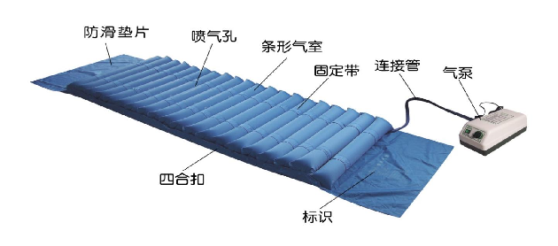
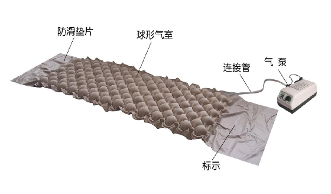
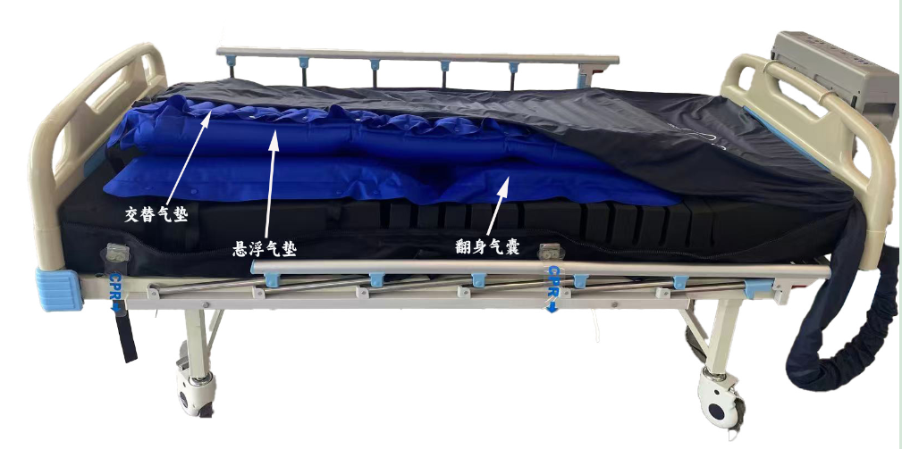
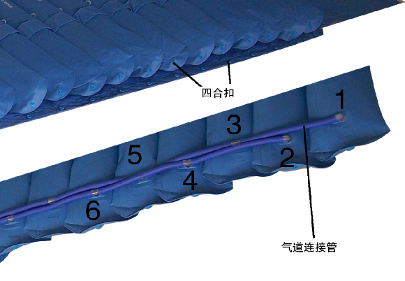

# 防褥疮（压疮）气床垫注册审查指导原则（2026年修订版）

防褥疮（压疮）气床垫注册审查指导原则

（2026年修订版）

本指导原则旨在指导注册申请人对防褥疮（压疮）气床垫注册申报资料的准备及撰写，同时也为技术审评部门审评注册申报资料提供参考。

本指导原则是对防褥疮（压疮）气床垫的一般要求，申请人应依据产品的具体特性确定其中的内容是否适用。若不适用，需具体阐述其理由及相应的科学依据，并依据具体的产品特性对注册申报资料的内容进行充实和细化。

本指导原则是供注册申请人和技术审评人员使用的指导性文件，但不包括注册审批所涉及的行政事项，亦不作为法规强制执行，应在遵循相关法规的前提下使用本指导原则。如果有能够满足相关法规要求的其他方法，也可以采用，但是需要提供详细的研究资料和验证资料。

本指导原则是在现行法规和标准体系以及当前认知水平下制定的，随着法规和标准的不断完善，以及科学技术的不断发展，相关内容也将适时进行调整。

一、适用范围

本指导原则适用于按II类管理的防褥疮（压疮）气床垫的产品注册。按现行《医疗器械分类目录》，该类产品分类编码为15-06-01。

二、注册审查要点

（一）监管信息

1.产品名称

按照《医疗器械通用名称命名规则》，并参考《医疗器械通用名称命名指导原则》和《患者承载器械通用名称命名指导原则》，按1个核心词和一般不超过3个特征词的结构编制。该类产品的核心词为“防压疮床垫”或“防褥疮床垫”，特征词可用产品的技术特点、工作原理等进行表征。

常用产品名称举例：防褥疮床垫、防压疮床垫等。

2.分类编码

依据《医疗器械分类目录》，申报产品分类编码为15-06-01。

3.注册单元划分

注册单元划分应符合《医疗器械注册与备案管理办法》第一百一十一条及《医疗器械注册单元划分指导原则》的要求，原则上以产品的技术原理、结构组成、性能指标为划分依据。

（二）综述资料

1.概述

申请人需描述产品的通用名称及确定依据、适用范围。如适用，申请人应提供产品的背景信息概述，如：申报产品的历史概述、历次提交的信息，与其他经批准上市产品的关系等。

2.产品描述

申请人应描述产品的工作原理、作用机理、结构及组成、主要功能及其组成部件的功能、产品图示，以及区别于其他同类产品的特征等内容。含有多个组成部分的，应说明其连接或组装关系。

2.1工作原理和作用机理

应结合产品功能，具体阐述各临床功能的工作原理，实现预防和缓解褥疮的作用机理。其中工作原理部分，应包括气床垫的充放气循环、微孔喷气（若有）的技术原理。

2.2结构组成

应当明确申报产品的组成部分，提供产品图示及详细说明，包括充气床垫、气道（连接管）和主机（含充气泵）等。其中充气床垫，应描述气床垫主体结构、材料、充气后尺寸、气室形状（条形、球形或其它）、气室数量、喷气微孔情况（若有）等。气道部分，应提供连接管路与气室的连接示意图，应描述气道数量（单气道、双气道、三气道或其它）等。主机部分，应明确充气泵的型号规格和主要参数，如充气压力、充气流量等，同时描述气流控制机制，如单泵加换向阀控制、双泵独立控制等；还应对控制模块、显示单元（若有）、报警模块（若有）、软件模块的信息予以描述。

常见防褥疮（压疮）气床垫示意图如下：

图1 防褥疮（压疮）充气床垫（条形）

图2 防褥疮（压疮）充气床垫（球形）

图3 防褥疮（压疮）充气床垫（多层气囊）

图4 气道连接示意图

2.3产品功能

应当详述产品功能及其组成部件（关键部件和软件）的功能，描述产品的工作方式，如循环充放气方式、波动形式、调姿形式等，以及上述工作方式的组合形式。除基本的充放气及充放气循环功能外，其他附加功能应分别说明其用途、原理和实现方式，如按摩功能（若有）、调姿功能（若有）。

2.4型号规格

气床垫按其结构和功能可划分为不同的型号规格。按结构有单气道、多气道；按气室形状有球形气室、条形气室等。按功能有波动型、喷气型或附加功能。不同结构和功能的组合可形成不同型式的产品，如喷气型、波动型、波动喷气型、带便孔型、双层波动喷气侧身型等。

对于存在多种型号规格的产品，应当明确各型号规格的区别。应当采用对比表或带有说明性文字的图片、图表，描述各种型号规格的结构组成（或配置）、功能、产品特征和运行模式、技术参数等内容。

2.5包装说明

应说明产品的包装信息，如包装材料、用途等，如有多层包装应分别描述，并提供各层包装的图示。说明如何确保最终使用者可清晰地辨识包装的完整性。

2.6研发历程、与同类和/或前代产品的参考和比较

阐述申请注册产品的研发背景和目的。若申报产品有同类产品和/或前代产品，申请人应说明相关的背景情况，提供同类产品和/或前代产品的上市情况说明。列表比较申报产品与同类产品和/或前代产品在工作原理、结构组成、制造材料、性能指标、作用方式以及适用范围等方面的异同。

3.适用范围和禁忌证

应提供申报产品的适用范围、预期使用环境、适用人群、禁忌证，并与说明书等资料中信息保持一致。

该产品的适用范围一般为：用于术后或长期坐卧患者，预防和缓解压疮。

4.申报产品上市历史

如适用，应提供申报产品在各国家或地区的上市批准时间、销售情况。

如适用，应提供申报产品上市后不良事件及召回情况，如不良事件及召回情况描述、原因分析、处理和解决方案、对安全有效性影响的分析评价等。

（三）非临床资料

1.产品风险管理资料

申请人可参考GB/T 42062及YY/T 1437标准对产品进行全生命周期风险管理，提交风险管理资料。

建议参考GB/T 42062标准及规范性文件，结合产品自身设计特点、临床用途及使用场景，充分识别与安全有关的特征，进行风险分析、评价及控制。风险控制的方案与实施、综合剩余风险的评价可参考GB/T 42062标准第7、第8章的相关要求。应确保各风险的可追溯性，提供各风险及综合剩余风险的可接受准则，确认各风险及综合剩余风险可接受。

防褥疮（压疮）气床垫风险要素及示例见附件1。

2.医疗器械安全和性能基本原则清单

注册申请人可参考《医疗器械安全和性能基本原则符合性技术指南》编写该清单。对于《医疗器械安全和性能基本原则清单》中不适用的各项要求，说明理由。

3.产品技术要求及检验报告

3.1申报产品适用标准情况

申请人需列表说明申报产品应符合的国家标准和行业标准，可以参考下表示例。

表2防褥疮（压疮）气床垫相关适用标准

| 标准号 | 标准名称 |
| --- | --- |
| GB 9706.1 | 医用电气设备 第1部分：基本安全和基本性能的通用要求 |
| YY 9706.102 | 医用电气设备 第1-2部分：基本安全和基本性能的通用要求 并列标准：电磁兼容 要求和试验 |
| YY 9706.108 | 医用电气设备 第1-8部分：基本安全和基本性能的通用要求 并列标准：通用要求,医用电气设备和医用电气系统中报警系统的测试和指南 |
| YY 9706.111 | 医用电气设备 第1-11部分：基本安全和基本性能的通用要求 并列标准：在家庭护理环境中使用的医用电气设备和医用电气系统的要求 |

上述标准均宜执行适用的国家标准、行业标准的现行有效版本。

3.2产品技术要求

产品技术要求需按照《医疗器械产品技术要求编写指导原则》进行编写，同时结合产品适用的标准和产品本身的技术特点，明确产品的各项性能指标和检验方法。本指导原则列出了防褥疮（压疮）气床垫可能涉及的主要性能指标，主要性能指标包括但不限于以下内容：

3.2.1气床垫充气后尺寸

应明确气床垫充气后的尺寸和误差。

3.2.2充气压力

应明确气床垫在最大工作载荷下的最大压力，最大压力应不小于4kPa。

出口充气压力若分档可调，应按档位明确各档压力及误差要求。

产品最大压力（范围值或标称值±允差），由企业自定，并在研究资料中阐明性能指标的确定依据。

3.2.3充放气交换时间

应规定每次充气时间、放气时间、交换时间，时间误差不得大于10%。如交换时间可调，应规定调节范围。

3.2.4气密性

将气床垫充气到最大气压，气床垫上均匀平置最大工作载荷的重物，按制造商规定的放置时间放置，气床垫最大压力的压力降应在制造商宣称的范围内。

放置时间、压力降范围由企业自定，并在研究资料中阐明性能指标的确定依据。

3.2.5工作噪声

用声级计距充气泵1m处测试工作噪声≤45dB。

3.2.6快速放气功能（适用于心脏复苏术“CPR”抢救使用）

应规定气床垫具有实现快速放气使气床垫达到平铺功能。并应在明显位置标示和说明。

3.2.7气床垫的侧身角度、调姿角度（若有）

对有侧身、调姿功能的气床垫，应规定侧身角度、调姿角度调节范围及相应误差。

3.2.8气床垫热合性能（若适用）

气床垫热合应严密，热合处整齐、平整；

3.2.9外观

多气室气床垫应排列均匀、整齐；气嘴应安装牢固，端正；气床垫导气管与床垫连接牢固；气床垫面料应无刺激气味。

3.2.10附加功能（若有）

申报产品若有附加功能，如按摩功能、翻身功能、睡眠模式功能、低压提示、尿湿提示等，应当明确其相应要求。

3.2.11软件要求

含软件的产品，应明确软件的功能、使用限制、接口、访问控制、性能效率（若适用）等要求。

3.2.12安全要求

应符合GB 9706.1、YY9706.111（若适用）、YY 9706.102的要求。

3.3检验报告

注册申请人应提供产品检验报告，产品检验报告可以是医疗器械注册申请人的自检报告，也可以是委托具有相应检验资质的医疗器械检验机构出具的检验报告。以自检报告形式提交注册的应符合《医疗器械注册自检管理规定》的要求。

依据《医疗器械注册与备案管理办法》第三十一条：“检验用产品应当能够代表申请注册或者进行备案产品的安全性和有效性”，气床垫检验产品典型性型号的选取，应依据注册单元内所有型号的差异和检验项目来决定。

典型产品应是同一注册单元内能够代表本单元内其他产品安全性和有效性的产品。考虑功能最齐全、结构最复杂、风险最高的产品。

注册单元内各种产品的主要结构及组成、性能指标不能被某一产品全部涵盖时，则应选择涵盖结构及组成、性能指标最多的产品作为典型产品，同时还应考虑其他产品中未被典型产品所涵盖的性能指标，并应对差异部分及由差异部分引起的其他相关安全性和有效性变化的部分进行补充检验。

4.研究资料

申请人需提供产品非临床研究综述，逐项描述所开展的研究，概述研究方法和研究结论。列表逐项说明产品性能指标条款的来源和制定依据。

4.1化学和物理性能研究

应当提供产品化学/材料表征、物理和/或机械性能指标的确定依据、设计输入来源以及临床意义，所采用的标准或方法、采用的原因及理论基础。

申请人可以结合综述资料中描述的产品功能、使用环境，提供相应的测试验证资料。例如：产品可以家用，提供家用环境验证资料。

4.2电气系统安全性研究

应提供电气安全性及电磁兼容性的研究资料。

目前与防褥疮（压疮）气床垫相关的常用标准为GB 9706.1、YY 9706.102、YY 9706.111（若适用）、YY 9706.108（若适用）。申请人还可根据产品自身特点引用其他相关的标准（国际标准、行业标准等）。若适用的强制性标准中有不适用的条款，还应说明不适用理由。

4.3联合使用

如申报产品预期与其他产品如手动或电动病床等联合使用，应当提供证明联合使用安全有效的研究资料，包括互联基本信息（连接类型、接口、协议、最低性能）、联合使用风险及控制措施、联合使用上的限制，兼容性研究等。

4.4软件研究

该类产品软件安全性级别通常为中等级别，申请人需依据《医疗器械软件注册审查指导原则（2022年修订版）》，提供软件研究资料。软件研究报告需覆盖全部软件组件，并建议关联综述资料描述的产品功能。

产品若具备电子数据交换、远程访问与控制、用户访问三种功能当中一种及以上功能的，应按照《医疗器械网络安全注册审查指导原则》提供网络安全相关研究资料。

4.5可用性研究

按照《医疗器械可用性工程注册审查指导原则》的要求，提交使用错误评估报告。

4.6生物学特性研究

患者在使用该类产品时，通常通过患者衣物及医用床单与床垫接触面物理隔离。产品不与患者接触，生物学特性研究不适用。

4.7清洁、消毒研究

防褥疮（压疮）气床垫通常由用户进行清洁消毒，需说明推荐清洁、消毒工艺的确定依据及验证的相关研究资料。

5.稳定性研究

5.1使用稳定性

应当提供使用稳定性/可靠性研究资料，证明在规定的使用期限/使用次数内，在正常使用、维护和校准情况下，产品的性能功能满足使用要求。

可参考《有源医疗器械使用期限指导原则》中推荐的方法，如采用加速老化和/或实时老化的方式进行，老化后对产品的关键功能性能及电气安全进行检验，例如充气压力、气密性、气床垫热合性能等，以证明产品的功能性能满足使用要求。应给出老化后测试的性能指标的确定依据，对于未测试的性能指标，应给出合理解释。

5.2运输稳定性

应提供运输稳定性和包装研究资料，证明生产企业规定的运输条件不会对产品的特性和性能造成不利影响。

运输稳定性研究通常通过模拟运输试验进行，通过模拟规定的运输贮存条件，验证包装对性能及安全的保护能力。运输试验开始前及结束后，应对产品关键功能性能及电气安全进行验证，例如充气压力、气密性、气床垫热合性能等，应提供验证项目的选择依据。模拟运输试验可参考GB/T 4857系列标准的要求进行，也可参考相应的国际标准，如ASTM D4169等。运输贮存条件应与说明书中规定的条件一致。

5.3医用电器环境试验研究

主要包括气候环境条件、机械环境条件，可参考GB/T 14710《医用电器环境要求及试验方法》及其他适用的国家标准和行业标准开展环境试验研究。

正常工作环境以产品标称为准，但需经相应环境试验验证。明确标识供电类型、电压。

6.其它

该产品已列入《免于临床评价医疗器械目录》（以下简称“目录”），应按照《列入免于临床评价医疗器械目录产品对比说明技术指导原则》，提交申报产品相关信息与《目录》所述内容的对比资料和申报产品与已获准境内注册的《目录》中医疗器械的对比说明资料，应能证明申报产品与《目录》所述的产品具有基本等同性。

（四）产品说明书和标签样稿

产品说明书和标签应当符合《医疗器械说明书和标签管理规定》和GB 9706.1、YY 9706.102、YY 9706.111（若适用）中关于说明书和标签的相关要求。

1.产品名称、型号规格、结构组成、功能性能应与产品技术要求内容一致。

2.产品随附的使用说明书中，应详细叙述产品的安装方法，操作使用、日常保养、维护的方法，床垫清洗、消毒的程序和实用的清洁剂和消毒剂以及产品使用注意事项。

3.产品垫面之上明显位置应有正确放置使用的标示，如“此面向上”等字样，标示应清晰、牢固、易懂。CPR（心肺复苏术）快速放气处应有明显、醒目标示及使用说明或示意图。

4.禁忌证应包括的内容。

5.注意事项至少应包括以下项目：

（1）快速放气功能仅在CPR（心肺复苏术）情况下使用。

（2）应明确“阅读说明书后再使用”。

（3）在正确使用的同时，应对患者进行规范的基础护理。

（4）气道（连接管）、电源线应避免重压、用力弯折牵拉，以防损坏。

（5）避免用尖锐物划伤气床垫，远离明火。

（6）充气泵应在通风、清洁卫生的环境中使用。

（7）使用中如有不适，应立即停止使用。

（8）应在产品的使用年限期内使用。

（9）气床垫覆盖单层床单使用（适用时）。

（10）气床垫不能完全替代人工护理。

（11）气床垫出现故障时，须由专业人员进行维修。

（12）脊柱骨折患者应慎用波动型防褥疮（压疮）气床垫。

（五）质量管理体系文件

1.应依据《关于公布医疗器械注册申报资料要求和批准证明文件格式的公告》（2021年第121号）要求提供质量管理体系核查文件。

2.若产品有多个研制、生产场地，应概述每个研制、生产场地的实际情况。

三、参考文献

[1]国家食品药品监督管理总局.医疗器械分类目录:国家食品药品监督管理总局公告2017年第104号[Z].

[2]国家市场监督管理总局.医疗器械注册与备案管理办法:国家市场监督管理总局令第47号[Z].

[3]国家药品监督管理局.医疗器械产品技术要求编写指导原则:国家药监局通告2022年第8号[Z].

[4]国家药品监督管理局医疗器械审评中心.医疗器械软件注册审查指导原则（2022年修订版）:国家药监局器审中心通告2022年第9号[Z].

[5]国家药品监督管理局医疗器械审评中心.医疗器械网络安全注册审查指导原则（2022年修订版）:国家药监局器审中心通告2022年第7号[Z].

[6]国家药品监督管理局.关于发布免于进行临床评价医疗器械目录的通告:国家药监局通告2025年第19号[Z].

[7]国家药品监督管理局.关于发布医疗器械临床评价技术指导原则等5项技术指导原则的通告:国家药监局通告2021年第73号[Z].

[8]国家食品药品监督管理总局.医疗器械说明书和标签管理规定:国家食品药品监督管理总局令第6号[Z].

[9]国家药品监督管理局.医疗器械注册申报资料要求和批准证明文件格式:国家药监局公告2021年第121号[Z].

[10]GB/T 42062-2022,医疗器械风险管理对医疗器械的应用[S].

[11]GB 9706.1-2020,医用电气设备 第1部分：基本安全和基本性能的通用要求[S].

[12]YY 9706.111-2021，医用电气设备 第1-11部分：基本安全和基本性能的通用要求 并列标准：在家庭护理环境中使用的医用电气设备和医用电气系统的要求[S].

[13]GB/T 4857,包装 运输包装件系列标准[S].

[14]GB/T 14710-2009,医用电器环境要求及试验方法[S].

[15]GB/T 16886,医疗器械生物学评价系列标准[S].

[16]YY 9706.102-2021,医用电气设备 第1-2部分：基本安全和基本性能的通用要求 并列标准：电磁兼容 要求和试验[S].

[17]YY 9706.108-2021,医用电气设备 第1-8部分：基本安全和基本性能的通用要求 并列标准：通用要求，医用电气设备和医用电气系统中报警系统的测试和指南[S].

[18]YY/T 1437-2023,医疗器械 GB/T 42062医用指南[S].

[19]ASTM D4169,Standard Practice for Performance Testing of Shipping Containers and Systems[S].

[20]国家药品监督管理局,有源医疗器械使用期限注册技术审查指导原则:国家药监局通告2019年第23号[Z].

附件：防褥疮（压疮）气床垫产品风险要素及示例

附件

防褥疮（压疮）气床垫产品风险要素及示例

表1 危险、可预见的事件序列、危险情况和可发生的伤害之间的关系

| 危险 | 可预见的事件序列 | 危险情况 | 伤害 |
| --- | --- | --- | --- |
| 电能 | 绝缘/隔离效果不符合要求 | 过量的漏电流 | 导致对人身电击伤害 |
| 热能 | 长时间使用造成散热部件疲劳磨损 | 散热条件变差，产品温升超标 | 使用者被灼伤或失火 |
| 声能 | 风扇、充气泵老化导致其性能降低 | 产品噪音超标 | 造成患者或操作者不适 |
| 功能性 | 气床垫开裂、锐器划伤，或气床垫、气管、充气泵之间连接不良 | 漏气，充气不能达到预定值 | 降低或失去预防和缓解褥疮的作用 |
| 功能性 | 不适当的标记，如无CPR标记或标记不明显 | 急用时不能迅速正确操作 | 延误治疗 |
| 功能性 | 信息缺失，如缺少必要的警告或使用方法不明确 | 不能正确操作 | 延误使用 |
| 生物（微生物污染） | 对可重复使用的防褥疮（压疮）床罩，提供的清洁、消毒说明不适当 | 使用了受污染的防褥疮（压疮）床罩 | 引起患者交叉感染 |
