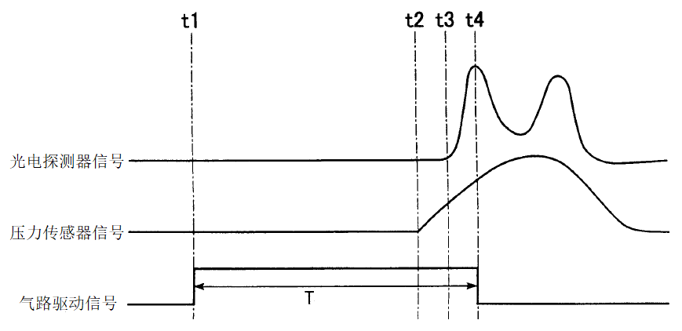
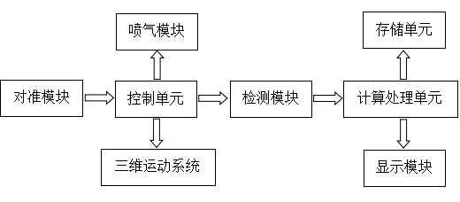
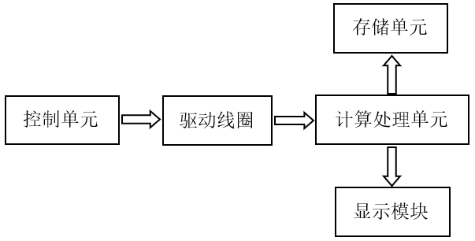
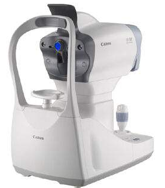
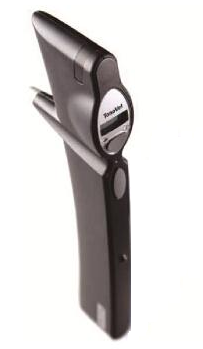

# 眼压计注册技术审查指导原则（2026年修订版）

眼压计注册技术审查指导原则

（2026年修订版）

本指导原则旨在指导注册申请人对眼压计产品注册申报资料的准备及撰写，同时也为技术审评部门审评注册申报资料提供参考。

本指导原则是对眼压计产品的一般要求，申请人应依据产品的具体特性确定其中内容是否适用。若不适用，需具体阐述理由及相应的科学依据，并依据产品的具体特性对注册申报资料的内容进行充实和细化。

本指导原则是供申请人和审查人员使用的指导文件，不涉及注册审批等行政事项，亦不作为法规强制执行。如有能够满足法规要求的其他方法，也可以采用，但应提供详细的研究资料和验证资料。应在遵循相关法规的前提下使用本指导原则。

本指导原则是在现行法规、标准体系及当前认知水平下制定的，随着法规、标准体系的不断完善和科学技术的不断发展，本指导原则相关内容也将适时进行调整。

一、适用范围

本指导原则适用于非接触式眼压计和回弹式眼压计。根据《医疗器械分类目录》，眼压计产品按二类医疗器械管理，分类编码为16-04-17（眼科器械—眼科测量诊断设备和器具—眼压计）。本指导原则范围不包含机械式眼压计。

二、注册审查要点

（一）监管信息

明确申请表中产品名称、管理类别、分类编码、型号规格、产品组成等信息。

1.产品名称

眼压计产品的命名应符合《医疗器械通用名称命名规则》《眼科器械通用名称命名指导原则》关于医疗器械命名规则的要求，名称中的核心词一般为眼压计，特征词中可体现接触形式或测试方式等内容，如非接触式眼压计、回弹式眼压计等。产品名称应为通用名，不应包括产品型号、系列。

2.分类编码

依据《医疗器械分类目录》，申报产品分类编码为16-04-17，管理类别为II类。

3.注册单元划分的原则和实例

产品注册单元的划分需符合《医疗器械注册单元划分指导原则》的要求。眼压计产品的注册单元原则上以工作原理、产品结构组成、性能指标和适用范围为划分依据。

3.1工作原理

产品的工作原理不同，应划分为不同的注册单元。

例如：非接触式眼压计和回弹式眼压计应划分为不同的注册单元。

3.2产品结构组成

台式和手持式眼压计应划分为不同的注册单元。

3.3性能指标

性能指标有较大差异的，应考虑划分为不同的注册单元。

（二）综述资料

1.产品描述

1.1器械及操作原理描述

1.1.1工作原理

非接触式眼压计的原理是利用一种可控的空气脉冲，其压力具有线性增加的特性，即喷射空气的力量随时间的延长呈线性增加。通过喷气模块将气体喷射到角膜中央表面，使角膜产生形变，形成一个直径3.6mm的圆形平面。依照Limber-Fick定律，此时角膜上的空气压力与人眼内压相等。系统可以通过气路中的压力传感器得出此时的空气压力，即人眼内压数值。

非接触式眼压计将一束光投射到角膜上。该光束经过角膜的反射后被检测模块中的光电探测器接收。光电探测器将接收的光信号转化为电信号，被系统监测。随着角膜形变的增加，光电探测器上接收的光能量也随之增加，直至压平角膜的面积达到3.6mm直径时，其接收到的光能量也达到了最大值。此时压力传感器测得的空气压力等于人眼内压数值。图1给出了眼压测试过程中光电探测器信号、压力传感器信号和气路驱动信号的时序关系。时刻t1系统判断人眼已调整到合适的位置，开始驱动气路。活塞移动到预定位置时，气缸内的压力开始上升，同时喷出气体，记为时刻t2。角膜受到压力后在时刻t3开始产生形变，光电探测器接收到的光能量开始增加。当压平角膜面积达到3.6mm直径时，光电探测器信号达到最大，记为时刻t4，并停止气路驱动，t4时测得压力值即为实际测量眼压值。

图1非接触式眼压计检测信号时序图

回弹式眼压计采用电磁感应技术。测量探针插入眼压计后被磁化，产生极性。完成对准开始测量时，仪器内螺线管中的瞬时电流产生瞬时磁场，使磁化的探针以一定的速度匀速朝向角膜运动。探针撞击角膜前表面后减速、回弹，控电开关监视回弹的磁化探针引起的螺线管电压，电子信号处理器和微传感器计算探针撞击角膜后的减速度，最后将整合信息转换成眼压读数。眼压较高时，探针撞击后的减速度较大，撞击的持续时间较短。反之，眼压较低时，探针撞击后的减速度较小，撞击的持续时间较长。

1.1.2结构及组成

非接触式眼压计一般为台式，由主机和电源线构成，其中主机包括显示模块、喷气模块、光路系统、计算处理单元、控制单元、三维运动系统。其中光路系统一般包括对准模块和检测模块。产品结构框图如图2所示。

图2非接触式眼压计产品结构框图

回弹式眼压计一般为手持式，由主机和电源构成，其中主机包括驱动线圈（可包含探针）、控制单元、计算处理单元、显示模块等组件。产品结构框图如图3所示。

图3回弹式眼压计产品结构框图

图4中给出了两种眼压计产品的图示举例，供审查人员参考。

1.非接触式眼压计                     2.回弹式眼压计

图4眼压计产品图示举例

1.2型号规格

需明确申报产品的型号规格，产品型号规格及其划分，如同一个注册单元包含多个型号规格，需提供产品型号规格区分列表或配置表。

2.适用范围和禁忌证

2.1适用范围

本产品用于定量检测人眼内压数值，可以由临床单位医护人员、熟练掌握该项操作的验光师、健康保健师等操作，用于测量或监测人眼内压。

2.2预期使用环境

需明确设备使用场所和使用环境要求。

设备使用场所包括：医疗机构、家庭护理环境等。

注册申请人应根据产品设计情况，给出使用环境条件，至少应包含温度、湿度、电源条件等内容。

2.3适用人群

眼压计可用于成人、儿童等能够配合眼内压检测的人群。

2.4禁忌证

有角膜病变（如：水肿、瘢痕等）慎用；有严重角膜病变（如：明显角膜变薄、炎症等）禁用；角膜感染性病变非接触式眼压计慎用，回弹式眼压计禁用。

因具体产品的结构及性能不尽相同，故上述适用范围仅为已注册上市常见眼压计产品的通用描述，审查中应结合产品实际情况做出更深层次的评估。如果不同型号、规格产品的临床应用不相同，则应分别进行说明。

3.申报产品上市历史

如适用，提交申报产品在各国家或地区的上市批准时间、销售情况。如有不良事件和召回，分别对申报产品上市后发生的不良事件、召回的发生时间、申请人采取的处理和解决方案、相关部门的调查处理情况等进行描述。

（三）非临床资料

1.产品风险管理资料

注册申请人需对产品全生命周期实施风险管理，依据GB/T 42062 《医疗器械 风险管理对医疗器械的应用》，提供产品风险管理报告。

申请人需重点说明：申报产品的研制阶段已对有关可能的危险及产生的风险进行了估计和评价，针对性地实施了降低风险的技术和管理方面的措施。产品测试对上述措施的有效性进行了验证，达到了接收准则的要求。申请人对所有剩余风险进行了评价，全部达到可接受的水平。产品风险管理资料需为申请人关于产品安全性的承诺提供支持。

风险管理报告一般包括以下内容：

1.1申报产品的风险管理组织。

1.2申报产品的组成。

1.3申报产品符合的安全标准。

1.4申报产品的预期用途，与安全性有关的特征的判定。

1.5对申报产品的可能危险作出判定（见附表1）。

1.6对所判定的危险采取的降低风险的控制措施。

1.7对采取控制措施后的剩余风险进行估计和评价。

1.8对风险管理计划的实施情况进行评审。

1.9对生产和生产后活动收集与评审信息。

2.医疗器械安全和性能基本原则清单

参考《医疗器械安全和性能基本原则符合性技术指南》的要求，根据《医疗器械安全和性能的基本原则》中的各项要求明确适用性。对于不适用的要求，应当逐项说明不适用的理由。对于适用要求，应逐项说明为符合要求所采用的方法，以及证明其符合性的文件。

3.产品技术要求及检验报告

3.1产品适用标准情况

表1相关产品标准

| 标准编号 | 标准名称 |
| --- | --- |
| GB/T 191 | 包装储运图示标志 |
| GB 9706.1 | 医用电气设备 第1部分：基本安全和基本性能的通用要求 |
| GB/T 7247.1 | 激光产品的安全 第1部分：设备分类和要求 |
| ISO15004-2 | 眼科仪器 基本要求和试验方法 第 2 部分：光危害防护 |
| GB/T 14710 | 医用电器环境要求及试验方法 |
| GB/T 16886.1 | 医疗器械生物学评价 第1部分：风险管理过程中的评价与试验 |
| GB/T 16886.5 | 医疗器械生物学评价 第5部分：体外细胞毒性试验 |
| GB/T 16886.10 | 医疗器械生物学评价　第10部分：皮肤致敏试验 |
| GB/T 16886.23 | 医疗器械生物学评价 第23部分：刺激试验 |
| YY 9706.102 | 医用电气设备 第1-2部分：基本安全和基本性能的通用要求 并列标准：电磁兼容 要求和试验 |
| YY 9706.111 | 医用电气设备 第1-11部分：基本安全和基本性能的通用要求 并列标准：在家庭护理环境中使用的医用电气设备和医用电气系统的要求 |
| GB/T 42062 | 医疗器械 风险管理对医疗器械的应用 |
| YY/T 0466.1 | 医疗器械 用于制造商提供信息的符号 第1部分：通用要求 |

注：以上标准适用最新版本。

上述标准包括了产品技术要求和其他相关材料中经常涉及的标准，注册申请人应关注上述国家标准和行业标准的有效性。

3.2产品技术要求

依据《医疗器械产品技术要求编写指导原则》进行编制。

本条款给出需要考虑的产品主要技术指标，其中部分指标给出定量要求，其他性能指标因要求不统一或不是强制要求而未给出定量要求。如有附加功能，注册申请人应采用相应的标准，具体可结合注册申请人自身的技术能力，参考相应的国家标准、行业标准。注册申请人如不采用以下条款（包括国家标准、行业标准要求），应当说明理由。

3.2.1外观

眼压计产品外观应整洁、无毛刺，文字和标示清晰。

3.2.2性能指标

3.2.2.1测量范围

申请人应明确眼压计产品的测量范围。

3.2.2.2测量准确度

眼压计产品的测量准确度应不低于表2的要求。

表2眼压计产品的测量准确度要求

| 产品名称 | 允许偏差 |
| --- | --- |
| 非接触眼压计 | ±5 mmHg |
| 回弹式眼压计 | ±5 mmHg |

3.2.2.3眼压计产品的最高喷气压强应不大于11kPa（82.5 mmHg）。

3.2.2.4光辐射安全

眼压计产品应满足相应的光辐射安全标准规定的要求：激光类光源（如适用）应给出确定的波长并符合GB/T 7247.1和ISO 15004-2中规定的要求；宽带光源应给出确定的光谱范围并参照ISO 15004-2中规定的要求。

3.2.2.5机械运动范围

应给出三维运动系统上下、左右、前后和颌托架的运动范围。

3.2.2.6如适用，无菌和残留的性能体现在技术要求中。

3.2.2.7软件功能要求

应参照《医疗器械软件注册审查指导原则（2022年修订版）》的相关要求，明确软件的性能指标。

3.2.2.8网络安全

如申报产品涉及网络安全，应按照《医疗器械网络安全注册审查指导原则》，给出产品技术要求中应包含的性能要求和需载明的信息。

3.2.3.电气安全

眼压计的安全要求应执行GB 9706.1《医用电气设备 第1部分：基本安全和基本性能的通用要求》中规定的要求。如适用于家用环境，还需符合YY 9706.111《医用电气设备 第1-11部分：基本安全和基本性能的通用要求 并列标准：在家庭护理环境中使用的医用电气设备和医用电气系统的要求》中规定的要求。

3.2.4电磁兼容

设备应满足YY 9706.102《医用电气设备 第1-2部分：基本安全和基本性能的通用要求 并列标准：电磁兼容 要求和试验》中规定的要求。如用于非医疗机构，应按1组B类进行检测，还需符合YY 9706.111《医用电气设备 第1-11部分：基本安全和基本性能的通用要求 并列标准：在家庭护理环境中使用的医用电气设备和医用电气系统的要求》中规定的要求。

3.3检验报告

可提交以下任一形式的检验报告：

3.3.1申请人出具的自检报告；如提交自检报告，应按照《医疗器械注册自检管理规定》的要求提交相关文件。

3.3.2委托有资质的医疗器械检验机构出具的检验报告。

3.4同一注册单元内注册检验代表产品确定原则和实例

3.4.1典型产品应是同一注册单元内能够代表本单元内其他产品安全性和有效性的产品。

3.4.2应考虑功能最齐全、结构最复杂、风险最高的产品。

3.4.3注册单元内各种产品的主要安全指标、性能指标不能被某一产品全部涵盖时，则应选择涵盖安全指标、性能指标最多的产品作为典型产品，同时还应考虑其他产品中未被典型产品所涵盖的安全指标及性能指标。并应对差异部分及由差异部分引起的其他相关安全性和有效性变化的部分进行检验。

3.4.4当没有充足证据能够证明同一注册单元内不同型号规格产品之间电磁兼容性能可以覆盖时，应选取每一型号规格产品进行电磁兼容项目检测。

4.研究资料

4.1化学和物理性能研究

4.1.1在开展产品性能研究时，应对产品技术要求中所涉及的功能性、安全性及质量控制指标研究。研究资料应从产品设计角度出发详细说明指标的确定依据、设计输入来源以及临床意义，所采用的标准或方法、采用的原因及理论基础，例如：注册申请人设定非接触式眼压计的测量准确度为±5mmHg，则应给出准确度确定的依据。

4.1.2研究资料中应详细写明通过研究验证确定的眼压计产品的结构组成及主要元器件信息。

4.1.3联合使用

如申报产品预期与其他医疗器械、药品、非医疗器械产品联合使用实现同一预期用途，应当提供证明联合使用安全有效的研究资料，包括互联基本信息（连接类型、接口、协议、最低性能）、联合使用风险及控制措施、联合使用上的限制，兼容性研究等。

联合药物使用的，应当提供药物相容性研究资料，证明药品和器械联合使用的性能符合其适应证和预期用途。

4.2电气系统安全性研究

应当提供电气安全性、机械和环境保护以及电磁兼容性的研究资料，说明适用的标准以及开展的研究。

4.3光辐射安全研究（若适用）

应参考《医疗器械光辐射安全注册审查指导原则》相关规定提交光辐射安全研究资料。应对产品所用光源的光危害和光辐射安全进行评价，申报产品含有光源（非激光）应在研究资料中提交符合ISO 15004-2的证明资料。若申报产品含激光光源，应符合GB/T 7247.1和ISO 15004-2的要求。

4.4软件研究

参考《医疗器械软件注册审查指导原则（2022年修订版）》《医疗器械网络安全注册审查指导原则（2022年修订版）》的相关要求提交资料。

4.4.1软件组件

注册申请人在提交软件研究资料时应当提供自研软件研究报告、外部软件环境评估报告（若适用）以及GB/T 25000.51自测报告，亦可提交自检报告或检验报告代替自测报告。自研软件研究报告包括基本信息、实现过程、核心功能、结论等内容，详尽程度取决于软件安全性级别（严重、中等、轻微）。其中，基本信息包括软件标识、安全性级别、结构功能、物理拓扑、运行环境、注册历史，实现过程包括开发概况、风险管理、需求规范、生存周期、验证与确认、可追溯性分析、缺陷管理、更新历史，明确核心功能、核心算法、预期用途的对应关系。根据眼压计的工作原理，结合其预期用途、使用环境、核心功能，建议软件按安全性级别不低于中等级别进行管理。

4.4.2网络安全

具备电子数据交换、远程控制或用户访问功能的（如可通过蓝牙连接进行电子数据交换），应提交网络安全研究资料。包括基本信息、实现过程、漏洞评估、结论等内容，详尽程度取决于软件安全性级别。其中，基本信息包括软件信息、数据架构、网络安全能力、网络安全补丁、安全软件，实现过程包括风险管理、需求规范、验证与确认、可追溯性分析、更新维护计划，漏洞评估明确已知漏洞相关信息。

如产品数据接口使用Wi-Fi、蓝牙、4G/5G等形式进行数据传输，应根据接口类型逐项说明每个网络接口、电子数据交换接口的预期用户、使用场景、预期用途、数据类型、技术特征、使用限制信息。

4.5生物学特性研究

生物相容性评价根据GB/T 16886.1标准进行，应对成品中与患者和使用者直接或间接接触的材料的生物相容性进行评价。企业的申报资料应描述眼压计产品所用材料及其与人体接触的性质，如：额托（如额托配合额托纸使用，不与患者直接接触，也可不进行生物相容性评价，但应在说明书中明确。）、探针等所采用的材料，与人体接触为直接接触。生物相容性评价研究应给出实施或豁免生物学试验的理由和论证，并对现有数据或试验结果进行评价。

4.6清洁、消毒、灭菌研究

一般情况下，非接触式眼压计与人体表面完好皮肤接触，无需灭菌，由使用者常规擦拭或低水平消毒，可不提供消毒灭菌研究资料。若主机及配件涉及终端用户消毒/灭菌，制造商应当明确推荐的消毒/灭菌工艺（方法和参数）以及所推荐方法确定的依据及验证的相关研究资料。

回弹式眼压计的探针如无菌提供，应当明确灭菌工艺（方法和参数）和无菌保证水平（SAL），并提供灭菌验证及确认的相关研究资料。

4.7可用性研究

参照《医疗器械可用性工程注册审查指导原则》，按照中使用风险医疗器械要求提交使用错误评估报告，包括基本信息、使用风险级别、核心要素、同类医疗器械上市后使用问题分析、使用风险管理、结论等内容。

5.稳定性研究

医用电器环境要求是评价产品在各种工作环境和模拟贮存、运输环境下的适应性，可以制定不同的气候环境条件和机械环境条件来进行试验，或通过对关键部件的试验来评价整机的情况，也可以通过已上市同类产品比对方式进行判断。

5.1使用稳定性

应当提供产品寿命信息及确定依据。需参照《有源医疗器械使用期限注册技术审查指导原则》提供产品使用稳定性的验证资料。

产品使用期限研究：注册申请人应根据自身产品临床应用和产品设计情况，确定出产品的关键部件和可更换部件。注册申请人应明确在预期使用条件下关键部件的使用期限，及可更换部件的定期保养维护时间和更换频次，且应提供确定使用寿命和更换频次的理论依据。若关键部件也可更换时，也应说明其定期保养维护时间和更换频次。非接触式眼压计产品的关键部件至少包括活塞、气缸、主芯片和光路元件（如适用）；回弹式眼压计的关键部件至少应包括线圈、主芯片和内部存储器（如适用）。应提交规定的使用期限后产品性能及安全满足要求的资料。

5.2运输稳定性

需提交运输稳定性验证资料，证明在规定的运输条件下，运输过程中环境条件（例如：震动、振动、温度和湿度的波动）不会对医疗器械的特性和性能，包括完整性和清洁度，造成不利影响。

如产品声称具有无菌提供的部件，应提供在宣称的有效期内以及运输条件下，保持包装完整性的依据。

包装研究：注册申请人应明确产品包装材料；提供在宣称的运输条件下，符合GB/T 14710《医用电器环境要求及试验方法》中运输试验要求的验证资料；并提供在宣称贮存条件下，保持包装完整性的依据。

6.其他资料

6.1按照国家药监局关于《发布免于进行临床评价医疗器械目录的通告》（以下简称《目录》的规定），回弹式眼压计和非接触式眼压计为免于进行临床评价的产品。本指导原则中用于人眼内压测量用的回弹式眼压计或非接触式眼压计产品属于《目录》中规定的免于进行临床评价的医疗器械产品。申请人应按照《列入免于临床评价医疗器械目录产品对比说明技术指导原则》的要求，从基本原理、结构组成、性能、安全性、适用范围等方面，证明产品的安全有效性。

应充分考虑豁免情况不包括新材料、新作用机理、新功能的产品。

6.2眼压准确度评估研究

6.2.1建议提交眼压准确度评估报告，通过具有显著代表性的模拟眼样本比较拟申报的设备与校准过的Goldmann式眼压计。推荐对30只模拟眼样本，按照表3的要求进行配对测试，并对测试结果进行分析。

表3眼压准确度评估配对测试要求

| 眼内压范围（mmHg） | 配对差异的公差（mmHg） | 最小测试模拟眼数量（只） |
| --- | --- | --- |
| 7到16 | ±5.0 | 10 |
| 大于16，小于23 | ±5.0 | 10 |
| 大于等于23 | ±5.0 | 10 |

6.2.2推荐的结果分析方法

分析下面所述的结果。

a.测得眼压值的散点图

提交一个散点图，其中Y轴显示眼压计测得的眼内压值，X轴显示Goldmann式眼压计测得的眼内压值。再提交一个散点图数据的线性回归，显示分界线、及其方程和关联系数。

b.Bland-Altman图

提交一份Bland-Altman图，Y轴显示Goldmann式眼压计产品和拟申报的眼压计产品读数的成对差，X轴显示Goldmann式眼压计产品和拟申报的眼压计产品读数的平均值。

提供成对差的平均值和标准偏差，并显示均值及其周围的两个标准差作为图上的水平线。如果使用Goldmann式眼压计产品或拟申报的眼压计产品对同一眼睛进行多次测量，建议在分析中使用眼压计产品正常临床输出的平均值。

c.与Goldmann式眼压计产品的可比性

将成对差的数量和百分比制成表格，为了显示与Goldmann式眼压计产品的可比性，超出每个压力范围公差的成对差不得超过5%。如果调查研究中有5%以上的成对差超过公差，建议申请人解释这些结果，并提供科学合理证据证明拟申报的设备的等效性。

（四）临床评价资料

该产品列入《免于进行临床评价医疗器械目录》（以下简称《目录》），申请人无需提交临床评价资料。

提交的资料应能证明申报产品与《目录》所述的产品具有基本等同性。若无法证明申报产品与《目录》所述的产品具有基本等同性，则应开展临床评价。

（五）产品说明书和标签样稿

产品说明书和标签的编写应符合《医疗器械说明书和标签管理规定》及相关标准的要求，一般应包括以下要求。

1.说明书

说明书应该清晰、简洁，应使用中文且易于被非专业人员理解的简单词语，结构严整，易于阅读，尽量使用符号或图示，明确指出当验证显示结果无效时应采取的措施。

每台设备都应附带说明书，说明书应符合《医疗器械说明书和标签管理规定》及相关标准要求，一般应包括以下内容：

1.1注意事项、警示及提示：应按照《医疗器械说明书和标签管理规定》中第十一条的要求进行审查；同时至少应明确指出当验证显示结果无效时应采取的措施；非接触式眼压计仅用于坐位；双眼视力无光感者、固视不良者测试会有偏差；对诸如静电放电、磁场和其他电力学环境以及温度、湿度和其他环境因素的预防措施（如适用）；对系统及其组件进行安全处理的信息（如适用）；超出参考范围时应建议患者及时就诊的提示等。

1.2使用方法：注册申请人应明确使用仪器之前应采取的预防感染的措施；系统使用所需的环境条件（例如温度、湿度范围等）；用户应遵循的详细的校准程序（如适用）；使用器械时应遵循的测量程序和用户根据测量结果采取措施的建议等。

1.2.1使用器械时应遵循的测量程序，包括：

——校准程序（如适用）；

——测量前仪器准备步骤的顺序、测量、测量后保养的详细步骤；

——仪器报告的测量单位，如mm Hg；

——报告结果为眼内压数值结果；

——仪器出现错误信息时建议采取的应对措施。

1.2.2用户根据测量结果采取措施的建议，包括：

——警告用户，未经咨询医生或相关专家的意见，不能仅根据检测结果而违背他们的指导；

——用户认为测量结果有问题时的对策；

——测量结果落在分析范围外时系统警示用户的方法（如错误信息，错误提示等）。

1.3保养及维护：注册申请人应给出产品维护和保养及定期检查的方法；若有可由用户自行排除的故障，则应说明故障的种类和产生的原因及排除方法等。

1.4运输条件：注册申请人应根据产品环境试验情况，明确运输方法及条件。

1.5储存条件：注册申请人应根据产品环境试验情况，明确储存环境要求。

1.6应明确生产日期、使用期限及在预期使用及维护条件下的定期检查时间。

1.7应明确产品配件清单（如适用）。

1.8应参照相关国家标准及行业标准中的规定，给出产品标签所用的图形、符号、缩写等内容的解释。

1.9清洁或消毒方法：注册申请人应根据其产品情况列出产品的清洁或消毒方法。

1.10明确说明书的编制或修订日期。

1.11按照YY 9706.102《医用电气设备 第1-2部分：基本安全和基本性能的通用要求 并列标准：电磁兼容 要求和试验》的要求给出符合电磁兼容性方面要求的声明。

产品说明书的内容均应有明确的来源，与综述资料、研究资料等注册申报资料的内容保持一致。说明书中涉及技术内容且前述注册申报资料中未包含的，建议提交相应验证资料。

2.标签

眼压计产品的标签应符合《医疗器械说明书和标签管理规定》和YY/T 0466.1《医疗器械 用于制造商提供信息的符号 第1部分：通用要求》及相关标准的要求。

眼压计产品标签因位置或者大小受限而无法全部标明上述内容的，至少应当标注产品名称、型号、规格、生产日期、使用期限，并在标签中明确“其他内容详见说明书”。如使用的符号没有现有的标准，应该在眼压计的相关文件中对这些符号进行说明。

（六）质量管理体系文件

产品的质量管理体系文件需符合《医疗器械生产质量管理规范》的要求，并按《医疗器械注册申报资料要求及说明》提交资料。

1.生产工艺过程及过程控制点

注册申请人应根据申报产品的实际情况，以流程图的形式对生产工艺过程进行详细描述，并根据流程图逐一描述其中的过程控制点。工艺流程图中的关键工序和特殊工艺应以特殊图形表示。

眼压计产品工艺举例说明：眼压计产品工艺一般包括线路板焊接、组装及程序烧录、整机装配和整机调试工序。其中，线路板焊接、程序烧录为特殊工序。整机调试属于关键工序。注：本说明仅为资料性说明，注册申请人可根据产品情况调整产品生产工艺和关键工序。

2.研制、生产场地情况概述

注册申请人应当对与申报产品有关的研制场地和生产场地情况进行概述，主要包括以下内容：

研制场地：地址、位置、面积、研制环境条件、研制设备、验证设备、人员等。

生产场地：地址、位置、面积、生产环境条件、生产设备、工艺装备、监视和测量装置、人员等。

如申报产品具有多个研制、生产场地，则对每一研制、生产场地的情况均应进行概述。

三、审查关注点

（一）审查产品名称时应注意产品名称中不应包含产品型号、规格，如：XXXX型眼压计。

（二）审查产品原理时应明确该产品是回弹式还是非接触式。

（三）在审查产品技术要求时应注意该产品的安全、性能、电磁兼容性等要求应分别符合国家标准、行业标准规定的要求。注册产品应符合相关的强制性国家标准、行业标准和有关法律、法规的规定，并按国家食品药品监督管理总局公布的《医疗器械产品技术要求编写指导原则》的要求编制。

（四）免于进行临床评价的资料是否符合《免于进行临床评价医疗器械目录》《列入免于临床评价医疗器械目录产品对比说明技术指导原则》的要求，并关注本指导原则推荐的眼压准确度评估研究要求。

（五）在审查产品使用说明书的时候，应注意产品使用说明书的内容是否符合相关法规及标准的要求。

四、参考文献

[1]国家市场监督管理总局.医疗器械注册与备案管理办法：国家市场监督管理总局令第 47 号 [Z].

[2]国家食品药品监督管理总局.医疗器械说明书和标签管理规定：国家食品药品监督管理总局令第 6 号 [Z].

[3]国家药品监督管理局.医疗器械注册申报资料要求和批准证明文件格式：国家药监局公告 2021 年第 121 号 [Z].

[4]国家药品监督管理局.医疗器械产品技术要求编写指导原则：国家药监局通告 2022 年第 8 号 [Z].

[5]国家药品监督管理局医疗器械审评中心.医疗器械软件注册审查指导原则（2022 年修订版）: 国家药监局器审中心通告 2022 年第 9 号 [Z].

[6]国家食品药品监督管理局.医疗器械分类目录：国家食品药品监督管理总局公告 2017 年第 104 号 [Z].

[7]国家食品药品监督管理局.医疗器械通用名称命名规则：国家食品药品监督管理总局令第 19 号 [Z].

[8]国家药品监督管理局医疗器械审评中心.医疗器械网络安全注册审查指导原则（2022 年修订版）: 国家药监局器审中心通告 2022 年第 7 号 [Z].

[9]GB/T 42062-2022,医疗器械 风险管理对医疗器械的应用 [S].

[10]GB/T 191—2008,包装储运图示标志 [S].

[11]GB 9706.1-2020,医用电气设备 第1部分：基本安全和基本性能的通用要求 [S].

[12]GB/T 7247.1-2024,激光产品的安全 第1部分：设备分类和要[S].

[13]GB/T 20145—2006,灯和灯系统的光生物安全性 [S].

[14]GB/T 14710—2009,医用电器环境要求及试验方法 [S].

[15]GB/T 16886.1-2022,医疗器械生物学评价 第1部分：风险管理过程中的评价与试验 [S].

[16]GB/T 16886.5-2017,医疗器械生物学评价 第5部分：体外细胞毒性试验 [S].

[17]GB/T 16886.10-2024,医疗器械生物学评价　第10部分：皮肤致敏试验 [S].

[18]YY 9706.102-2021,医用电气设备 第1-2部分：基本安全和基本性能的通用要求 并列标准：电磁兼容 要求和试验[S].

[19]GB/T 42062-2022,医疗器械 风险管理对医疗器械的应用[S].

[20]YY/T 0466.1—2023,医疗器械 用于制造商提供信息的符号 第1部分：通用要求[S].

[21]ISO 15004-2:2024,眼科仪器 基本要求和试验方法 第 2 部分：光危害防护[S].

附件

产品的主要风险

（1）能量危险

电磁能：漏电流，可能共同使用的设备（计算机、移动电话、其他医疗设备等）对眼压计产品的电磁干扰，静电放电对眼压计产品产生的干扰，眼压计产品产生的电磁场对可能共同使用的设备的影响等引发的危害。

机械能：坠落，坠落导致机械部件松动，导致测量错误、误差过大或显示异常。非接触式眼压计检测眼压时气压过大，引起角膜上皮损伤、脱落。回弹式眼压计针芯异常弹出可能造成眼部物理损伤，探头无故断裂可能导致组织接触风险。

（2）生物学和化学危险

生物学：公共场所未经清洗、消毒的与人体接触的部件引起的交叉感染；眼压计产品的原材料有毒有害对人体造成的危害。

化学：使用的清洁剂、消毒剂残留引发的危害；长时间不使用的电池未经取出，导致电池漏液引发的危害。

（3）操作危险

不正确的测量：眼压计产品超过寿命或长时间未经校准，导致误差过大。

未按使用说明书中的要求进行测量，造成的测量失败、测量误差过大。

在注册申请人规定的使用环境条件外使用产品或与不适当的其他器械产品及配件组合使用，可能造成测量误差过大，产品寿命降低。

（4）信息危险

包括标记缺少或不正确，标记的位置不正确，不能被正确地识别，不能永久贴牢和清楚易认。

不符合法规及标准的说明书，包括说明书中未对限制充分告知，未对不正确的操作、与其他设备共同使用时易产生的危害进行警告，未正确标示储存条件、消毒方法、维护信息，未对因长期使用产生功能丧失而可能引发的危害进行警告，未对合理可预见的误用进行警告等引发的危害。

危险、可预见的事件序列、危害处境和可能发生的伤害之间的关系示例详见表4。

表4危险、可预见的事件序列、危害处境和可能发生的伤害之间的关系

| 危险 | 可预见的事件序列 | 危险情况 | 伤害 |
| --- | --- | --- | --- |
| 电磁能量 | 在强电磁辐射源边使用眼压计测量。 | 电磁干扰程序运行。 | 测量错误、测量结果误差过大。 |
| 电磁能量 | 静电放电。 | 干扰程序运行。 | 导致测量结果误差过大、或数据擦除。 |
| 机械能 | 产品意外坠落。 | 机械零件松动，显示器接触不良。 | 无法测量或测量误差过大，数据无法读取，严重时延误治疗。 |
| 机械能 | 非接触式眼压计检测眼压时气压过大 | 设备参数异常 | 引起角膜上皮损伤、脱落 |
| 机械能 | 回弹式眼压计针芯异常弹出，探头无故断裂。 | 设备维护不到位 | 气压过大，引起角膜上皮损伤、脱落。针芯异常弹出可能造成眼部物理损伤，探头无故断裂可能导致组织接触风险。 |
| 化学 | 长时间不使用的电池未经取出，造成电池漏液。 | 电路腐蚀。 | 设备故障，无法工作。 |
| 操作错误 | 未在规定的预期使用环境中应用器械，如：海拔、气压、光照强度。 | 获得不准确的结果。 | 根据测量结果采用不准确的治疗方法。 |
| 操作错误 | 工作距离过近或过远。 | 得不到结果或者获得不准确的结果。 | 根据测量结果采用不准确的治疗方法。 |
| 不完整的说明书 | 未对错误操作进行说明。 | 错误操作、不正确的测量。 | 测量值误差过大，测量失败，严重时延误治疗。 |
| 不完整的说明书 | 不正确的清洁或消毒方法。 | 使用有腐蚀性的清洁剂、消毒剂。 | 产品部件腐蚀、防护性能降低。 |
| 不完整的说明书 | 不正确的产品贮存条件。 | 器件老化、部件寿命降低。 | 产品寿命降低、导致测量值误差过大。 |
| 不完整的说明书 | 未规定校验周期。 | 未对设备进行校准。 | 测量值误差过大，测量失败，严重时延误治疗。 |

由于眼压计产品的原理、功能和结构的差异，本章给出的风险要素及其示例是常见的而不是全部的。上述部分只是风险管理过程的组成部分，不是风险管理的全部。注册申请人应按照GB/T 42062《医疗器械 风险管理对医疗器械的应用》中规定的过程和方法，在产品整个生命周期内建立、形成文件和保持一个持续的过程，用以判定与医疗器械有关的危险、估计和评价相关的风险、控制这些风险并监视上述控制的有效性，以充分保证产品的安全和有效。
