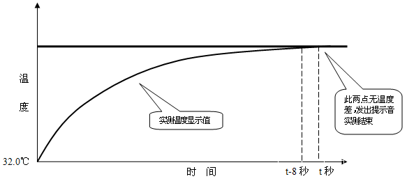
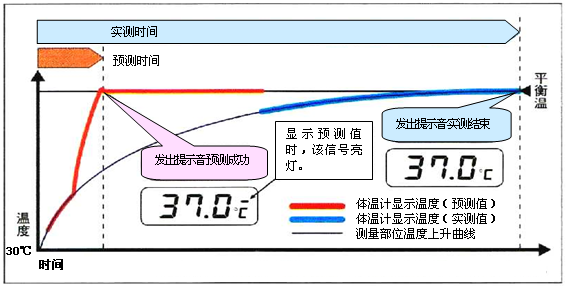
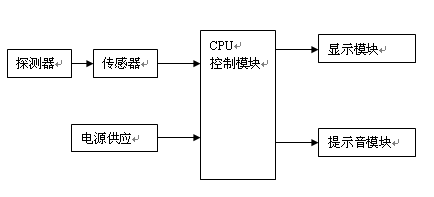
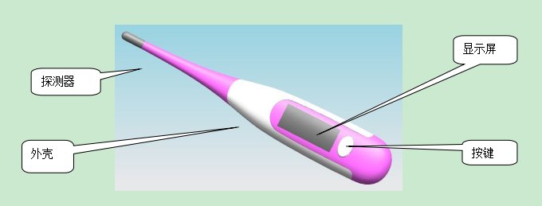
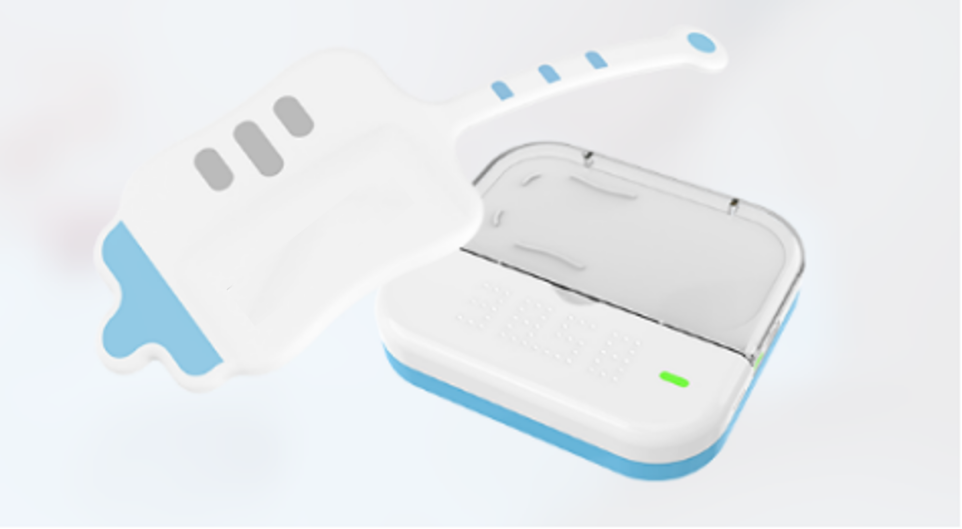

# 医用电子体温计注册审查指导原则（2026年修订版）

医用电子体温计注册审查指导原则

（2026年修订版）

本指导原则旨在指导和规范注册申请人对医用电子体温计产品的注册申报资料的准备及撰写，同时有助于审评机构对该类产品科学规范的审评，提高审评工作的质量和效率。

本指导原则是对医用电子体温计产品的一般要求，注册申请人应依据产品的具体特性确定相关内容是否适用，若不适用，需具体阐述理由及相应的科学依据，并依据产品的具体特性对注册申报资料的内容进行充实和细化。

本指导原则是对注册申请人和技术审评人员的指导性文件，但不包括注册审批等行政事项，亦不作为法规强制执行，应在遵循相关法规的前提下使用本指导原则。如果有能够满足相关法规要求的其它方法也可以采用，但是需要提供详细的研究资料和验证资料。

本指导原则是在现行法规和标准体系以及当前认知水平下制定的，随着法规和标准体系的不断完善，以及科学技术的不断发展，本指导原则相关内容也将适时进行调整。

一、适用范围

本指导原则的适用范围为以直接接触方式测量人体被测部位体温的医用电子体温计类产品，测量部位通常包括人体的口腔、腋下、肛门等。

本指导原则范围不包含红外体温计等间接测量法体温计、温度变化引起材料的化学或物理变化的直接接触方式测量体温的临床用变色体温计（如液晶变色体温计/变色温度条等）及带有体温测量功能（仅辅助功能）的其他设备，但在审查这些设备时也可参考本原则适用内容。

二、注册审查要点

（一）监管信息

1.产品名称

产品命名应符合《医疗器械通用名称命名规则》《医用诊察和监护器械通用名称命名指导原则》和国家标准、行业标准中的通用名称要求，如：医用电子体温计。

产品名称应为通用名称，不应包括产品型号、系列。

2.分类编码

医用电子体温计在《医疗器械分类目录》中，管理类别为第II类，产品分类编码为07-03-04。

3.注册单元划分的原则

申报产品注册单元的划分应符合《医疗器械注册单元划分指导原则》的要求。

如产品的工作原理相同，其结构组成、性能指标和适用范围符合以上描述的电子体温计产品，原则上可作为同一注册单元。产品技术结构、性能指标存在差异的可作为不同注册单元，如预测式与非预测式医用电子体温计，其工作模式、算法及临床验证要求存在实质差异，原则上应划分为不同注册单元。

不同测量部位的产品可作为同一注册单元，但应作为不同型号，并应在型号规格描述中明确相应的测量部位。

（二）综述资料

1.概述

注册申请人（以下简称申请人）需描述申报产品的通用名称及其确定依据、管理类别信息、产品适用范围。若适用，申请人需要提供申报产品的背景信息概述。

2.产品描述

2.1工作原理

申请人需结合临床应用，描述产品工作原理和技术类型，可以从体温测量原理、工作模式等重要方面进行分析说明，工作模式包括实测模式、预测模式。

医用电子体温计的工作原理一般为：放置在测量部分顶端的热敏电阻作为温度传感装置，当外界被测热源的温度发生改变时，热敏电阻的阻值将随之改变，内部微处理器对测量回路中热敏电阻的阻值变化，进行换算、处理、修正后，将测量温度以数字的形式在显示屏上显示出来，同时蜂鸣音响，测量过程结束。

1.实测模式的医用电子体温计原理如下：

当检出温度在一定值以上时（比如32℃），实测式体温计的测定程序开始，体温计显示实际检测到的温度。当体温计在一定时间内（比如8秒）检测到的温度不再上升时，提示音响起，此时体温计所显示的温度值即为实测的温度。

图1 实测模式医用电子体温计的温度上升示意图

2.预测模式的医用电子体温计原理如下：

当检出温度在一定温度以上时（比如30℃），且温度以一定的速率上升时，体温计的测定程序开始工作。之后，体温计继续测温，体温计内部的微处理器根据从临床得到的体温上升曲线，预测并演算平衡温度。经过一定时间后，当温度上升趋于稳定，每一单位时间内体温计检出温度的上升速率在规定值以下且预测值稳定，此时预测成功的提示音响起，体温计此时显示的温度即为预测温度。若在预测提示音响后继续测定，温度检测与预测演算也将继续进行，再过一段时间后，体温计开始显示实测温度（即体温计实际测得的最高温度）。当最后检测完成时，提示音响起，此时体温计显示的温度值即为实测的体温。

图2 预测模式医用电子体温计的温度上升示意图

因该产品为非治疗类医疗器械，故本指导原则不包含产品作用机理的内容。

2.2结构组成

2.2.1产品整体描述

申请人需提供产品整体描述资料。医用电子体温计一般由探测器（探头保护套附件（若有）)、传感器、CPU控制模块、显示模块、提示音模块（若有）、电源供应模块、胶贴（若有）、充电盒（若有）、APP软件（若有）组成。产品结构图及实物图示例如图3、图4、图5。

图3产品结构框图

图4医用电子体温计实物图示例

图5 体温贴实物图示例

2.3产品部件及功能

申请人可以结合产品逐项描述产品功能、部件的关键信息，包括但不限于产品主要部件功能（如探测器、按键、CPU控制模块、显示屏、电源）、软件功能（若有运行数据记录功能，需说明记录的数据类型、数据最长记录和保存时间等）、传感器的技术参数（至少应包括测量范围、准确度/精度、分辨力（如适用）等）、内部电源（建议申请人说明电池类型、电气指标、续航能力等，以及配套充电器具的性能指标和使用要求）等。

2.4型号规格

对于存在多种型号规格的产品，需明确各型号规格的区别。应当采用对比表或带有说明性文字的图片、图表，描述各种型号规格的结构组成（或配置）、功能、产品特征和运行模式、技术参数等内容。

2.5包装说明

申请人需描述注册单元内所有产品组成的包装情况，说明包装清单和包装方式，提供包装图示，说明如何确保最终使用者可清晰地辨识包装的完整性。

2.6研发历程、与同类和/或前代产品的参考和比较

阐述申请注册产品的研发背景和目的。若申报产品有同类产品和/或前代产品，申请人应说明相关的背景情况，提供同类产品和/或前代产品的上市情况说明。列表比较申报产品与同类产品和/或前代产品在工作原理、结构组成、制造材料、性能指标、作用方式以及适用范围等方面的异同，并重点说明申报产品的新功能、新应用、新特征。

3.适用范围

应提供申报产品的适用范围、预期使用环境、适用人群、禁忌证，并与其他资料中信息保持一致。

医用电子体温计产品的适用范围一般可限定于：供家庭和医疗部门测量人体体温使用。通常放置于人体的口腔、腋下、肛门、额头部位测量。

预期使用环境：提供产品的储存运输、使用环境要求（温度范围、相对湿度范围、气压范围等）；说明产品可以安全、有效地使用的环境、场景和范围（例如：医院、家庭环境等）。

适用人群：无特定适用人群。

禁忌证：尚未发现明确的禁忌证要求。

4.申报产品上市历史

如适用，应提供申报产品在各国家或地区的上市批准时间、销售情况。

如适用，应提供申报产品上市后不良事件及召回情况，如不良事件及召回情况描述、原因分析、处理和解决方案、对安全有效性影响的分析评价等。

国内未见严重不良事件报道，现有报告均为一般事件。事件主要表现有：无法测量体温、测量温度不准确、按键失灵、显示屏显示数字缓慢不清晰等。造成上述现象的原因主要有：超过产品可使用的环境温度无法工作、当产品从一个环境温度转移到另一个环境温度后未按照制造商规定的要求稳定一段时间再测量造成的测量不准确、按键损坏、电池电量耗尽、个别元件松动或需换置等。注册申请人在风险分析时应关注同类产品的不良事件历史记录。

（三）非临床资料

1.产品风险管理资料

申请人可参考GB/T 42062及YY/T 1437标准对产品进行全生命周期风险管理，提交风险管理资料。

建议参考GB/T 42062标准及规范性文件，结合产品自身设计特点、临床用途及使用场景，充分识别与安全有关的特征，进行风险分析、评价及控制。风险控制的方案与实施、综合剩余风险的评价可参考GB/T 42062标准第7、第8章的相关要求。应确保各风险的可追溯性，提供各风险及综合剩余风险的可接受准则，确认各风险及综合剩余风险可接受。

医用电子体温计风险要素及示例见附件2。

2.医疗器械安全和性能基本原则清单

注册申请人可参考《医疗器械安全和性能基本原则符合性技术指南》编写该清单。对于《医疗器械安全和性能基本原则清单》中不适用的各项要求，说明理由。

3.产品技术要求及检验报告

3.1申报产品适用标准情况

申报产品应当符合适用的强制性标准。对于强制性行业标准，若申报产品结构特征、预期用途、使用方式等与强制性标准的适用范围不一致，申请人应当提出不适用强制性标准的说明，并提供经验证的证明性资料。

3.2产品技术要求

注册申请人应按照《医疗器械产品技术要求编写指导原则》编写产品技术要求，结合申报产品的特点设置条款。

3.2.1 产品型号/规格及其划分说明

产品技术要求明确产品规格型号及划分说明，多个型号/规格，建议列表的形式列出各个型号的规格参数。

申报产品需说明软件组件名称、软件发布版本、软件版本命名规则，其中软件版本命名规则需与质量管理体系保持一致。

3.2.2性能指标

医用电子体温计应符合适用的强制性标准要求，如YY 9706.256《医用电气设备 第2-56部分：用于体温测量的临床体温计的基本安全和基本性能专用要求》，申报产品若同时具有其他功能，也应在性能参数中体现。

在不低于相关强制性国家标准、行业标准要求的前提下，不同的产品其参数根据设计要求有所区别，可根据自身产品的技术特点制定性能指标。医用电子体温计可能涉及的技术指标主要包括但不限于：温度显示范围、分辨力、最大允许误差、重复性、测量时间要求、抗拉强度、耐腐蚀性能等。

此外，需要考虑符合以下标准要求：

若结构组成中包含了胶贴，可参考YY/T 0148制定相应性能指标，如持粘力、柔顺性、液体耐受性、耐折耐绕曲等相关性能。

电气安全：GB 9706.1、YY 9706.256、YY 9706.111（若适用）。

电磁兼容：YY 9706.102。

3.2.3检验报告

注册申请人应提供产品检验报告，产品检验报告可以是医疗器械注册申请人的自检报告，也可以是委托具有相应检验资质的医疗器械检验机构出具的检验报告。以自检报告形式提交注册的应符合《医疗器械注册自检管理规定》的要求。

典型产品应是同一注册单元内能够代表本单元内其他产品安全性和有效性的产品。考虑功能最齐全、结构最复杂、风险最高的产品。

注册单元内各种产品的主要结构及组成、性能指标不能被某一产品全部涵盖时，则应选择涵盖结构及组成、性能指标最多的产品作为典型产品，同时还应考虑其他产品中未被典型产品所涵盖的性能指标，并应对差异部分及由差异部分引起的其他相关安全性和有效性变化的部分进行注册补充检验。

4.研究资料

4.1产品性能研究

性能指标的确定依据应明确、具体，并应描述其所考虑的实际临床应用出发点，以及相关指标和临床使用的关联性。还应考虑设计输入来源以及临床意义，所采用的标准或方法、采用的原因及理论基础。需描述所采用的国家标准、行业标准中不适用条款的理由。确定依据不能笼统地描述为“依据产品特点”、“依据临床需求确定”，应详细说明是产品的什么特点，何种临床需求。对于参考同类产品确定的，应提供同类产品的相关资料。

4.2软件研究

该类产品软件安全性级别至少为中等级别，申请人需依据《医疗器械软件注册审查指导原则（2022年修订版）》，提供软件研究资料。软件研究报告需覆盖全部软件组件，并建议关联综述资料描述的产品功能。核心功能部分，需明确产品温度处理算法以及各输出参数的计算公式，并提供算法有效性验证资料，如信号采集处理、参数计算等。对于具有预测功能的产品，应明确产品采用的温度补偿方法（如曲线、折线、查表），并给出建立温度补偿模型的过程。

产品若具备电子数据交换、远程访问与控制、用户访问三种功能当中一种及以上功能的，应按照《医疗器械网络安全注册审查指导原则（2022年修订版）》提供网络安全相关研究资料。

对于符合移动医疗设备定义的，建议参考《移动医疗器械注册审查指导原则（2025年修订版）》提供移动计算终端研究报告。

4.3生物学特性研究

生物相容性评价根据GB/T 16886.1系列标准进行。申报资料应描述产品所用材料及其与人体接触的性质，如：体温计为与人体皮肤、黏膜短期接触器械，接触的部件为探测器，该部件一般采用不锈钢材料制成（如产品包含探测器保护套，则该附件的生物相容性需一并考虑）。体温贴与人体接触的性质应考虑累计测量时间。生物相容性评价研究应给出实施或豁免生物学试验的理由和论证，并对现有数据或试验结果进行评价。如实施生物学试验，应按照GB/T 16886.1系列标准提供相关研究。

4.4清洁、消毒、灭菌研究

本产品属于终端用户清洁、消毒产品，应根据测量部位考虑交叉感染风险，明确消毒水平，还需明确推荐的清洗、消毒工艺（方法和参数、消毒频率、消毒介质）以及所推荐清洗、消毒方法确定的依据，提交清洁、消毒有效性的验证确认资料。

4.5 可用性研究

应参照《医疗器械可用性工程注册审查指导原则》，按照中、低使用风险医疗器械要求提交使用错误评估报告。

5.稳定性研究

5.1使用稳定性

应当提供使用稳定性/可靠性研究资料，证明在规定的使用期限/使用次数内，在正常使用、维护和校准情况下，产品的性能功能满足使用要求。

可参考《有源医疗器械使用期限指导原则》中推荐的方法，如采用加速老化和/或实时老化的方式进行，老化后对产品的关键功能性能及电气安全进行检验，以证明产品的功能性能满足使用要求。应给出老化后测试的性能指标的确定依据，对于未测试的性能指标，应给出合理解释。

5.2运输稳定性

应提供运输稳定性和包装研究资料，证明生产企业规定的运输条件不会对产品的特性和性能造成不利影响。

运输稳定性研究通常提供模拟运输试验进行，通过模拟规定的运输贮存条件，验证包装对性能及安全的保护能力。运输试验开始前及结束后，应对产品关键功能性能及电气安全进行验证，例如温度性能，应提供验证项目的选择依据。模拟运输试验可参考GB/T 4857系列标准的要求进行，也可参考相应的国际标准，如ASTM D4169等。运输贮存条件应与说明书中规定的条件一致。

5.3医用电器环境试验研究

主要包括气候环境条件、机械环境条件，可参考GB/T 14710《医用电器环境要求及试验方法》及其他适用的国家标准和行业标准开展环境试验研究。

正常工作环境以产品标称为准，但需经相应环境试验验证。明确标识供电类型、电压。

6.其他资料

医用电子体温计（非预测模式）已列入《免于临床评价医疗器械目录》（以下简称“目录”），申请人应按照《列入免于进行临床评价医疗器械目录产品对比说明技术指导原则》的要求提交相关资料，对比项目可参考附件1。

（四）临床评价资料

若无法证明申报产品与《目录》产品具有等同性或申报产品为预测式医用电子体温计，则应按照《医疗器械临床评价技术审查指导原则》其他路径开展相应工作，提供符合要求的临床评价资料。对于连续式电子体温计以及带有预测模式的间歇式电子体温计，注册申请人应根据《医疗器械临床评价技术指导原则》提交临床评价资料。带有调整模式的电子体温计应按照YY 9706.256的要求在其每种调整模式下进行临床准确度确认。

在通过同品种医疗器械临床试验或临床使用获得的数据进行分析评价时，应选择具有相同技术原理的电子体温计产品作为对比器械，根据《医疗器械临床评价等同性论证技术指导原则》对申报器械和对比器械的工作原理、结构组成、适用范围、性能要求、工作环境等进行等同性论证。差异部分可以通过充分的性能试验和算法比对等非临床试验的研究证明申报产品安全性和有效性无显著差异，也可以通过临床试验验证相应的安全性和有效性。

（五）产品说明书和标签样稿

医用电子体温计产品的说明书、标签应符合《医疗器械说明书和标签管理规定》和GB 9706.1、YY 9706.102、YY 9706.256、YY 9706.111（若适用）、YY/T 0466.1等标准中的相关要求。还应包括以下内容：

温度显示范围、温度单位、最大允许误差、测量时间、正常工作和贮存条件。

被测对象的身体部位。

说明书中应包括对使用警告总结的章节。

介绍如何进行使用前检查，获取帮助服务的渠道、标准操作程序、常规维护及清洗方法建议。

对于家用电子体温计指出：详细测量方法，至少包括测量位置、在测量之前恰当的休息时间，并声明应有专业人士解释测量所得的体温值。

提示用户，测量者的姿势以及身体状况会影响体温测量（如提示用户，测量部位的正确放置方式（如腋下是否夹紧、口腔是否闭合）以及被测者的身体状况（如剧烈运动、进食、情绪波动等）可能影响测量结果）。

声明如果在注册申请人指定的温度和湿度范围外储存或使用，系统可能无法达到声称的性能（注册申请人指定的温度和湿度范围应一并在声明中给出）。

推荐使用的消毒程序。

医用电子体温计检测温度持续16秒或其他时长（如8秒、32秒等）不发生变化时（或上升斜率在规定值以下），发出提示（如蜂鸣提示），此时测温值为预测的人体平衡温度。使用者如果想要得到更精确的体温值，应继续测温，体温计会适时更新温度显示，直至达到实际的人体平衡温度（实测平衡温），这个过程口腔一般需要3—5分钟，腋下需要5—10分钟，因此此前发出提示时显示的温度值与人体平衡温度值可能存在偏差，产品说明书中应对此予以提示，给出不同测量部位的预测测温时间和实测测温时间，防止患者误解。

使用说明书应向使用者或操作者提供有关存在于该产品与其他装置之间的潜在的电磁干扰或其他干扰的资料，以及有关避免这些干扰的建议，如明确不要在强电磁条件下使用。

体温计应根据《医用电子体温计检定规程》（JJG 1162）标准要求进行检定。

一次性使用部件（若有）的说明。

（六）质量管理体系文件

1.应依据《关于公布医疗器械注册申报资料要求和批准证明文件格式的公告》（2021年第121号）要求提供质量管理体系核查文件。

2.若产品有多个研制、生产场地，应概述每个研制、生产场地的实际情况

三、参考文献

中华人民共和国国务院.医疗器械监督管理条例:中华人民共和国国务院令第739号[Z]..

国家市场监督管理总局.医疗器械注册与备案管理办法:国家市场监督管理总局令第47号[Z].

国家药品监督管理局.关于公布医疗器械注册申报资料要求和批准证明文件格式的公告：国家药品监督管理局公告2021年第121号[Z].

国家药品监督管理局.医疗器械注册自检管理规定:国家药品监督管理局公告2021年第126号[Z].

国家食品药品监督管理总局.医疗器械说明书和标签管理规定：国家食品药品监督管理总局令第6号[Z].

国家食品药品监督管理总局.医疗器械通用名称命名规则：国家食品药品监督管理总局令第19号[Z].

国家食品药品监督管理总局.医疗器械分类目录：国家食品药品监督管理总局公告2017年第104号[Z].

国家药品监督管理局.医疗器械安全和性能的基本原则：国家药品监督管理局通告2020年第18号[Z].

国家药品监督管理局.医疗器械产品技术要求编写指导原则：国家药品监督管理局通告2022年第8号[Z].

《国家药监局关于发布医疗器械临床评价技术指导原则等5项技术指导原则的通告》[Z].

国家药品监督管理局医疗器械技术审评中心.医疗器械软件注册审查指导原则（2022年修订版）：国家药品监督管理局医疗器械技术审评中心通告2022年第9号[Z].

国家药品监督管理局医疗器械技术审评中心.医疗器械网络安全注册审查指导原则（2022年修订版）：国家药品监督管理局医疗器械技术审评中心通告2022年第7号[Z].

国家药品监督管理局医疗器械技术审评中心.医疗器械可用性工程注册审查指导原则：国家药品监督管理局医疗器械技术审评中心通告2024年第13号[Z].

国家药品监督管理局.有源医疗器械使用期限注册技术审查指导原则：国家药品监督管理局通告2019年第23号[Z].

GB/T 14710,医用电器环境要求及试验方法[S].

GB 9706.1-2020,医用电气设备 第1部分:基本安全和基本性能的通用要求[S].

YY 9706.102-2021,医用电气设备第1-2部分:基本安全和基本性能的通用要求 并列标准：电磁兼容 要求和试验[S].

YY 9706.111-2021,医用电气设备 第1-11部分：基本安全和基本性能的通用要求 并列标准：在家庭护理环境中使用的医用电气设备和医用电气系统的要求[S].

YY 9706.256-2023,医用电气设备 第2-56部分：用于体温测量的临床体温计的基本安全和基本性能专用要求[S].

GB/T 14710-2009,医用电气设备环境要求及试验方法[S].

GB/T 42062-2022,医疗器械 风险管理对医疗器械的应用[S].

GB/T 16886.1,医疗器械生物学评价 第1部分：风险管理过程中的评价与试验[S].

GB/T 16886.5,医疗器械生物学评价第5部分：体外细胞毒性试验[S].

GB/T 16886.10,医疗器械生物学评价 第10部分：皮肤致敏试验[S].

GB/T 16886.23,医疗器械生物学评价 第23部分：刺激试验[S].

GB/T 21417.1,医用红外体温计第1部分：耳腔式[S].

WS/T 367,医疗机构消毒技术规范[S].

YY/T 0466.1,医疗器械用于医疗器械标签、标记和提供信息的符号第1部分：通用要求[S].

GB/T 191,包装储运图示标志[S].

附件1

实质性等同判定表

（公司）（申报产品A）（型号）与（公司） （等同产品B） （型号）  对比说明：

一、A和B产品分别综述，综述内容包括：预期用途、产品结构、工作原理、测量部位、测量方式、主要技术指标、关键部件（探测器、传感器、CPU控制模块）、其他功能等内容。

二、对照表

附表1 	A、B产品关键参数、关键部件的描述对比

| 对比项目 | 等同否 | 产品A描述 | 产品B描述 | 备注（差异） |
| --- | --- | --- | --- | --- |
| 适用范围 |  |  |  |  |
| 标识 |  |  |  |  |
| 结构组成 |  |  |  |  |
| 工作原理 |  |  |  |  |
| 测量部位 |  |  |  |  |
| 测量方式 |  |  |  |  |
| 传感器 |  |  |  |  |
| 信号处理与显示 |  |  |  |  |
| 与人体接触部分材料 |  |  |  |  |
| 测温范围 |  |  |  |  |
| 工作环境 |  |  |  |  |
| 准确度 |  |  |  |  |
| 重复性 |  |  |  |  |
| 测温时间 |  |  |  |  |
| 其他功能 |  |  |  |  |

注：斜体部分可以不完全一致，但要满足国家标准或行业标准要求，如存在差异，应提供差异不影响安全有效性的支持性资料。

附件2

表2 初始事件和环境

| 通用类别 | 初始时间和环境示例 |
| --- | --- |
| 不完整的要求 | 性能要求不符合 ——测温时间、准确性等不符合要求 说明书未对体温计的测量部位、消毒方法进行说明 |
| 制造过程 | 控制程序（包括软件）修改未经验证，导致产品的测量误差不符合要求 生产过程中关键工序控制点未进行检测，导致部件、整机不合格 供方的控制不充分：外购件、外协件供方选择不当，外购件、外协件未进行有效进货检验等 |
| 运输和贮藏 | 不适当的包装 不恰当的环境条件等 |
| 环境因素 | 过冷、过热的环境 不适当的能量供应 电磁场等 |
| 清洁、消毒和灭菌 | 对体温计的清洗、消毒方法未经确认 使用者未按要求进行清洗、消毒等 |
| 处置和废弃 | 产品或电池使用后处置问题等 |
| 人为因素 | 设计缺陷引发的使用错误等 ——易混淆的或缺少使用说明书 ——不正确的测量和计量 |
| 失效模式 | 由于老化、磨损和重复使用而导致功能退化/疲劳失效（特别是医院等公共场所中使用时）等 |

表3危害、可预见的事件序列、危害处境和可发生的损害之间的关系

示例

| 危害 | 可预见的事件序列 | 危害处境 | 损害 |
| --- | --- | --- | --- |
| 电磁能量 | 在强电磁辐射源边使用电子体温计测量 | 电磁干扰程序运行 | 测量错误、测量结果误差过大 |
| 电磁能量 | 静电放电 | 干扰程序运行 | 导致测量结果误差过大或数据擦除 |
| 漏电流 | 产品漏电流超标 | 外壳、金属帽与带电部分隔离/保护不够 | 漏电流超出允许值，导致人体感觉不舒服 |
| 热能 | 电池漏液 | 使用环境过热 | 产品损坏，严重时起火 |
| 机械能 | 体温计摔落、践踏后使体温计破损 | 造成体温计外壳出现锋棱 | 被体温计划伤 |
| 机械能 | 测温部位因受外界影响温度偏低 | 体温计没有进入测温状态 | 导致不能正确测温 |
| 机械能 | 坠落导致机械部件松动 | 体温计破损 | 导致测量错误、误差过大或显示异常等 |
| 机械能 | 机体从高处落下、被践踏 | 液晶屏破碎 | 使显示屏没有显示导致不能测量 |
| 不正确的测量 | （1）测量部位不正确 （2）测量方法不当 | 体温计无法测得人体真实体温 | 测量误差过大，严重时延误治疗 |
| 生物学 | 使用有生物相容性不良的材质制作探测器 | 人体接触 | 皮肤过敏、刺激 |
| 化学 | 长时间不使用的电池未经取出，造成电池漏液 | 电路腐蚀 | 设备故障，无法工作 |
| 操作错误 | 环境温度过低或过高 | 体温计显示报警信号 | 测量值误差过大，测量失败，严重时延误治疗 |
| 操作错误 | 测量过程中体动 | 体温计与人体没有紧密接触 | 测量值误差过大，测量失败，严重时延误治疗 |
| 操作错误 | 测量时被测者活动，说话 | 体温计与人体没有紧密接触 | 测量值误差过大，测量失败，严重时延误治疗 |
| 操作错误 | 测量未完成时，将体温计取出 | 体温计测温时间不足 | 测量值误差过大，测量失败，严重时延误治疗 |
| 不完整的说明书 | 未对错误操作进行说明 | 见“操作错误” | 测量值误差过大，测量失败，严重时延误治疗 |
| 不完整的说明书 | 不正确的清洁、消毒方法 | 使用有腐蚀性的清洁剂、消毒剂 | 产品部件腐蚀，防护性能降低 |
| 不完整的说明书 | 不正确的产品贮存条件 | 器件老化，部件寿命降低 | 产品寿命降低，导致测量值误差过大 |
