# 定制式正畸矫治器注册审查指导原则

本指导原则旨在指导注册申请人对定制式正畸矫治器注册申报资料的准备及撰写，同时也为技术审评部门审评提供参考。

本指导原则是对定制式正畸矫治器的一般要求，申请人应依据产品的具体特性确定其中内容是否适用，若不适用，需具体阐述理由并说明相应的科学依据，并依据产品的具体特性对注册申报资料的内容进行充实和细化。

本指导原则是供申请人和审评人员使用的指导文件，不涉及注册审批等行政事项，亦不作为法规强制执行，如有能够满足法规要求的其他方法，也可以采用，但应提供详细的研究资料和验证资料。应在遵循相关法规的前提下使用本指导原则。

本指导原则是在现行法规、标准体系及当前认知水平下制定的，随着法规、标准体系的不断完善和科学技术的不断发展，本指导原则相关内容也将适时进行调整。

一、适用范围

本指导原则适用于《医疗器械分类目录》中管理类别为二类，分类编码为17-07-07的定制式正畸矫治器产品，该产品通常由正畸丝、正畸基托聚合物、正畸带环、扩弓螺丝等材料经弯制、充胶、焊接、打磨等制作而成。适用于正畸治疗，采取持续的外力调整牙齿位置使其恢复正常咬合关系。制造过程中所用的医疗器械材料全部为具有注册证或备案凭证的材料。

本指导原则不适用于无托槽矫治（压膜）矫治器、口腔保持器，增材制造正畸矫治器（管理类别三类）。

二、注册审查要点

（一）监管信息

1.产品名称

产品名称应采用《医疗器械分类目录》或国家标准、行业标准中的通用名称，或以产品结构和预期目的为依据命名，需符合《医疗器械通用名称命名规则》，《口腔科器械通用名称命名指导原则》等相关规范性文件的要求。

产品名称应与产品特征一致，由一个核心词和一般不超过三个特征词组成。命名举例：定制式正畸矫治器、定制式矫治器。

2.分类编码

根据《医疗器械分类目录》，分类编码为17-07-07（口腔科器械-口腔正畸材料及制品-矫治器具及附件）。管理类别为Ⅱ类。

3.注册单元划分的原则和实例

定制式正畸矫治器注册单元原则上以产品的技术原理、结构组成、性能指标和适用范围为划分依据。需符合《医疗器械注册单元划分指导原则》的要求。

例如：如预防性矫治器与本产品建议不作为同一注册单元申报；

4.型号规格

定制式正畸矫治器的型号一般按照固位方式可分为固定矫治器、活动矫治器。固定矫治器的规格：如固定横腭杆矫治器、Nance托、扩弓器、舌弓、阻（导）萌器等；活动矫治器的规格：如颌垫式矫治器、圈簧矫治器、导弓式矫治器、单（双）向基托螺旋扩弓器、平（斜）面导板、Frankel功能性矫治器等。

5.结构组成

需提供所含组件描述、材料信息等信息。

如：该产品由固位体、连接体、加力体组成，由正畸丝、正畸基托聚合物、正畸带环、扩弓螺丝等材料经弯制、充胶、焊接、打磨、抛光等工艺加工而成。制造过程中所用的医疗器械材料全部为具有注册证或备案凭证的材料。

注册人应分别描述产品的各组件组成、材料、图示等内容。

常见矫治器示例见附件。

（二）综述资料

1.器械及操作原理描述

1.1产品工作原理/作用机理

定制式正畸矫治器产品是由临床机构设计，生产企业生产的医疗器械产品，一般采取持续外力（回弹力）或在支抗的作用下调整关节关系/口腔组织形态/牙齿位置，起到恢复正确咬合关系的作用。生产企业选择合适的材料和工艺，生产的定制式正畸矫治器产品应符合医生的设计要求。

1.2 对于申报产品存在多种型号规格的情况，以结构示意图或带有说明性文字的图片、图表的形式描述不同型号规格的结构组成、功能、产品特征及使用方法等内容。

1.3申报资料中需明确相关材料牌号/商品名及符合的标准。

1.4明确各型号产品的划分依据。

2.产品的适用范围、适用人群、禁忌证

产品的适用范围、适用人群、禁忌证需与申报产品的性能、功能相符，并需与临床评价资料结论一致。适用范围的描述需清晰准确，结合产品的技术原理，分别描述各产品具体适用范围，如扩弓、前导或功能型等。

2.1适用范围：适用于正畸治疗，采取持续的外力调整牙齿位置使其恢复正常咬合关系。

2.2预期使用环境：产品首次使用时在有资质的医疗机构由专业牙医为患者装戴，活动矫治器调试好后可由患者日常自行装戴，并根据医嘱定期复诊。

2.3适用人群：本产品目标人群为牙列拥挤、牙间隙宽、咬合错颌、反颌、牙齿排列不齐等需要正畸治疗的患者，目标人群由临床医生确定。

2.4禁忌证：

2.4.1患有全身系统性疾病并经过口腔专科医生综合评估不适合佩戴矫治器的情况；

2.4.2有相关过敏史、过敏体质或者对矫治器材料过敏者，对异物感明显又无法克服者；

2.4.3大量牙缺失、大量牙体组织损耗、基牙形态不适合戴用矫治器者；

2.4.4有吞服矫治器危险者；

2.4.5癫痫病、精神病、昏迷、意识不清、生活不能自理；

2.4.6牙周病较严重，牙根部有病理性改变者。

3.包装说明

提供产品的包装信息，可包括包装形式、包装材料、包装工艺以及包装尺寸等信息。

4.安装要求

定制式正畸矫治器由专业口腔医疗机构医生安装、调试。

5.不良事件

应当提交申报产品的上市、销售、不良事件和召回等相关情况分析资料。

（三）非临床资料

1.产品风险管理资料

注册申请人需对产品全生命周期实施风险管理，提交风险管理资料，应参照GB/T42062-2022《医疗器械 风险管理对医疗器械的应用》对矫治器进行风险分析，确保综合剩余风险是可接受的。矫治器的的主要危害举例（见表1）。

表1 矫治器的主要危害举例

| 危害分类 | 危害分类 | 危害形成的因素 | 可能的后果 |
| --- | --- | --- | --- |
| 生物学危害 | 生物相容性不符合要求 | 原材料或加工过程影响，产品不具有良好的生物相容性 消毒剂残留 | 患者口腔黏膜、牙龈受刺激破溃充血等牙龈刺激、出现红肿、过敏等 |
| 生物学危害 | 生物 污染 | 包装破损或产品未进行有效的消毒 产品包装无法有效保护产品 | 引起患者不适或其他副作用 |
| 信息 危害 | 使用说明书不规范 | 不完整的产品使用说明书、未提及产品的货架有效期或不规范 对产品性能特征不恰当地描述 不恰当的使用规范 产品注意事项、禁忌证未充分公示 警告不明确或叙述不清 | 产生无效治疗、对人体产生副作用或引发其他伤害 |
| 设计输出不满足要求产生的危害 | 设计生产等不恰当 | 产品的设计方案不恰当或未经医疗机构确认 产品性能的要求不全面 产品设计输入数据有误或不符合接收标准 设计软件等不适合 设计生产等未有医疗机构参与 | 产生无效治疗或发生副作用 |
| 人为因素产生的危害 | 操作 危害 | 由缺乏正畸技术/未经培训的人员开展治疗 | 对患者均产生不必要的危害 |
| 人为因素产生的危害 | 使用 错误 | 产品的异常使用、不适合的摘戴 不遵守产品的使用规则，违反常规操作 | 产生无效治疗或发生副作用 |
| 失效产生的危害 | 功能 退化 | 材料老化引起产品机械性能退化，使用过程中产品破裂、降解、腐蚀而导致功能退化。 | 产生无效治疗、引发割伤、部分残片吞噬等伤害或副作用 |
| 环境 危害 | 储存或运行偏离预订的环境条件 | 储运条件（如温度、湿度、酸碱度）不符合要求导致产品变色、降解等 | 产品使用性能无法得到保证或者无法保证正常使用 |
| 环境 危害 | 意外的机械破坏 | 储运、使用过程中发生意外的机械性破坏 | 产品使用性能无法得到保证或者无法保证正常使用 |
| 其他危害 | 其他危害 | 矫治器表面或组件表面不光滑等（边缘尖锐） | 口腔组织损伤，对患者产生不必要的危害 |

申请人还应根据自身产品特点确定其他危害，可通过产品设计控制、产品原材料选择、产品技术性能指标的制定、正确的标签标识、生产和检验控制、产品说明书等多项措施以降低风险至可接受水平。

2、医疗器械安全和性能基本原则清单

申请人应依据《医疗器械安全和性能基本原则符合性技术指南》的要求逐项对符合性方法、证明符合性的客观证据进行说明。

产品技术要求及检验报告

3.1产品技术要求

申请人应根据《医疗器械产品技术要求编写指导原则》规定的格式、字体要求编制产品技术要求。产品技术要求需符合相关国家标准、行业标准和有关法律、法规的相应要求。在此基础上，注册申请人需根据产品的特点，制定保证产品安全、有效的技术要求。产品技术要求中试验方法需依据有关国家标准、行业标准、国际标准制订或经过验证。

3.1.1产品型号/规格及其划分说明

企业可根据定制式正畸矫治器的固位方式、作用目的、矫治力来源进行型号/规格划分。

3.1.2定制式正畸矫治器产品性能指标至少应包括以下内容：

3.1.2.1设计：应按医疗机构提供的工作模型或临床口扫数据和设计文件要求制造。

3.1.2.2原材料：制作矫治器的主要原材料（焊接使用的焊料除外）应具有医疗器械注册证书或备案凭证。

3.1.2.3外观：矫治器除组织面及带环内壁外，固位体、连接体等均应光滑，无异物附着，凹陷、裂纹、砂眼、缩孔等缺陷。

3.1.2.4表面粗糙度：矫治器暴露于口腔的金属部分应高度抛光，无锋棱、无毛刺，表面粗糙度应达到0.025μm。

3.1.2.5正畸丝：

3.1.2.5.1应根据医生的设计要求弯制连接体和卡环，唇弓和卡环一般采用 0.6mm-1.0mm正畸丝、加力体用的弹簧用 0.3mm-0.6mm 正畸丝弯制。正畸丝应一体成型，不应有明显的弯制痕迹。（如医生对正畸丝尺寸有特殊要求，则应符合医生的设计要求）

3.1.2.5.2正畸丝制作的固位体、加力体表面无划痕、末端圆钝。

3.1.2.5.3正畸丝被包埋的部分应被完全包裹在基托内，钢丝进入基托部的末端部分应弯制固位形（打折、波浪形），并保证固位圈有足够的空隙填充树脂以形成基托。

3.1.2.6树脂基托

3.1.2.6.1基托应根据牙列形态及组织面形态形成。基托部分最薄处应不小于0.6mm。基托应固位稳定、边缘圆钝，不妨碍唇、颊、舌软组织正常活动。

3.1.2.6.2 颜色（如适用）：产品树脂基托部分应符合医生的配色要求。

3.1.2.6.3色稳定性：基托树脂部分应具有良好的色稳定性。

3.1.2.7扩弓螺丝

3.1.2.7.1应根据医生的设计要求选择扩弓螺丝型号，扩弓螺丝安装的位置应与临床设计方案保持一致。

3.1.2.7.2扩弓螺丝被包埋的部分应被完全包裹在基托内，并保证扩弓螺丝的固位端有足够的空隙填充树脂以形成基托。

3.1.2.7.3扩弓螺丝作为连接体的部分经弯制后应与组织面弧度保持一致，表面光滑无划痕，无明显弯制痕迹。

3.1.2.8组织面：矫治器的组织面应可实现细节再现，不得存在残余石膏等杂质。

3.1.2.9就位和适合性

3.1.2.9.1产品在模型上就位后，树脂基托边缘应与模型相密合，应与模型贴合牢固、不易脱落、不妨碍就位，就位后不应有翘起、摆动、旋转、下沉等不稳定现象。

3.1.2.9.2卡环起固位作用的部分进入基牙倒凹区，并与模型密合且不妨碍就位或影响咬合。

3.1.2.9.3金属带环部件作为固位体应暴露牙尖，边缘与牙体密合，就位后不翘动、旋转，且不影响咬合。

3.1.2.10金属内部质量：金属带环与连接体交接/焊接处应无气孔、夹杂、砂眼等缺陷。

3.1.2.11耐腐蚀性能：矫治器金属部分应具有良好的耐腐蚀性能，应不低于 YY/T 0149-2006 中 5.4 b 级。

3.1.3检验方法

产品的检验方法需根据技术性能指标设定，检验方法需优先采用公认的或已颁布的标准检验方法；自建检验方法需提供相应的方法学依据及理论基础，同时保证检验方法具有可操作性和可重现性，必要时可附相应图示进行说明，文本较大的可以附录形式提供。

3.2检验报告

申请人可按照《医疗器械注册自检管理规定》的要求提交自检报告，也可提交有资质的医疗器械检验机构出具的检验报告。

同一注册单元内所检验的产品应当能够代表本注册单元内其他产品的安全性和有效性，代表产品的确定可以通过比较同一注册单元内所有产品的原材料、生产工艺、技术结构、性能指标和预期用途等资料，说明其能够代表本注册单元内其他产品的安全性和有效性。若一个型号、规格不能覆盖，除选择典型型号、规格进行全性能检验外，还需选择其他型号、规格产品进行差异性检验。

4.研究资料

根据所申报的产品，提供相应的研究资料。

4.1物理和机械性能研究

根据产品的技术原理、组成、适用范围、结构设计、尺寸规格、临床使用风险等，分别提供各类矫治器产品能够发挥预期作用的物理和机械性能研究资料。需要提供的物理机械性能项目，例如与基托的结合强度、抗压强度、抗拉强度、弯曲性能、旋转扭矩、弓丝弹性性能、卡环固位力、扩弓螺丝扩张精度和扭矩等适用的静态性能和抗疲劳性能（循环加载）、反复摘戴固位力等适用的动态性能研究（动态性能只做为研究资料要求）。申请人可以根据产品的技术原理、组成、适用范围、结构设计、尺寸规格、临床使用风险及受力情形等，制定试验方法进行相应的性能研究，提供试验方法和试验参数的设定依据，以及产品技术要求性能指标的确定依据。矫治器的力学性能与弯制钢丝及医生安装调试相关，可不单独进行研究。

4.2化学/材料表征研究

明确终产品材料的化学性能指标，包括但不限于耐腐蚀等。同时，提供各项性能指标要求的确定依据及可接受性论述。

原材料已取得医疗器械注册证或备案凭证，申请人需提供原材料供应商信息及质量验收标准。

4.3生物学特性研究

定制式正畸矫治器预期与口腔黏膜表面和牙齿硬组织外表面接触，属于表面接触的器械，接触时间结合产品具体的使用方法确定，应考虑累计使用时间，确定生物学评价项目，生物学试验项目建议至少考虑：细胞毒性、致敏反应、刺激或皮内反应、亚慢性毒性和遗传毒性。生物相容性评价应按照GB/T 16886.1《医疗器械生物学评价第1部分：风险管理过程中的评价与试验》、YY/T 0268《牙科学口腔医疗器械生物学评价第1单元：评价与试验》和《关于印发医疗器械生物学评价和审查指南的通知》的要求开展生物相容性评价，生物相容性评价研究资料应当包括：生物相容性评价的依据、项目和方法；产品所用材料的描述及与人体接触的性质和时间；实施或豁免生物学试验的理由和论证；对于现有数据或试验结果的评价。

对于使用已取得医疗器械注册证原材料制作的矫治器，可豁免生物学试验，并将注册证作为生物相容性评价研究资料的一部分。豁免生物学试验的理由中应重点对生产加工过程引入的生物学风险进行评估，提供产品经生产加工后对原材料生物相容性安全无影响的研究资料。

4.4清洁、消毒、灭菌研究

定制式正畸矫治器一般为非无菌产品，由申请人制定终端用户消毒工艺（方法和参数）。应提供方法合理性论证和工艺确认的过程控制报告并提供所推荐消毒方法确定的依据。

可参考WS/T 367-2012《医疗机构消毒技术规范》附录C制订，常见的清洁和消毒工艺包括紫外线、臭氧、含氯消毒剂、纯化水、酒精、蒸汽等，如果采用化学方式消毒，需考虑化学残留影响。

4.5.稳定性研究

4.5.1安装有效期及质保期

应明确定制式正畸矫治器产品的安装有效期，即在患者口腔内取模至安装的最长期限，以及产品的质保期。

4.5.2运输稳定性

应明确产品的内包装形式并确保包装在宣称的运输储存条件下（例如：震动、振动、温度和湿度的波动）不会对医疗器械的特性和性能，包括完整性和清洁度，造成不利影响。产品包装验证可参考GB/T4857等标准，提交产品的包装验证报告。包装材料的选择应考虑以下因素：包装材料的物理化学性能；是否会引入重金属、微生物等外来物质；包装材料与成型和密封过程的适应性；包装材料与产品的适应性；包装材料与标签系统的适应性；包装材料与贮存运输过程的适合性；包装验证的资料内容应与包装说明中给出的信息相符。

4.6可用性工程

定制式正畸矫治器为中、低使用风险医疗器械，按照《医疗器械可用性工程注册审查指导原则》要求，中、低使用风险医疗器械可基于风险管理过程开展可用性工程生命周期质控工作，提交使用错误评估报告。

4.7医工交互

申请人应描述产品的临床设计情况，可以流程图的形式提供，并阐述各阶段的医工职责及交互内容。

临床机构需要提供的资料和数据：临床使用口内扫描获取口内数据时，需提供口腔软硬组织表面的三维形貌及纹理（口内扫描）数据等电子资料。临床使用实物取模时，需提供石膏模型或者口腔印模，咬合记录等实物资料。如三维数字牙颌数据由申请人对硅橡胶印模扫描获得，应予以明确。

软件信息及验证：如使用三维数字牙颌数据制作模型时，需提供设计（建模）软件、排版软件界面截图等，还应明确软件发布版本，外购或自行研发情况，验证设计软件能够满足产品制作要求。

（四）临床评价资料

该产品尚未列入免于进行临床评价医疗器械目录，注册申请人需按照《医疗器械临床评价技术指导原则》的要求，根据产品的适用范围、技术特征、已有临床数据等情形，选择恰当的临床评价路径。

（五）产品说明书和标签样稿

产品说明书和标签要求的编写应符合《医疗器械说明书和标签管理规定》和相关标准的要求，说明书中所描述的适用范围、禁忌证等应与产品的临床评价资料保持一致。此外，还应包含以下内容的适用项：

1.原材料相关信息。

2.活动矫治器每天佩戴时间遵医嘱。

3.产品使用说明、禁忌证及其他应该说明的问题等。

4.注意事项应明确以下内容：

4.1需要在具有口腔正畸专业资质医师的指导下进行首次佩戴。

4.2戴用前应经过清洁消毒并根据产品的材料特性明确推荐的清洁消毒方法。

4.3对治疗依从性要求的提示性语言。

4.4进食、刷牙及定期复诊的要求。

4.5过敏反应、附件脱落、矫治器贴合度不高时的处理方法。

4.6在贮存、运输过程中的要求。

（六）质量管理体系文件

注册申请人应当形成相关质量管理体系文件和记录。应当提交下列资料，在质量管理体系核查时进行检查。

1.注册申请人基本情况表。

2.注册申请人组织机构图。

3.生产企业总平面布置图、生产区域分布图。

4.生产过程有净化要求的，应当提供有资质的检测机构出具的环境检测报告（附平面布局图）复印件。

5.产品生产工艺流程图，应当标明主要控制点与项目及主要原材料、采购件的来源及质量控制方法。

6.主要生产设备和检验设备（包括进货检验、过程检验、出厂最终检验所需的相关设备；在净化条件下生产的，还应当提供环境监测设备）目录。

7.质量管理体系自查报告。

8.如适用，应当提供拟核查产品与既往已通过核查产品在生产条件、生产工艺等方面的对比说明。

三、参考文献

[1]中华人民共和国国务院.医疗器械监督管理条例:中华人民共和国国务院令第739号[Z].

[2]国家市场监督管理总局.医疗器械注册与备案管理办法:国家市场监督管理总局令第47号[Z].

[3]国家药品监督管理局.医疗器械注册申报资料要求和批准证明文件格式:国家药监局关于公布医疗器械注册申报资料要求和批准证明文件格式的公告2021年第121号[Z].

[4]国家食品药品监督管理局.医疗器械通用名称命名规则:国家食品药品监督管理总局令第19号[Z].

[5]国家药品监督管理局.国家药监局关于发布医疗器械临床评价技术指导原则等5项技术指导原则的通告2021年第73号[Z].

[6]国家食品药品监督管理局.医疗器械说明书和标签管理规定:国家食品药品监督管理总局令第6号[Z].

[7]国家食品药品监督管理局.医疗器械注册单元划分指导原则:总局通告2017年第187号[Z].

[8]GB/T 16886,医疗器械生物学评价 系列标准[S].

[9]YY/T 0127,口腔医疗器械生物学评价 系列标准[S].

[10]YY/T 0268,牙科学 口腔医疗器械生物学评价 第1单元：评价与试验[S].

[11]YY/T 0270.2，牙科学 基托聚合物 第2部分：正畸基托聚合物[S].

[12]GB/T42062医疗器械风险管理对医疗器械的应用[S].

[13] YY/T 0466.1医疗器械用于医疗器械标签、标记和提供信息的符号第1部分：通用要求[S].

[14] YY/T0149《不锈钢医用器械 耐腐蚀性能试验方法》[S].

[15] 赵志河. 《口腔正畸学》:第7版[M].北京:人民卫生出版社,2020.

[16] 赵春洋.《口腔正畸矫治器临床制作与应用指南》第1版[M].江苏：凤凰科技技术出版社.2018.

附件

常见矫治器示例

| 分类 | 型号 | 规格 | 产品 图片 | 结构组成和功能 | 结构组成和功能 | 结构组成和功能 | 主要 原材料 |
| --- | --- | --- | --- | --- | --- | --- | --- |
| 分类 | 型号 | 规格 | 产品 图片 | 固位体 | 连接体 | 加力体 | 主要 原材料 |
| 固定矫治器 | Nance托 | Nance托 | 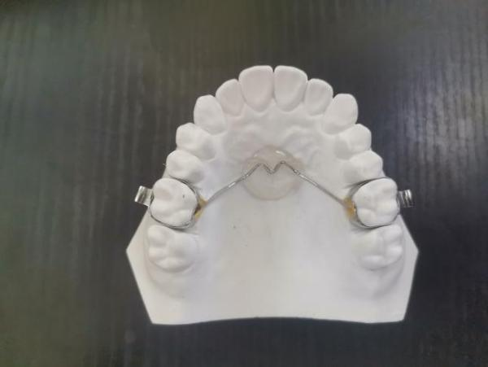 | 正畸带环 | 牙用不锈钢丝、 正畸基托聚合物 |  | 牙用不锈钢丝、 正畸带环、 正畸基托聚合物 |
| 固定矫治器 | 钟摆式矫治器 | 钟摆式矫治器 | 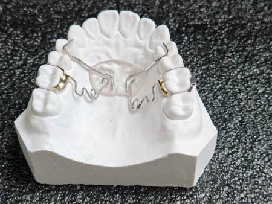 | 正畸带环 | 牙用不锈钢丝、 正畸基托聚合物 | 扩弓螺丝 | 牙用不锈钢丝、 正畸带环、 正畸基托聚合物 |
| 固定矫治器 | 缺隙恢复器 | 缺隙恢复器 | 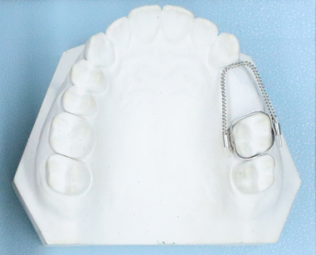 | 正畸带环 | 牙用不锈钢丝 |  | 牙用不锈钢丝、 正畸带环 |
| 固定矫治器 | 横腭杆矫治器 | 横腭杆矫治器 | 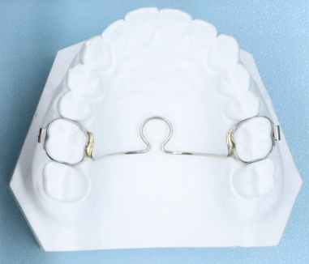 | 正畸带环 | 牙用不锈钢丝 |  | 牙用不锈钢丝、正畸带环 |
| 固定矫治器 | 导萌器 | 导萌器 | 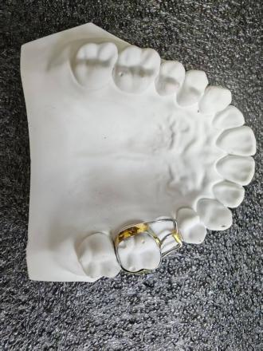 | 正畸带环 | 牙用不锈钢丝 |  | 牙用不锈钢丝、 正畸带环 |
| 固定矫治器 | 四眼簧扩弓器 | 四眼簧扩弓器 | 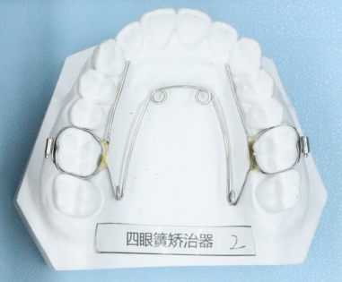 | 正畸带环 | 牙用不锈钢丝 |  | 牙用不锈钢丝、 正畸带环 |
| 固定矫治器 | 固定舌弓 | 固定舌弓 | 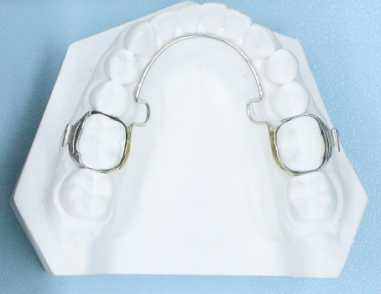 | 正畸带环 | 牙用不锈钢丝 |  | 牙用不锈钢丝、 正畸带环 |
| 固定矫治器 | 快速扩弓器 | 快速扩弓器 | 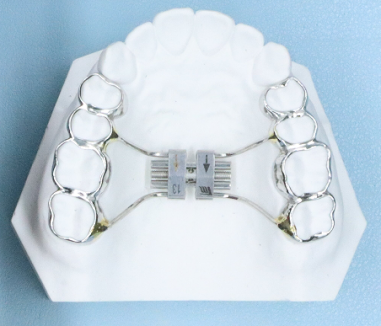 | 正畸带环 |  | 扩弓螺丝 | 正畸带环、 扩弓螺丝 |
| 活动矫治器 | 螺旋可调矫治器 | 螺旋可调矫治器 | 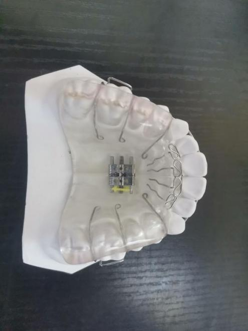 | 正畸带环 | 正畸基托聚合物 | 扩弓螺丝 | 牙用不锈钢丝、 正畸基托聚合物、 扩弓螺丝 |
| 活动矫治器 | 三向基托螺旋扩弓器 | 三向基托螺旋扩弓器 | 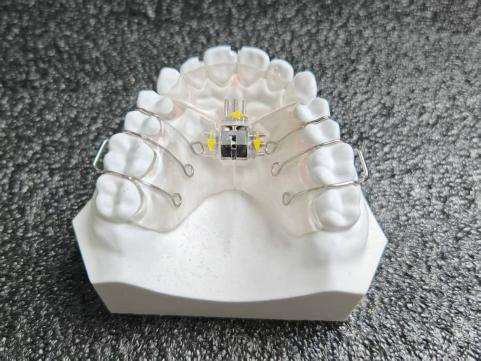 | 正畸带环 | 正畸基托聚合物 | 扩弓螺丝 | 牙用不锈钢丝、 正畸基托聚合物、 扩弓螺丝 |
| 活动矫治器 | 双向基托螺旋扩弓器 | 双向基托螺旋扩弓器 | 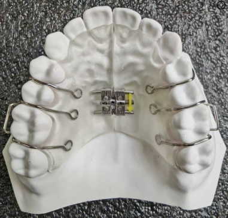 | 牙用不锈钢丝 | 正畸基托聚合物 | 扩弓螺丝 | 牙用不锈钢丝、 正畸基托聚合物、 扩弓螺丝 |
| 活动矫治器 | 正菱形扩弓器 | 正菱形扩弓器 | 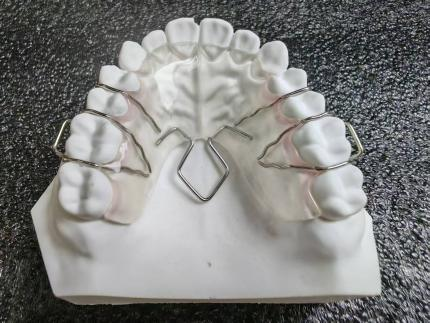 | 牙用不锈钢丝 | 正畸基托聚合物 |  | 牙用不锈钢丝、 正畸基托聚合物、 |
| 活动矫治器 | 单向基托螺旋扩弓器 | 单向基托螺旋扩弓器 | 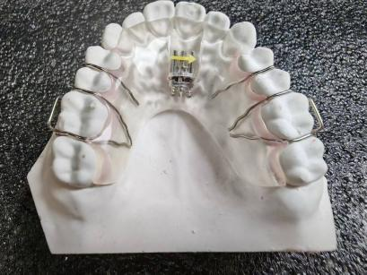 | 牙用不锈钢丝 | 正畸基托聚合物 | 扩弓螺丝 | 牙用不锈钢丝、 正畸基托聚合物、 扩弓螺丝 |
| 活动矫治器 | 舌侧矫治器 | 舌侧矫治器 | 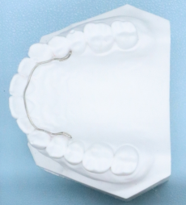 |  | 牙用不锈钢丝 |  | 牙用不锈钢丝 |
| 活动矫治器 | 平面导板矫治器 | 平面导板矫治器 | 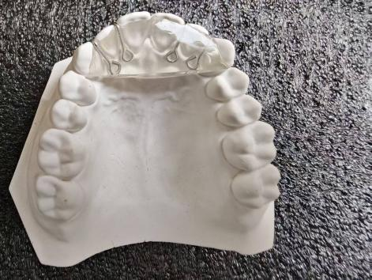 | 牙用不锈钢丝 | 正畸基托聚合物 |  | 牙用不锈钢丝、 正畸基托聚合物 |
| 活动矫治器 | 斜面导板矫治器 | 斜面导板矫治器 | 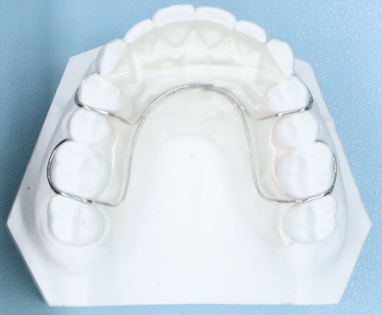 | 牙用不锈钢丝 | 正畸基托聚合物 |  | 牙用不锈钢丝、 正畸基托聚合物 |
| 活动矫治器 | 全口颌垫矫治器 | 全口颌垫矫治器 | 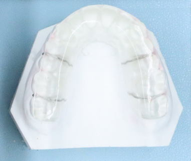 | 牙用不锈钢丝 | 正畸基托聚合物 |  | 牙用不锈钢丝、 正畸基托聚合物 |
| 活动矫治器 | FR-Ⅱ型功能矫治器 | FR-Ⅱ型功能矫治器 | 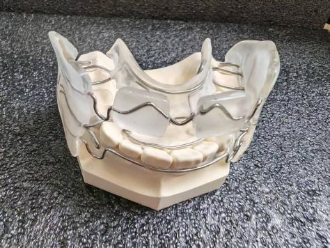 | 牙用不锈钢丝 | 正畸基托聚合物 |  | 牙用不锈钢丝、 正畸基托聚合物 |
| 活动矫治器 | FR-Ⅲ型功能矫治器 | FR-Ⅲ型功能矫治器 | 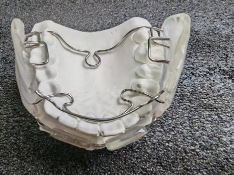 | 牙用不锈钢丝 | 正畸基托聚合物 |  | 牙用不锈钢丝、 正畸基托聚合物 |
| 活动矫治器 | Twin  block双颌垫矫治器 | Twin  block双颌垫矫治器 | 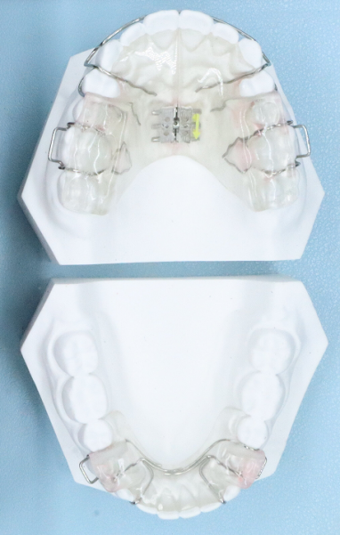 | 牙用不锈钢丝 | 正畸基托聚合物 | 扩弓螺丝 | 牙用不锈钢丝、 正畸基托聚合物、扩弓螺丝 |
| 活动矫治器 | 前庭盾 | 前庭盾 | 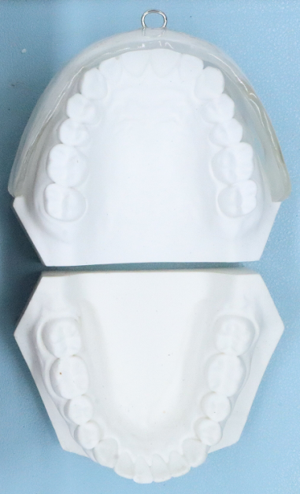 | 牙用不锈钢丝 | 正畸基托聚合物 |  | 牙用不锈钢丝、 正畸基托聚合物 |
| 活动矫治器 | Activators肌激动器 | Activators肌激动器 | 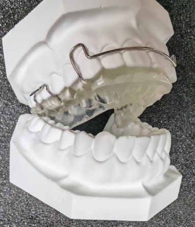 | 牙用不锈钢丝 | 正畸基托聚合物 |  | 牙用不锈钢丝、 正畸基托聚合物 |
| 活动矫治器 | 颌垫矫治器 | 颌垫矫治器 | 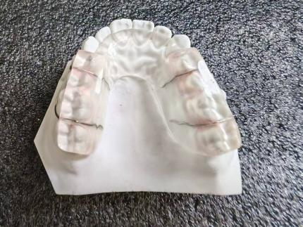 | 牙用不锈钢丝 | 正畸基托聚合物 |  | 牙用不锈钢丝、 正畸基托聚合物 |
| 活动矫治器 | 前方牵引矫治器 | 前方牵引矫治器 | 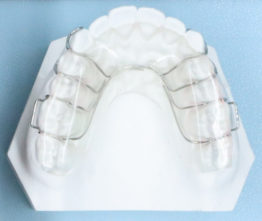 | 牙用不锈钢丝 | 正畸基托聚合物 |  | 牙用不锈钢丝、 正畸基托聚合物 |
| 活动矫治器 | 舌簧颌垫矫治器 | 舌簧颌垫矫治器 | 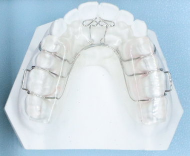 | 牙用不锈钢丝 | 正畸基托聚合物 |  | 牙用不锈钢丝、 正畸基托聚合物 |
| 活动矫治器 | 鳄刺矫治器 | 鳄刺矫治器 | 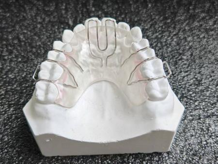 | 牙用不锈钢丝 | 正畸基托聚合物 |  | 牙用不锈钢丝、 正畸基托聚合物 |
