# 手术动力设备注册审查指导原则（2026年修订版）

手术动力设备注册审查指导原则

（2026年修订版）

本指导原则旨在指导注册申请人对手术动力设备注册申报资料的准备及撰写，同时也为技术审评部门审查注册申报资料提供参考。

本指导原则是对手术动力设备的一般要求，申请人应依据产品的具体特性确定其中内容是否适用。若不适用，需具体阐述理由及相应的科学依据，并依据产品的具体特性对注册申报资料的内容进行充实和细化。

本指导原则是供注册申请人和技术审评人员使用的指导性文件，但不包括审评审批所涉及的行政事项，亦不作为法规强制执行，应在遵循相关法规的前提下使用本指导原则。如果有能够满足相关法规要求的其他方法，也可以采用，但是需要提供详细的研究资料和验证资料。

本指导原则是在现行法规和标准体系以及当前认知水平下制定，随着法规和标准的不断完善，以及科学技术的不断发展，相关内容也将适时进行调整。

一、适用范围

本指导原则适用于由电源驱动动力装置，动力装置为工具头（如钻、铣、锯、磨、刨……）提供所需机械动力，用于内窥镜/开放性手术时切割/切开、削磨、钻孔、敲击、绞碎或切除组织等操作的手术动力设备。

二、审查要点

（一）监管信息

1.产品名称

产品的命名应符合《医疗器械通用名称命名规则》和国家标准、行业标准中的通用名称要求。产品名称由一个核心词和不超过三个的特征词组成。如手术动力装置、手术动力设备、手术动力系统、内窥镜手术刨削设备、内窥镜手术动力设备。

2.分类编码

手术动力设备，按照《医疗器械分类目录》，分类编码为01-10-04，按第二类医疗器械管理。

内窥镜手术动力设备，按照《医疗器械分类目录》，分类编码为01-09-01，按第二类医疗器械管理。

3.注册单元划分

注册单元划分应符合《医疗器械注册单元划分指导原则》的要求，原则上以产品的技术原理、结构组成、性能指标和适用范围为划分依据。手术动力设备注册单元划分建议重点关注以下几个方面：

（1）不同结构的产品，宜划分为不同的注册单元。

如：设备供电方式不同，如网电源供电和内部电源供电，宜划分为不同的注册单元。对于主机中不含电机的产品，若手机单独注册，一体式手机和分体式手机宜划分为不同注册单元。

（2）适用范围

产品适用范围不同，应划分为不同的注册单元。

注意：同一主机配备不同适用范围的工具头时，应根据产品实际使用情况并结合风险分析划分注册单元。必要时，可拆分工具头的组合划分为不同的注册单元。

如，适用于整容手术的产品和适用于骨科手术的产品不能划为同一注册单元。

如：仅用于鼻腔部位与仅用于膀胱部位的内窥镜手术刨削设备划分为不同注册单元。

注：一个产品有多个部位的应用，不涉及注册单元划分。

工具头可与主机一同注册，也可单独注册。

（二）综述资料

1.工作原理

工作原理应根据产品的具体情况进行描述。

开放性手术动力设备通常描述为：由网电源或电池供电，驱动动力装置，动力装置为工具头提供机械动力驱动工具头旋转或往复运动实施对人体组织或异物切割/切开、削磨、钻孔、敲击等操作。

内窥镜手术动力设备需配合内窥镜使用，由电源驱动动力装置，动力装置为工具头提供机械动力驱动工具头旋转或往复运动。

产品正常工作时，工具头接口部位插入手柄接口部位，手柄在主机和/或脚踏开关（若有）的控制下输出单向或往复的旋转运动，带动工具头旋转部分旋转，实施对人体组织或异物的绞碎和切除。使用过程中，工具头整体处于充满等渗液的液体环境中，等渗液可经工具头通道注入，或者由其它器械单独注入，然后等渗液与被切削下来的组织一起在负压作用下从工具头和手柄的中空通道排出。鼻窦与颅底的应用则多为气体环境。负压装置可由独立的电动吸引器提供，或者由产品自带负压装置提供。

手术中配合使用的内窥镜多为硬性内窥镜，如关节内窥镜、鼻窦内窥镜等。

工具头通常经与内窥镜相同的或不同的通道进入人体。通道分为创口通道和人体自然腔道。

2.组成单元结构/功能描述

申请人应根据产品实际情况，描述产品主要功能、各组成部件的功能以及区别于同类产品的特征。

描述产品的结构组成。

开放手术动力设备通常由主机、控制装置、电动马达、手柄和各类切割器组成。提供产品主机、控制装置、马达、手柄和附件的实物图、图示和连接示意图，结合实物图、图示和连接示意图，对产品的结构组成进行详尽描述。描述的内容包括主机和附件的结构、尺寸、材料、重量等。

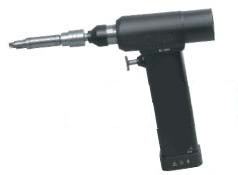

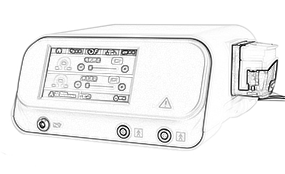

图1开放性手术动力设备产品主机和附件示意图

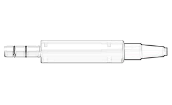

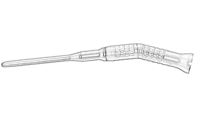

微电机                            磨钻手柄

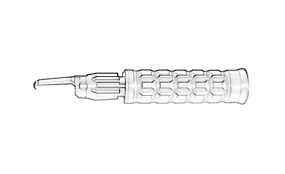

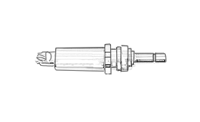

颅骨钻头                         颅骨铣手机

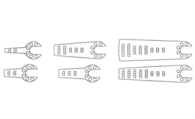

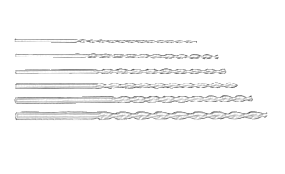

骨锯片                         骨钻头

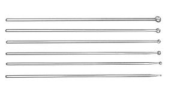

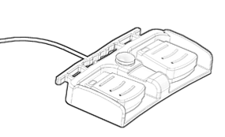

磨头                             脚踏开关

2）内窥镜手术动力设备通常由主机、手柄、工具头（刨削头、磨头、钻头等）、脚踏开关（若有）、附件组成。

（1）主机为手柄提供电能或机械能，并对其输出实施监控。若产品自带负压吸引功能，主机还可为该功能提供负压。示例见图2。

（2）手柄由操作者握持并驱动所夹持的工具头实现手术。手柄可为一体式或分体式。一体式手柄通常内置电机并集成传动和工具头接口部分。分体式手柄由夹持工具头的手柄和给手柄提供动力的电机两部分组成。部分产品的电机不在手柄中而内置在主机中。部分手柄带有负压吸引通道。示例见图3、图4。

（3）工具头夹持在手柄上，对人体组织或异物实施绞碎、切除。工具头种类较多，较为常见的有刨削头、磨头、钻头等。

刨削头由内旋转部分与带窗口的外固定部分构成。内旋转部分由内刀头、内刀管、内刀接口组成，带窗口外固定部分由外刀头/护鞘（若有）、外刀管、外刀接头组成。刨削头需将软组织吸入到内旋转部分，因而工具头内旋转部分含有吸引通道。示例见图5。

磨头通常包含旋转部分，少数磨头由旋转部分与带窗口的外固定部分构成。旋转部分由头端工作部分、柄部、尾部接口组成，带有外固定部分由护鞘、外管、外管接头组成。带有外固定部分结构的磨头含有吸引通道。示例图见图5。

钻头通常仅包含旋转部分，旋转部分由头端工作部分、柄部和尾部接口组成。示例见图6。

（4）脚踏开关通常按与主机的连接方式分为电缆连接和无线连接。示例见图7。

（5）与设备存在电气或物理连接的附件，主要包括电源线、负压调节器、收集容器等。

若组成中含多个型号，综述资料中应明确各型号之间的差异，必要时提供图示。产品技术要求及说明书中也应根据产品具体情况明确本注册单元内各型号/规格产品的结构和组成。

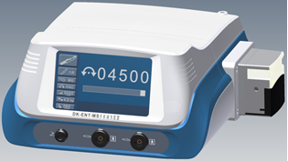

图2内窥镜手术动力设备示意图  主机

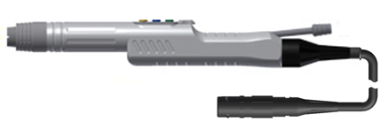

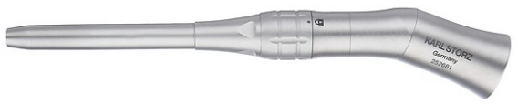

图3手柄（一体式）        图4 分体式手柄（连接钻头）

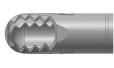

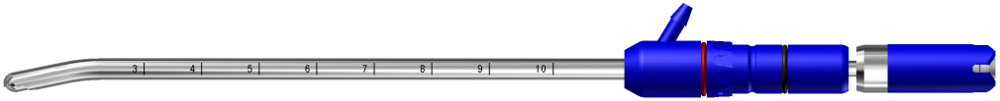

图5刨削头

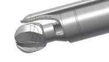

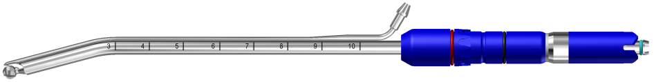

图6钻头

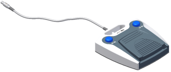

图7脚踏开关（线缆连接）

（2）对产品的功能、性能和临床使用流程进行描述。

3.适用范围和禁忌证

开放性手术动力设备用于开放性手术时切割/切开、削磨、钻孔、敲击等操作。

内窥镜手术动力设备通常用于组织的绞碎和切除。适用范围的表述应根据工具头类型，明确适用的组织类型，还应明确可配合使用内窥镜的种类。例如：产品与关节内窥镜配合使用，用于绞碎和切除软组织和骨组织。并注明“在医疗机构中使用”。

该类产品无特殊禁忌证，若与内窥镜配合使用需与搭配使用内窥镜的禁忌症保持一致。

4.参考的同类产品或前代产品的情况

应当提供同类产品（国内外已上市）或前代产品的信息，阐述申请注册产品的研发背景和目的。对于同类产品，应当说明选择其作为研发参考的原因。同时列表说明申请注册产品与参考产品（同类产品或前代产品）在工作原理、结构组成、性能指标以及预期用途等方面的异同，必要时提供图示。

（三）非临床资料

1.产品风险管理资料

申请人应参照GB/T 42062的规定，并结合产品特点对产品风险进行全生命周期的管理。风险管理活动要贯穿产品设计、生产、上市后使用及产品处理的整个生命周期。风险管理报告可包含风险分析、风险评价、风险控制、风险监测，应符合《医疗器械风险管理对医疗器械的应用》（GB/T 42062）的有关要求，审查要点包括：

1.1是否正确识别与产品安全有关的特征。

1.2是否系统识别正常和故障两种条件下的可预见危险（源）。

1.3是否利用风险管理计划中规定的可接受准则，对风险进行评价并进行风险控制，也包括综合剩余风险的可接受性评价及生产和生产后监视相关方法。

产品相关的危害包括能量危害、生物学危害、环境危害、与操作使用有关的危害、软件的危害、人机工程学危害、功能失效、维护和老化导致的危害等方面，申请人应根据产品特点确定产品风险并进行有效控制。

2.医疗器械安全和性能基本原则清单

申请人可根据产品特性判断医疗器械安全性能基本原则中各条款的适用性，证明符合性采用的方法和为符合性提供客观证据的文件由申请人根据实际情况进行填写。为符合性提供的证据如包含在产品注册申报资料中，应当在文件中说明其在申报资料中的具体位置。例如：注册检验报告（医用电气安全：机械风险的防护部分）；说明书第4.2章。对于未包含在产品注册申报资料中的文件，应当注明该证据文件名称及其在质量管理体系文件中的编号备查。对于不适用的条款，应结合产品特点说明理由。

3.产品技术要求

产品技术要求应按照《医疗器械产品技术要求编写指导原则》的要求进行编写。技术要求中主要包括产品自身性能的参数、软件发布版本及命名规则、软件的名称、型号规格（若适用）等内容。含有多个规格型号的，应明确型号之间的差异。

申请人应参考相应的国家标准、行业标准，并结合临床需求、自身产品的技术特点对各项指标的具体参数作出规定。

网电源供电手术动力设备可参考YY/T 0752《电动骨组织手术设备》。

电池供电手术动力设备可参考YY/T 0904《电池供电骨组织手术设备》。

内窥镜下使用手术动力设备可参考YY/T 0955《医用内窥镜内窥镜手术设备刨削器》。

工具头：

磨头可参考YY/T 1629.1《 电动骨组织手术设备刀具第1部分：磨头》

颅骨钻头可参考YY/T 1629.2《电动骨组织手术设备刀具第2部分：颅骨钻头》

钻头可参考YY/T 1629.3《电动骨组织手术设备刀具第3部分：钻头》

刨削头可参考YY/T 0955《医用内窥镜内窥镜手术设备刨削器》

铣刀可参考YY/T 1629.4-2020 《电动骨组织手术设备刀具第4部分：铣刀》

锯片可参考YY/T 1629.5《电动骨组织手术设备刀具第5部分：锯片》

锉刀可参考YY/T 1629.6《电动骨组织手术设备刀具第6部分：锉刀》

安全要求：应符合GB 9706.1《医用电气设备 第 1 部分： 基本安全和基本性能的通用要求》；经内窥镜通道进入人体的还应考虑GB 9706.218《医用电气设备 第2-18部分：内窥镜设备的基本安全和基本性能专用要求》。

电磁兼容性要求：应符合YY 9706.102《医用电气设备 第 1-2 部分： 基本安全和基本性能的通用要求并列标准： 电磁兼容 要求和试验》的要求。

软件组件（若有）：应符合《医疗器械软件注册审查指导原则》中第九章注册申报资料补充说明中关于产品技术要求性能指标的建议内容。

若产品具有冲洗等特殊功能，申请人还应根据产品自身特性（如降温、清创）在技术要求中规定特殊功能相应的定性或定量的要求。

其他：产品若具有其他特定功能，应制定相应要求。

技术要求中应明确与患者直接或间接接触的材料，并标明所选材料的牌号和/或代号以及符合的标准。

不同的手术动力设备产品其参数根据设计要求会有所区别，注册申请人可根据自身产品的技术特点制定性能指标的具体要求。

4.产品检验报告

4.1对于同一个注册单元具有多个规格型号的，原则上选取结构最复杂、功能最多、指标最高的作为典型型号进行性能和电气安全检测，并提供详细的典型性分析。

4.2电磁兼容报告中产品基本信息（电压、频率等）、分组分类应与产品技术要求、说明书等相关内容一致。工作模式应选择最不利情况，例如最大转速等。如果主机存在多种型号，需要出具典型性覆盖说明。

5.研究资料

5.1产品性能研究

应当提供产品性能研究资料以及产品技术要求的研究和编制说明，包括功能性、安全性指标以及与质量控制相关的其他指标的确定依据，所采用的标准或方法、采用的原因及理论基础。指标的确定依据应明确、具体，不能笼统地描述为“依据产品特点”、“依据临床需求确定”，应具体说明产品特点和临床需求。重点关注空载转速、负载转矩、硬度、吸引量等参数设定的理由及依据，同时还需关注与临床使用安全有关的工具头尖端的稳定性（如径向跳动）、负载动态转矩、堵转转矩等、微电机驱动需具有止停功能。可根据产品设计自行制定高转速时的负载特性的试验方法，但需提供试验方法合理性的支持性资料。

对于参考同类产品确定的，应提供同类产品的相关资料，例如主要性能参数的对比。

对于依据国家标准、行业标准设定的指标，应关注标准中是否给出了具体的要求（例如数值、限值）；对于未给出具体要求的，申请人应说明申报产品功能、性能指标确定的依据，即设计输入确定的理由。性能指标可根据产品实际情况参考YY/T 0904《电池供电骨组织手术设备》、YY/T 0752《电动骨组织手术设备》、YY/T 0955《医用内窥镜内窥镜手术设备刨削器》、YY 0636.1《医用吸引设备第1部分：电动吸引设备安全要求》、YY 0636.3《医用吸引设备 第3部分：以负压或压力源为动力的吸引设备》、YY/T 0863《医用内窥镜内窥镜功能供给装置滚压式冲洗吸引器》等标准制定,通过自然腔道或手术创建通道进入人体腔内涉及内窥镜应用的还应考虑GB 9706.218《医用电气设备 第2-18部分：内窥镜设备的基本安全和基本性能专用要求》的相关要求。

电气系统安全性研究

应当提供电气安全性、机械和环境保护以及电磁兼容性的研究资料，说明适用的标准以及开展的研究。

联合使用（若适用）

如申报产品预期与其他医疗器械联合使用实现同一预期用途的，应当提供证明联合使用安全有效的研究资料。

5.2生物学特性研究

应对产品结构组成中与患者直接或间接接触部分的生物相容性进行评价。生物相容性评价可根据GB/T 16886.1《医疗器械生物学评价第1部分：风险管理过程中的评价与试验》和《关于印发医疗器械生物学评价和审评指南的通知》的要求进行。生物相容性评价研究资料应当包括：生物相容性评价的依据和方法；产品所用材料的描述及与人体接触的性质；实施或豁免生物学试验的理由和论证；对于现有数据或试验结果的评价。

提供生物相容性评价研究资料时请关注以下方面：

（1）生物相容性评价应对成品而不是原材料进行评价，部分材料生产加工过程可能会改变材料的生物相容性结果，例如添加了加工助剂、或者加工过程（例如高温）改变了原材料的性质。

（2）生物学试验按照《关于实施《医疗器械注册与备案管理办法》《体外诊断试剂注册与备案管理办法》有关事项的通告》的要求提交资料。

（3）生物学试验报告应体现产品名称和型号，与申报产品相对应。如提供其他产品的报告，应对试验产品与申报产品的差异性进行评价，应证明原材料及来源、生产工艺等影响生物相容性重新评价的差异均不存在。

（4）金属材料若采用了国家或行业标准中应用范围适合的医用金属材料，可不进行生物学试验。但需检测认定材质。

5.3消毒灭菌工艺研究

手柄及工具头使用前应灭菌。

由使用者对手柄、工具头等进行清洗、消毒、灭菌的，应当明确推荐的工艺（方法、参数）及确定的依据，并提供清洗、消毒、灭菌的研究资料。对可耐受两次或多次灭菌的产品，概述所提供产品对灭菌方法耐受性的研究资料情况。

由生产企业灭菌后交付的一次性使用的工具头、手柄等，应明确灭菌工艺（方法和参数）和无菌保证水平（SAL），并提供灭菌确认报告。对于采用辐照灭菌的，应当提供最大可接受剂量、灭菌剂量以及剂量分布的研究。对于采用环氧乙烷（EO）等易产生残留的灭菌方式，应当提供残留物的最大残留水平及其研究资料。

若产品包含冲洗功能，该功能涉及的部件（如管路等）若可重复使用，应提交清洁和灭菌消毒研究资料。

5.4稳定性研究

产品有效期一般取决于使用过程中部件、元器件的损耗、老化等，申请人可按照声称的有效期对设备进行老化/疲劳试验，也可对影响设备有效期的关键部件进行老化/疲劳试验，例如设备中不可更换（或更换成本高）的部件，提供相应的研究资料。手术动力设备中主机、手柄、脚踏开关等有源部件若通过加速老化试验（参考GB /T 34986）进行验证的，试验应至少考虑温度和湿度两个应力水平，还应考虑电子元器件以及材料的老化、操作使用磨损（工具头、手柄连接部等）、消毒灭菌方式等对使用年限的影响。对于电池供电的设备应考虑电池寿命，可充电电池的使用时间。研究资料应能证明产品按照所声称的有效期，经过老化/疲劳试验后，产品性能和安全仍符合预期的要求。

有效期也可基于已有数据进行合理的推断、分析、计算得出，但应提供详细的说明及支持性资料。具体可参考《有源医疗器械使用期限注册技术审查指导原则》的要求。

无菌包装的工具头、手柄，其货架有效期和包装通过试验进行验证的，试验方法可参考YY/T 0681系列标准。不同灭菌方式、不同包装材料的产品，应分别进行有效期验证和包装研究。

可重复使用的工具头、手柄的使用寿命若与清洗、灭菌次数相关，还应提交相应的稳定性及耐受性验证分析报告，至少应当证明重复使用过程中，采用相应的清洗、灭菌工艺处理后，申报产品在有效期内是安全有效的。并根据分析报告，确定可重复使用次数或使用期限。

包装研究资料应对产品及包装进行模拟试验，模拟在贮存和运输过程中，遇到复杂情况时，例如环境（温湿度、气压等）变化、跌落、振动等，产品不会发生性能、功能、安全性改变，包装具有保护产品能力。经过模拟试验后，观察包装外观是否有不可接受的异常情况；对产品进行性能测试，证明运输和环境测试后产品能够保持其完整性、功能性和安全性。

5.5软件研究

若产品含有软件，申请人应按照《医疗器械软件注册审查指导原则》的要求提供相应的软件研究资料。同时，应当出具关于软件版本命名规则的说明，明确软件版本的全部字段及字段含义，确定软件的完整版本和发布版本。

该类产品通常不具有采用存储媒介或含有网络连接功能以进行电子数据交换或远程控制功能，适用时，应按照《医疗器械网络安全注册审查指导原则》的要求，提供网络安全相关研究资料。

5.6其他研究

根据产品的具体特性，需提供的其他研究资料。

若产品含有其他附件，应提供相应的性能研究资料。

产品具有新技术特性时，应提交相关研究资料，以证明产品的安全性和有效性。

6.其他资料

手术动力设备已列入《免于临床评价医疗器械目录》（以下简称《目录》）第23、26项，可免于提交临床评价资料。当工具头单独注册时，参考《目录》23、26项进行分析，免于提交临床评价资料。申请人应当按照《列入免于进行临床评价医疗器械目录产品对比说明技术指导原则》，从基本原理、结构组成、性能、安全性、适用范围等方面，证明产品的安全有效性。

若无法证明申报产品与《目录》产品具有等同性，则应提交临床评价资料。

若申请注册的产品在结构组成、性能要求、制造材料、适用范围等方面与对比产品有一定的差异（例如刨削头和其他工作头在转速等性能上的差异、工作头头端设计上的差异、结构组成关键部件的差异等），则注册申请人应详细说明这些差异，并提交证明资料说明这些差异不影响等同性，同时说明差异是否会形成新的产品安全性和有效性的风险。若这种差异可能形成新的影响产品安全性和有效性的风险，则注册申请人应视风险严重程度补充临床评价资料或临床试验资料。对于一次性使用的工具头，还应当提供证明其无法重复使用的支持性资料。

（四）临床评价资料

对于符合《免于临床评价医疗器械目录》（以下简称《目录》）第27项的手术动力设备，申请人无需提交临床评价资料。对于《目录》以外的手术动力设备，需提交相应的临床评价资料。

产品说明书和标签样稿

说明书和标签应符合《医疗器械说明书和标签管理规定》、YY/T 0752、YY /T 0904、YY/T 0955及其他适用标准中有关说明书和标签的要求，应包括有效期、说明书修订或编制日期等细节。若产品含有有限使用次数的工具头或手柄，还应在说明书中明确可重复使用部件的使用次数或者其他限制，并提示不能继续使用的情形。一次性使用的还应明确货架有效期。对于电池供电的设备应说明电池规格和正常工作的使用时间；可充电电池的安全使用和保养说明。

三、参考文献

[1]《医疗器械监督管理条例》（中华人民共和国国务院令第739号）[Z].

[2]《医疗器械注册与备案管理办法》（国家市场监管总局令第47号）[Z].

[3]《医疗器械说明书和标签管理规定》（原国家食品药品监督管理总局令第6号）[Z].

[4]《关于公布医疗器械注册申报资料要求和批准证明文件格式的公告》（国家药品监督管理局2021年第121号） [Z].

[5]《医疗器械通用名称命名规则》（原国家食品药品监督管理总局令第19号）[Z].

[6]《总局关于发布医疗器械分类目录的公告》（原国家食品药品监督管理总局公告2017年第104号）[Z].

[7]《免于临床评价医疗器械目录（2025年）》（国家药品监督管理局通告2025年第19号）[Z].

[8]《国家药监局关于发布医疗器械产品技术要求编写指导原则的通告》（2022年第8号）[Z].

[9]《关于调整《医疗器械分类目录》部分内容的公告》（国家药品监督管理局2020年第147号）[Z].

[10]《国家药品监督管理局关于实施《医疗器械注册与备案管理办法》《体外诊断试剂注册与备案管理办法》有关事项的通告（2021年第76号）[Z].

[11] YY/T 1629.1-2018《 电动骨组织手术设备刀具第1部分：磨头》

[12] YY/T 1629.2-2018 《电动骨组织手术设备刀具第2部分：颅骨钻头》

[13] YY/T 1629.3-2022 《电动骨组织手术设备刀具第3部分：钻头》

[14] YY/T 1629.4-2020 《电动骨组织手术设备刀具第4部分：铣刀》

[15] YY/T 1629.5-2020《电动骨组织手术设备刀具第5部分：锯片》

[16] YY/T 1629.6-2021《电动骨组织手术设备刀具第6部分：锉刀》

[17] YY/T 0752-2016《电动骨组织手术设备》[S].

[18] YY/T 0904-2013《电池供电骨组织手术设备》[S].

[19] YY/T 0955-2014《医用内窥镜内窥镜手术设备刨削器》[S].

[20] GB 9706.1-2020《医用电气设备 第 1 部分： 基本安全和基本性能的通用要求》[S].

[21] YY 9706.102-2021《医用电气设备 第 1-2 部分： 基本安全和基本性能的通用要求并列标准： 电磁兼容 要求和试验》 [S].

[22] GB 9706.218-2021《医用电气设备 第2-18部分：内窥镜设备的基本安全和基本性能专用要求》[S].

[23] GB /T 34986-2017《产品加速试验方法》[S].

[24] YY/T 0681.1-2018《无菌医疗器械包装试验方法第1部分：加速老化试验指南》[S].

[25] GB/T 16886.1-2022《医疗器械生物学评价第1部分：风险管理过程中的评价与试验》[S].

[26] YY/T 0316-2016《医疗器械风险管理对医疗器械的应用》[S].
