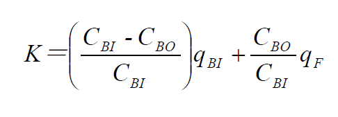

# 一次性使用血液透析器临床评价注册审查指导原则

附件5

一次性使用血液透析器临床评价

注册审查指导原则

本指导原则旨在指导注册申请人对一次性使用血液透析器注册开展临床评价，同时也为技术审评部门审评一次性使用血液透析器临床评价资料提供参考。

本指导原则是对一次性使用血液透析器临床评价的一般要求，注册申请人需依据产品的具体特性确定其中内容是否适用。若不适用，需具体阐述理由及相应的科学依据，并依据产品的具体特性对注册申报资料的内容进行充实和细化。

本指导原则是对注册申请人和技术审评人员的指导性文件，但不包括审评审批所涉及的行政事项，亦不作为法规强制执行，需在遵循相关法规的前提下使用本指导原则。如果有能够满足相关法规要求的其他方法，也可以采用，但是需要提供详细的研究资料和验证资料。

本指导原则是在现行法规和标准体系以及当前认知水平下制定，随着法规和标准的不断完善，以及科学技术的不断发展，相关内容也将适时进行调整。

一、适用范围

本指导原则适用于一次性使用血液透析器，包括低通量透析器和高通量透析器，在医疗机构用于急、慢性肾功能衰竭患者，进行常规的血液透析治疗。该产品分类编码为10-04-01，管理类别为第三类。

其他用于开展常规的血液透析滤过治疗，不用于连续性肾脏替代治疗等产品可参考本导则相关内容（若适用）。

一次性使用血液透析器通常需通过临床试验路径进行临床评价。若注册申请人通过临床试验开展临床评价时，可参考本指导原则第二部分的相关要求开展临床试验。若注册申请人选择同品种路径进行临床评价时，则需满足本指导原则第三部分的相关要求。

二、临床试验基本要求

（一）试验目的

临床试验需设定明确、具体的试验目的。注册申请人可综合分析试验器械特征、非临床研究情况、以及已在中国境内上市（下文简称已上市）同类产品的临床数据等因素，设定临床试验目的。临床试验目的决定了临床试验各设计要素，包括主要评价指标以及临床试验设计类型等，进而影响临床试验的样本量。

（二）试验设计类型

建议开展多中心临床试验，临床试验类型为前瞻性、随机对照、非劣效设计。对照组一般选择性能参数和膜材料相似的血液透析器。

（三）入排标准

试验者需具有代表性，对入选标准和排除标准需有详细说明。试验对象原则上为开展维持期血液透析的慢性肾衰竭成年患者，明确年龄、性别、原发病、特殊要求等。排除标准通常包括试验对象伴有严重贫血，感染，恶性肿瘤，活动性出血，严重心、肝、肺脏疾病，精神异常或病情不稳定等患者；或有其他不适合进行临床试验的情况。

（四）评价指标

1.主要评价指标

低通量血液透析器主要评价指标包括肌酐清除率与尿素/尿素氮清除率，对于高通量血液透析器还需包括β2微球蛋白（β2-MG）下降率。

2.次要评价指标

2.1整体透析完成后肌酐及尿素/尿素氮清除率、肌酐下降率、尿素/尿素氮下降率。

2.2超滤率。

2.3透析开始时和开始后15min的血气分析、透析开始后15min白细胞及血小板下降率等。

2.4透析前后血常规、肝肾功能、血电解质（包括血钾、血钙、血磷等）、HCO3-、CO2CP、白蛋白、球蛋白、C-反应蛋白。生命体征：血压、脉搏、体温、心率；患者一般状态：患者自我感觉、首次使用综合征及体征变化；与使用透析器相关的数据变化；与透析器功能相关的实验室参数。

2.5不良事件发生情况及严重不良事件发生情况，明确事件的具体信息如患者信息、发生时间、原因、后果、处理措施、患者转归及与器械的相关性等。

3.评价方法

3.1超滤率（mL/h）=总除水量（mL）/治疗时间(h)。

3.2透析溶质清除率

透析溶质清除率需平稳透析60min后，在固定工作状态下的血流量和透析液流量（通常设置超滤率为0mL/min或者10mL/min），同时从透析器动静脉端抽血，检测肌酐、尿素/尿素氮等溶质浓度并计算清除率。通常按照如下公式进行计算：

和采用的浓度单位相同；是指血液透析器血液入口的溶质浓度；是指血液透析器血液出口的溶质浓度；是指产品入口端的血液流速；是指滤过液流速（超滤率）。

3.3透析溶质下降率

透析溶质下降率＝1－(透析后血浓度／透析前血浓度)％。

测定透析溶质下降率时，在透析开始和结束时抽血，停止超滤，血流量先减至100mL/min后，停泵立刻从透析器动静脉端抽血。

（五）并发症及处理预案（预计本试验中可能出现的并发症及如何处理）

并发症包括如透析中低血压、肌肉痉挛、恶心和呕吐、头痛、胸痛和背痛、皮肤瘙痒、失衡综合征、透析器反应（临床分为A型和B型反应）、心律失常、溶血、空气栓塞、发热、透析器破膜、体外循环凝血等。

（六）临床试验样本量

根据对照用血液透析器的相应指标的循证医学相关资料做出检验假设并计算样本量。同时，样本量的确定与选择的假设检验类型（优效、非劣效、等效性检验）及I、II类错误和具有临床意义的界值（疗效差）有关，同时还需考虑预计排除及临床失访的病例数。

临床试验样本量的确定需符合临床试验的目的和统计学要求，并且完成所有访视受试者不应少于临床试验方案中规定的最低样本量。为保证各主要评价指标的检验功效均不低于80%，临床试验选择计算例数最多的样本量为临床试验样本量。临床试验如为非劣效设计，非劣效界值不大于主要评价指标平均水平的10%。若申报产品包含不同膜面积产品，建议注册申请人在膜面积<1.5m2以及1.5m2-2.2m2范围内分别选择代表性产品进行样本量估计并开展临床试验。

三、同品种临床评价基本要求

以下两种情形血液透析器可通过同品种路径开展临床评价，一是申报产品使用的透析膜已在中国境内获准上市，注册申请人可选择具有相同透析膜（膜的原材料、配方及膜的性能指标基本一致）的透析器作为同品种医疗器械；二是申报产品的前代产品已在中国境内获准上市，申报产品是对前代产品透析膜壁厚及纹理/波形进行改变，注册申请人可选择前代产品作为同品种医疗器械。此时，血液透析器同品种临床评价相关要求如下：

（一）适用范围及临床使用相关信息的对比

申报产品与同品种医疗器械需有相同的适用范围，需比对的信息包括适用范围（适应证，适用人群等，疾病阶段及严重程度等）及使用时间等。

（二）技术特征的对比

1. 结构组成

注册申请人需对比申报产品与同品种医疗器械的结构组成，关注透析膜材料和设计特征的对比，其包括但不限于透析膜材料（原材料及配方），以及透析膜的相关性能参数如膜面积大小、纤维数量、有效纤维长度、纤维内径、纤维壁厚、孔隙率等。

2.性能指标

申报产品与同品种医疗器械需在同等的检测条件下进行性能检测，若申报产品包括不同膜面积，按照膜面积<1.5m2以及1.5m2-2.2m2范围内分别选择代表性产品进行性能测试。透析器性能参数的比对建议重点考虑以下内容（包括但不限于）：

2.1性能参数：需包括清除率、筛选系数、超滤率、血室容量、血室压力降等。测定性能参数时，需覆盖注册申请人申报的血液流速和透析液流速等范围。建议相关物质的清除率测定选择透析液流速的最低和最高点，并分别对应注册申请人申报的血液流速的最低流速、每增加100mL/min的血液流速，直至最高血液流速。

2.2超滤率与超滤系数：超滤率可评价血液透析器对水的清除能力。测定超滤率需覆盖注册申请人申请的跨膜压（TMP）和血液流速的范围。超滤系数可参考FDA《常规和高通量血液透析器的上市前通知内容指南》等文件进行。

2.3筛选系数：高通量透析器还需测定筛选系数。建议在血液流速为 200mL/min、300mL/min、400mL/min、500mL/min以及最大流速（当与上述流速不同时）时测量白蛋白、菊粉、肌红蛋白或β2-MG的筛选系数。

（三）差异性部分的安全有效性证据

1.申报产品为新注册产品，其使用的透析膜已在境内获准上市，注册申请人选择具有相同透析膜的透析器作为同品种医疗器械时，注册申请人需按照上述要求进行结构组成、透析膜材料和设计特征以及相关性能指标的对比，在充分识别申报产品与同品种医疗器械相同性和差异性的基础上，论证二者的等同性。若申报产品的设计影响血液流动模式，或是最大血液流速与同品种医疗器械存在明显差异，注册申请人需提供最大血液流速下机械性溶血测试数据，以验证该设计不会引起红细胞的过度溶解。

2.申报产品的前代产品已在中国境内获准上市，申报产品是对前代产品透析膜的壁厚及纹理/波形进行改变，注册申请人选择前代产品作为同品种医疗器械，在结构组成、透析膜材料和设计特征以及相关性能指标对比的基础上，还需针对差异部分开展临床试验，以确认血液透析器的临床性能。

2.1总体要求：通过12名受试者，每名受试者接受3次治疗，接受总计36次治疗的数据，验证血液透析器的临床性能。如申报产品包括不同膜面积，建议在（每个膜面积产品）膜面积<1.5m2以及1.5m2-2.2m2范围内分别选择代表性产品，分别开展临床试验。

2.2评价指标

2.1.1超滤率和超滤系数：每名受试者测定4个数据点的超滤率，通过线性回归计算超滤率与其对应的TMP的斜率，获得体内超滤系数。通过12例受试者的超滤系数来反映透析器体内的超滤系数，评价体内外超滤系数的一致性。

2.2.2尿素/尿素氮、肌酐、血磷清除率、β2-MG下降率（高通量透析器）。

2.2.3测定透析开始时和开始后15min的血气分析、红细胞、白细胞、血小板。并计算透析开始后15min白细胞、血小板下降率等。

2.2.4不良事件的发生情况、处理方式及处理结果，包括补体激活和血栓形成等。

2.3数据分析及结论

注册申请人需对临床试验结果进行分析，评价产品的临床性能。

（四）同品种产品的临床数据

建议参考《医疗器械临床评价技术指导原则》要求，提交同品种产品的临床数据；临床试验或临床使用获得的数据（以下简称临床数据）可来自中国境内和/或境外公开发表的科学文献和合法获得的相应数据，包括临床试验数据、临床经验数据、临床文献数据等。临床文献数据的收集应保证查准、查全，具有可重复性；临床经验数据收集应包括对已完成的临床研究、不良事件、与临床风险相关的纠正措施等数据的收集。注册申请人可依据产品的具体情形选择合适的数据来源和收集方法。

同品种医疗器械在国内开展临时数据收集时，需在国内现行血液透析操作规范的条件下（特别是血液流速与治疗次数）收集。

四、参考文献

[1]《医疗器械临床评价技术指导原则》（2021年第73号通告）[Z].

[2]《决策是否开展医疗器械临床试验技术指导原则》（2021年第73号通告）[Z].

[3]《医疗器械临床试验设计指导原则》（2018年第6号通告）[Z].

[4]《医疗器械临床评价等同性论证技术指导原则》（2021年第73号通告）[Z].

[5]《医疗器械注册申报临床评价报告技术指导原则》（2021年第73号通告）[Z].

[6]《一次性使用血液透析器产品注册技术审查指导原则》（2023年第15号通告）[Z].
