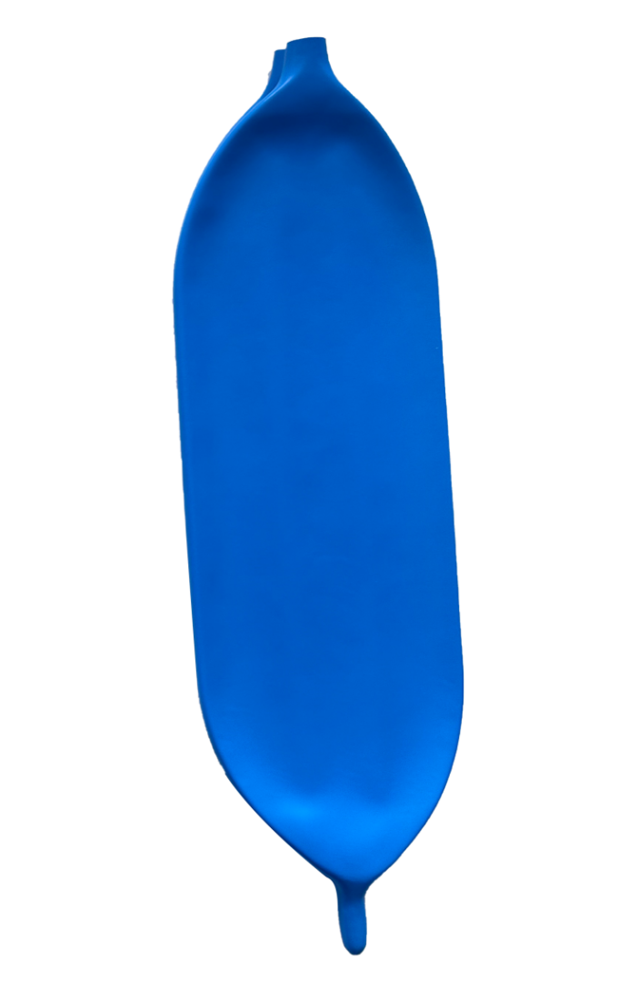
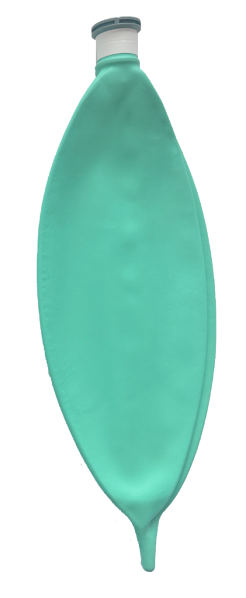
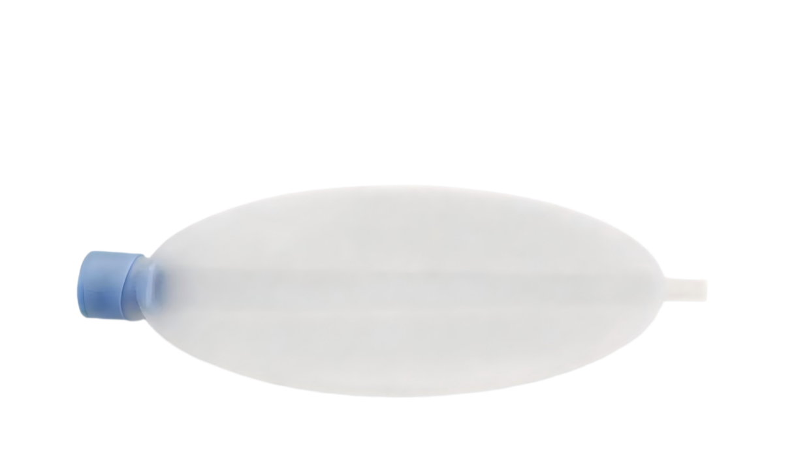
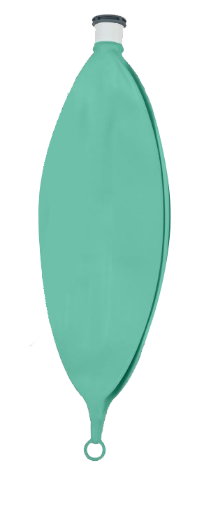
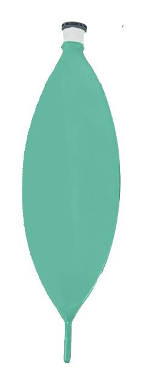

# 麻醉储气囊产品注册审查指导原则

本指导原则旨在指导注册申请人准备及撰写麻醉储气囊产品注册申报资料，同时也为技术审评部门审查注册申报资料提供参考。

本指导原则是对麻醉储气囊的注册申报资料的一般要求，注册申请人应依据具体产品的特性对注册申报资料的内容进行充实和细化，并依据具体产品的特性确定其中的具体内容是否适用，若不适用，需具体阐述其理由及相应的科学依据。

本指导原则是对注册申请人和技术审评人员的指导性文件，但不包括注册审批所涉及的行政事项，亦不作为法规强制执行，如果有能够满足相关法规要求的其他方法，也可以采用，但是需要提供详细的研究资料和验证资料。应在遵循相关法规和标准的前提下使用本指导原则。

本指导原则是在现行法规和标准体系以及当前认知水平下制定的，随着法规和标准的不断完善，以及科学技术的不断发展，本指导原则相关内容也将进行适时的调整。

一、适用范围

本指导原则适用于按第二类医疗器械管理的麻醉储气囊产品，包括一次性使用和重复使用的麻醉储气囊、无菌和非无菌麻醉储气囊。参考《医疗器械分类目录》，产品的分类编码为08呼吸、麻醉和急救器械-05呼吸、麻醉、急救设备辅助装置-08麻醉储气囊。

二、注册审查要点

（一）监管信息

注册申请人应提供申请表、产品列表、既往沟通记录（如不适用，应当明确声明申报产品没有既往申报和/或申报前沟通）、关联文件（如主文档授权信）及其他管理信息等。

1.申请表

1.1产品名称

产品名称应符合《医疗器械通用名称命名规则》或行业标准上的通用名称等相关文件的要求，由一个核心词和一般不超过三个特征词组成，以体现产品的特性、使用特点和预期用途。

命名举例：麻醉储气囊、重复使用呼吸囊、一次性使用麻醉储气囊、重复使用麻醉储气囊、无菌麻醉储气囊等。

1.2管理类别、分类编码

申报产品按第二类医疗器械管理，参考《医疗器械分类目录》，产品的分类编码为08-05-08。

1.3注册单元划分的原则

申报产品的注册单元原则上以产品的技术原理、主要结构组成、性能指标和适用范围为划分依据，同时应满足《医疗器械注册单元划分指导原则》相关要求。

1.4型号规格

应明确申报产品的型号规格。

1.5结构及组成

结构及组成中部件名称应规范。各项文件中结构及组成应一致。

2.产品列表

应以表格形式列出拟申报产品的型号、规格、结构及组成、附件，以及每个规格型号的标识（如型号或部件的编号、器械唯一标识等）和描述说明（如尺寸、材质等）。

3.既往沟通记录（如适用）

在产品申报前，如果注册申请人与监管机构针对申报产品以会议形式进行了沟通，或者申报产品与既往注册申报相关，应提交相关沟通记录。

4.主文档授权信（如适用）

申请人应当对主文档引用的情况进行说明。

5.其他管理信息

5.1按照《创新医疗器械特别审查程序》审批的境内医疗器械申请注册时，应当提交通过创新医疗器械审查的相关说明。

5.2委托其他企业生产的，应当提供受托企业资格文件（营业执照副本复印件）、委托合同和质量协议。

（二）综述资料

1.产品描述

1.1工作原理

麻醉储气囊与麻醉机相连接，用于在麻醉过程中储存来自麻醉机的新鲜气体，在手动模式下或停电等特殊情况时，通过按压麻醉储气囊进行手动通气。由于气囊有很好的弹性以及顺应性，能保护患者的肺部不受高压气流的伤害。

1.2结构组成

麻醉储气囊通常由储气囊体、囊尾（可开口、带尾环、加长）和连接件（如转换接头等）组成，产品可分为裸颈或组合颈。储气囊可采用天然橡胶、氯丁橡胶、丁腈橡胶、硅橡胶等适宜的高分子材料制成；接头可采用PVC等适宜的高分子材料制成。

1.3型号规格

麻醉储气囊可按材质、结构、尺寸等划分规格型号。如按结构划分为裸颈或组合颈（装有一只转换接头）结构，其结构图片（图1-图2）如下所示：

图1典型裸颈麻醉储气囊实物照片

图2 典型组合颈麻醉储气囊实物照片

按囊尾形式划分为开口囊尾、带尾环囊尾、加长囊尾产品图片如下所示（图3-图5）。

图3 开口囊尾麻醉储气囊实物照片

图4 带尾环囊尾麻醉储气囊实物照片

图5 加长囊尾麻醉储气囊实物照片

1.4包装说明

说明申报产品组成的包装信息，以无菌形式提供的医疗器械，应当说明其无菌屏障系统的信息；以非无菌形式提供的医疗器械，应当说明保持其微生物指标的包装信息。说明如何确保最终使用者可清晰地辨识包装的完整性。

1.5研发历程

阐述申报产品的研发背景和目的。如有参考的同类产品或前代产品，应当提供同类产品或前代产品的信息，并说明选择其作为研发参考的原因。

1.6与同类和/或前代产品的参考和比较

列表比较说明申报产品与同类产品和/或前代产品（如有）在工作原理、结构组成、制造材料、性能指标、作用方式、适用范围等方面的异同。

2.适用范围和禁忌证

2.1适用范围

2.1.1应当描述申报产品的适用范围，明确预期用途。麻醉储气囊用于麻醉过程中储存来自麻醉机的新鲜气体，在手动模式下或停电等特殊情况时，通过按压麻醉储气囊进行手动通气。

2.1.2明确目标用户及其操作或使用该产品应当具备的技能/知识/培训。明确产品为一次性使用或重复使用。

2.2预期使用环境

应明确申报产品使用场所要求，如医疗机构等。

2.3适用人群

应详述申报产品的适用人群。

2.4禁忌证

应说明产品临床应用的禁忌证，如：对原材料过敏者禁用。

3.申报产品上市历史

如适用，应当提交申报产品的上市情况、不良事件和召回、销售不良事件及召回率。

（三）非临床资料

1.产品风险管理资料

应依据GB/T 42062提供产品风险管理报告。注册申请人应重点说明：申报产品的研制阶段及对有关可能的危害及产生的风险进行了估计和评价，针对性地实施了降低风险的技术和管理方面的措施。产品性能测试对上述措施的有效性进行了部分验证，达到了通用和专用标准的要求。注册申请人对所有剩余风险进行了评价，全部达到可接受的水平。产品风险分析资料应为注册申请人关于产品安全性的承诺提供支持。应对申报产品的可能危害进行判定并列出清单（详见附件）。

2.医疗器械安全和性能基本原则清单

说明申报产品符合《医疗器械安全和性能基本原则清单》各项适用要求所采用的方法，以及证明其符合性的文件。对于《医疗器械安全和性能基本原则清单》中不适用的各项要求，应当说明理由。

3.产品技术要求及检验报告

3.1产品技术要求

产品技术要求的制定应符合《医疗器械产品技术要求编写指导原则》、YY/T 0978的相关法规及标准要求。本条款给出需要考虑的产品主要技术指标，如有其他指标，注册申请人结合相应的标准、产品设计特点及临床应用进行制定。注册申请人如不采用以下条款（包括国家标准、行业标准要求），应当说明理由。

3.1.1产品型号/规格及其划分说明

应说明申报产品的型号/规格，明确产品型号/规格的划分说明。不使用“主要”“等”之类模糊词语。必要时可提供产品的结构示意图。

3.1.2性能指标

申报产品的性能指标建议包含以下几点（包括但不限于此）：规格标识、泄漏、容量、囊颈、囊尾、囊体抗扩张（压力/体积）所需压力、静电预防（如适用）、无菌或微生物指标（如适用）。采用环氧乙烷灭菌的产品应规定环氧乙烷残留量的要求。如有配合使用的附件（如连接件等）应制定相应要求等。重复使用产品在宣称使用方式及最大使用次数后仍能满足所有物理性能要求。

应在产品技术要求附录中明确产品所有原材料及含量，包括其添加剂、着色剂等。

注册申请人对宣称的其他技术参数和功能，应在产品技术要求中予以规定。

3.1.3检验方法

申报产品的检验方法应根据性能指标制定，优先采用已颁布的标准或公认的检验方法。其他检验方法需提供相应的方法学依据及理论基础，同时保证检验方法具有可操作性和重现性，必要时可附相应图示进行说明，文本较大的可以附录形式提供。

3.2产品检验报告

可提交注册申请人出具的自检报告或委托有资质的医疗器械检验机构出具的检验报告。若提交自检报告，应按照《医疗器械注册自检管理规定》的要求提供相关资料。

3.3同一注册单元内注册检验典型性产品确定原则

同一注册单元中所检验产品应能够代表注册单元内其他产品安全性和有效性。代表产品的确定可以通过比较同一注册单元内所有产品的主要原材料、生产工艺、技术结构、性能指标和预期用途等资料，说明其能够代表注册单元内其他产品的安全性和有效性。必要时提交不同型号规格产品的差异性检测报告。

例如：裸颈麻醉储气囊与组合颈麻醉储气囊在技术结构方面存在差异，应进行差异性检验；不同囊尾的麻醉储气囊在技术结构方面存在差异，应进行差异性检验。

4.研究资料

4.1原材料控制

申报资料中应按YY/T 0978进行原材料控制，明确各种原材料的名称、质量控制指标及要求、供应商信息等，说明原材料的功能特点或选择依据。对于首次用于医疗器械方面的新材料，应提供该材料适合用于符合预期用途的相关研究资料。若有加工助剂的，应列明加工助剂的主要化学成分和比例信息，及制造过程中使用的添加成分、添加剂、着色剂等。

提交原材料与预期接触的气体及麻醉剂相容性研究资料。原材料与已上市产品相同的，可通过已有的文献、数据和信息资料进行说明；采用新材料、新工艺的产品，应提供相应的试验数据和分析评价资料。

4.2性能研究

应当提供产品化学/材料表征、物理和/或机械性能指标及检验方法的确定依据、设计输入来源以及临床意义，所采用的标准或方法、采用的原因及理论基础。

常见性能研究指标包括但不限于技术要求中条款，有特殊设计、性能和结构的，应提供相应研究和验证资料。如有配合使用的附件应制定相应要求，考虑附件与产品的适宜性。

4.3生物学特性研究

生物相容性评价研究资料应当包括：生物相容性评价的依据和方法；产品所用材料的描述及与人体接触的性质；实施或豁免生物学试验的理由和论证；对于现有数据或试验结果的评价。

产品首次注册时应根据产品所用材料及与人体的接触性质、接触时间，参照GB/T 16886系列标准、《医疗器械生物学评价和审查指南》、YY/T 1778.1的要求对其进行生物相容性评价。

重复性使用产品应确认产品在经过相应的清洗、消毒或灭菌程序处理及宣称的最大使用次数后仍能满足生物相容性要求。

4.4灭菌工艺研究

以无菌形式提供的产品，应提交产品包装及灭菌方法选择的依据，经过确认并进行常规控制，开展以下方面的确认：

4.4.1产品与灭菌过程的适应性：应考察灭菌方法等工艺过程对于产品的影响。

4.4.2包装与灭菌过程的适应性。

4.4.3应明确灭菌工艺（方法和参数）和无菌保证水平（SAL），SAL应达到10-6，并提供灭菌确认报告。

可根据适用情况选择不同的灭菌方式：

如采用环氧乙烷灭菌，参照GB 18279等标准的要求开展研究；

如采用辐射灭菌，参照GB 18280.1、GB 18280.2、GB/T 18280.3等标准的要求开展研究。

残留毒性：若灭菌使用的方法容易出现残留，如环氧乙烷灭菌，应当明确残留物信息及采取的处理方法，可参考GB/T 16886.7等标准的要求开展研究并提供环氧乙烷解析的研究资料。

对于可重复使用麻醉储气囊产品，应明确产品最大重复使用次数，提供终端用户清洗消毒或灭菌方法的研究资料。

4.5稳定性研究

4.5.1货架有效期

应提供货架有效期研究资料，证明在货架有效期内，产品可保持性能功能满足使用要求，包括产品有效期和包装有效期的研究。

货架有效期验证可采用实时稳定性试验或加速稳定性试验。实时稳定性试验是唯一能够反映产品在规定运输贮存条件下实际稳定性要求的方法。建议以加速稳定性试验来对产品货架有效期进行先期研究和预测，并适时启动实时稳定性试验，对产品货架有效期做进一步的研究和确认，当加速稳定性试验与实时稳定性试验结果不一致时，应以实时稳定性试验结果为准。加速稳定性试验的具体要求可参考YY/T 0681系列标准、YY/T 0698系列标准、GB/T 19633系列标准。

无论实时稳定性试验还是加速稳定性试验，注册申请人均需在试验方案中设定检测项目、检测方法及判定标准。检测项目包括产品自身性能检测和包装系统性能检测两方面。其中，产品自身性能检测需选择与医疗器械货架有效期密切相关的性能检测项目。建议注册申请人在试验过程中设立多个检测时间点（一般不少于3个）对申报产品进行检测。可采用零点时间的性能数据作为检测项目的参照指标。

产品以无菌或非无菌形式提供时，应分别进行有效期的研究。

申报产品如为重复使用，应明确相应的储存方式和最长储存时间，明确重复使用的最大次数及清洗、消毒或灭菌方法，并提供按照该程序处理后仍能满足相关性能要求的验证资料。

4.5.2包装研究

应提供包装研究资料，明确产品的包装形式及材质并证明在宣称的有效期及规定的运输储存条件（例如：震动、振动、温度、湿度、光线的波动）下，能够对产品起到防护作用并保持产品性能。

注册申请人应提交最终成品包装的初始完整性和维持完整性的验证资料。对于在加速稳定性试验中可能导致产品变性而不适于选择加速稳定性试验研究其包装的情况，应以实时稳定性试验进行验证。

包装研究资料可依据GB/T 19633系列标准对包装进行分析研究和评价。包装材料的选择应至少考虑以下因素：包装材料的物理化学性能；包装的密封性；包装的使用性能；包装材料与产品的适应性；包装材料与灭菌或洁净控制过程的适应性；包装材料与标签系统的适应性；包装材料与贮存运输过程的适应性；包装有效期。其包装验证的资料内容应与包装说明中给出的信息相符。

4.6可用性研究

按照《医疗器械可用性工程注册审查指导原则》要求，中、低使用风险医疗器械可基于风险管理过程开展可用性工程生命周期质控工作，提交使用错误评估报告。若前期已开展可用性工程工作，亦可提交可用性工程研究报告，用于替代使用错误评估报告。

使用错误评估报告用于细化风险管理报告关于可用性的内容，包括基本信息、使用风险级别、核心要素、同类医疗器械上市后使用问题分析、使用风险管理、结论等内容。申请人在对麻醉储气囊同类产品上市后使用问题进行分析时，应重点考虑产品材质与麻醉气体兼容性问题。

4.7其他资料

对于符合列入《免于进行临床评价医疗器械目录》（以下简称《目录》）中分类编码为08-05-08的麻醉储气囊产品，注册申请人需提交申报产品相关信息与《目录》所述内容的对比资料，和申报产品与已获准境内注册的《目录》中医疗器械的对比表，可参照《列入免于临床评价医疗器械目录产品对比说明技术指导原则》的要求提交具体资料。

（四）临床评价资料

对于不符合《目录》描述的麻醉储气囊产品，注册申请人应按照《医疗器械临床评价技术指导原则》的要求提交相应的临床评价资料。

（五）产品说明书和标签样稿

产品说明书和标签的编写应符合《医疗器械说明书和标签管理规定》、YY/T 0978和相关法规、规章、规范性文件、强制性标准的要求。说明书中关于产品性能特征的描述不应超过注册申请人提交的研究资料及产品技术要求，不得含有未经验证的夸大宣传的相关描述。应注意以下内容：

1.产品的结构组成及主要性能指标应与产品技术要求内容一致。

2.无菌形式提供的产品应当注明灭菌方式、“无菌”等字样或符号；非无菌形式提供的产品应当标注“非无菌”字样或符号。

3.注明产品主要原材料，应有对材料过敏者禁止使用的提示。如产品由天然橡胶（乳胶）制造，应说明可能会引起过敏反应。

4.使用前检查包装是否完好，如有破损，禁止使用。

5.应标明产品的货架有效期，严禁使用超过货架有效期的产品。

6.明确产品的指定尺寸、公称容积。

7.一次性使用产品应当注明，并明确禁止重复使用。

8.可重复使用的产品应注明建议的清洗、消毒或灭菌方法、最大重复使用次数和周期。

9.如产品宣称抗静电性能，应注明“抗静电”字样，并应为黑色或带有黄色标记。

10.产品应注明建议使用时间和使用方法。

11.明确产品的储存、运输要求。

12.明确产品可相容的麻醉剂要求。

13.产品使用后，应按照《医疗废物管理条例》的要求处理。

14.使用前必须检查储气囊是否完好，如有破损、漏气或老化迹象，严禁使用。

15.产品需由经过培训的专业医务人员在临床环境下使用。选择与患者潮气量相匹配的规格。密切监测患者通气状况，避免过度通气或通气不足。

（六）质量管理体系文件

根据《医疗器械注册申报资料要求及说明》六、质量管理体系文件要求提交资料。

三、参考文献

[1]中华人民共和国国务院.医疗器械监督管理条例:中华人民共和国国务院令第739号[Z].

[2]国家市场监督管理总局.医疗器械注册与备案管理办法:国家市场监督管理总局令第47号[Z].

[3]国家药品监督管理局.医疗器械注册申报资料要求和批准证明文件格式:国家药监局公告2021年第121号[Z].

[4]国家食品药品监督管理局.医疗器械注册单元划分指导原则:总局通告2017年第187号[Z].

[5]国家食品药品监督管理局.医疗器械分类目录:国家食品药品监督管理总局公告2017年第104号[Z].

[6]国家药品监督管理局.医疗器械安全和性能基本原则清单:国家药监局公告2021年第121号[Z].

[7]国家药品监督管理局.医疗器械产品技术要求编写指导原则:国家药监局公告2022年第8号[Z].

[8]国家药品监督管理局.医疗器械注册自检管理规定:国家药监局公告2021年第126号[Z].

[9]国家药品监督管理局.《医疗器械通用名称命名指导原则》（2019年第99号）[Z].

[10]国家食品药品监督管理局.医疗器械生物学评价和审查指南:国家食品药品监督管理局通知2007年345号[Z].

[11]国家药品监督管理局.列入免于临床评价医疗器械目录产品对比说明技术指导原则:国家药监局通告2021年第73号 [Z].

[12]国家药品监督管理局.免于临床评价医疗器械目录：国家药监局通告2025年第19号）[Z].

[13]国家食品药品监督管理局.医疗器械说明书和标签管理规定:国家食品药品监督管理总局令第6号[Z].

[14]GB 18278.3,医疗保健产品灭菌 湿热 第1部分 医疗器械灭菌过程的开发、确认和常规控制要求[S].

[15]GB 18279, 医疗保健产品灭菌 环氧乙烷 医疗器械灭菌过程的开发、确认和常规控制要求[S].

[16]GB 18280.1,医疗保健产品灭菌 辐射 第1部分：医疗器械灭菌过程的开发、确认和常规控制要求[S].

[17]GB 18280.2,医疗保健产品灭菌 辐射 第2部分：建立灭菌剂量[S].

[18]GB/T 18280.3,医疗保健产品灭菌 辐射 第3部分：剂量测量指南[S].

[19] GB/T 14233.1,医用输液、输血、注射器具检验方法第1部分：化学分析方法[S].

[20]GB/T 14233.2,医用输液、输血、注射器具检验方法  第2部分：生物学试验方法[S].

[21]GB/T 19633.1,最终灭菌医疗器械包装 第1部分：材料、无菌屏障系统和包装系统的要求[S].

[22]GB/T 19633.2,最终灭菌医疗器械包装 第2部分：成形、密封和装配过程的确认的要求[S].

[23]GB/T 42061,医疗器械质量管理体系用于法规的要求[S].

[24]GB/T 42062,医疗器械风险管理对医疗器械的应用[S].

[25]GB/T 16886.1,医疗器械生物学评价 第1部分：风险管理过程中的评价与试验[S].

[26]GB/T 16886.5,医疗器械生物学评价 第5部分：体外细胞毒性试验[S].

[27] GB/T 16886.7,医疗器械生物学评价 第7部分：环氧乙烷灭菌残留量[S].

[28]GB/T 16886.10,医疗器械生物学评价 第10部分：皮肤致敏试验[S].

[29]GB/T16886.23,医疗器械生物学评价 第23部分：刺激试验[S].

[30]GB/T 16886.12,医疗器械生物学评价 第12部分：样品制备与参照材料[S].

[31]GB/T 45665.1,麻醉和呼吸设备 圆锥接头 第1部分：锥头与锥套[S].

[32]YY/T0978,麻醉储气囊[S].

[33]YY/T 0313,医用高分子产品 包装和制造商提供信息的要求[S].

[34]YY/T 0466.1,医疗器械用于制造商提供信息的符号 第1部分: 通用要求[S].

[35]YY/T 0681.1,无菌医疗器械包装试验方法第1部分：加速老化试验指南[S].

[36]YY/T 0698.2,最终灭菌医疗器械包装材料 第2部分：灭菌包裹材料要求和试验方法[S].

[37]YY/T 1778.1,医疗应用中呼吸气体通路生物相容性评价第1部分：风险管理过程中的评价与试验[S].

[38]WS/T 367,医疗机构消毒技术规范[S].

[39]中华人民共和国药典（2025版）[S].

附件

产品主要危险

| 危险 | 可预见的事件序列 | 危险的形成因素 | 可能的后果 |
| --- | --- | --- | --- |
| 生物学危险 | 生物污染 | 生产环境控制不好。包装破损或使用时不规范造成生物污染；产品没有达到无菌或微生物指标的要求 | 产品污染，引起患者呼吸道感染 |
| 生物学危险 | 不正确的配方 | 未按照工艺要求配料 | 有可能引起小分子物质残留,造成毒性危害 |
| 生物学危险 | 加工工艺 | 加工工艺控制不严格，后处理工艺控制不严格 | 引入有害物质，引起患者感染或造成毒性危害 |
| 生物学危险 | 环境污染 | 生产环境污染产品，如外来的粉尘、微生物、其他杂质等 | 引起交叉感染 |
| 生物学危险 | 环境污染 | 储存（如温度、湿度）或运行偏离预定的环境条件 | 产品老化、有效期缩短 |
| 生物学危险 | 生物相容性 | 采用不合格原材料 | 引起患者呼吸道刺激 |
| 操作 危险 | 由不熟练/未经培训的人员使用 | 操作不熟练、操作失误 | 无法保证使用的安全性，导致无法达到满意的使用效果 |
| 操作 危险 | 使用产品时未按照说明书中操作方法使用 | 操作要点不突出 | 无法保证使用的安全性，导致无法达到满意的使用效果 |
| 操作 危险 | 忽视说明书中禁忌证、警示信息等内容 | 使用过程中出现过敏或刺激；超出产品的最长使用时间 | 引起患者接触部位的过敏或刺激 |
| 操作 危险 | 忽视说明书中禁忌证、警示信息等内容 | 在限定环境下未正确选用合适的产品 | 引起交叉感染 |
| 操作 危险 | 忽视说明书中禁忌证、警示信息等内容 | 规格型号选择不合理。 | 与病人体重不匹配，无法完成预期用途 |
| 操作 危险 | 使用老化、劣质产品或过度充气导致囊体破裂或泄漏。 | 材料抗拉强度不足；重复使用超过寿命；接触不兼容化学品导致降解。 | 通气中断，患者缺氧；麻醉气体泄漏污染手术室环境。 |
| 操作 危险 | 使用错误规格的储气囊，如 为成人患者选用儿童规格储气囊。 | 规格标识不清；用户培训不足。 | 通气不足或过度通气，导致低氧血症或气压伤。 |
| 信息 危险 | 不正确的标签 | 标记错误或不清晰、不全面，没有按照要求标记 | 错误使用；储存错误；产品辨别错误 |
| 信息 危险 | 不正确的说明书；说明书上的注意事项、禁忌证不全 | 没有明确可重复性使用医疗器械的使用次数限制及适宜的清洗、消毒或灭菌方法。 | 导致产品性能不符合要求 |
| 信息 危险 | 不正确的说明书；说明书上的注意事项、禁忌证不全 | 缺少详细的使用方法、必要的警告说明；使用前未检查产品包装状态；未标示使用后的处理方法（如产品用后按医疗废物处理） | 错误操作；无法保证使用安全有效性，造成环境污染或者交叉感染 |
| 信息 危险 | 对医疗器械寿命终止缺少适当的决定 | 未标识产品有效期 | 使用超出有效期的产品导致无法达到满意的使用效果；或引起交叉感染 |
| 信息 危险 | 不适当的产品包装（产品污染和／或降低性能） | 生产、运输和储存过程中导致包装破损；包装封口不严密；包装材料选择不适当；使用前未检查产品包装密封状态 | 产品使用效果和有效期无法得到保证 |
| 信息 危险 | 一次性使用产品重复使用时危害性警告不适当 | 一次性使用产品的标识不全或不易识别 | 错误操作，无法达到满意效果 |
| 信息 危险 | 由于废物和/或医疗器械处置的污染 | 使用后的产品没有按照要求销毁 | 造成环境污染或者交叉感染 |
