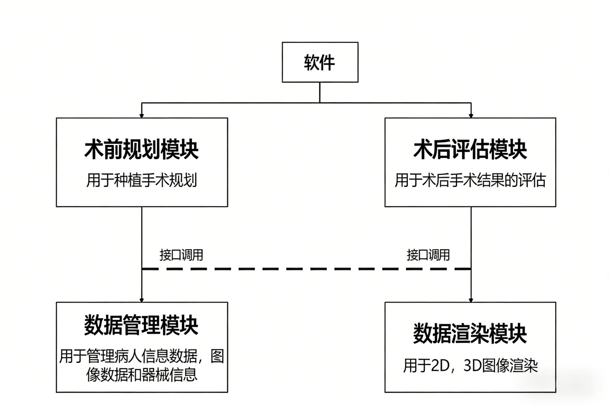
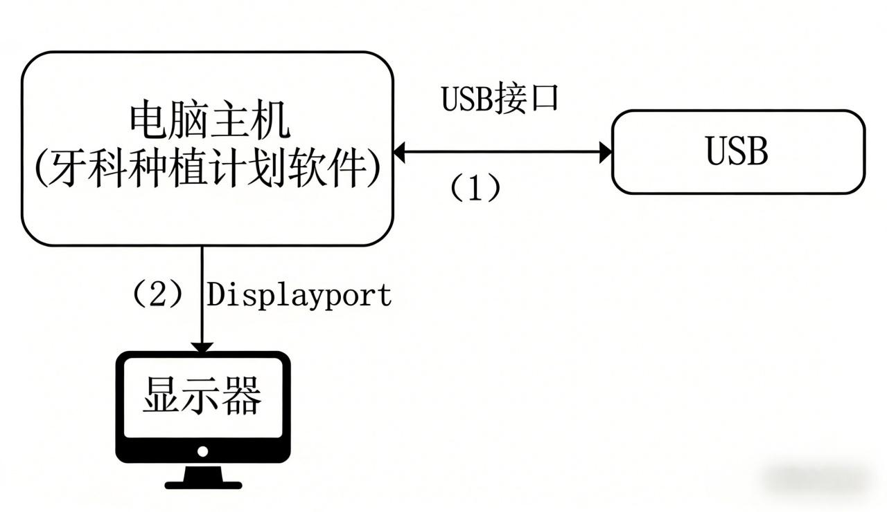
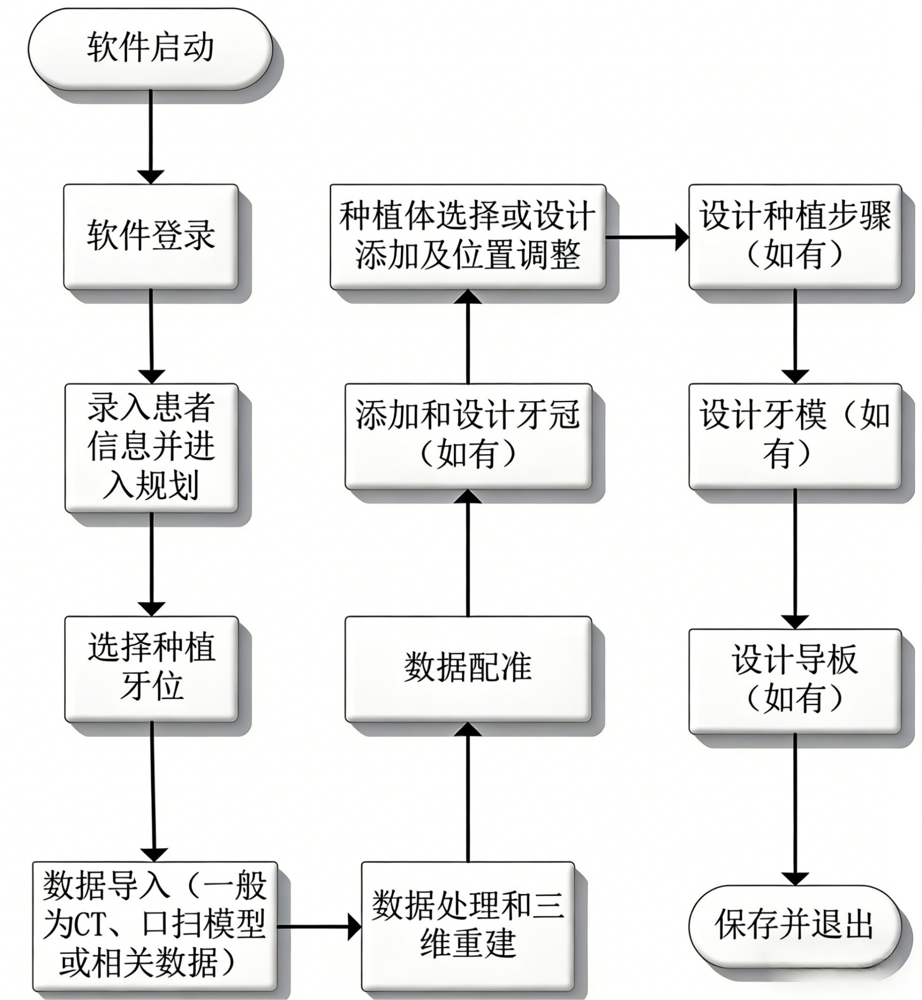
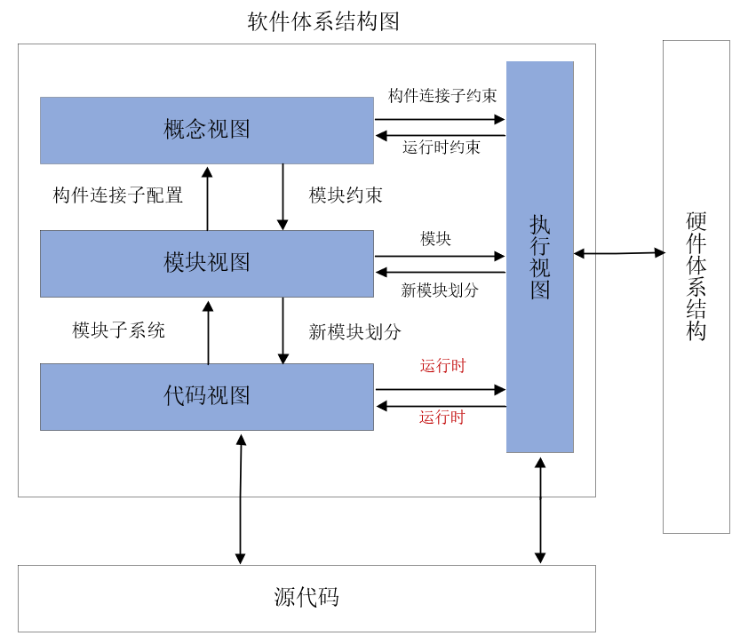
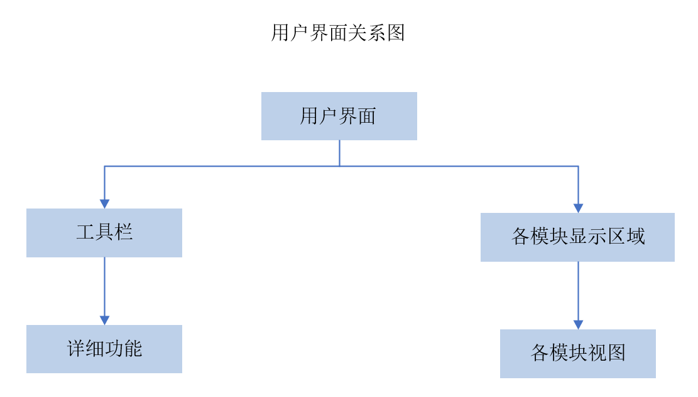
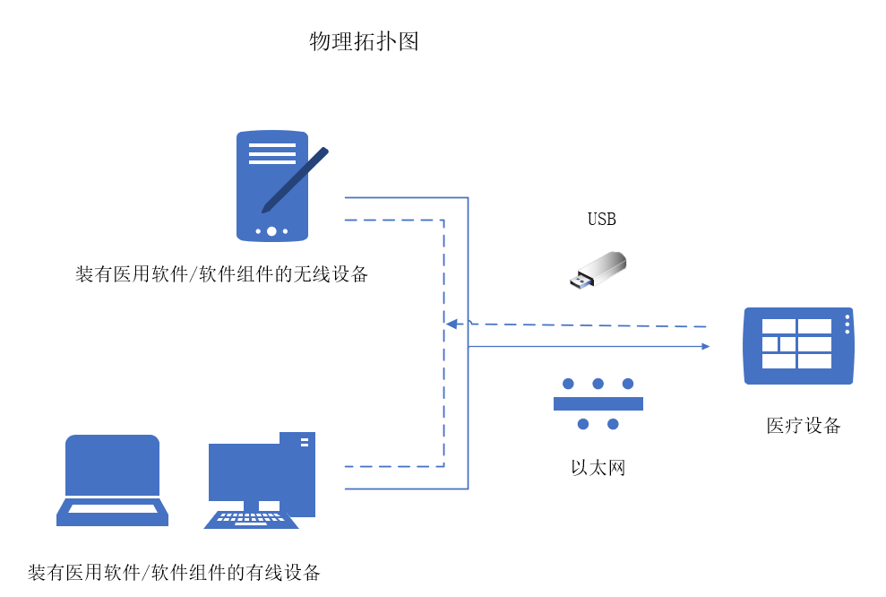

# 牙科种植计划软件注册审查指导原则

本指导原则旨在指导注册申请人对牙科种植计划软件注册申报资料的准备及撰写，同时也为技术审评部门审查注册申报资料提供参考。

本指导原则是对牙科种植计划软件的一般要求，申请人应依据产品的具体特性确定其中内容是否适用。若不适用，需具体阐述理由及相应的科学依据，并依据具体的产品特性对注册申报资料的内容进行充实和细化。

本指导原则是供注册申请人和技术审评人员使用的指导性文件，但不包括审评审批所涉及的行政事项，亦不作为法规强制执行，应在遵循相关法规的前提下使用本指导原则。如果有能够满足相关法规要求的其他方法，也可以采用，但是需要提供详细的研究资料和验证资料。

本指导原则是在现行法规和标准体系以及当前认知水平下制定的，随着法规和标准的不断完善，以及科学技术的不断发展，相关内容也将适时进行调整。

一、适用范围

本指导原则适用于牙科种植计划软件。牙科种植计划软件通常由软件安装光盘（或者从网络下载安装程序）组成。利用获得的影像信息，以及对其分析处理的结果，制定牙科种植手术计划或方案。按现行《医疗器械分类目录》，该类产品分类编码为21-01-03，管理类别为II类。本指导原则不适用于采用人工智能技术实现辅助决策用途的医疗器械，若采用人工智能技术实现非辅助决策用途参考《人工智能医疗器械注册审查指导原则》相关要求。

二、注册审查要点

（一）监管信息

1.产品名称

依据《医疗器械通用名称命名指导原则》及《医疗器械分类目录》，并结合产品预期用途，确定产品名称，如“牙科种植计划软件”。

2.注册单元划分

注册单元划分应符合《医疗器械注册与备案管理办法》第一百一十一条及《医疗器械注册单元划分指导原则》的要求，并参照《医疗器械软件注册审查指导原则》关于独立软件注册单元的划分原则。原则上以产品的管理类别、预期用途、功能模块作为划分依据。

（二）综述资料

1.概述

申请人需描述牙科种植计划软件的通用名称及确定依据；描述申报产品的管理类别，包括：所属分类子目录名称、一级产品类别、二级产品类别，管理类别，分类编码；描述申报产品适用范围。如适用，申请人应提供牙科种植计划软件的背景信息概述，如：申报产品的历史概述、历次提交的信息，与其他经批准上市产品的关系等。

2.产品描述

2.1器械及操作原理描述

2.1.1工作原理

注册申请人应在综述资料中明确产品工作原理，包括逻辑结构和物理结构。结构示意图中根据需要可预留接口。

2.1.1.1逻辑结构

应描述产品的体系结构，可以按照功能模块或组成模块进行描述，也可采用其他方式进行描述。提供示意图并依据示意图进行描述。

结构示意图及相应描述示例如下（图1）：

图1 体系结构示意图

牙科种植计划软件一般由数据管理模块、数据渲染模块、术前规划模块和术后评估模块组成：

（1）数据管理模块

病人信息管理：管理病人的基本信息。

图像数据管理：管理病人的CT和扫描件等数据。

器械库管理：管理种植体、种植工具等数据。

（2）数据渲染模块

2D渲染：渲染CT数据切片的二维图像。

3D渲染：渲染CT数据、扫描件、牙冠(如有)、种植体、牙模的三维图像。

根据设计需要其他渲染功能。

（3）术前规划模块

配准：配准CT数据和扫描件。

牙颌及神经管、上颌窦：在CT数据中生成下颌的神经管及上颌的上颌窦。

牙冠规划：为种植牙部位规划牙冠，将其放到合适的位置并调整为合适的形状。（如有）

种植体规划：为种植牙部位规划种植体，将其放置到合适的位置。

种植步骤规划（如有）：规划种植步骤，为每一个步骤设计钻头类型、起点、终点等。

根据需要可生成牙模、导板设计或选型等。

（4）术后评估模块（如有）

术后数据导入：导入术后CT或术后扫描件，用于手术评估。

配准对比：配准术前和术后数据，通过比对计算出评估结果。

评估报告：生成评估报告

2.1.1.2物理结构

应描述产品的物理拓扑和技术规格，对于物理拓扑，可以结合产品架构或产品规模进行描述，也可采用其他方式进行描述。提供示意图并依据示意图进行描述。

技术规格包括产品运行所需的技术要求和硬件要求，如软件通信协议(如USB)，规划和图像的导入和导出模式、存储格式、传输内容等。

物理拓扑图示意图及相应描述示例如下（图2）：

图2 物理拓扑示意图

本软件为单机运行版本，牙科种植计划软件安装于电脑主机上，数据输入输出格式及显示器相关信息描述如下：

表1 数据输入输出格式及显示器相关信息

| 标号 | 说明 |
| --- | --- |
| 1 | USB接口用于CT、扫描件、手术计划、导板（如有）、种植体模型（如有）、术后评估报告（如有）等的导入或导出。 其中软件支持患者的CT数据和扫描件数据的导入，CT的格式为*.DICOM，扫描件格式为*.stl或*.ply；支持手术计划导入和导出；支持导板、种植体模型、神经管、牙模的导出，其数据格式为*.STL,支持术后评估报告的导出，其数据格式为*.pdf。 说明：也可以有其它形式的数据格式。 |
| 2 | 显示器显示软件界面，接收用户操作。 |

2.1.1.3软件通用功能流程

软件的通用功能流程一般如下：

图3 软件通用功能流程图（流程顺序可调整，环节可增加或删减）

2.1.2结构及组成

注册申请人应在综述资料中明确产品结构组成。结构组成明确交付内容、产品架构和功能模块，各项内容满足如下要求：

（1）交付内容：包括软件安装程序、授权文件、外部软件环境安装程序等软件程序文件（注：可不再体现交付形式）；

（2）产品架构：如单机（客户端）、C/S架构、B/S架构、混合式架构（兼具C/S、B/S架构））；

（3）功能模块：应与产品技术要求保持一致，包括客户端、服务器端（若适用）。其中，“服务器端”是指产品部署于本地或局域网环境中，具备相对独立的计算和数据处理能力的模块。

2.1.3区别于其他同类产品的特征

依实际情况填写，如无明显特征可写无。

2.2型号规格

需明确申报产品的型号规格及发布版本。对于产品型号规格及其划分，如同一个注册单元包含多个型号规格，可采用对比表或带有说明性文字的图片、图表描述各种型号规格的结构及组成（或配置）、功能、产品特征和运行模式、技术参数等内容。

2.3包装说明

（1）若产品采用物理交付的形式，应提供下列信息：

a)包装材料/材质

b)包装清单

c)包装图纸、照片

（2）若产品采用网络交付的形式，提交产品网络交付页面照片，该页面的产品注册信息应符合相应规定。

2.4研发历程

依实际情况阐述产品的研发背景和目的，如为由三类医疗器械产品中剥离出二类医疗器械软件产品。写清楚剥离关系。

2.5同类产品的参考和比较

描述选取同类产品参考原因，并列表对比说明申报产品与同类产品和/或前代产品在工作原理、结构及组成、性能指标，以及适用范围等方面的异同。

3.适用范围和禁忌证

应根据产品功能规范产品的适用范围。适用范围的描述需清晰准确，可描述为：用于制定牙科种植计划。

根据产品特征需列明禁忌证。如“暂未发现”或其他描述。

（三）非临床资料

1.产品风险管理资料

申请人可参考GB/T 42062及YY/T 1437标准对产品进行全生命周期风险管理，提交风险管理资料。

建议参考GB/T 42062标准及规范性文件，结合产品自身设计特点、临床用途及使用场景，充分识别与安全有关的特征，进行风险分析、评价及控制。风险控制的方案与实施、综合剩余风险的评价可参考GB/T 42062标准第7、第8章的相关要求。应确保各风险的可追溯性，提供各风险及综合剩余风险的可接受准则，确认各风险及综合剩余风险可接受。

2.医疗器械安全和性能基本原则清单

说明产品符合《医疗器械安全和性能基本原则清单》各项适用要求所采用的方法，以及证明其符合性的文件。

牙科种植计划软件产品的《医疗器械安全和性能基本原则清单》条款适用性判定可参考附件2。

3.产品技术要求及检验报告

3.1申报产品适用标准情况

注册申请人可根据产品的特点引用相关标准。

3.2产品技术要求

申请人应依据《医疗器械产品技术要求编写指导原则》和《医疗器械软件注册审查指导原则》等文件编写产品技术要求。

产品技术要求应明确软件的名称、型号规格、发布版本、软件版本命名规则。软件模块（含医用中间件）若有单独的版本、版本命名规则均需说明。

如有不同的型号规格，需明确不同型号规格间产品差异。

产品性能指标及检验方法是产品检验的依据，性能指标包括通用要求、专用要求（如适用）、安全要求（如适用）。通用要求根据软件产品特性进行规范。可依据说明书和用户界面明确软件的全部功能，并明确软件的使用限制、输入输出数据类型、接口、运行环境、访问控制等要求，具体可参考《医疗器械软件注册审查指导原则》附录（独立软件产品技术要求模板）的要求。产品技术要求的附录需提供体系结构图、用户界面关系图与主界面图示和物理拓扑图，并提供必要注释。

牙科种植计划软件的产品功能性能指标通常包括病人信息管理、手术规划、图像数据处理、种植步骤设计（如有）、定位板设计和导出（如有）、术后评估（如有）等功能。专用要求应符合相关产品标准要求，安全要求应符合相关安全标准要求。

牙科种植计划软件的《产品技术要求》模板参见附件1。

3.3检验报告

注册申请人应提供产品检验报告，产品检验报告应符合国务院药品监督管理部门的要求，可以是医疗器械注册申请人的自检报告，也可以是委托具有医疗器械检验资质的医疗器械检验机构出具的检验报告。

依据《医疗器械注册与备案管理办法》第三十一条：“检验用产品应当能够代表申请注册或者进行备案产品的安全性和有效性”。牙科种植计划软件检验典型性型号的选取，应依据注册单元内所有型号的差异和检验项目来决定。

检验报告提供软件版本界面照片或列明软件版本信息，有用户界面的软件体现软件发布版本、软件完整版本，无用户界面的软件体现软件完整版本。

4.研究资料

根据申报产品适用范围和技术特征，提供非临床研究综述，逐项描述所开展的研究，概述研究方法和研究结论。根据非临床研究综述，提供相应的研究资料。

4.1软件研究

注册申请人应依据《医疗器械软件注册审查指导原则》提交软件研究资料（含现成软件组件研究资料、外部软件环境研究资料、互操作性研究资料、GB/T 25000.51 检测报告等），应按照中等或以上安全性级别的要求提交软件研究资料，如存在软件与导航设备联用等高风险情形时，需按严重级别的要求提交软件研究资料。

GB/T 25000.51适用于医疗器械软件，其中“产品说明要求”、“用户文档集要求”适用于说明书，“软件质量要求”适用于软件本身，同时“使用质量”不适用。需在软件研究资料中提交GB/T 25000.51自测报告，亦可提交自检报告或检验报告代替自测报告。如GB/T 25000.51检测报告为自测报告，应按照GB/T 25000.51第6章、第7章提供相应证明及过程资料，关注检测条件和检测过程的可追溯性。

需明确软件功能实现用到的算法，全新的核心功能、核心算法、预期用途需注明，并提供相应安全有效性研究资料。全新算法需要提供《算法研究报告》，通常包括算法基本信息、算法风险管理、算法需求规范、算法质控要求、算法验证与确认、算法可追溯性分析、结论等内容。

4.2网络安全研究

应依据《医疗器械网络安全注册审查指导原则》提交网络安全研究资料，详尽程度取决于软件安全性级别。

4.3可用性研究

应依据《医疗器械可用性工程注册审查指导原则》，提交使用错误评估报告。若前期已开展可用性工程研究，亦可提交可用性工程研究报告，用于替代使用错误评估报告。

4.4其他

产品若采用移动计算、虚拟现实等信息通信技术实现预期功能与用途，应提交相应的研究资料。

软件若运行于移动计算终端（如平板计算机、智能手机等），则属于移动医疗器械。此时需综合考虑移动计算终端的技术特征及其风险，应按《移动医疗器械注册审查指导原则（2025年修订版）》提交相关研究资料。

（四）临床评价资料

申请人应按照《医疗器械临床评价技术指导原则》、《医疗器械临床评价等同性论证技术指导原则》、《医疗器械注册申报临床评价报告技术指导原则》及《口腔种植手术导航定位系统同品种临床评价注册审查指导原则》（2021年第93号）的要求，基于软件功能进行临床评价，必要时可基于软件算法进行临床评价。如产品需要联合牙科手术导航设备使用，应将软件和手术设备作为系统一同进行临床评价。临床评价需结合软件的预期用途和成熟度予以综合考虑，可选择已上市医疗器械所含同类软件功能进行同品种医疗器械比对。通过对同品种医疗器械临床数据（含临床文献数据、临床经验数据和临床试验数据）评估和分析的方法进行临床评价，以确认申报产品对安全和性能基本原则的符合性，产品的安全性、临床性能和有效性已被证明，与患者受益相比，器械相关的风险可接受。

申请人应依据适用范围、技术特征等选取境内已上市同品种产品，比对项目应包含但不限于适用范围、关键性能指标、主要功能及相关指标、软件核心算法等。存在差异的，应依据《医疗器械临床评价等同性论证技术指导原则》的要求，提供差异性不会对安全有效性产生不利影响的支持性资料。其中，对于ISQ值及长期稳定性、有效性的证据，可参照《牙科种植体（系统）注册审查指导原则》进行补充完善。

申请人如有境外临床试验数据，可参照《接受医疗器械境外临床试验数据技术指导原则》的要求提交相关资料。

（五）产品说明书和标签样稿

牙科种植计划软件的产品说明书及标签样稿应符合《医疗器械说明书和标签管理规定》、《医疗器械软件注册审查指导原则》、《医疗器械网络安全注册审查指导原则》等相关标准的规定。除上述要求的内容外，产品说明书及标签至少还应包括以下内容。

1.产品说明书

（1）产品规格型号：应与其他注册申报文件（如申请表、综述资料、产品技术要求等）中规格型号描述一致。

（2）产品结构及组成：应与其他注册申报文件（如申请表、综述资料等）中一致；应明确运行环境（操作系统、硬件配置要求、显示器分辨率、显示器尺寸大小等）。

（3）适用范围：应与其他注册申报文件（如申请表、综述资料、临床评价资料等）中一致，明确预期使用的地点（如医疗机构）、使用的部位、目标患者人群等。

（4）使用方法：应明确产品推荐使用部位的详细描述、操作的顺序和步骤、各功能的描述，对产品操作按钮等有清楚的解释和说明。

（5）禁忌证：应与其他注册申报文件（如申请表、综述资料、临床评价资料等）中一致；列出该产品不适宜的某些疾病、情况或特定的人群及部位，如“暂未发现”或其他描述。

（6）性能指标：产品技术要求的主要性能指标中明确需要在说明书中明示的内容，应在说明书中给出完整的说明，宣称的性能指标不能超出性能研究部分的要求。

（7）产品适用人群的说明。

说明书需体现软件的功能、使用限制、输入输出数据类型、必备软硬件、最大并发数、接口、访问控制、运行环境（如适用）、性能效率（如适用）等信息，明确软件发布版本。

其中，软件功能包括全部核心功能（含安全功能），注明选装、自动功能。对于测量功能，明确测量准确性指标。对于图形学测量功能，还需提供关于测量准确性的警示信息。对于数据资源，明确数据种类和每类数据的样本量。对于接口，逐项说明每个供用户调用软件接口的预期用户、使用场景、预期用途、技术特征、使用限制、故障应对措施。

说明书提供网络安全说明和使用指导，明确用户访问控制机制、电子接口（含网络接口、电子数据交换接口）及其数据类型和技术特征、网络安全特征配置、数据备份与灾难恢复、运行环境（含硬件配置、外部软件环境、网络环境，如适用）、安全软件兼容性列表（如适用）、外部软件环境与安全软件更新（如适用）等要求。

2.产品标签

对于物理交付方式，产品标签应符合相应规定。对于网络交付方式，提交产品网络交付页面照片。

此外，建议在“关于”或“帮助”等软件用户界面体现产品注册信息。

（六）质量管理体系文件

产品的质量管理体系文件应符合《医疗器械生产质量管理规范》和《医疗器械生产质量管理规范附录独立软件》的要求，并按《医疗器械注册申报资料要求及说明》提交资料。

应当明确产品生产及研发过程，可采用流程图的形式，并说明其过程控制点。提交软件开发与测试工具确认的过程文件。

三、参考文献

[1]国家食品药品监督管理总局.医疗器械分类目录:国家食品药品监督管理总局公告2017年第104号[Z].

[2]国家市场监督管理总局.医疗器械注册与备案管理办法:国家市场监督管理总局令第47号[Z].

[3]国家食品药品监督管理局.医疗器械通用名称命名规则:国家食品药品监督管理总局令第19号[Z].

[4]国家药品监督管理局.医疗器械注册单元划分指导原则:国家药监局通告2017年第187号[Z].

[5]国家药品监督管理局.医疗器械产品技术要求编写指导原则:国家药监局通告2022年第8号[Z].

[6]国家药品监督管理局医疗器械审评中心.医疗器械软件注册审查指导原则（2022年修订版）:国家药监局器审中心通告2022年第9号[Z].

[7]国家药品监督管理局医疗器械审评中心.医疗器械网络安全注册审查指导原则（2022年修订版）:国家药监局器审中心通告2022年第7号[Z].

[8]国家药品监督管理局.医疗器械临床评价技术指导原则:国家药监局通告2021年第73号[Z].

[9]国家药品监督管理局.医疗器械临床评价等同性论证技术指导原则:国家药监局通告2021年第73号[Z].

[10]国家药品监督管理局.医疗器械注册申报临床评价报告技术指导原则:国家药监局通告2021年第73号[Z].

[11]国家食品药品监督管理总局.医疗器械说明书和标签管理规定:国家食品药品监督管理总局令第6号[Z].

[12]国家药品监督管理局.医疗器械注册申报资料要求和批准证明文件格式:国家药监局公告2021年第121号[Z].

[13]国家药品监督管理局医疗器械审评中心. 移动医疗器械注册技术审查指导原则:国家药监局器审中心通告2025年第9号[Z].

[14]YY/T 0664-2020,医疗器械软件 软件生存周期过程[S].

[15]YY/T 1843-2022, 医用电气设备网络安全基本要求[S].

[16]GB/T 42062-2022,医疗器械风险管理对医疗器械的应用[S].

[17]YY/T 1437-2023,医疗器械 GB/T 42062应用指南[S].

[18]GB/T 25000.51-2016,系统与软件工程 系统与软件质量要求和评价（SQuaRE） 第 51 部分：就绪可用软件产品（RUSP）的质量要求和测试细则[S].

附件1

牙科种植计划软件产品技术要求模板

医疗器械产品技术要求编号：

牙科种植计划软件

1. 产品型号/规格及其划分说明

1.1 软件型号规格

明确软件的型号/规格，无需体现软件发布版本。

1.2 软件发布版本

明确软件发布版本，若软件模块（含医用中间件）单独进行版本控制亦需提供其发布版本。

1.3 软件版本命名规则

明确软件完整版本全部字段的位数、范围、含义，若软件模块（含医用中间件）单独进行版本控制亦需提供其版本命名规则，并明确与软件版本命名规则的关系。软件和软件模块的版本命名规则均需与质量管理体系保持一致。

2. 性能指标

注：性能指标可以不完全适用，但不应有空缺部分（可宣称某条款不适用），不适用部分应在非临床资料中单独提供详细说明；性能指标应可测试、可验证，如指标在不同典型测试环境有区别应分别要求(PC端、移动端)。

2.1 通用要求

2.1.1 功能

依据说明书和用户界面明确软件供用户调用的全部功能（含安全功能）纲要，注明选装、自动功能，其中客观物理测量功能明确测量准确性指标，数据资源（如参考数据库）明确数据种类和每类数据的样本量。若核心功能相同但核心算法类型不同，则每类核心算法均需备注。

产品技术要求中不应包含可拆分的非医疗器械功能，对于不可拆分的非医疗器械功能简述功能即可。

功能描述应具体准确，如图像的测量功能应明确测量具体内容，且功能描述不要用“主要”“等”“大概”字眼。

不同算法类型的医疗器械功能应进行说明。

产品一般包含以下临床功能，也可以根据企业软件功能自定。

（1）病人信息管理模块，可明确可输入、保存和操作的病人信息和规划功能。

（2）图像输入和显示功能

明确可导入符合DICOM3.0标准的CT图像；明确CT图像的质量要求，能够进行三维重建、数据的分割功能、全景曲线绘制和图像显示、图像编辑等功能。

明确用户可以将患者的口扫或仓扫数据导入软件并显示，支持对导入数据的编辑处理功能。

（3）手术规划功能

明确软件的配准功能、绘制神经管、添加牙冠、添加种植体、设计种植步骤（如有）和调整、设计导板功能（如有）。

（4）术后评价功能（如适用）

明确术后评价的方法和输出结果。

2.1.2 使用限制

依据说明书明确软件的用户使用限制和技术限制。

可包括如下使用限制：

用户使用限制包括用户使用或管理的数据的长度、数量、句法条件等客观约束，如登录用户名字符限制长度在*个字符，登录密码字符要求和字符数限制要求，导入导出文件格式要求。

技术限制包括样本的大小、参数的限制值、处理图像数据的限制，如CT配准时最大采样点数限制、CT图像层厚和分辨率的要求、种植设备时转速设置范围、配准时画点时光标半径限制等。

2.1.3 输入输出

明确软件的输入数据类型（如患者CT数据、导入模型、手术计划、口扫数据等）、输出结果类型（如手术计划、术后评估报告、导板、种植体模型等结果）。

注：需要与数据接口中数据类型相对应，或者此项可以与接口统一采用表格方式一起描述数据类型和数据格式。

2.1.4 接口

明确软件供用户调用的应用程序接口（API）、数据接口（含传输协议、存储格式，如DICOM、HL7、pdf、JPG、PNG、私有协议与格式）、产品接口（如适用），可明确联合使用的其他医疗器械独立软件、医疗器械硬件产品。

2.1.5必备软硬件（如适用）

明确软件正常运行所必需的其他的医疗器械独立软件（名称、型号规格、发布版本）及医用中间件（名称、型号规格、发布版本）、医疗器械硬件产品（名称、型号规格）。

2.1.6 运行环境

明确软件正常运行所需的典型运行环境，包括硬件配置（含处理器、存储器、外设器件）、外部软件环境（列明全部软件的名称、完整版本、补丁版本，使用“兼容版本”而非“以上版本”、“更高版本”）、网络条件（含网络架构、网络类型、网络带宽等要求，如为单机使用，可以直接写单机版）。无需重复描述必备软硬件。

2.1.7 性能效率

明确软件在典型运行环境下完成典型核心功能的时间特性，如导入CT或口扫数据的时间，（若适用）明确资源利用性、容量。

2.1.8 最大并发数

XXXX。

2.1.9 用户界面

明确软件的用户界面类型和用户输入类型，如菜单、工具栏、窗口和命令行等。

2.1.10 消息

明确软件向用户提供的消息类型和形式，如弹窗、进度条显示等。

2.1.11用户差错防御

明确软件对导致严重后果的用户操作错误的防御能力。

注：用户差错防御应对的应当是用户的主动行为，如影像文件传输过程中的关闭，可进行提醒确认，以及支持断点续传。

2.1.12 访问控制

明确软件的用户身份鉴别方法、用户类型及用户访问权限。

用户登陆软件的方式通常包括：用户名和口令、个人密钥、生物特征技术等。

2.1.13 版权保护

明确软件的版权保护技术及其对软件正常使用的影响。

通常采用：注册码，license，硬件加密狗等。

2.1.14 可靠性

明确软件出错的数据保存、恢复及继续运行能力。

2.1.15 维护性

明确软件向用户提供的维护功能和维护信息类型。

包括对系统资源使用情况的监测，日志，警告屏，异常信息提示，软件本身的配置管理功能，用户管理，系统管理等。

2.2 专用要求 （若适用）

注：依据专用标准（名称、发布年份）适用条款逐条描述

2.3 安全要求 （若适用）

注：明确安全标准名称和发布年份

3. 检验方法

依据检测单元分述软件测试环境（与典型运行环境等同）。

3.1 通用要求符合性检验

通过检查说明书、实际操作、软件测试等方法逐条说明2.1各条款的检验方法，并验证2.1各条款的符合性。

若核心功能相同但核心算法类型不同，则每类核心算法所对应的核心功能均需检测（检测对象为核心功能而非核心算法）。

注：建议在产品技术要求中提供具体明确且能满足可复现要求的检验方法。

3.2 专用要求检验方法（若适用）

……

3.3 安全要求检验方法（若适用）

……

4. 术语（若适用）

注：明确软件所用专业术语（缩写）含义

……

附录

注：图示均需提供必要注释

1)体系结构图：

用于展示系统的整体架构，包含各个模块、组件及其之间的关系，内容应包括分层结构、模块划分、组件交互和技术栈标注等。示例图如下：

2)用户界面关系图与主界面图示

用于描述用户在系统中的导航路径和主界面的布局，应包括界面节点、导航路径、条件分支等。示例图如下：

3)物理拓扑图

物理拓扑图用于展示系统在物理层面的部署结构，包括服务器、网络设备等。示例图如下：

附件2

医疗器械安全和性能基本原则清单

| 条款号 | 要求 | 适用 | 证明符合性采用的方法 | 为符合性提供客观证据的文件 |
| --- | --- | --- | --- | --- |
| A | 安全和性能的通用基本原则 | 安全和性能的通用基本原则 | 安全和性能的通用基本原则 | 安全和性能的通用基本原则 |
| A1 | 一般原则 | 一般原则 | 一般原则 | 一般原则 |
| A1.1 | 医疗器械应当实现申请人的预期性能，其设计和生产应当确保器械在预期使用条件下达到预期目的。这些器械应当是安全的并且能够实现其预期性能，与患者受益相比，其风险应当是可接受的，且不会损害医疗环境、患者安全、使用者及他人的安全和健康。 | 是 | 121号公告 YY/T 1437 GB/T 42062 | 风险管理资料 技术要求 检验报告 说明书 |
| A1.2 | 申请人应当建立、实施、形成文件和维护风险管理体系，确保医疗器械安全、有效且质量可控。在医疗器械全生命周期内，风险管理是一个持续、反复的过程，需要定期进行系统性的改进更新。在开展风险管理时，申请人应当： a)	建立涵盖所有医疗器械风险管理计划并形成文件； b)	识别并分析涵盖所有医疗器械的相关的已知和可预见的危险（源）； c)	估计和评价在预期使用和可合理预见的误使用过程中，发生的相关风险； d)	依据A1.3和A1.4相关要求，消除或控制c）点所述的风险； e)	评价生产和生产后阶段信息对综合风险、风险受益判定和风险可接受性的影响。上述评价应当包括先前未识别的危险（源）或危险情况，由危险情况导致的一个或多个风险对可接受性的影响，以及对先进技术水平的改变等。 f)	基于对e）点所述信息影响的评价，必要时修改控制措施以符合A1.3和A1.4相关要求。 | 是 | 121号公告 YY/T 1437 GB/T 42062 | 风险管理资料 |
| A1.3 | 医疗器械的申请人在设计和生产过程中采取的风险控制措施，应当遵循安全原则，采用先进技术。需要降低风险时，申请人应当控制风险，确保每个危险（源）相关的剩余风险和总体剩余风险是可接受的。在选择最合适的解决方案时，申请人应当按以下优先顺序进行： a)	通过安全设计和生产消除或适当降低风险； b)	适用时，对无法消除的风险采取充分的防护措施，包括必要的警报； c)	提供安全信息（警告/预防措施/禁忌证），适当时，向使用者提供培训。 | 是 | GB/T 42062 | 风险管理资料 说明书 |
| A1.4 | 申请人应当告知使用者所有相关的剩余风险。 | 是 | 6号令 GB/T 42062 | 风险管理资料 说明书 |
| A1.5 | 在消除或降低与使用有关的风险时，申请人应该： a)	适当降低医疗器械的特性（如人体工程学/可用性）和预期使用环境（如灰尘和湿度）可能带来的风险； b)	考虑预期使用者的技术知识、经验、教育背景、培训、身体状况（如适用）以及使用环境。 | 是 | YY/T 1437、 GB/T 42062 | 风险管理资料 说明书 |
| A1.6 | 在申请人规定的生命周期内，在正常使用、维护和校准（如适用）情况下，外力不应对医疗器械的特性和性能造成不利影响，以致损害患者、使用者及他人的健康和安全。 | 是 | 121号公告 | 说明书 |
| A1.7 | 医疗器械的设计、生产和包装，包括申请人所提供的说明和信息，应当确保在按照预期用途使用时，运输和贮存条件（例如：震动、振动、温度和湿度的波动）不会对医疗器械的特性和性能，包括完整性和清洁度，造成不利影响。申请人应能确保有效期内医疗器械的性能、安全和无菌保证水平。 | 是 | 6号令 | 说明书 |
| A1.8 | 在货架有效期内、开封后的使用期间，以及运输或送货期间，医疗器械应具有可接受的稳定性。 | 否 | / |  |
| A1.9 | 在正常使用条件下，基于当前先进技术水平，比较医疗器械性能带来的受益，所有已知的、可预见的风险以及任何不良副作用应最小化且可接受。 | 是 | GB/T 42062 | 风险管理资料 |
| A2 | 临床评价 | 临床评价 | 临床评价 | 临床评价 |
| A2.1 | 基于监管要求，医疗器械可能需要进行临床评价（如适用）。所谓临床评价，就是对临床数据进行评估，确定医疗器械具有可接受的风险受益比，包括以下几种形式： a)	临床试验报告 b)	临床文献资料 c)	临床经验数据 | 是 | 医疗器械临床评价技术指导原则 | 临床评价资料 |
| A2.2 | 临床试验的实施应当符合《赫尔辛基宣言》的伦理原则。保护受试者的权利、安全和健康，作为最重要的考虑因素，其重要性超过科学和社会效益。在临床试验的每个步骤，都应理解、遵守和使用上述原则。另外，临床试验方案审批、患者知情同意等应符合相关法规要求。 | 视情况适用 | 医疗器械临床试验质量管理规范 | 临床评价资料 |
| A3 | 化学、物理和生物学特性 | 化学、物理和生物学特性 | 化学、物理和生物学特性 | 化学、物理和生物学特性 |
| A3.1 | 关于医疗器械的化学、物理和生物学特性，应当特别注意以下几点： a)	所用材料和组成成分的选择，需特别考虑： -毒性； -生物相容性； -易燃性； b)	工艺对材料性能的影响； c)	生物物理学或者建模研究结果应当事先进行验证（如适用）； d)	所用材料的机械性能，如适用，应当考虑强度、延展性、断裂强度、耐磨性和抗疲劳性等属性； e)	表面特性； f)	器械与已规定化学和/或物理性能的符合性。 | 否 | / |  |
| A3.2 | 基于医疗器械的预期用途，医疗器械的设计、生产和包装，应当尽可能减少污染物和残留物对使用者和患者，以及对从事医疗器械运输、贮存及其他相关人员造成的风险。特别要注意与使用者和患者暴露组织接触的时间和频次。 | 否 | / |  |
| A3.3 | 医疗器械的设计和生产应当适当降低析出物（包括滤沥物和/或蒸发物）、降解产物、加工残留物等造成的风险。应当特别注意致癌、致突变或有生殖毒性的泄漏物或滤沥物。 | 否 | / |  |
| A3.4 | 医疗器械的设计和生产应当考虑到医疗器械及其预期使用环境的性质，适当降低物质意外进入器械所带来的风险。 | 否 | / |  |
| A3.5 | 医疗器械及其生产工艺的设计应当能消除或适当降低对使用者和其他可能接触者的感染风险。设计应当： a)	操作安全，易于处理； b)	尽量减少医疗器械的微生物泄漏和/或使用过程中的感染风险； c)	防止医疗器械或其内容物（例如：标本）的微生物污染； d)	尽量减少意外风险（例如：割伤和刺伤（如针刺伤）、意外物质溅入眼睛等）。 | 否 | / |  |
| A4 | 灭菌和微生物污染 | 灭菌和微生物污染 | 灭菌和微生物污染 | 灭菌和微生物污染 |
| A4.1 | 医疗器械其设计应当方便使用者对其进行安全清洁、消毒、灭菌和/或重复灭菌（必要时）。 | 否 | / |  |
| A4.2 | 具有微生物限度要求的医疗器械，其设计、生产和包装应当确保在出厂后，按照申请人规定的条件运输和贮存，符合微生物限度要求。 | 否 | / |  |
| A4.3 | 以无菌状态交付的医疗器械，其设计、生产和包装应按照适当的程序进行，以确保在出厂时无菌。在申请人规定的条件下运输和贮存的未破损无菌包装，打开前都应当保持无菌状态。应确保最终使用者可清晰地辨识包装的完整性（例如：防篡改包装）。 | 否 | / |  |
| A4.4 | 无菌医疗器械应按照经验证的方法进行加工、生产、包装和灭菌，其货架有效期应按照经验证的方法确定。 | 否 | / |  |
| A4.5 | 预期无菌使用的医疗器械（申请人灭菌或使用者灭菌），均应在适当且受控的条件和设施下生产和包装。 | 否 | / |  |
| A4.6 | 以非无菌状态交付，且使用前灭菌的医疗器械： a)	包装应尽量减少产品受到微生物污染的风险，且应适用于申请人规定的灭菌方法； b)	申请人规定的灭菌方法应当经过验证。 | 否 | / |  |
| A4.7 | 若医疗器械可以无菌和非无菌状态交付使用，应明确标识其交付状态。 | 否 | / |  |
| A5 | 环境和使用条件 | 环境和使用条件 | 环境和使用条件 | 环境和使用条件 |
| A5.1 | 如医疗器械预期与其他医疗器械或设备整合使用，应确保整合使用后的系统，包括连接系统，整体的安全性，且不影响器械本身的性能。整合使用上的限制应明确标识和/或在使用说明书中明确。对于需要使用者处理的连接，如液体、气体传输、电耦合或机械耦合等，在设计和生产过程中尽可能消除或降低所有可能的风险，包括错误连接或安全危害。 | 视情况适用 | GB/T 42062 | 风险管理资料 产品技术要求 检测报告 联合使用研究 说明书 |
| A5.2 | 医疗器械的设计和生产应当考虑预期的使用环境和使用条件，以消除或降低下列风险： a)	与物理和人体工程学/可用性的特性有关，对使用者或他人造成损伤的风险； b)	由于用户界面设计、人体工程学/可用性的特性以及预期使用环境导致的错误操作的风险； c)	与合理可预期的外部因素或环境条件有关的风险，如磁场、外部电磁效应、静电释放、诊断和治疗带来的辐射、压力、湿度、温度和/或压力和加速度的变化； d)	正常使用条件下与固体材料、液体和其他物质，包括气体，接触而产生的风险； e)	软件与信息技术（IT）运行环境的兼容性造成的风险； f)	正常使用过程中，医疗器械非预期析出物导致的环境风险； g)	样本/样品/数据不正确识别和错误结果导致的风险，比如用于分析、测试或检测的样本容器、可拆卸部件和/或附件，其颜色和/或数字编码混淆； h)	与其他用于诊断、监测或治疗的医疗器械互相干扰导致的风险。 | 否 | YY/T 1437、 GB/T 42062 医疗器械软件注册技术审查指导原则 医疗器械可用性工程注册审查指导原则 | 风险管理资料 可用性研究 软件研究资料 技术要求及检测报告 说明书 |
| A5.3 | 医疗器械的设计和生产应当消除或降低在正常状态及单一故障状态下燃烧和爆炸的风险，尤其是预期用途包括暴露于易燃、易爆物质或其他可致燃物相关的器械联用。 | 否 |  |  |
| A5.4 | 医疗器械的设计和生产应能确保调整、校准和维护过程能够安全有效的完成。 a)	对无法进行维护的医疗器械，如植入物，应尽量降低材料老化等风险； b)	对无法进行调整和校准的医疗器械，如某些类型的温度计，应尽量降低测量或控制机制精度的损失风险。 | 是 | GB/T 42062 | 风险管理资料 |
| A5.5 | 与其他医疗器械或产品联合使用的医疗器械，其设计和生产应能保证互操作性和兼容性可靠且安全。 | 视情况适用 | 医疗器械软件注册技术审查指导原则 | 联合使用研究 互操性研究 产品技术和检测报告 |
| A5.6 | 医疗器械的设计和生产应能降低未经授权的访问风险，这种访问可能会妨碍器械正常运行，或造成安全隐患。 | 是 | 医疗器械网络安全注册技术审查指导原则 | 网络安全研究 产品技术要求及检测报告 风险管理资料 说明书 |
| A5.7 | 具有测量、监视或有数值显示功能的医疗器械，其设计和生产应当符合人体工程学/可用性原则，并应顾及器械预期用途、预期使用者、使用环境。 | 视情况适用 | 医疗器械软件注册技术审查指导原则 医疗器械可用性工程注册审查指导原则 | 可用性研究 |
| A5.8 | 医疗器械的设计和生产应便于使用者、患者或其他人员对其以及相关废弃物的安全处置或再利用。使用说明书应明确安全处置或回收的程序和方法。 | 是 | 6号令 | 说明书 |
| A6 | 对电气、机械和热风险的防护 | 对电气、机械和热风险的防护 | 对电气、机械和热风险的防护 | 对电气、机械和热风险的防护 |
| A6.1 | 医疗器械的设计和生产应具有机械相关的防护，保护使用者免于承受由诸如运动阻力、不稳定性和活动部件等引起的机械风险。 | 否 |  |  |
| A6.2 | 除非振动是器械特定性能的一部分，否则医疗器械的设计和生产应当将产品振动导致的风险降到最低，应尽量采用限制振动（特别是振动源）的方法。 | 否 |  |  |
| A6.3 | 除非噪声是器械特定性能的一部分，否则医疗器械设计和生产应将产品噪声导致的风险降到最低，应尽量采用限制噪声（特别是噪声源）的方法。 | 否 |  |  |
| A6.4 | 如果医疗器械的部件在使用前或使用中需要进行连接或重新连接，其设计和生产应当降低这些部件间的连接故障风险。 | 否 |  |  |
| A6.5 | 医疗器械的可接触部件（不包括用于供热或既定温度设置部位）及其周围环境，在正常使用时不应存在过热风险。 | 否 |  |  |
| A7 | 有源医疗器械及与其连接的医疗器械 | 有源医疗器械及与其连接的医疗器械 | 有源医疗器械及与其连接的医疗器械 | 有源医疗器械及与其连接的医疗器械 |
| A7.1 | 当有源医疗器械发生单一故障时，应当采取适当的措施消除或降低因此而产生的风险。 | 否 |  |  |
| A7.2 | 患者的安全依赖于内部电源供电的医疗器械，应当具有检测供电状态的功能，并在电源容量不足时提供适当的提示或警告。 | 否 |  |  |
| A7.3 | 患者的安全取决于外部电源供电状态的医疗器械，应当包括可显示任何电源故障的报警系统。 | 否 |  |  |
| A7.4 | 用于监视患者一个或多个临床指标的医疗器械，必须配备适当报警系统，在患者健康状况恶化或危及生命时，向使用者发出警报。 | 否 |  |  |
| A7.5 | 鉴于电磁干扰可能会损害正常运行的装置或设备，医疗器械的设计和生产应降低产生电磁干扰的风险。 | 否 |  |  |
| A7.6 | 医疗器械的设计和生产，应确保产品具有足够的抗电磁干扰能力，以确保产品的正常运行。 | 否 |  |  |
| A7.7 | 当产品按申请人的说明进行安装和维护，在正常状态和单一故障状态时，医疗器械的设计和生产应减少使用者和他人免于遭受意外电击的风险。 | 否 |  |  |
| A8 | 含有软件的医疗器械以及独立软件 | 含有软件的医疗器械以及独立软件 | 含有软件的医疗器械以及独立软件 | 含有软件的医疗器械以及独立软件 |
| A8.1 | 含有电子可编程系统（内含软件组件）的医疗器械或独立软件的设计，应确保准确度、可靠性、精确度、安全和性能符合其预期用途。应采取适当措施，消除或减少单一故障导致的风险或性能降低。 | 是 | GB/T 20438.1, GB/T 42062 医疗器械软件注册技术审查指导原则 | 风险管理资料 技术要求及检测 说明书 软件功能验证资料 |
| A8.2 | 含有软件组件的医疗器械或独立软件，应根据先进技术进行开发、生产和维护，同时应当考虑开发生存周期（如快速迭代开发、频繁更新、更新的累积效应）、风险管理（如系统、环境和数据的变化）等原则，包括信息安全（如安全地进行更新）、验证和确认（如更新管理过程）的要求。 | 是 | YY/T 0664 GB/T 42062 医疗器械软件注册技术审查指导原则 | 软件研究资料 网络安全研究 风险管理资料 |
| A8.3 | 预期与移动计算平台整合使用的软件，其设计和开发，应当考虑平台本身（如屏幕尺寸和对比度、联通性、内存等）以及与其使用相关的外部因素（不同环境下的照明或噪声水平）。 | 视情况适用 | 移动医疗器械注册技术审查指导原则 | 移动医疗技术研究资料 |
| A8.4 | 申请人应规定软件按照预期正常运行所必须的最低要求，如硬件、IT网络特性和IT网络安全措施，包括未经授权的访问。 | 是 | 医疗器械网络安全注册技术审查指导原则 医疗器械软件注册技术审查指导原则 | 软件研究资料 网络安全研究 风险管理资料 产品技术要求及检测报告 说明书 |
| A8.5 | 医疗器械的设计、生产和维护应能提供足够的网络安全水平，以防止未经授权的访问。 | 是 | 医疗器械网络安全注册技术审查指导原则 | 网络安全研究 产品技术要求及检测报告 说明书 |
| A9 | 具有诊断或测量功能的医疗器械 | 具有诊断或测量功能的医疗器械 | 具有诊断或测量功能的医疗器械 | 具有诊断或测量功能的医疗器械 |
| A9.1 | 具有诊断或测量（包括监测）功能的医疗器械的设计和生产，应当基于适当的科技方法，除其他性能外，还应确保相应的准确度、精密度和稳定性，以实现其预期目的。 a)	申请人应规定准确度限值（如适用）。 b)	为便于使用者理解和接受，数字化测量值应以标准化单位表示（如可能），推荐使用国际通用的标准计量单位，考虑到安全、使用者的熟悉程度和既往的临床实践，也可使用其他公认的计量单位。 c)	医疗器械导示器和控制器的功能应有详细的说明，若器械通过可视化系统提供与操作、操作指示或调整参数有关的说明，该类信息应能够被使用者和患者（适用时）理解。 | 是 | 医疗器械软件注册技术审查指导原则 | 测量准确性研究资料 说明书 |
| A10 | 说明书和标签 | 说明书和标签 | 说明书和标签 | 说明书和标签 |
| A10.1 | 医疗器械应附有识别该器械及其申请人所需的信息。每个医疗器械还应附有相关安全和性能信息或相关指示。这些信息可出现在器械本身、包装上或使用说明书中，或者可以通过电子手段（如网站）便捷访问，易于被预期使用者理解。 | 是 | 6号令 | 说明书 标签 |
| A11 | 辐射防护 | 辐射防护 | 辐射防护 | 辐射防护 |
| A11.1 | 医疗器械的设计、生产和包装应当考虑尽量减少使用者、他人和患者（如适用）的辐射吸收剂量，同时不影响其诊断或治疗功能。 | 否 |  |  |
| A11.2 | 具有辐射或潜在辐射危害的医疗器械，其操作说明应详细说明辐射的性质，对使用者、他人或患者（若适用）的防护措施，避免误用的方法，降低运输、贮存和安装的风险。 | 否 |  |  |
| A11.3 | 若医疗器械有辐射或有潜在辐射危害，应当具备辐射泄漏声光报警功能（如可行）。 | 否 |  |  |
| A11.4 | 医疗器械的设计和生产应降低使用者、其他人员或患者（若适用）暴露于非预期、偏离或散射辐射的风险。在可能和适当的情况下，应采取措施减少使用者、其他人员或患者（若适用）等可能受影响的人在辐射中的暴露。 | 否 |  |  |
| A11.5 | 具有辐射或潜在辐射危害且需要安装的医疗器械，应当在操作说明中明确有关验收和性能测试、验收标准及维护程序的信息。 | 否 |  |  |
| A11.6 | 若医疗器械对使用者有辐射或潜在辐射危害，其设计和生产应确保辐射剂量、几何分布、能量分布（或质量）以及其他辐射关键特性能够得到合理的控制和调整，并可在使用过程中进行监控（如适用）。上述医疗器械的设计和生产，应确保相关可变参数的重复性在可接受范围内。 | 否 |  |  |
| A12 | 对非专业用户使用风险的防护 | 对非专业用户使用风险的防护 | 对非专业用户使用风险的防护 | 对非专业用户使用风险的防护 |
| A12.1 | 对于非专业用户使用的医疗器械（如自测或近患者检测），为保证医疗器械的正常使用，其设计和生产应当考虑非专业用户的操作技能，以及因非专业用户技术和使用环境的不同对结果的影响。申请人提供的信息和说明应易于理解和使用，并可对结果做出解释。 | 否 |  |  |
| A12.2 | 供非专业用户使用的医疗器械（如自测或近患者检测）的设计和生产应当： a)	确保使用者可以按照使用说明书的规定安全准确的使用。当无法将与说明书相关的风险降低到适当水平时，可以通过培训来降低此类风险； b)	尽可能减少非专业用户因错误操作和错误解释结果导致的风险。 | 否 |  |  |
| A12.3 | 供非专业用户使用的医疗器械可通过以下措施方便用户： a)	在使用时，可以验证器械的正常运行； b)	当器械不能正常运行或提供无效结果时，会发出警告。 | 否 |  |  |
| A13 | 含有生物源材料的医疗器械 | 含有生物源材料的医疗器械 | 含有生物源材料的医疗器械 | 含有生物源材料的医疗器械 |
| A13.1 | 对于含有动植物组织、细胞或其它物质，细菌来源物质或衍生物的医疗器械，若无活性或以非活性状态交付，应当： a)	组织、细胞及其衍生物应来源于已受控且符合预期用途的动物种属。动物的地理来源信息应根据相关法规要求予以保留。 b)	动物源的组织、细胞、物质或其衍生物的采集、加工、保存、检测和处理过程，应确保患者、使用者以及其他人员（如适用）的安全。特别是病毒和其他传染性病原体，应通过经验证的先进技术消除或灭活，影响医疗器械性能的情况除外。 | 否 |  |  |
| A13.2 | 对于监管部门而言，当医疗器械由人体来源的组织、细胞、物质或其衍生物生产时，应当采取以下措施： a)	组织、细胞的捐赠、获取和检测应依据相关法规的要求进行； b)	为确保患者、使用者或他人的安全，应对组织、细胞或其衍生物进行加工、保存或其他处理。对于病毒和其他传染源，应通过源头控制，或在生产过程中通过经验证的先进技术消除或灭活。 | 否 |  |  |
| A13.3 | 当医疗器械使用A13.1、A13.2以外的生物物质（例如植物或细菌来源的材料）生产时，其加工、保存、检测和处理应确保患者、用户以及其他人员（如废弃物处置人员等）的安全。对于病毒和其他传染源，为确保安全，应通过源头控制，或在生产过程中通过经验证的先进技术消除或灭活。 | 否 |  |  |
| B | 适用于医疗器械的基本原则 | 适用于医疗器械的基本原则 | 适用于医疗器械的基本原则 | 适用于医疗器械的基本原则 |
| B1 | 化学、物理和生物学特性 | 化学、物理和生物学特性 | 化学、物理和生物学特性 | 化学、物理和生物学特性 |
| B1.1 | 根据医疗器械的预期用途，以及产品（例如某些可吸收产品）在人体的吸收、分布、代谢和排泄情况，对于医疗器械的化学、物理和生物学特性，应特别注意所用材料/物质与人体组织、细胞和体液之间的相容性。 | 否 |  |  |
| B1.2 | 医疗器械的设计和生产，应能够保证产品在预期使用中接触到其他的材料、物质和气体时，仍然能够安全使用。如果医疗器械用于配合药物使用，则该产品的设计和生产需要符合药品管理的有关规定，且具有药物相容性，同时药品和器械的性能符合其适应证和预期用途。 | 否 |  |  |
| B1.3 | 医疗器械的设计和生产，除接触完整皮肤的产品外，应适当降低释放进入患者或使用者体内的颗粒，产生与颗粒尺寸和性质相关的风险。对纳米材料应给予重点关注。 | 否 |  |  |
| B2 | 辐射防护 | 辐射防护 | 辐射防护 | 辐射防护 |
| B2.1 | 用于医学影像的医疗器械具有电离辐射时，其设计和生产，在保障图像和/或输出质量的同时，应尽可能降低患者、使用者和其他人员的辐射吸收剂量。 | 否 |  |  |
| B2.2 | 具有电离辐射的医疗器械应能够精确预估（或监测）、显示、报告和记录治疗过程中的辐射剂量。 | 否 |  |  |
| B3 | 植入医疗器械的特殊要求 | 植入医疗器械的特殊要求 | 植入医疗器械的特殊要求 | 植入医疗器械的特殊要求 |
| B3.1 | 植入医疗器械的设计和生产，应当能消除或降低相关治疗风险，例如除颤器、高频手术设备的使用。 | 否 |  |  |
| B3.2 | 可编程有源植入式医疗器械的设计和生产，应保证产品在无需手术时即可准确识别。 | 否 |  |  |
| B4 | 提供能量或物质的医疗器械对患者或使用者的风险防护 | 提供能量或物质的医疗器械对患者或使用者的风险防护 | 提供能量或物质的医疗器械对患者或使用者的风险防护 | 提供能量或物质的医疗器械对患者或使用者的风险防护 |
| B4.1 | 用于给患者提供能量或物质的医疗器械，其设计和生产应能精确地设定和维持输出量，以保证患者、使用者和其他人的安全。 | 否 |  |  |
| B4.2 | 若输出量不足可能导致危险，医疗器械应具有防止和/或指示“输出量不足”的功能。意外输出危险等级量的能量或物质作为较大风险，应采取适当的措施予以降低。 | 否 |  |  |
| B5 | 含有药物成分的组合产品 | 含有药物成分的组合产品 | 含有药物成分的组合产品 | 含有药物成分的组合产品 |
| B5.1 | 当医疗器械组成成分中含有某种物质，依据监管法规，该物质作为药用产品/药物进行管理，且该物质在体内为医疗器械提供辅助作用时，应将医疗器械和此物质作为一个整体，对其安全和性能进行验证，同时应当验证该物质的特征、安全、质量和有效性。 | 否 |  |  |
| 说明 | 1.第3列若适用，应当注明“是”。不适用应当注明“否”，并结合产品特点说明不适用的理由。 2.第4列应当填写证明该医疗器械符合安全和性能基本原则的方法，通常可采取下列方法证明符合基本要求： （1）符合已发布的医疗器械部门规章、规范性文件。 （2）符合医疗器械相关国家标准、行业标准、国际标准。 （3）符合普遍接受的测试方法。 （4）符合企业自定的方法。 （5）与已批准上市的同类产品的比较。 （6）临床评价。 3.证明符合性的证据包含在产品注册申报资料中，应当说明其在申报资料中的具体位置。证明符合性的证据未包含在产品注册申报资料中，应当注明该证据文件名称及其在质量管理体系文件中的编号备查。 | 1.第3列若适用，应当注明“是”。不适用应当注明“否”，并结合产品特点说明不适用的理由。 2.第4列应当填写证明该医疗器械符合安全和性能基本原则的方法，通常可采取下列方法证明符合基本要求： （1）符合已发布的医疗器械部门规章、规范性文件。 （2）符合医疗器械相关国家标准、行业标准、国际标准。 （3）符合普遍接受的测试方法。 （4）符合企业自定的方法。 （5）与已批准上市的同类产品的比较。 （6）临床评价。 3.证明符合性的证据包含在产品注册申报资料中，应当说明其在申报资料中的具体位置。证明符合性的证据未包含在产品注册申报资料中，应当注明该证据文件名称及其在质量管理体系文件中的编号备查。 | 1.第3列若适用，应当注明“是”。不适用应当注明“否”，并结合产品特点说明不适用的理由。 2.第4列应当填写证明该医疗器械符合安全和性能基本原则的方法，通常可采取下列方法证明符合基本要求： （1）符合已发布的医疗器械部门规章、规范性文件。 （2）符合医疗器械相关国家标准、行业标准、国际标准。 （3）符合普遍接受的测试方法。 （4）符合企业自定的方法。 （5）与已批准上市的同类产品的比较。 （6）临床评价。 3.证明符合性的证据包含在产品注册申报资料中，应当说明其在申报资料中的具体位置。证明符合性的证据未包含在产品注册申报资料中，应当注明该证据文件名称及其在质量管理体系文件中的编号备查。 | 1.第3列若适用，应当注明“是”。不适用应当注明“否”，并结合产品特点说明不适用的理由。 2.第4列应当填写证明该医疗器械符合安全和性能基本原则的方法，通常可采取下列方法证明符合基本要求： （1）符合已发布的医疗器械部门规章、规范性文件。 （2）符合医疗器械相关国家标准、行业标准、国际标准。 （3）符合普遍接受的测试方法。 （4）符合企业自定的方法。 （5）与已批准上市的同类产品的比较。 （6）临床评价。 3.证明符合性的证据包含在产品注册申报资料中，应当说明其在申报资料中的具体位置。证明符合性的证据未包含在产品注册申报资料中，应当注明该证据文件名称及其在质量管理体系文件中的编号备查。 |
