# 一次性无菌眼科无源手术器械注册审查指导原则

一次性无菌眼科无源手术器械

注册审查指导原则

本指导原则旨在指导注册申请人对一次性无菌眼科无源手术器械产品注册申报资料的准备及撰写，同时也为技术审评部门对注册申报资料的审评提供技术参考。

本指导原则是对一次性无菌眼科无源手术器械注册申报资料的一般要求，注册申请人需依据产品的具体特性确定其中内容是否适用。若不适用，需具体阐述理由及相应的科学依据，并依据产品的具体特性对注册申报资料的内容进行充实和细化。

本指导原则是提供注册申请人和技术审评人员的指导性文件，但不包括注册审批所涉及的行政事项，亦不作为法规强制执行，需在遵循相关法规和强制性标准的前提下使用本指导原则。如果有能够满足相关法规要求的其他方法，也可以采用，但是需要提供详细的研究资料和验证资料。

本指导原则是在现行法规和标准体系以及当前认知水平下制定的，随着法规和标准的不断完善，以及科学技术的不断发展，本指导原则相关内容也将进行适时的调整。

一、适用范围

本指导原则适用于按照第Ⅱ类医疗器械管理的一次性无菌眼科无源手术器械。该类器械用于切割、剪切、夹持、钩拉、冲吸、扩张和支撑眼组织，一般为一次性使用的灭菌产品。包括一次性使用无菌眼科手术刀、一次性使用无菌眼用剪、一次性使用无菌眼用镊、一次性使用无菌眼用注吸冲洗器等。

二、注册审查要点

（一）监管信息

1.产品名称

产品名称应符合《医疗器械通用名称命名规则》和《眼科器械通用名称命名指导原则》的要求。遵守一个核心词和一般不超过三个特征词的要求。可以通过器械材料、使用部位或者预期目的来概括表述核心词，产品均为一次性使用的无菌产品，产品名称中建议加入“一次性使用”和“无菌”字样。

2.管理类别、分类编码

根据《医疗器械分类目录》，一次性无菌眼科无源手术器械管理类别为Ⅱ类，子目录为16眼科器械，一级分类目录为01眼科无源手术器械。分类编码为眼用刀（16-01-01）；眼用剪（16-01-03）；眼用镊（16-01-05）；眼用针（16-01-07）；眼用钩（16-01-08）；眼用扩张器（16-01-12）；眼用冲吸器（16-01-13）；眼用钻（16-01-14）；注册申请人应根据申报产品的实际情况，明确其子目录信息、一级产品类别信息及二级产品类别信息。

3.注册单元划分的原则和实例

注册单元的划分应参照《医疗器械注册单元划分指导原则》的要求，以产品的技术原理、性能指标和适用范围等因素为划分依据。产品预期用途/适用范围或灭菌处理方式不同而导致产品性能指标不同时，原则上划分为不同的注册单元。

常见产品举例：

1、刀头 2、手柄

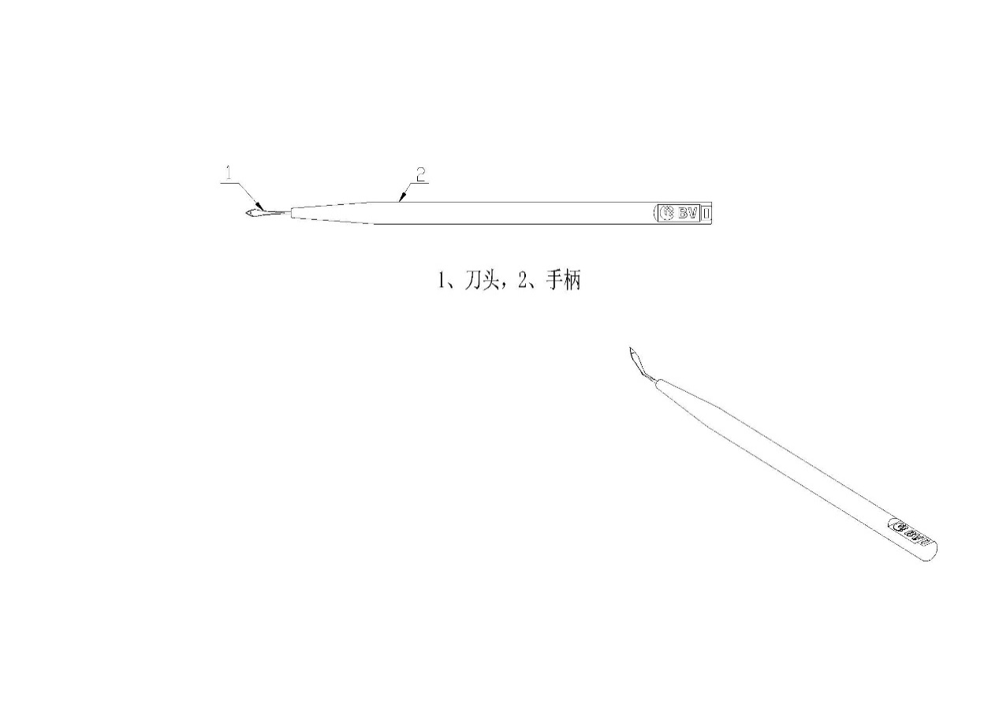

（1）一次性使用无菌眼科手术刀——无保护壳（护鞘）

1.刀头 2、保护套 3手柄 4、推杆

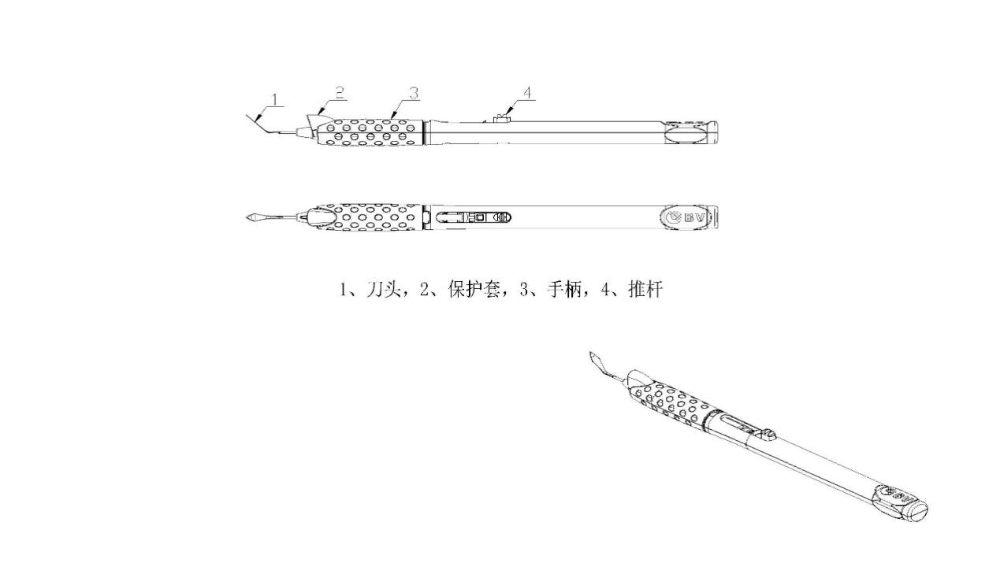

（2）一次性使用无菌眼科手术刀——有保护壳（护鞘）

隧道刀                       侧切刀

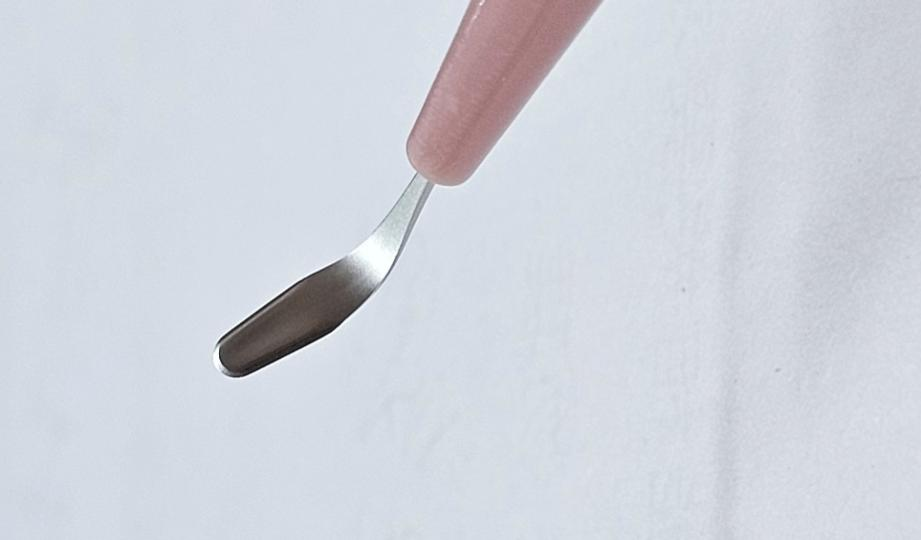

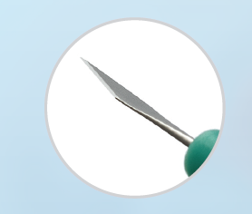

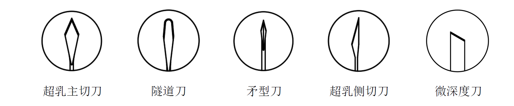

主切刀                          矛型刀

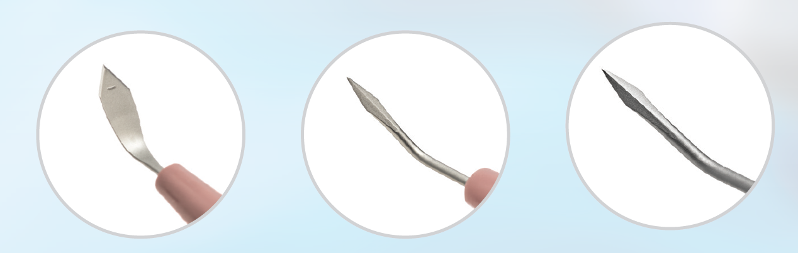

（3）常见眼科手术刀——刀头形状

（4）眼用钩

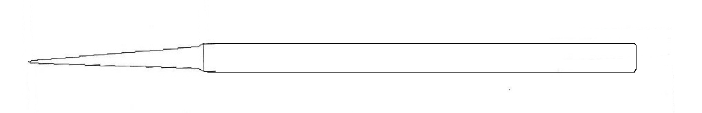

（5）泪点扩张器

（6）眼用冲吸器

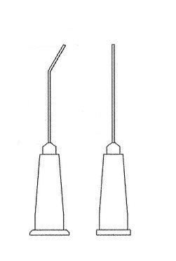

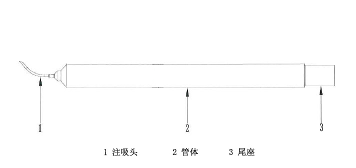

（7）眼用钻

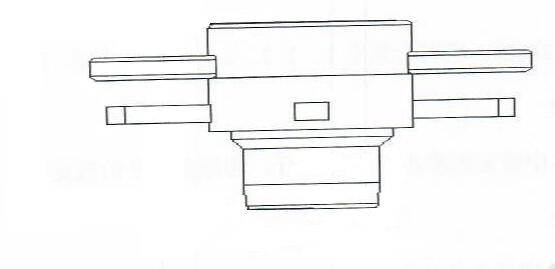

（8）眼用针（双头式样）

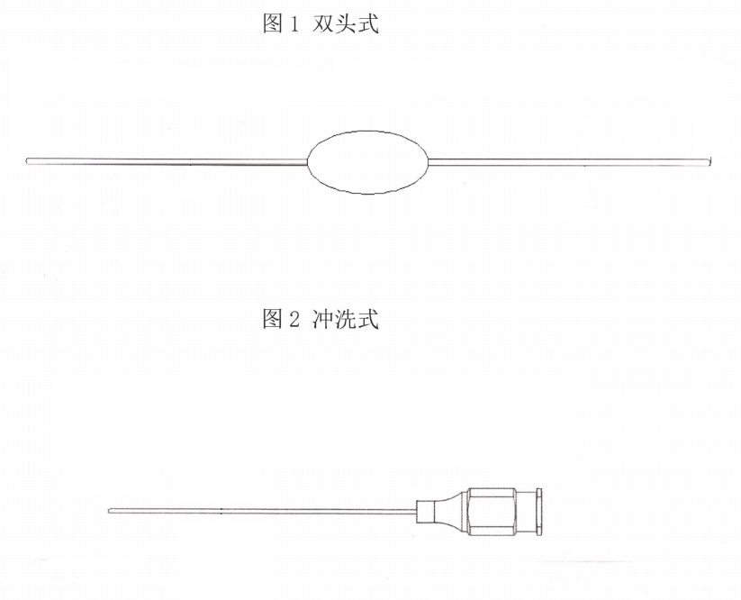

（9）眼用剪

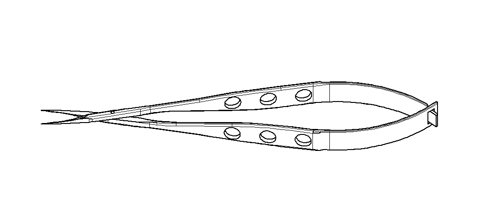

(10)眼用镊

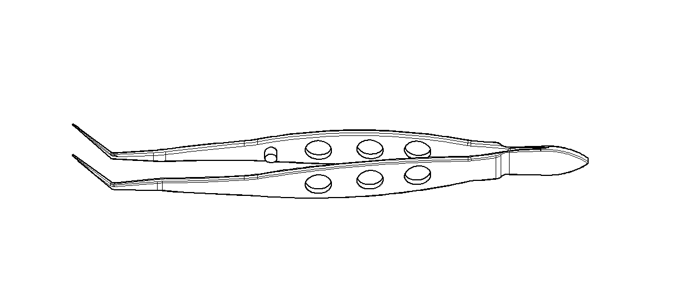

（二）综述资料

1.器械及操作原理描述

1.1提供产品各型号的几何结构外形图，充分描述产品结构信息。结构组成需提供所含组件描述、选用材料、材料牌号信息、交付状态、一次性使用信息。

表1 建议的结构组成描述

| 产品类别 | 结构组成 |
| --- | --- |
| 眼用刀 | 通常由刀片、刀柄等部件组成 |
| 眼用剪 | 通常由一对中间连接的叶片组成，头部有刃口 |
| 眼用镊 | 通常由一对尾部叠合的叶片组成 |
| 眼用钩 | 通常由头部和杆部组成，头部带钩头 |
| 眼用扩张器 | 通常由扩张器、导入头和导入器组成 |
| 眼用冲吸器 | 通常由注吸头、管体和尾座组成 |
| 眼用钻 | 通常由柄部和头部组成，头部为环状 |
| 眼用针 | 通常由针头和固定器组成。针头为弯形，头端呈尖钉状 |

1.2申报资料中需明确相关材料牌号/商品名及符合的标准。

1.3提供器械的关键尺寸信息如长度、宽度、角度，体现产品设计特征的尺寸及公差。

1.4明确各型号产品的划分依据。

1.5提供产品工作原理/作用机理。

1.6提供产品结构及关键尺寸的设计依据。

1.7产品列表

以表格形式列出拟申报产品的型号、规格、结构及组成，以及每个型号规格的标识和描述说明（如尺寸、材质等）

2.产品的适用范围、适用人群、禁忌证

2.1应当描述申报产品的适用范围，明确预期用途。

表2 产品类别与用途

| 产品类别 | 预期用途 |
| --- | --- |
| 眼用刀 | 用于切割眼组织。 |
| 眼用剪 | 用于剪切眼组织。 |
| 眼用镊 | 用于夹持眼组织。 |
| 眼用针 | 用于探、拨、挑和刺眼组织 |
| 眼用钩 | 用于钩拉眼组织。 |
| 眼用扩张器 | 用于扩张和支撑眼组织。 |
| 眼用冲吸器 | 用于冲洗眼组织或吸液。 |
| 眼用钻 | 用于切割眼组织。 |

2.2.适用人群

明确目标患者人群的信息，如需进行眼部手术或检查的患者/人群。

2.3.禁忌证

应当明确说明该器械不适宜应用的特定人群或特定情况等信息。如对该产品所用不锈钢及塑料材料过敏者禁止使用。

3.包装说明

提供产品的包装信息，应包括包装形式、包装材料、包装工艺、包装原材料供应商信息以及无菌屏障系统等信息。明确最小销售单元内包含的产品数量及其中每一独立产品或配件的包装形式。必要时，可提供图示及照片进行说明。

4.研发历程

阐述申请注册产品的研发背景和目的。如有参考的同类产品或前代产品（如有），应当提供同类产品或前代产品的信息，并说明选择其作为研发参考的原因。

5.与同类和/或前代产品比较

列表比较说明申报产品与同类产品和/或前代产品在工作原理、结构组成、制造材料、性能指标、作用方式、灭菌方式以及适用范围等方面的异同。

6.预期使用环境

预期使用环境为医疗机构。

（三）非临床研究资料

1.产品的风险管理资料

应依据GB/T 42062《医疗器械 风险管理对医疗器械的应用》提供产品风险管理报告。注册申请人应重点说明：申报产品的研制阶段已对有关可能的危害及产生的风险进行了估计和评价，针对性地实施了降低风险的技术和管理方面的措施。产品性能测试对上述措施的有效性进行了充分验证，达到了相关标准的要求。注册申请人对所有剩余风险进行了评价，全部达到可接受的水平。产品风险分析资料应为注册申请人关于产品安全性的承诺提供支持。应对申报产品的可能危害进行判定并列出清单。产品在进行风险分析时至少应包括以下的主要危害（见附表3），还应根据自身产品特点确定其他危害。

2.医疗器械安全和性能基本原则清单

应结合申报产品自身特点说明申报产品符合《医疗器械安全和性能基本原则清单》各项适用要求所采用的方法，以及证明其符合性的文件。对于《医疗器械安全和性能基本原则清单》中不适用的各项要求，应当说明理由。

对于包含在产品注册申报资料中的文件，应当说明其在申报资料中的具体位置；对于未包含在产品注册申报资料中的文件，应当注明该证据文件名称及其在质量管理体系文件中的编号备查。

3.产品技术要求及检验报告

产品技术要求需符合相关国家标准、行业标准和有关法律、法规的相应要求。在此基础上，注册申请人需根据产品的技术特征和临床使用情况，制定保证产品安全、有效的技术要求。产品技术要求中试验方法需依据有关国家标准、行业标准、国际标准制订，或试验方法经过验证。

3.1产品型号/规格及其划分的说明

列表说明产品的型号、规格，明确产品型号、规格的划分说明。需包含以下产品相关信息：

3.1.1明示产品的组成、各组成部分的材料牌号/商品名及符合的国家标准、行业标准、国际标准，如GB/T20878、GB/T3621、YY/T 0806、YY/T0294.1等。

3.1.2提供各型号产品的结构图并标识关键尺寸。

3.1.3提供产品关键尺寸信息，如长度、宽度、角度等。

3.2性能指标

产品技术要求的主要性能指标需包括以下适用内容：

3.2.1外观

表面应光滑，应无非设计预期的锋棱、裂纹、毛刺等。器械叶片应相互吻合，不得有错位、摇晃现象，刃口不得有缺齿、烂齿、毛齿等缺陷，刃面不得有卷刃、崩刃现象。

3.2.2尺寸和公差

应标称器械的工作尺寸：如长度、宽度、角度等。尺寸允许公差参照GB/T 18457、YY/T 0981标准的相关条款制定。

3.2.3表面粗糙度

器械的表面粗糙度，可参照YY/T 0180、YY/T 0072、YY/T 1015、YY/T 0295.1相关要求制定。

3.2.4连接牢固度

适用于有连接部件的产品，如针体与针柄、刀片与刀柄、注吸头和管体等。器械各连接部位应充分紧密，无松动现象。

3.2.5硬度

器械的硬度要求，由制造商依据产品使用特点设定。3.2.6耐腐蚀性能

器械的不锈钢材料耐腐蚀性能应符合YY/T 0149、GB/T 18457的规定。其他材料用说明书中指定的最不利的灭菌方法灭菌后，应无腐蚀现象。

3.2.7开合性能

预期用于抓取、分离、夹持等操作的可开合的器械，应开合顺利，开合时应无干扰使用的晃动。

3.2.8锋利度

预期用于剪切或切割操作的器械，如眼用刀、眼用剪、眼用钻等器械，应对其刃面的锋利度进行要求。

3.2.9夹持性能

预期用于抓取、分离、夹持等操作的眼科器械，如眼用镊，应对其夹持性能进行要求。

3.2.10韧性（如适用）

器械的不锈钢材料韧性能应符合GB/T 18457的要求。

3.2.11通畅性

预期用于冲洗眼组织或吸液的眼用注吸冲洗器，内孔应畅通，不得有堵塞现象。

3.2.12穿刺力

预期用于穿刺操作的器械，应对其头部的穿刺力进行要求。

3.2.13化学性能（如适用）

如重金属含量、酸碱度、易氧化物等。

3.2.14细菌内毒素

预期与眼内组织直接或间接接触的器械应制定细菌内毒素限制要求。

3.2.15无菌

3.2.16若灭菌使用的方法涉及出现残留，需对允许的残留量进行规定，如环氧乙烷残留量。

3.3.17.其他（如适用）

为了保证器械安全有效而设定的其他性能，如护鞘滑动性、操作性能、配合使用性能等。

3.3检验方法

产品的检验方法需根据技术性能指标设定，检验方法需优先采用公认的或已颁布的标准检验方法；自建检验方法需提供相应的方法学依据及理论基础，同时保证检验方法具有可操作性和可重现性，必要时可附相应图示进行说明，文本较大的可以附录形式提供。

3.4产品检验报告

检验报告可以是注册申请人出具的自检报告，或委托有资质的医疗器械检验机构出具的检验报告。若提供自检报告，应按照《医疗器械注册自检管理规定》的要求提供相关资料。

同一注册单元中典型产品是指能够代表本注册单元内其他产品安全性和有效性的产品，其功能最齐全，结构最复杂，风险最高。

典型产品的确定可以通过比较同一注册单元内所有产品的技术结构、性能指标和预期用途等相应资料，说明能够代表本注册单元内其他产品的安全性和有效性。

4.研究资料

4.1产品性能研究

应当提供产品性能研究资料以及产品技术要求的研究和编制说明，包括有效性、安全性指标的确定依据、所采用的标准或方法、采用的原因及理论基础等。

4.2生物学特性研究

一次性无菌眼科无源手术器械产品与人体组织接触，应按照相关标准（GB/T 16886）对产品进行全面的生物学评价，并提交生物学评价报告证明其安全性。在进行生物学评价过程中，应明确一次性无菌眼科无源手术器械产品与人体接触组件或部位的材料性质。生物学评价终点的选择通常包括细胞毒性、致敏反应、刺激或皮内反应、材料介导的致热性、急性全身毒性。如器械符合GB/T 16886.1中瞬时接触医疗器械要求，通常不需要生物相容性试验，创新功能设计新产品，新材料除外。

4.3灭菌工艺研究

注册申请人应提交灭菌工艺研究资料。一般包括但不限于以下内容：

4.3.1灭菌场地的描述，主要包括生产企业自行灭菌或委托灭菌。

4.3.2灭菌方法的描述，需要达到的无菌保证水平。

4.3.3灭菌工艺的参数（如湿热灭菌的温度、压力、暴露时间等；干热灭菌温度、暴露时间或传送速度等；环氧乙烷灭菌的环氧乙烷浓度、时间、温度、湿度、压力等；辐射灭菌的辐射剂量等）。

4.3.4灭菌设备的描述。

4.3.5灭菌样品的选择及对申报产品的代表性依据。

4.3.6采用环氧乙烷灭菌，应指明器械上该灭菌剂及其衍生物的残留量。

4.3.7采用湿热灭菌或环氧乙烷灭菌或辐射灭菌的，确认报告应符合GB 18278.1、GB 18279.1、GB 18280.1。

4.3.8申报资料中还应该指明采用的相关的国家和行业标准，若有不适用条款应阐明不适用的理由。

4.3.9应明确灭菌产品的包装形式以及灭菌适宜性（灭菌确认中应包含对包装的评价）还应该描述产品包装（无菌屏障系统）以及该包装如何维持器械的无菌性。

4.4产品稳定性研究

4.4.1货架有效期

应当提供产品货架有效期和包装研究资料，证明在货架有效期内，在生产企业规定的运输贮存条件下，产品可保持性能功能满足使用要求，并保持无菌状态。

产品货架有效期的验证可选择加速稳定性试验或实时稳定性试验，具体需根据产品特性选择验证方式。无论加速稳定性试验还是实时稳定性试验，注册申请人均需在试验方案中设定测试项目、测试方法及判定标准。货架有效期验证项目通常包括产品性能研究中与有效期密切相关的条款，加速老化研究的具体要求可参考YY/T 0681.1《无菌医疗器械包装试验方法 第1部分：加速老化试验指南》标准。

包装研究资料应包括封口试验以及包装材料对灭菌的适应性研究。可依据GB/T 19633、GB/T 4857系列标准对包装进行分析研究和评价。直接接触产品的包装材料的选择应至少考虑以下因素：包装材料的物理化学特性；包装材料与产品的适应性；包装材料与成型和密封过程的适应性；包装材料与灭菌过程的适应性；包装材料所能提供的物理、化学和微生物屏障保护；包装材料与标签系统的适应性。

提交包装验证报告，常见验证项目包括但不限于：包装完整性、封口强度和微生物屏障性能等。

4.4.2运输稳定性

在宣称的有效期内以及运输储存条件下，提供保持包装完整性的依据。企业需提交产品包装验证和运输验证资料。

需提交运输稳定性验证资料，可依据YY/T 0681.15、ASTM D4169、GB/T 4857系列标准等进行验证并提交运输稳定性验证资料，证明在规定的运输条件下，运输过程中环境条件不会对医疗器械的特性和性能造成不利影响。

4.5可用性研究

按照《医疗器械可用性工程注册审查指导原则》要求，中、低使用风险医疗器械可基于风险管理过程开展可用性工程生命周期质控工作，提交使用错误评估报告。若前期已开展可用性工程工作，亦可提交可用性工程研究报告，用于替代使用错误评估报告。

5.其他资料

一次性无菌眼科无源手术器械可参考《免于进行临床评价医疗器械目录》（以下简称目录）中的一次性无菌眼科无源手术器械免于进行临床评价，豁免情况不包括新材料、新作用机理、新功能的产品。注册申请人应当按照《列入免于临床评价医疗器械目录产品对比说明技术指导原则》的要求，从基本原理、结构组成、性能要求、适用范围等方面，证明产品的安全有效性。

临床评价资料

对于不符合《免于进行临床评价医疗器械目录》的一次性无菌眼科无源手术器械产品，应按照《医疗器械注册与备案管理办法》、《医疗器械临床评价技术指导原则》、《医疗器械临床试验质量管理规范》等要求提交临床评价资料。

1.同品种临床评价路径

在满足注册法规要求的前提下，可按照《医疗器械临床评价等同性论证技术指导原则》进行境内已上市同品种产品的对比、分析、评价，并按照《医疗器械注册申报临床评价报告技术指导原则》要求的内容和格式出具评价报告。

2.临床试验路径

临床试验需按照《医疗器械临床试验质量管理规范》开展，提交完整的临床试验资料。临床试验的设计可参考《医疗器械临床试验设计指导原则》，根据注册申请人宣称的申报产品适用范围开展。

（五）产品说明书和标签样稿

产品说明书、标签和包装标识应符合《医疗器械说明书和标签管理规定》的相关要求，建议参照YY/T 0466.1《医疗器械 用于制造商提供信息的符号 第1部分：通用要求》相关标准制定说明书及标签内容，同时还应注意以下几点（不限于此）：

1.应明确临床使用方法和步骤。

2.应当注明灭菌方式、“无菌”字样或符号。

3.注明产品主要原材料，应有对材料过敏者禁止使用的提示。

4.使用前检查初包装是否完好，如有破损，禁止使用。

5.应标明产品的货架有效期，严禁使用超过货架有效期的产品；明确产品存储条件。

6.应明确产品一次性使用，严禁重复使用。

7.明确针对产品特点的特殊注意事项、警示信息、可能的不良事件及处理措施等。

8.按医疗垃圾处理的要求：使用后依据当地法规要求，按照医疗垃圾进行处理，不得随意丢弃。

9.本产品应由专业的医护人员使用，使用前请阅读全部说明。

10.根据使用目的，选择适宜的型号，使用时遵循通常的手术程序。

11.应在无菌操作下取出产品。

12.由于产品头部尖锐，在使用时务必格外小心，如果不注意会引发外伤事故，被污染的产品有可能引起血液性传播疾病。

（六）质量管理体系文件

质量管理体系文件应符合国家药品监督管理局《关于公布医疗器械注册申报资料要求和批准证明文件格式的公告》中对质量管理体系文件的要求。

三、参考文献

[1]中华人民共和国国务院.医疗器械监督管理条例:中华人民共和国国务院令第739号[Z].

[2]国家市场监督管理总局.医疗器械注册与备案管理办法:国家市场监督管理总局令第47号[Z].

[3]国家药品监督管理局.医疗器械注册申报资料要求和批准证明文件格式:国家药监局公告2021年第121号[Z].

[4]国家食品药品监督管理总局.医疗器械注册单元划分指导原则:总局通告2017年第187号[Z].

[5]国家食品药品监督管理总局.医疗器械分类目录:国家食品药品监督管理总局公告2017年第104号[Z].

[6]国家药品监督管理局.医疗器械安全和性能基本原则清单:国家药监局公告2021年第121号[Z].

[7]国家药品监督管理局.医疗器械产品技术要求编写指导原则:国家药监局公告2022年第8号[Z].

[8]国家药品监督管理局.医疗器械注册自检管理规定:国家药监局公告2021年第126号[Z].

[9]国家食品药品监督管理总局.医疗器械生物学评价和审查指南:国家食品药品监督管理总局通知2007年第345号[Z].

[10]国家药品监督管理局.列入免于临床评价医疗器械目录产品对比说明技术指导原则:国家药监局通告2021年第73号[Z].

[11]国家药品监督管理局.关于发布免于进行临床评价医疗器械目录的通告2025年第19号[Z].

[12]国家药品监督管理局.医疗器械临床评价技术指导原则:国家药监局通告2021年第73号[Z].

[13]国家食品药品监督管理总局.医疗器械说明书和标签管理规定:国家食品药品监督管理总局令第6号[Z].

[14]中华人民共和国药典（2025版）[S].

[15]GB 18280.1-2015,医疗保健产品灭菌 辐射 第1部分医疗器械灭菌过程的开发、确认和常规控制要求[S].

[16]GB 18279.1-2015,医疗保健产品灭菌 环氧乙烷第1部分：医疗器械灭菌过程的开发、确认和常规控制的要求[S].

[17]GB 15810-2019,一次性使用无菌注射器[S].

[18]GB 4857,包装 包装运输件系列标准[S].

[19]GB 18278.1-2015,医疗保健产品灭菌 湿热 第1部分：医疗器械灭菌过程的开发、确认和常规控制要求[S].

[20]ASTM F899-2020,外科器械用锻造不锈钢 [S].

[21]GB/T 19633,最终灭菌医疗器械包装系列标准[S].

[22]GB/T 16886,医疗器械生物学评价系列标准[S].

[23]GB/T 42062-2022,医疗器械风险管理对医疗器械的应用[S].

[24]GB/T 3621-2022,钛及钛合金板材[S].

[25]GB/T 20878-2024,不锈钢 牌号及化学成分[S].

[26]GB/T 1220-2007,不锈钢棒[S].

[27]GB/T 18457-2024,制造医疗器械用不锈钢针管要求和试验方法[S].

[28]YY/T 0681,无菌医疗器械包装试验方法系列标准[S].

[29]YY/T 0698,最终灭菌医疗器械包装材料系列标准[S].

[30]YY/T 1437-2023,医疗器械 GB/T 42062应用指南[S].

[31]YY/T 0466.1-2023,医疗器械 用于制造商提供信息的符号 第1部分：通用要求.[S].

[32]YY/T 0615.1-2007,标示无菌医疗器械的要求 第1部分：最终灭菌医疗器械的要求[S].

[33]YY/T 0806-2010,医用输液、输血、注射及其他医疗器械用聚碳酸酯专用料[S].

[34]YY/T 0072-2010,眼用刀通用技术条件[S].

[35]YY/T 0176.9-2011,眼用剪[S].

[36]YY/T 1015-2016,眼用持针钳[S].

[37]YY/T 0806-2010,医用输液、输血、注射及其他医疗器械用聚碳酸酯专用料[S].

[38]YY/T 0294.1-2024,外科器械 材料 第1部分：金属材料[S].

[39]YY/T 0981-2016,一次性使用五官冲洗器[S].

[40]YY/T 0819-2010,眼用镊[S].

[41]YY/T 0180-2013,眼脸拉钩[S].

[42]YY/T 0295.1-2005,医用镊通用技术条件[S].

[43]YY/T 0149-2006,不锈钢医用器械耐腐蚀性能试验方法[S]

附录

表3  产品主要危险（源）

| 危险（源） | 危险（源） | 危险（源）的形成因素 | 可能的后果 |
| --- | --- | --- | --- |
| 生物学危险（源） | 生物污染 | 生产环境控制不好； 产品原材料受到污染； 灭菌操作不严格； 包装破损； 使用时操作不规范 | 产品带菌、引起患者感染 |
| 生物学危险（源） | 生物不相容性 | 与眼组织接触的材料，不具有良好的生物相容性 | 使用中产生细胞毒性、致敏反应等 |
| 生物学危险（源） | 再感染和（或）交叉感染 | 使用不当、标识不清 | 引起感染、交叉感染 |
| 机械力 | 锋棱、裂纹、毛刺 | 与眼组织接触的部分存在锋棱、裂纹、毛刺等 | 对患者造成意外伤害 |
| 环境危险（源） | 储存或运行偏离预设的环境条件 | 储运条件（如温度、湿度、臭氧/紫外线、有机溶剂）不符合要求 | 产品老化、无菌有效期缩短 |
| 环境危险（源） | 意外的机械破坏 | 储运、使用过程中发生意外的机械性破坏 | 产品使用性能无法得到保证 |
| 环境危险（源） | 由于废物和（或）医疗器械处置的污染 | 使用后的产品没有按照要求集中销毁 | 造成环境污染或者细菌的交叉感染 |
| 与医疗器械使用有关的危险（源） | 不适当的标记 | 标记不清晰、错误、 没有按照要求进行标记 | 错误使用 储存错误 产品辨别错误 |
| 与医疗器械使用有关的危险（源） | 操作不熟练 | 由不熟练/未经培训的人员使用；操作不熟练、操作失误 | 无法保证使用安全性、造成眼组织损伤，出血、穿孔 |
| 与医疗器械使用有关的危险（源） | 不适当的操作说明，如： （1）和医疗器械一起使用的附件操作说明不适当； （2）预先检查操作说明不适当 | 包装破损无法识别 操作要点不突出 与其他器械匹配的关键参数标记不正确；与其他器械匹配的关键尺寸偏差超出标准要求。 | 无法保证使用安全性 |
| 与医疗器械使用有关的危险（源） | 对副作用的警告不充分 | 对操作人员警示不足 | 重复使用； 二次灭菌； 使用者出现过敏、刺激反应 |
| 与医疗器械使用有关的危险（源） | 对一次性使用医疗器械很可能再次使用的危害警告不适当 | 重复使用 | 交叉感染 破损、断裂 |
| 功能性失效和老化引起的危险（源） | 对医疗器械寿命终止缺少适当的决定 | 没有标识产品有效期 | 超出有效期的产品被使用，造成细菌感染或因材料老化导致产品性能不符合要求 |
| 功能性失效和老化引起的危险（源） | 缺少适当使用前检查，失去产品的完整性 | 说明书中没有提供相关信息，如灭菌方法、使用前的检查建议，产品破损 | 造成产品意外损坏，产品提前报废，无法保证使用有效性 |
| 功能性失效和老化引起的危险（源） | 不适当的包装（医疗器械的污染和/或变质） | 没有进行包装确认 | 不能确保产品无菌，从而导致出现细菌感染 |
