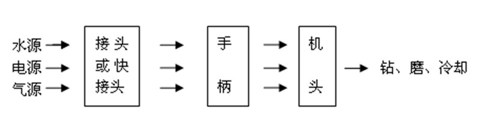
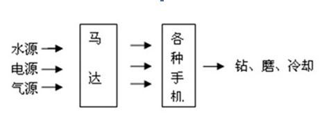
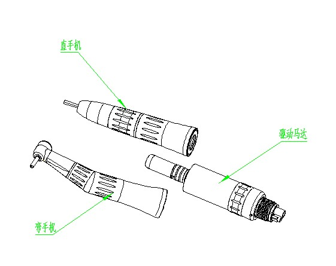
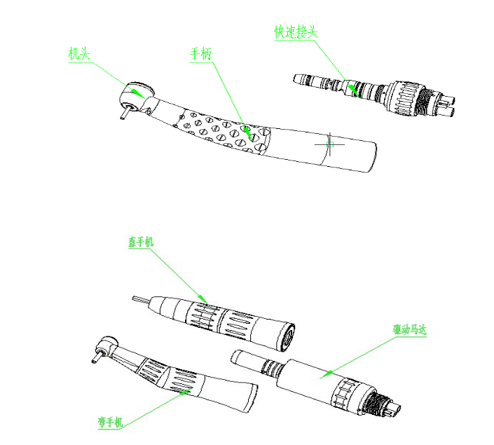

# 牙科手机注册审查指导原则（2026年修订版）

牙科手机注册审查指导原则

（2026年修订版）

本指导原则旨在指导注册申请人对牙科手机注册申报资料的准备及撰写，同时也为技术审评部门审评注册申报资料提供参考。

本指导原则是对牙科手机的一般要求，申请人应依据产品的具体特性确定其中的内容是否适用。若不适用，需具体阐述其理由及相应的科学依据，并依据具体的产品特性对注册申报资料的内容进行充实和细化。

本指导原则是供注册申请人和技术审评人员使用的指导性文件，但不包括注册审批所涉及的行政事项，亦不作为法规强制执行，应在遵循相关法规的前提下使用本指导原则。如果有能够满足相关法规要求的其他方法，也可以采用，但是需要提供详细的研究资料和验证资料。

本指导原则是在现行法规和标准体系以及当前认知水平下制定的，随着法规和标准的不断完善，以及科学技术的不断发展，相关内容也将适时进行调整。

一、适用范围

本指导原则适用于口腔治疗设备中的牙科手机产品注册。按现行《医疗器械分类目录》，该类产品分类编码为17-03-04，管理类别为Ⅱ类。

本指导原则适用于高速气涡轮手机、牙科直手机/牙科弯手机，不包含洁牙手机。与电动马达/气动马达合体的一体式设备中的牙科手机部分和一次性使用牙科手机可参照本文准备申报资料。

二、注册审查要点

（一）监管信息

1.注册单元划分

注册单元划分应符合《医疗器械注册单元划分指导原则》的要求，原则上以产品的技术原理、结构组成、性能指标和适用范围为划分依据。

举例如下：

（1）高速气涡轮手机与由马达驱动的牙科弯手机/牙科直手机应划分为不同的注册单元。

（2）牙科弯手机与牙科直手机应用于不同预期用途时，应划分为不同的注册单元，如：夹持根管锉用于扩大牙齿根管的手机、用于口腔种植治疗的手机、用于牙齿钻孔打磨用的手机。

2.产品名称

产品命名需符合《医疗器械通用名称命名规则》的要求。

若牙科手机的申报组成中包含牙科弯手机和牙科直手机，应使用“牙科手机”作为注册产品名称；若牙科手机仅为单独的牙科弯手机或牙科直手机，应使用“牙科弯手机”或“牙科直手机”作为注册产品名称。申报高速气涡轮手机应规范使用“高速气涡轮手机”作为产品名称。

（二）综述资料

1.概述

申请人需描述产品的通用名称及确定依据、适用范围。如适用，申请人应提供产品的背景信息概述，如：申报产品的历史概述、历次提交的信息，与其他经批准上市产品的关系等。

2.产品描述

申请人应描述产品的工作原理、结构及组成、主要功能及其组成部件的功能、产品图示，以及区别于其他同类产品的特征等内容。含有多个组成部分的，应说明其连接或组装关系。

2.1工作原理

牙科手机是一种口腔治疗器械，由整体或成套相互关联的器械部件所组成。

电流、压缩空气分别经过电路系统、气路系统的各控制装置到达机头，驱动光源、涡轮（或叶片）旋转（轴芯转动），从而带动车针旋转，达到钻、削牙的目的，另一路水和气经过内部管道到达机头汇合达到冷却目的。其工作原理见图1、图2。

图1 高速气涡轮机手机工作原理示意图

图2 牙科直手机/弯手机工作原理示意图

因该产品为非直接治疗类医疗器械，故本指导原则不包含产品作用机理的内容。

应结合产品功能，具体阐述实现临床功能的工作原理，如动力源、驱动运动的技术原理，应包括整体或成套相互关联的器械部件。

2.2结构组成

牙科手机是用于向牙科工具或器具传递（带转换或不带转换）工作所需能量的手持工具。其根据主轴与被夹工具或器具的角度，分为直手机和弯手机，若主轴与被夹工具或器具重合则为直手机，若其输入轴与输出轴之间具有角度则为弯手机；根据动力源和转化方式的不同又区分为马达驱动的手机和高速气涡轮手机；根据照明方式的情况又分为带照明光源式、无照明光源式和导光式三种方式，其中导光式是指结构不含照明光源，但是含有导光装置，可通过传导提供照明，如可弯曲的导光纤维束（玻璃或石英）。

牙科手机一般由机头、手柄、接头或快速接头（若有）组成，直/弯手机的结构示意图如下：

图3 牙科直手机/弯手机整体结构示意图

图4 高速气涡轮机手机整体结构示意图

申请人需要对牙科手机总体结构，各组成部件进行详细描述，建议提供清晰的图示，标明机头、手柄、接头等关键部位，再对各关键部位进行详细描述。

机头：说明夹持方式、夹头形式、气体通道设计、冷却通道设计、照明集成方式等；针对高速气涡轮手机，描述其内部涡轮结构情况；针对直/弯手机，描述动力传动机构，如齿轮组情况。

手柄：说明材质、内部管道布局，密封设计等。

接头：明确接头类型和接口的孔数以及各孔对应的功能，如驱动气、冷却水、回气等。

若含有其他集成功能，需详细描述结构组成及其部件功能。

2.3型号规格

对于存在多种型号规格的产品，应当明确各型号规格的区别。应当采用对比表或带有说明性文字的图片、图表，描述各种型号规格的结构组成（或配置）、功能、产品特征和运行模式、技术参数等内容。

2.4包装说明

应说明产品的包装信息，如包装材料、用途等，如有多层包装应分别描述，并提供各层包装的图示。说明如何确保最终使用者可清晰地辨识包装的完整性。

2.5研发历程、与同类和/或前代产品的参考和比较

阐述申请注册产品的研发背景和目的。若申报产品有同类产品和/或前代产品，申请人应说明相关的背景情况，提供同类产品和/或前代产品的上市情况说明。列表比较申报产品与同类产品和/或前代产品在工作原理、结构组成、制造材料、性能指标、作用方式以及适用范围等方面的异同，并重点说明申报产品的新功能、新应用、新特征。

3.适用范围和禁忌证

提供申报产品的适用范围、预期使用环境、适用人群、禁忌证，并与说明书等资料中信息保持一致。

产品一般用于夹持车针、牙钻、牙锉等旋转器械，驱动其运动从而实现切、磨、削、钻等牙科手术操作。申请人根据产品实际夹持情况和临床用途进行描述。

举例：适用于医务人员在口腔治疗过程中，用来夹持牙科车针进行钻、磨和切削牙齿用。

禁忌证：

（1）血友病患者慎用。

（2）带有心脏起搏器的患者或医生慎用电动马达驱动手机。

（3）心脏病患者、孕妇及幼儿慎用。

其他禁忌证可根据临床使用的实际情况制定。

4.申报产品上市历史

如适用，应提供申报产品在各国家或地区的上市批准时间、销售情况。

如适用，应提供申报产品上市后不良事件及召回情况，如不良事件及召回情况描述、原因分析、处理和解决方案、对安全有效性影响的分析评价等。

5.其他需说明的内容

申请人需明确与牙科手机联合使用实现预期用途的其他产品的详细信息，如配合使用的马达、被夹持产品等。

对于已获得批准的部件或配合使用的附件，申请人需提供注册证编号和国家药监局官方网站公布的注册证信息。

（三）非临床资料

1.产品风险管理资料

申请人可参考GB/T 42062及YY/T 1437标准对产品进行全生命周期风险管理，提交风险管理资料。

建议参考GB/T 42062标准及规范性文件，结合产品自身设计特点、临床用途及使用场景，充分识别与安全有关的特征，进行风险分析、评价及控制。风险控制的方案与实施、综合剩余风险的评价可参考GB/T 42062标准第7、第8章的相关要求。应确保各风险的可追溯性，提供各风险及综合剩余风险的可接受准则，确认各风险及综合剩余风险可接受。

牙科手机风险要素及示例见附件1。

2.医疗器械安全和性能基本原则清单

注册申请人可参考《医疗器械安全和性能基本原则符合性技术指南》编写该清单。对于《医疗器械安全和性能基本原则清单》中不适用的各项要求，说明理由。

3.产品技术要求及检验报告

3.1申报产品适用标准情况

注册申请人需列表说明申报产品参考的国家标准和行业标准，可以参考下表示例。

表1牙科手机参考标准

| 标准编号 | 标准名称 |
| --- | --- |
| GB 9706.1 | 医用电气设备 第1部分：基本安全和基本性能的通用要求 |
| YY 9706.102 | 医用电气设备 第1-2部分：基本安全和基本性能的通用要求 并列标准：电磁兼容 要求和试验 |
| GB 9706.260 | 医用电气设备 第2-60部分：牙科设备的基本安全和基本性能专用要求 |
| YY 1045 | 牙科学 手机和马达 |
| YY/T 1012 | 牙科学 手机连接件联轴节尺寸 |
| YY/T 0514 | 牙科学 气动牙科手机用软管连接件 |

上述标准均宜执行适用的国家标准、行业标准的现行有效版本。

3.2产品技术要求

产品技术要求需按照《医疗器械产品技术要求编写指导原则》进行编写，同时结合表1中的产品适用的标准和产品本身的技术特点，明确产品的各项性能指标和检验方法。本指导原则列出了牙科手机可能涉及的主要性能指标，主要性能指标包括但不限于以下内容：

YY 1045中的通用要求：动力源、气压和水压、温度（高速涡轮手机不适用）、泄漏和/或进液、控制器、连接和供应（其中手机和马达的连接应符合YY/T 1012；若为快速连接器且其独立于软管，则快速连接器应符合YY/T 0514）、杆的夹头系统、转速、径向跳动、堵转扭矩（仅适用于高速气涡轮手机）、高速气涡轮输出功率（仅适用于高速气涡轮手机）、尺寸等。若手机含有照明光源，则其测量照度应至少为7000lx；若手机没有内部光源，但包含光传输元件，如导光束，则应满足在一个不超过65000lx的光源照射在光传输元件的输入端的条件下，输出端的光不得少于7000lx。

该标准中对于马达的相关要求为不适用，若存在其他不适用情况，应在申报资料中说明具体理由。

带电子元器件的牙科手机，如带独立照明装置，应符合GB 9706.1、YY 9706.102和GB 9706.260的要求，同时标准要求中已被上述强制性标准涵盖的项目，如超温、泄漏和/或进液等与电气安全相关的性能指标则无需在性能指标中体现。

若产品含独立照明装置，技术要求应按照《医疗器械光辐射安全注册审查指导原则》要求，明确所有光源的波长和最大输出要求（能量/功率等）的参数。

3.3检验报告

注册申请人应提供产品检验报告，产品检验报告可以是医疗器械注册申请人的自检报告，也可以是委托具有相应检验资质的医疗器械检验机构出具的检验报告。以自检报告形式提交注册的应符合《医疗器械注册自检管理规定》的要求。

典型产品应是同一注册单元内能够代表本单元内其他产品安全性和有效性的产品。考虑功能最齐全、结构最复杂、风险最高的产品。

注册单元内各种产品的主要结构及组成、性能指标不能被某一产品全部涵盖时，则应选择涵盖结构及组成、性能指标最多的产品作为典型产品，同时还应考虑其他产品中未被典型产品所涵盖的性能指标，并应对差异部分及由差异部分引起的其他相关安全性和有效性变化的部分进行注册补充检验。

牙科手机使用的关键件、基本原理、预期用途、主要技术性能指标相同，如仅外观不同，或配置附件的数量和种类不同，建议选取配置附件数量和种类最复杂的型号为典型产品。

（1）高速气涡轮手机应选取空载转速最大的产品作为检测的典型产品。

（2）牙科手机中的增速手机和减速手机应划分为不同的检测单元。增速手机应选取齿轮传送比最小的产品作为检测的典型产品，减速手机中应选取齿轮传送比最大的产品作为检测的典型产品。

4.研究资料

申请人需提供产品非临床研究综述，逐项描述所开展的研究，概述研究方法和研究结论。列表逐项说明产品性能指标条款的来源和制定依据。

4.1化学和物理性能研究

应当提供产品技术要求中化学/材料表征、物理和/或机械性能指标的确定依据、设计输入来源以及临床意义，所采用的标准或方法、采用的原因及理论基础。申请人结合配套的驱动源的情况，提供其驱动源最大转速的情况下，牙科手机转速的研究资料。

4.2电气系统安全性研究

若适用，应提供电气安全性及电磁兼容性的研究资料。

目前与牙科手机相关的常用标准为GB 9706.1、YY 9706.102、GB 9706.260。申请人还可根据产品自身特点引用其他相关的标准（国际标准、行业标准等）。若适用的强制性标准中有不适用的条款，还应说明不适用理由。

4.3联合使用

如申报产品预期与马达、牙科设备等联合使用，应当提供证明联合使用安全有效的研究资料，包括互联基本信息（连接类型、接口、最低性能）、联合使用风险及控制措施、联合使用上的限制，兼容性研究等。

4.4辐射安全研究（若适用）

应按照《医疗器械光辐射安全注册审查指导原则》的要求，提交光辐射安全研究资料。

4.5生物学特性研究

生物学评价报告应体现产品名称和型号，应考虑临床使用中牙科手机在口内操作，会与口腔内生理组织接触，因此应评价其生物学风险。申请人应描述直接或间接与组织接触的材料，以及在使用过程中与口腔黏膜组织接触的性质和时间，同时应考虑生产工艺及清洁灭菌对生物相容性的影响，考虑设计生产过程中可能引入的污染物、残留物、降解产物、加工残留物影响等。

根据GB/T 16886.1（或YY/T 0268）的分类要求，手机预期与人体口腔黏膜组织短期接触，属于表面接触器械。如需进行生物学试验，通常应考虑细胞毒性、致敏、刺激或皮内反应，若可能接触破裂或损伤表面的则不限于这三项。生物学评价报告应包括：生物相容性评价的依据和方法、所用材料的描述及与人体接触的性质、实施或豁免生物学试验的理由和论证、对于现有数据或试验结果的评价

4.6灭菌确认

手机应可耐受灭菌处理，并参照YY 1045的要求能够承受一定次数的灭菌循环，而无损坏现象。应提供该灭菌工艺（方法和参数）及其确定的依据。提供推荐的灭菌工艺有效性和耐受性的研究资料。

若产品经灭菌后可能产生残留物质，应当对灭菌后的产品进行残留毒性的研究，明确残留物信息及采取的处理方法，并提供相关研究资料。

4.7可用性研究

应参照《医疗器械可用性工程注册审查指导原则》，按照中使用风险医疗器械要求提交使用错误评估报告。

4.8证明产品安全性、有效性的其他研究资料。

5.稳定性研究

5.1使用稳定性

应当提供使用稳定性/可靠性研究资料，证明在规定的使用期限/使用次数内，在正常使用、维护和校准情况下，产品的性能功能满足使用要求。

牙科手机的使用期限可参照《有源医疗器械使用期限注册技术审查指导原则》的要求进行评价，如采用加速老化和/或实时老化的方式进行。

该产品为有限次重复使用产品，需在使用期限的基础上同时考虑使用次数的验证。使用次数可通过对产品多次模拟使用、清洁、灭菌后的灭菌耐受性研究进行评价。

试验后需对产品性能和电气安全（若适用）进行验证，证明产品的性能安全满足使用要求，应给出老化后测试的性能指标的确定依据，对于未测试的性能指标，应给出合理解释。

5.2运输稳定性

应提供运输稳定性和包装研究资料，证明生产企业规定的运输条件不会对产品的特性和性能造成不利影响。

运输稳定性研究通常提供模拟运输试验进行，通过模拟规定的运输贮存条件，验证包装对性能及安全的保护能力。运输试验开始前及结束后，应对产品关键功能性能及电气安全进行验证，应提供验证项目的选择依据。模拟运输试验可参考GB/T 4857系列标准的要求进行，也可参考相应的国际标准，如ASTM D4169等。运输贮存条件应与说明书中规定的条件一致。

5.3医用电气环境试验研究（若适用）

主要包括气候环境条件、机械环境条件，可参考GB/T 14710《医用电器环境要求及试验方法》及其他适用的国家标准和行业标准开展环境试验研究。

正常工作环境以产品标称为准，但需经相应环境试验验证。明确标识供电类型、电压。

6其他

该产品已列入《免于临床评价医疗器械目录》（以下简称“目录”），应按照《列入免于临床评价医疗器械目录产品对比说明技术指导原则》，提交申报产品相关信息与《目录》所述内容的对比资料和申报产品与已获准境内注册的《目录》中医疗器械的对比说明资料，应能证明申报产品与《目录》所述的产品具有基本等同性。

（五）产品说明书和标签样稿

应符合《医疗器械说明书和标签管理规定》及相关标准的要求。

1.说明书的内容

除符合《医疗器械说明书和标签管理规定》和相关标准中的要求之外，手机的说明书还应至少明确以下信息：

（1）明确牙科手机（含易损件如轴承、光导管，水路，气路等）的灭菌、维护、保养说明；明确灭菌周期的重要参数，例如时间、温度；明确干燥说明。

（2）明确夹持的手术器械类型（如车针）、规格、尺寸。

（3）若为气源驱动的手机，明确压缩空气的供气压力及基本要求。

（4）若带水冷却，明确水冷却方式（外给水、内给水），水源的压力及基本要求。

（5）在驱动马达的最大转速下，手机的空载转速。

（6）明确手机夹头形式、软管连接件类型（如适用，参照YY/T 0514进行明确）、联轴节类型。

（7）若带水冷却，明确水冷却方式（外给水/内给水），水源的压力及基本要求。

2.禁忌症、注意事项、警示及提示性说明

（1）应仔细阅读、理解说明书中全部内容方可操作。

（2）操作时应遵循仪器上的全部警示和说明。

（3）本产品是特为口腔治疗而制造，不能作为其他用途。

（4）本产品为高速旋转手机，使用时请注意安全。

（5）本产品仅限于专业口腔科医生使用。

（6）每次使用时，请预先在患者的口腔外进行运转检查。若发觉有松动、振动、杂音或发热等异常现象，请立即停止使用，并与原经销商联系。

（7）已损坏的手机机芯有可能会产生很高的噪音，长时间使用会影响听力，请及早更换。

（8）为免手机严重损坏，请避免手机受到撞击或不小心掉落。

（9）使用的车针应符合YY/T 0302.1的标准。使用车针时，必须了解车针的规定转速和规格是否符合本手机使用。使用弯曲、有裂纹、变形、已损坏及不符合规格的车针，可能会导致运转过程中突然折断、飞出等事故，造成伤害，以及损坏手机。

（10）气源、水源的压力和流量必须达到本机的要求。进气压力过高，会导致手机涡轮转速过高，而损坏轴承。

（11）可用通针疏通喷孔。

（12）产品储存和运输应在干燥、稳定（无摔碰）、远离酸碱等有害化学物质及气体的洁净的常温、常压、湿度小于90%的环境中。

（13）产品使用寿命末期光纤导光棒为玻璃制品，按玻璃制品环保要求处理，其余金属可进行分类回收处理，LED灯是电子产品应按《废弃电器电子产品回收处理管理条例》处理。

（14）本产品的维修需由专业人员负责。

（15）为确保手机的使用寿命，应使用干燥、洁净的压缩空气并定期维护空气压缩机及气、水过滤系统以保证压缩空气及水的质量，使用未过滤的水将导致管道接头的堵塞。

（16）车针夹持部分不可过短，否则轴承负荷不均，加快轴承磨损。

（17）请保持车针夹头的清洁，避免内部因存有污物而导致车针夹持力减弱或机芯振动。

（18）手机未装上车针时，不得通气旋转，否则将损坏轴承。

（19）请在旋转完全停止后，再进行车针或手机的装卸，切勿在旋转中按压机头盖。

（20）手机如是扭针式芯轴，不工作或长时间存放时，请预先清洗和上油，并装上车针或标准棒，如是按压式芯轴，请拆卸车针和标准棒，避免芯轴疲劳磨损。

（21）当手机表面沾有药品时，经高温消毒灭菌后，有可能致使手机表面镀层脱落或发黑，因此必须特别注意。

（22）端盖与手机头上的螺纹极为精细，打开时应先将扳手放在端盖适当的位置，对准后才扭动，以免损伤螺纹。

（23）在装入新机芯前，注意清洁手机机头内部。

（24）血友病患者慎用。

（25）带有心脏起搏器的患者或医生慎用电动马达驱动手机。

（26）心脏病患者、孕妇及幼儿慎用。

3.应当在说明书中明确重复使用的处理过程，包括清洁、消毒、包装及灭菌的方法和重复使用的次数或者其他限制。

（六）质量管理体系文件

1.应依据《关于公布医疗器械注册申报资料要求和批准证明文件格式的公告》（2021年第121号）要求提供质量管理体系核查文件。

2.若产品有多个研制、生产场地，应概述每个研制、生产场地的实际情况。

三、参考文献

[1]国家市场监督管理总局.医疗器械注册与备案管理办法:国家市场监督管理总局令第47号[Z].

[2]国家食品药品监督管理总局.医疗器械说明书和标签管理规定:国家食品药品监督管理总局令第6号[Z].

[3]国家药品监督管理局.医疗器械注册申报资料要求和批准证明文件格式:国家药监局公告2021年第121号[Z].

[4]国家药品监督管理局.医疗器械产品技术要求编写指导原则:国家药监局通告2022年第8号[Z].

[5]国家食品药品监督管理局.医疗器械分类目录:国家食品药品监督管理总局公告2017年第104号[Z].

[6]国家食品药品监督管理局.医疗器械通用名称命名规则：国家食品药品监督管理总局令第19号[Z].

[7]国家药品监督管理局.国家药监局关于发布医疗器械安全和性能基本原则的通告:2020年第18号 [Z].

[8]国家药品监督管理局医疗器械技术审评中心.关于发布医疗器械安全和性能基本原则符合性技术指南的通告:2022年第29号 [Z].

[9]国家药品监督管理局.国家药监局关于发布免于临床评价医疗器械目录的通告:2025年第19号 [Z].

[10] GB/T 42062,医疗器械 风险管理对医疗器械的应用[S].

[11]GB/ T 14710,医用电器环境要求及试验方法[S].

[12]GB/T 4857,包装 运输包装件系列标准[S].

[13]YY/T 0681,无菌医疗器械包装试验方法 系列标准[S].

[14]GB/T 16886.1,医疗器械生物学评价 第1部分：风险管理过程中的评价与试验[S].

[15]YY/T 0268-2008,牙科学 口腔医疗器械生物学评价 第1单元：评价与试验[S].

附件：1.产品风险管理资料关注点

附件1

产品风险管理资料关注点

风险管理报告应符合GB/T 42062《医疗器械风险管理对医疗器械的应用》以及适用的安全标准（如GB 9706.1、YY 9706.102、GB 9706.260等）及规范性文件的有关要求，审查要点包括：

1.1与安全有关的特性的识别可参考YY/T 1437标准附录A。确定与安全有关的特性应具有合理的可预见性，应从所有涉及人员的角度提出关于医疗器械的制造、预期用户、预期用途、合理可遇见的误使用和最终处置的问题，识别影响安全的医疗器械的特性和相关的危险；

1.2危险和危险情况的识别可参考GB/T 42062标准附录C；

1.3风险控制的方案、方案实施的验证、方案有效性的验证，及综合剩余风险的评价可参考GB/T 42062标准第7、第8章的相关要求；

1.4应提供采取风险控制措施前后的风险矩阵表，应包括综合剩余风险是否可接受的判定。

1.5识别出的基本性能及其识别过程。

依据GB/T 42062标准附录C列举了牙科手机有关的可能危险示例的不完全清单，如下，以帮助判定与牙科手机有关的危险。注册申请人还应根据自身产品特点确定其他可能危险。针对产品的各项风险，注册申请人应确定是否需要采取控制措施确保风险降到可接受的程度。

表2  牙科手机产品的主要危险

| 危险类型 | 示例 | 危险处境 | 损害 |
| --- | --- | --- | --- |
| 能量 | 能量 | 能量 | 能量 |
| 电场 磁场 | 设计不合理导致电磁场过大影响其他设备的运转。 在强电磁辐射源边使用影响设备的运转。 | 其他设备运转故障。 设备运转故障。 | 设备故障 |
| 热能 高温 | 转动部分性能不稳定可能导致摩擦高温。 | 设备温度太高而烫伤病人或操作者。 | 烫伤 |
| 机械能 重力 －坠落 －悬挂质量 振动 运动零件 患者的移动和定位 | 设计不合理，采购原料不合格，生产控制失控。如：手机夹持力不足或夹轴失效操作时发生车针脱落，车针折断现象。 | 错误的机械能或机械力施加到病人。 | 机械损伤 |
| 声能 －超声能量 －次声能量 －声音 | 设计不合理，采购原料不合格，生产控制失控。 | 噪音，超声。 | 噪音，超声损伤 |
| 生物学和化学 | 生物学和化学 | 生物学和化学 | 生物学和化学 |
| 细菌 病毒 其他微生物 | 生产环境和产品清洁未控制好导致管路受污染。 | 使用过程中细菌、病毒或其他微生物进入患者的体内。 | 细菌、病毒等感染 死亡 |
| 消毒、清洁 | 应用部件消毒不完全传染疾病。 | 交叉传染。 | 传染高致病性疾病 |
| 操作—功能 | 操作—功能 | 操作—功能 | 操作—功能 |
| 功能的丧失或变坏 | 零部件故障导致功能丧失。 | 使用时导致无法正常使用。 | 治疗失败 |
| 操作危害-使用错误 不遵守规则 缺乏知识 违反常规 | 错误的使用了产品； 损坏了产品。 | 使用时导致无法正常使用。 | 治疗失败 |
| 信息—标记 | 信息—标记 | 信息—标记 | 信息—标记 |
| 不完整的使用说明 性能特征的不适当的描述 | 1.标签设计错误； 2.标签使用错误。 | 给用户在使用、操作上误导，使用时导致无法正常使用。 | 治疗失败 |
| 不适当的预期使用规范 限制未充分公示 | 1.标签设计错误； 2.标签使用错误。 | 给用户在使用、操作上误导，使用时导致无法正常使用。 | 治疗失败 |
| 信息—操作说明书 | 信息—操作说明书 | 信息—操作说明书 | 信息—操作说明书 |
| 使用前检查规范不适当 | 操作说明中注意事项未写明或标注不明显； 使用已损坏的产品； 使用了受污染的产品。 | 使用时导致无法正常使用； 使用过程中细菌进入患者的体内。 | 治疗失败 细菌感染 |
| 信息—警告 | 信息—警告 | 信息—警告 | 信息—警告 |
| 副作用的警告 | 禁忌症的警告未写明或标注不明显； 违反禁忌症使用了产品。 | 患者因治疗发生意外。 | 治疗失败 |
