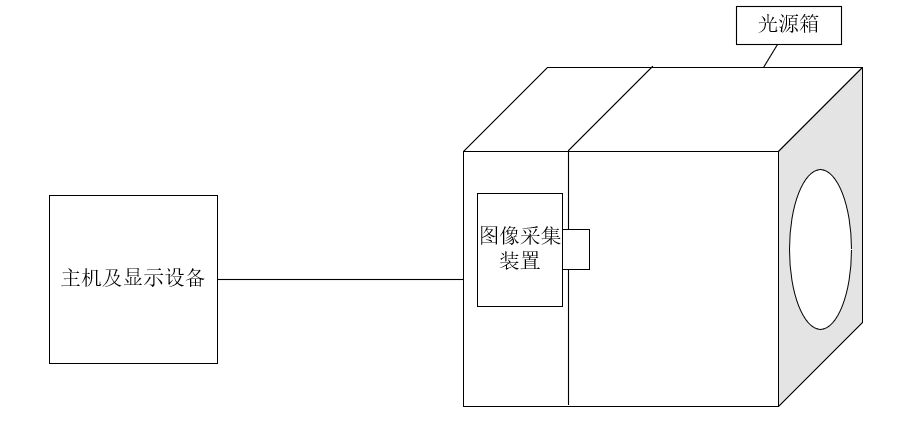
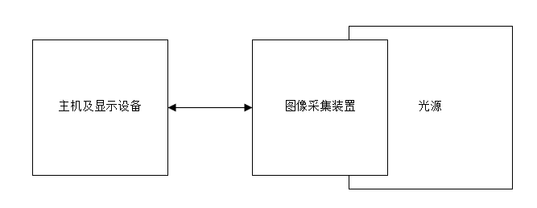
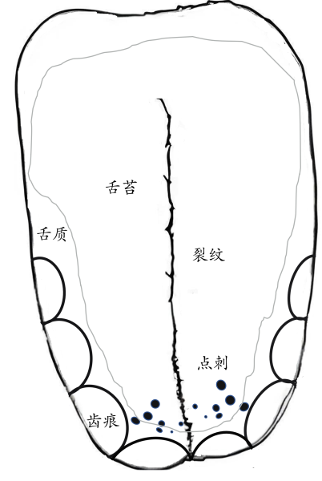

# 中医舌诊仪产品注册审查指导原则

本指导原则旨在指导注册申请人对中医舌诊设备注册申报资料的准备及撰写，同时也为技术审评部门审查注册申报资料提供参考。

本指导原则是对中医舌诊设备的一般要求，申请人应依据产品的具体特性确定其中内容是否适用。若不适用，需具体阐述理由及相应的科学依据，并依据产品的具体特性对注册申报资料的内容进行充实和细化。

本指导原则是供注册申请人和技术审评人员使用的指导性文件，但不包括审评审批所涉及的行政事项，亦不作为法规强制执行，应在遵循相关法规的前提下使用本指导原则。如果有能够满足相关法规要求的其他方法，也可以采用，但是需要提供详细的研究资料和验证资料。

本指导原则是在现行法规和标准体系以及当前认知水平下制定，随着法规和标准的不断完善，以及科学技术的不断发展，相关内容也将适时进行调整。

一、适用范围

本指导原则适用于中医舌诊设备。根据《医疗器械分类目录》，申报产品的管理分类为Ⅱ类，分类编码为20-01-02，通常由主机、图像采集装置和光源组成，通过图像采集装置获取舌象图像，并对采集到的图像进行分析。中医临床采集、存储舌象图像数据，计算舌象图像参数信息的设备可参考本指导原则执行。

二、注册审查要点

（一）监管信息

注册申请人（以下简称申请人）需要描述申报产品的管理类别、分类编码、产品名称的确定依据。

1.产品名称

产品的命名应符合《医疗器械通用名称命名规则》、《中医器械通用名称命名指导原则》和国家标准、行业标准上的通用名称要求。产品名称由一个核心词和不超过三个的特征词组成，如：“舌象信息采集设备”、“舌诊仪”。

2.分类编码

根据《医疗器械分类目录》，分类编码为20-01-02，管理类别为Ⅱ类。

3.注册单元划分的原则

注册单元划分应符合《医疗器械注册单元划分指导原则》的要求，原则上以申报产品的技术原理、结构组成和适用范围为划分依据。产品技术原理存在较大差异的应考虑划分为不同的注册单元。

（二）综述资料

1.产品描述

1.1设备的结构组成

中医舌诊设备通常包含主机、图像采集装置和光源。不同类型的舌诊产品可能包含：电脑主机、软件、显示设备，以及其他为实现中医舌象图像数据采集、存储、计算功能而配合使用的模块或部件。 产品典型结构示意图见图1。

图1 舌诊仪产品典型结构示意图

申请人应结合产品图示详细描述产品结构组成（含配合使用的附件）、主要功能及其组成部件（关键组件和软件）的功能，如：全部光源的参数信息（类型、波长、最大输出要求等）、图像采集装置的参数及定义信息、嵌入式软件及上位机软件（如有）的全部功能，包括分析的参数情况及临床意义、接口情况等，含有多个组成部分的，应说明其连接或组装关系。

1.2工作原理

中医舌诊设备在特定光源条件下，通过图像采集装置获取舌象图像，通过其他配合使用的模块实现对中医舌象图像存储、计算、分析等功能。

申请人应结合光源、图像采集装置和主机及显示设备详述申报产品工作原理。产品工作原理结构示意图详见图2。

图2 工作原理结构示意图

1.3型号规格

对于存在多种型号规格的产品，应当明确各型号规格的区别。应当采用对比表或带有说明性文字的图片、图表，描述各种型号规格的结构组成（或配置）、功能、产品特征和运行模式、技术参数等内容。

1.4包装说明

申请人应详细描述申报产品中注册单元所有产品组成的包装情况，说明包装清单和包装方式，提供包装图示。

1.5研发历程

应描述申报产品的研发背景和目的，如申报产品的研发历史概述、历次注册申请提交的信息。

1.6与同类和/或前代产品的参考和比较

对于研发参考的同类产品或前代产品，应说明选择其作为研发参考的原因。同时列表说明申报产品与研发参考产品在工作原理、结构组成、性能指标及适用范围等方面的异同。

区别于其他同类产品的特征是技术审评的关注点，如设备适用范围、结构组成、性能指标等。

2.适用范围和禁忌证

2.1适用范围

中医舌诊设备的预期用途应体现其临床应用范围。例如：用于中医舌象图像数据采集、特征分析。

2.1.1明确目标用户及其操作或使用该产品应当具备的技能/知识/培训，例如：操作者应具有相关中医专业从业资质，或者在具有中医专业从业资质的医师指导下使用。

2.2预期使用环境

预期使用环境的信息应当明确该产品预期使用的地点，还应明确可能影响其安全性和有效性的环境条件，如温度、湿度、压力、移动、振动、海拔等。

2.3适用人群与禁忌证

申请人应说明申报产品适用人群的标准。

中医舌诊设备禁忌证一般包括：

（1）严重光过敏者；

（2）采集装置原材料过敏者。

（三）非临床资料

1.产品风险管理资料

主要的风险包括生物学危害、环境危害、与使用有关的危害、软件危害、功能失效及老化有关的危害等，应按照GB/T 42062《医疗器械风险管理对医疗器械的应用》的要求对每种可能涉及的危害识别评估，为降低风险所执行风险控制，剩余风险的可接受性评定，产品受益相比综合评价，并形成风险分析管理报告。

同时，因申报产品含有光源，申请人应参照《医疗器械光辐射安全注册审查指导原则》对光辐射安全进行风险分析。

2.医疗器械安全和性能基本原则清单

参考《医疗器械安全和性能基本原则符合性技术指南》的要求，根据《医疗器械安全和性能的基本原则》中的各项要求明确适用性。对于不适用的要求，应当逐项说明不适用的理由。对于适用要求，应逐项说明为符合要求所采用的方法，以及证明其符合性的文件。

3.产品技术要求及检验报告

3.1申报产品适用标准情况

注册申请人需列表说明申报产品执行和参考的国家标准和行业标准。

3.2产品技术要求

注册申请人应按照《医疗器械产品技术要求编写指导原则》编写产品技术要求，结合申报产品的特点设置条款。

产品技术要求明确产品规格型号及划分说明，并应明确软件发布版本和软件完整版本命名规则。

产品技术指标可参考YY/T 1488《舌象信息采集设备》。

3.2.1光学要求。

3.2.1.1照度。

3.2.1.2相关色温。

3.2.1.3显色指数。

3.2.1.4特殊光谱。

3.2.1.5辐射照度。

3.2.1.6紫外辐射照度。

3.2.2成像质量。

3.2.2.1分辨率。

3.2.2.2彩色还原性

3.2.2.3相对畸变。

3.2.3结构要求。

3.2.4功能

3.2.5光源要求

含有光源的产品，应参照《医疗器械光辐射安全注册审查指导原则》明确所有光源的波长和最大输出要求（能量/功率等）。

3.2.6软件要求

对于包含软件组件的舌诊设备，应参照《医疗器械软件注册指导原则（2022年修订版）》明确软件的性能指标。如软件的功能、使用限制、接口、访问控制、运行环境（如适用）、性能效率（如适用）。

申报产品若同时具备其他功能，也应在性能参数中体现。

3.2.7安全要求：通用安全应符合GB 9706.1标准的要求。申报产品光源若预期在人体身上产生非视觉光生物效应（如：采用绿光光源照射舌苔，突出舌苔某些特质等），还应符合YY 9706.257的要求（作为照明功能使用的LED光源不适用此标准）。

3.2.8电磁兼容要求：电磁兼容应符合YY 9706.102的要求。

3.3检验报告

注册申请人应提供产品检验报告，产品检验报告应符合国务院药品监督管理部门的要求，可以是医疗器械注册申请人的自检报告，也可以是委托具有医疗器械检验资质的医疗器械检验机构出具的检验报告。

检验报告提供软件版本界面照片或列明软件版本信息，有用户界面的软件体现软件发布版本、软件完整版本，无用户界面的软件体现软件完整版本。

检验产品典型性：同一注册单元可选择结构最复杂、功能最多、技术指标最高的型号进行性能和电气安全检测。如果检测一个型号不能覆盖其他型号的全部性能功能，则可对其他型号不能覆盖的部分进行差异检测。

4.研究资料

根据申报产品适用范围和技术特征，提供非临床研究综述，逐项描述所开展的研究，概述研究方法和研究结论。根据非临床研究综述，提供相应的研究资料，各项研究可通过文献研究、实验室研究等方式开展，一般应当包含研究方案、研究报告等。

4.1产品性能研究

应当提供产品物理和/或机械性能指标的确定依据、设计输入来源以及临床意义，所采用的标准或方法、采用的原因及理论基础。包含功能性、安全性指标以及与质量控制相关的其他指标。

4.2电气系统安全性研究

应当提供电气安全性、机械和环境保护以及电磁兼容性的研究资料，说明适用的标准以及开展的研究。

4.3光辐射安全研究

应参考《医疗器械光辐射安全注册审查指导原则》相关规定提交光辐射安全研究资料。对于非激光照明光源，需在研究资料中明确其光辐射安全等级分类并提供证明资料，可参考GB/T 20145标准进行分类。对于含有LED照明光源的，应同时考虑YY/T 1534标准。

4.4可用性工程研究

本指导原则中的舌诊设备一般为中低风险设备，可参照《医疗器械可用性工程注册审查指导原则》及其应用说明要求提交使用错误评估报告。

4.5软件研究

对于包含软件组件的中医舌诊设备，注册申请人应依据《医疗器械软件注册审查指导原则》（2022年修订版）的要求，提交软件研究资料。

若具备电子数据交换、远程访问与控制、用户访问三种功能当中一种及以上功能的中医舌诊设备，应依据《医疗器械网络安全注册审查指导原则》（2022年修订版）的要求，提交网络安全研究资料。

4.5.1软件

注册申请人在提交软件研究资料时应当提供自研软件研究报告、外部软件环境评估报告（若适用）以及GB/T 25000.51自测报告，亦可提交自检报告或检验报告代替自测报告。自研软件研究报告包括基本信息、实现过程、核心功能、结论等内容，详尽程度取决于软件安全性级别（严重、中等、轻微）。其中，基本信息包括软件标识、安全性级别、结构功能、物理拓扑、运行环境、注册历史，实现过程包括开发概况、风险管理、需求规范、生存周期、验证与确认、可追溯性分析、缺陷管理、更新历史，明确核心功能、核心算法、预期用途的对应关系。

4.5.2准确性研究资料

除根据申报产品适用范围和技术特征提供非临床研究综述外，还应针对中医舌诊设备产品的具体特点，提供产品准确性的研究资料，如：舌象图像颜色数值采集准确性研究资料（如适用）、点刺/裂纹等舌象特征判断准确性研究资料（如适用）等。

常见的舌象特征举例：

舌色：淡白舌、淡红舌、红舌、绛舌、青紫舌等；

苔色：白苔、黄苔、灰黑苔等；

苔质：薄苔、厚苔、少苔、腻苔、腐苔、剥落苔等；

干湿度：干燥、湿润、正常等；

舌形：胖大舌、瘦薄舌、裂纹舌、齿痕舌、点刺舌、正常等；

瘀斑瘀点：有瘀斑瘀点、无瘀斑瘀点等。

图3 舌象图像特征示意图

准确性研究资料可采用但不限于以下方法：与已取得医疗器械注册证的上市产品开展对比。开展时应保证试验条件一致性，精准提取申报产品声称的舌部关键区域的色彩或特征数据，并采用适宜的统计学方法进行对比分析，综合评估申报产品与对比产品在舌部各区域颜色数值或舌部特征数据采集结果上的一致性与等效性。

4.5.3网络安全

若申报产品具备电子数据交换、远程控制或用户访问功能，应当提供自研软件网络安全研究报告，包括基本信息、实现过程、漏洞评估、结论等内容，详尽程度取决于软件安全性级别。其中，基本信息包括软件信息、数据架构、网络安全能力、网络安全补丁、安全软件，实现过程包括风险管理、需求规范、验证与确认、可追溯性分析、更新维护计划，漏洞评估明确已知漏洞相关信息。

4.6生物学特性研究

依据 GB /T 16886.1标准要求开展生物学评价。按照患者直接接触具体部件进行相应的评价。设备一般与人体皮肤接触的部件有封闭光源结构部件。例如，封闭光源结构放置下巴位置与人体面部皮肤短期接触，按照GB /T 16886.1标准的要求，生物相容性评价至少应考虑以下方面的要求：细胞毒性、致敏、刺激或皮内反应。对不同接触类型的部件应分别进行评价。豁免进行试验的项目宜给出充分理由和论证。

4.7清洁消毒研究

申请人应开展清洁消毒研究。申报产品在使用前应对与患者接触部件进行清洁消毒处理。应当明确推荐的清洗和消毒工艺（方法和参数）、工艺的确定依据以及验证的相关研究资料。

5.稳定性研究

5.1使用期限一般主要取决于使用过程中部件、元器件的损耗、老化等，注册申请人应按照声称的使用期限对设备进行老化/疲劳试验，也可对影响设备使用期限的关键部件进行老化/疲劳试验，例如设备中不可更换（或更换成本高）的部件，并提供相应的研究资料。研究资料应能证明上述部件按照所声称的使用期限，经过老化/疲劳试验后，产品性能和安全仍符合预期的要求。使用期限也可基于已有数据进行合理的推断、分析、计算得出，但应提供详细的说明及支持性资料。可参考《有源医疗器械使用期限技术审查指导原则》的要求。

5.2注册申请人对包装和产品进行模拟试验，模拟在贮存和运输过程中，遇到极端情况时，例如环境（温湿度、气压等）变化、跌落、振动、加速度等，产品不会发生性能、功能改变，包装系统具有保护产品的能力。经过模拟试验后，观察包装外观是否有不可接受的异常现象，对产品进行性能测试，证明运输和环境测试后产品能够保持其完整性和功能性。环境试验可参考GB/T 14710的要求。

（四）临床评价资料

中医舌诊设备的临床评价应遵循该类产品研发的基本规律以及中医理论和实践，通过科学的过程来评估产品临床效果和潜在风险，最终确定产品在预期用途下的安全性和有效性。

中医舌诊仪不属于免于进行临床评价医疗器械目录中的产品，申请人应按照《医疗器械临床评价技术指导原则》及相关文件要求提交临床评价资料。注册申请人可参考《决策是否开展医疗器械临床试验技术指导原则》选择临床评价路径。若注册申请人采用同品种对比路径，可参考《医疗器械临床评价等同性论证技术指导原则》开展临床评价。若开展临床试验，则需严格按照《医疗器械临床试验质量管理规范》进行临床试验，并提交完整的临床试验资料。

（五）产品说明书和标签样稿

1.申报产品的说明书、标签样稿应当符合《医疗器械说明书和标签管理规定》、《医疗器械光辐射安全注册审查指导原则》、《医疗器械软件注册审查指导原则（2022年修订版）》以及GB 9706.1、YY 9706.102中有关要求，除此之外，说明书中还应包含以下内容：

1.1明确舌诊设备出具的报告模板及内容。

1.2应说明产品可分析的全部参数及对应的定义信息。

1.3应明确发生意外情况时（如患者对光照过敏），操作者可以快速安全地将患者脱离光照范围的操作步骤及方法。

1.4使用舌诊设备前请勿进食可能会导致舌苔染色的食品或药品。

2.产品说明书还需结合产品特点明确以下内容：

2.1设备的注意事项及警告信息。

2.2操作者应当具备相关专业资质，并在使用前请务必详细阅读使用说明书。

2.3设备电磁兼容的相关信息。应给出设备电磁兼容信息的相关说明及工作环境。

（六）质量管理体系文件

产品的质量管理体系文件应符合《医疗器械生产质量管理规范》的要求，并按《医疗器械注册申报资料要求及说明》提交资料。

应明确产品生产工艺过程，可采用流程图的形式，并说明其过程控制点，且应结合产品实际生产过程细化产品生产工艺介绍，应能体现出外协加工部分（如有）、半成品加工过程，工艺流程图中应明示关键工序、特殊过程（如有）、过程控制点、各生产检验工序对环境的要求、使用的相关设备及对设备精度的要求等相关信息。

应详细介绍研制场地、生产场地情况，并应结合前面介绍的产品加工工艺，以及工序和工位的划分、预计产量、生产线划分等实际需求细化研发、生产、检验、库房场地面积、环境控制等相关情况说明。

若产品有多个研制、生产场地，应概述每个研制、生产场地的实际情况。

三、参考文献

[1]中华人民共和国国务院.医疗器械监督管理条例:中华人民共和国国务院令第739号[Z].

[2]国家市场监督管理总局.医疗器械注册与备案管理办法:国家市场监督管理总局令第47号[Z].

[3]国家食品药品监督管理局.医疗器械说明书和标签管理规定:国家食品药品监督管理总局令第6号[Z].

[4]国家食品药品监督管理局.医疗器械分类规则:国家食品药品监督管理总局令第15号[Z].

[5]国家食品药品监督管理局.医疗器械通用名称命名规则：国家食品药品监督管理总局令第19号[Z].

[6]国家药品监督管理局.中医器械通用名称命名指导原则:国家药监局关于发布医用康复器械通用名称命名指导原则等6项指导原则的通告2021年第48号[Z].

[7]国家食品药品监督管理局.医疗器械分类目录:国家食品药品监督管理总局关于发布医疗器械分类目录的公告2017年第104号[Z].

[8]国家食品药品监督管理局.医疗器械注册单元划分指导原则:总局关于发布医疗器械注册单元划分指导原则的通告2017年第187号[Z].

[9]国家药品监督管理局.有源医疗器械使用期限注册技术审查指导原则:国家药品监督管理局关于发布有源医疗器械使用期限注册技术审查指导原则的通告2019年第23号[Z].

[10]国家药品监督管理局医疗器械审评中心.医疗器械软件注册审查指导原则（2022年修订版）:国家药监局器审中心关于发布医疗器械软件注册审查指导原则（2022年修订版）的通告2022年第9号[Z].

[11]国家药品监督管理局.医疗器械临床评价技术指导原则:国家药监局关于发布医疗器械临床评价技术指导原则等5项技术指导原则的通告2021年第73号[Z].

[12]国家食品药品监督管理局.医疗器械生物学评价和审查指南:关于印发医疗器械生物学评价和审查指南的通知2007年345号[Z].

[13]国家药品监督管理局.医疗器械产品技术要求编写指导原则:国家药监局关于发布医疗器械产品技术要求编写指导原则的通告2022年第8号[Z].

[14]国家药品监督管理局:医疗器械注册申报资料要求和批准证明文件格式:关于公布医疗器械注册申报资料要求和批准证明文件格式的公告2021年第121号[Z].

[15]GB 9706.1-2020,医用电气设备 第1部分：基本安全和基本性能的通用要求[S].

[16]YY 9706.102-2021,医用电气设备　第1-2部分：基本安全和基本性能的通用要求　并列标准：电磁兼容要求和试验[S].

[17]YY/T 0466.1-2016,医疗器械用于医疗器械标签、标记和提供信息的符号第1部分：通用要求[S].

[18]YY/T 1488-2025,中医器械 舌象信息采集设备[S].

[19]GB/T 42062-2022,医疗器械风险管理对医疗器械的应用[S].
