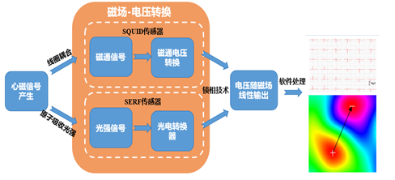
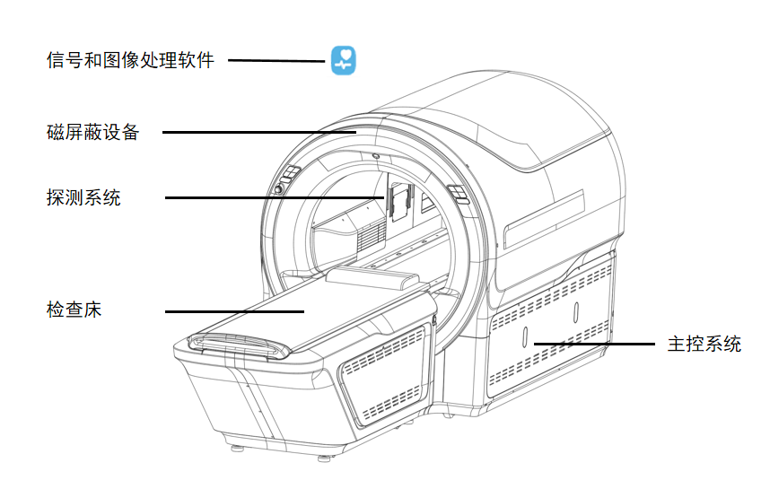
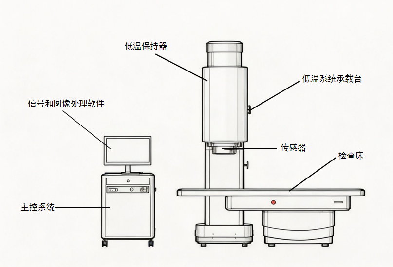
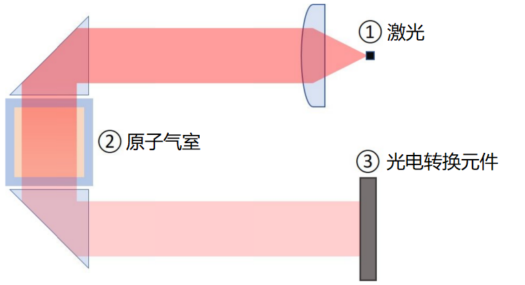
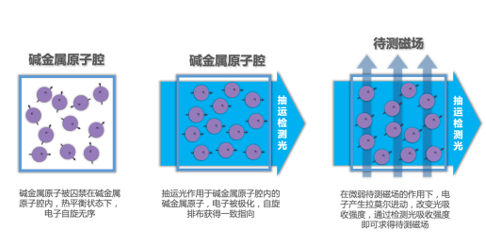
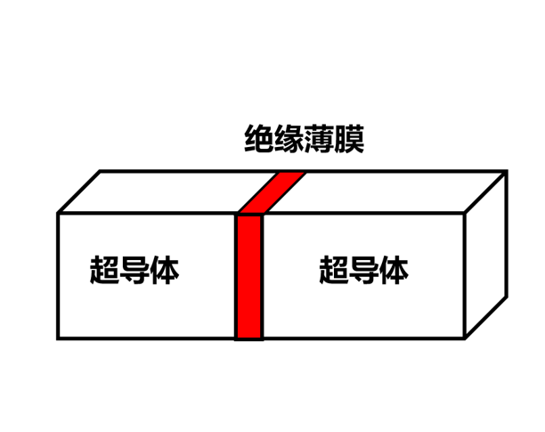
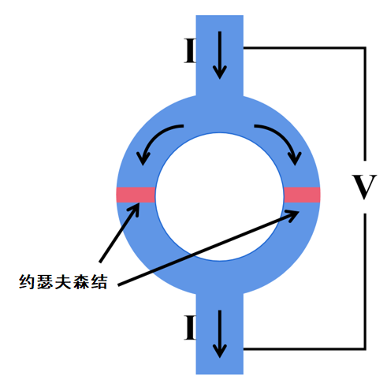
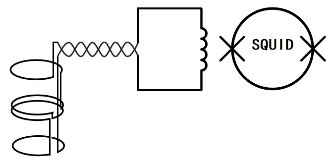

# 心磁信号采集设备注册审查指导原则

本指导原则旨在指导注册申请人对心磁信号采集设备注册申报资料的准备及撰写，同时也为技术审评部门提供参考。

本指导原则是对基于SERF技术和SQUID技术的心磁信号采集设备的一般要求，注册申请人应依据产品的具体特性确定其中内容是否适用。若不适用，需具体阐述理由及相应的科学依据，并依据产品的具体特性对注册申报资料的内容进行充实和细化。

本指导原则是供注册申请人和技术审评人员使用的指导性文件，但不包括审评审批所涉及的行政事项，亦不作为法规强制执行，应在遵循相关法规的前提下使用本指导原则。如果有能够满足相关法规要求的其他方法，也可以采用，但是需要提供详细的研究资料和验证资料。

本指导原则是在现行法规和标准体系以及当前认知水平下制定，随着法规和标准的不断完善，以及科学技术的不断发展，相关内容也将适时进行调整。

一、适用范围

本指导原则适用于基于无自旋交换弛豫（spin-exchange relaxation free，SERF）原子磁强计技术和基于超导量子干涉仪（superconducting quantum interference device，SQUID）技术的心磁信号采集设备注册申报。采集和记录胎儿心脏磁场信号的产品可参考执行本指导原则。

二、注册审查要点

（一）监管信息

应按照《医疗器械注册申报资料要求及说明》的要求提交申请表、术语、缩写词列表、产品列表、关联文件、申报前与监管机构的联系情况和沟通记录（如适用）、符合性声明等。

明确申请表中产品名称、管理类别、分类编码、型号规格、产品组成等信息。

1.产品名称

产品名称应符合《医疗器械通用名称命名规则》、《医用诊察和监护器械通用名称命名指导原则》的要求。

产品名称示例：心磁信号采集设备、心磁图仪、心磁信号记录仪。

2.分类编码

结合已上市产品的分类界定结果，该产品为第二类医疗器械。按照2017版《医疗器械分类目录》，分类编码为07-03-00。

3.注册单元划分

注册单元划分应符合《医疗器械注册单元划分指导原则》的要求。产品性能差异较大、核心功能的实现原理差异较大、结构组成差异较大的应考虑划分为不同的注册单元。如：基于SERF技术和SQUID技术的心磁检测设备，在技术原理、结构组成方面存在较大差异，不能划分在同一注册单元内。

（二）综述资料

1.产品描述

1.1器械及操作原理描述

1.1.1工作原理

心磁信号采集设备通过传感器获取人体心磁信号，并将该心磁信号转换为电压信号，送入到主控系统，再通过软件进行处理。心磁的检测技术根据传感器类型可分为电磁感应式心磁检测、磁阻式心磁检测、基于SERF技术的心磁检测、基于SQUID技术的心磁检测。目前已上市的产品是基于SERF技术和SQUID技术的心磁检测产品。具体原理见附件1。

图1 心磁信号采集及处理原理图

1.1.2结构组成

结构组成中需提供产品整体描述资料、产品整体结构示意图、系统框图、实物图及必要的文字解释。

1.1.2.1基于SERF技术的心磁检测产品

产品一般包括主控系统、磁屏蔽设备、探测系统（传感器）、检查床、信号和图像处理软件。部分产品包含了心电电极，其主要作用为采集心电信号做时间校准用。

图2 基于SERF技术的心磁检测产品示意图

主控系统：控制探测系统采集心磁信号，将采集到的心磁信号传输至信号和图像处理软件。

磁屏蔽设备：隔离外部磁信号的干扰，为传感器提供低剩磁和低噪声的工作环境。部分产品包含照明光源。

探测系统：包括传感器探头和支架，传感器探头按照一定的空间阵列排布，用于采集心磁信号，将心磁信号转换为电压信号。

检查床：承载被采集者。

信号和图像处理软件：一般包括信号采集、信号分析处理等模块。信号采集模块通常包含心磁信号质量评估算法，评价信号采集质量。信号分析处理模块将传感器采集到的心磁信号去除噪声和干扰，通过算法计算后输出图形（如蝴蝶图等）和参数。

1.1.2.2基于SQUID技术的心磁检测产品

产品一般包括主控系统、磁屏蔽设备（若有）、探测系统（包括传感器探头、低温保持器、低温系统承载台）、检查床、信号和图像处理软件。

图3 基于SQUID技术的心磁检测产品示意图

主控系统：控制探测系统采集心磁信号，将采集到的心磁信号传输至信号和图像处理软件。

磁屏蔽设备（若有）：隔离外部磁信号的干扰，为传感器提供低剩磁和低噪声的工作环境。部分产品包含照明光源。

探测系统：包括传感器探头、低温保持器（杜瓦）和低温系统承载台。传感器探头按照一定的空间阵列排布，用于采集心磁信号，将心磁信号转换为电压信号。低温保持器为超导量子干涉仪提供低温工作环境。低温系统承载台用于支撑低温保持器。

检查床：承载被采集者。

信号和图像处理软件：一般包括信号采集、信号分析处理等模块。信号采集模块通常包含心磁信号质量评估算法，评价信号采集质量。信号分析处理模块将传感器采集到的心磁信号去除噪声和干扰，通过算法计算后输出图形（如蝴蝶图等）和参数。

表1 产品结构组成对比表

|  | 基于SQUID技术的心磁检测产品结构部件 | 基于SERF技术的心磁检测产品结构部件 | 功能描述 |
| --- | --- | --- | --- |
| 通用结构 | 主控系统 | 主控系统 | 控制探测系统采集心磁信号，将采集到的心磁信号传输至信号和图像处理软件。 |
| 通用结构 | 探测系统 | 探测系统 | 采集心磁信号，将心磁信号转换为电压信号。 |
| 通用结构 | 检查床 | 检查床 | 承载被采集者。 |
| 通用结构 | 信号和图像处理软件 | 信号和图像处理软件 | 一般包括信号采集、信号处理等模块。 |
| 差异性结构 | 低温保持器 |  | 为超导量子干涉仪提供低温工作环境。 |
| 差异性结构 | 低温系统承载台 |  | 支撑低温保持器。 |
| 差异性结构 | 磁屏蔽设备（若有） | 磁屏蔽设备 | 隔离外部磁信号的干扰。 |

1.2型号规格

对于存在多种型号规格的产品，应说明型号规格的划分依据、明确各型号规格的区别。可采用对比表或带有说明性文字的图片、图表，对不同型号规格的结构组成、性能指标加以描述。

1.3包装说明

需说明所有产品组成的包装信息。描述产品包装的组成部分，对于每个组成部分，详细描述包装清单和包装方式。

1.4研发历程

阐述申请注册产品的研发背景和目的。如有参考的同类产品或前代产品，需提供同类产品或前代产品的信息，并说明选择其作为研发参考的原因。

1.5与同类和/或前代产品的参考和比较

列表比较说明申报产品与同类产品和/或前代产品在工作原理、结构组成、制造材料、性能指标、适用范围等方面的异同。

2.适用范围和禁忌证

2.1适用范围

适用范围需明确产品使用场景、核心功能、临床用途等。适用范围不应超出临床评价资料所确认的范围。

例如：供医疗机构采集、记录人体心脏的磁信号。

2.2预期使用环境

需明确产品在医疗机构中使用；产品需远离震动源、强磁源；患者佩戴铁磁性材料物品会影响产品采集信号。

需明确产品的使用环境要求，至少包括：温度、湿度、大气压条件。

2.3适用人群

应详述产品的适用人群。

2.4禁忌证

如产品具有禁忌证，应予以说明。并应当明确说明该器械不适宜应用的某些疾病、情况或特定的人群。

例如：具有金属材质人体植入物的患者（慎用）、幽闭恐惧症患者（慎用）、带有抢救设备的危重患者等。

（三）非临床资料

1.产品风险管理资料

测量设备主要的风险包括能量危害、生物学危害、环境危害、与使用有关的危害、功能失效及老化有关的危害等，注册申请人应按照GB/T 42062的要求说明产品在设计、原材料、生产加工、包装、运输、贮存、使用等生命周期内各个环节的安全特征，从生物学危害、环境危害、有关使用的危害、因功能失效、老化及存储不当引起的危害等方面，对产品进行全面的风险分析，并详述所采取的风险控制措施及验证结果，必要时需引用检测和评价性报告。

提供产品上市前对其风险管理活动进行全面评审所形成的风险管理报告，此报告旨在说明并承诺风险管理计划已被恰当地实施，并经过验证后判定综合剩余风险是可接受的。

具体要求参见附件2产品风险管理要求。

2.医疗器械安全和性能基本原则清单

应按照《医疗器械注册申报资料要求及说明》的要求提交《医疗器械安全和性能基本原则清单》，说明产品符合《医疗器械安全和性能基本原则清单》各项适用要求所采用的方法，以及证明其符合性的文件。对于《医疗器械安全和性能基本原则清单》中不适用的各项要求，需说明理由。

3.产品技术要求

产品技术要求需按照《医疗器械产品技术要求编写指导原则》的规定编制，详见附件3。

依据产品的临床用途，预期会对产品安全有效性产生重要影响的项目，宜在产品技术要求中制定相应的、具体的性能指标条款，且条款内容需要准确、简要、客观的描述其所实现的产品功能。

4.产品检验报告

注册申请人需按照产品技术要求进行检验，并提交检验报告。可以是注册申请人出具的自检报告或委托有资质的医疗器械检验机构出具的检验报告。若提交自检报告，按照《医疗器械自检管理规定》的要求提供相关资料。

需说明检验用型号规格的典型性。典型型号产品原则上应是同一注册单元内能够代表本单元内其他产品安全性和有效性的产品，需考虑功能最齐全、结构组成最复杂、风险最高的产品。

产品检验报告提供软件版本界面照片或列明软件版本信息，有用户界面的软件体现软件发布版本、软件完整版本，无用户界面的软件体现软件完整版本。

5.研究资料

5.1化学和物理性能研究

应当提供产品材料表征、物理和/或机械性能指标的确定依据、设计输入来源以及临床意义，所采用的标准或方法、采用的原因及理论基础。

需明确磁屏蔽设备（若有）、传感器、检查床的材料。

基于SQUID技术的心磁检测产品需明确配套使用液氦的具体要求，并提供如何确保液氦剩余容量能满足产品要求的研究资料。

应当提供产品扫描区域定位性能的研究资料。

产品的性能参数和功能应能满足产品适用范围的要求，在产品磁探测能力方面，主要考虑以下方面：

磁场探测阵列通道的数量；

磁场探测灵敏度，该指标表征产品对磁场的探测能力，单位为fT/Hz1/2，需明确测量环境；

磁场测量带宽，该指标表征产品能正常响应的磁场频带范围，单位为Hz；

采样率，该指标表征信号采样频率；

磁场摆率，该指标表征产品对磁场变化的响应速率；

扫描时间，该指标表征产品采集完整心磁信号所需的时间；

扫描范围，该指标表征产品探测系统可扫描的范围；

噪声基线稳定性，该指标表征产品在一段时间内空采时的噪声峰峰值，需明确测量环境。

在产品采集信号质量方面，主要考虑以下方面：

通道间信号同步性，以产品采集同一目标磁场信号时，通道之间信号在时间上存在的最大偏差值来表征；

通道一致性，用来衡量产品各通道采集信号的一致性，以产品采集同样大小磁场时各个通道输出值的偏差来表征；

信号失真度，以真实信号与经产品采集、转换后的输出信号的偏差值来表征；

在心磁信号的采集过程中，还需要考虑以下方面：

扫描区域的定位性能。若产品具备足够数量的磁场探测阵列通道，只需要对目标区域进行一次性扫描采集，只需要提交设备定位功能的准确性研究资料，明确设备在心磁检测过程中的定位方式，不需要作为性能指标。若产品不具备足够数量的磁场探测阵列通道，需要多次扫描目标区域并进行信号的整合，则需要提交设备定位功能的准确性研究资料，并且需要将定位性能作为性能指标考量。

对于磁场探测传感器的工作环境，基于SQUID技术的心磁检测产品需考虑低温保持器的容量（液氦容量），有磁屏蔽设备的产品应明确磁屏蔽设备中的直流剩余磁场（剩磁），有磁补偿的还需明确磁补偿系数。

另外，检查床的承重、尺寸、移动等性能需要考量。

5.2电气系统安全性研究

应当提供电气安全性、机械和环境保护以及电磁兼容性的研究资料，说明适用的标准以及开展的研究。

5.3辐射安全研究

应当分析产品的辐射或潜在辐射危害，若包含心电采集功能的，需分析心电采集是否会对心磁采集产生影响。

若产品在扫描定位中需要激光光源，则要考虑激光辐射安全。若磁屏蔽设备包含LED光源，有照射人眼的风险，申请人应按照《医疗器械光辐射安全注册审查指导原则》的相关要求提供研究资料。

5.4软件研究

申请人应按照《医疗器械软件注册审查指导原则（2022年修订版）》的相关要求，给出软件安全性级别及判定理由，并根据软件的安全性级别（轻微、中等、严重）提交相应软件文档。需注意，心磁信号采集设备的软件安全性等级通常不低于中等级别。如涉及网络安全（例如具备电子数据交换、远程访问与控制、用户访问)，应按照《医疗器械网络安全注册审查指导原则（2022年修订版）》的相关要求提供资料。产品若通过电子接口与其他医疗器械或非医疗器械交换并使用信息，应当提供互操作性研究资料，包括基本信息、需求规范、风险管理、验证与确认、维护计划等内容。

核心功能部分，需明确信号处理算法以及各输出参数的计算公式，并提供算法有效性验证资料，如信号采集处理、参数计算等。输出的图形、参数需说明其临床意义，明确算法原理，并提供有效性验证资料。

5.5生物学特性研究

产品可能与患者直接或间接接触的部分（如检查床等），应进行生物学特性研究。

5.6清洁、消毒、灭菌研究

产品为非灭菌产品，故无需灭菌。检查床的外表面在使用过程中与人接触，应定期进行清洁和消毒。应列出清洁和消毒工艺，提供对推荐使用的消毒剂进行评价试验的记录。

5.7动物试验研究

对于拟开展动物试验的，应参照《医疗器械动物试验研究技术审查指导原则第二部分：实验设计、实施质量保证》进行研究方案设计和实施质量保证工作。可针对宣称的适应证设计动物试验方法。开展动物试验时，需明确动物试验目的、动物种属、性别、月龄、数量的选择确定依据；对照组的选择及设立的目的；观察指标需考虑生化指标、CT等数据。合理设定观察周期，并关注动物模型建立的科学性和合理性，以及对临床的借鉴意义。

5.8稳定性研究

可参照《有源医疗器械使用期限注册技术审查指导原则》的相关要求，提供使用期限研究资料。需分析评价传感器的使用期限，基于SQUID技术的心磁检测产品应考虑低温保持器在真空状态下的使用寿命。提供产品的使用稳定性、可靠性研究资料，证明在规定的使用期限内，在正常使用、维护和校准（如适用）情况下，产品的性能、功能可以满足临床使用要求。应当提供产品对相应工作环境要求的研究资料。

提供产品的运输稳定性和包装研究资料，证明在规定的运输条件下，运输过程中的环境条件不会对产品的特性和性能，造成不利影响。

可以参照GB/ T 14710标准的要求及产品使用（温度、湿度、气压、电源）、运输、储存条件开展环境试验研究。

5.9可用性

应参照《医疗器械可用性工程注册审查指导原则》，按照中、低使用风险医疗器械要求提交使用错误评估报告。

（四）临床评价资料

应按照《医疗器械临床评价技术指导原则》的要求提交临床评价资料。

1.同品种医疗器械临床数据

在通过同品种医疗器械临床试验或临床使用获得的数据进行分析评价时，可选用一个或多个同品种产品进行比对，应选择具有相同技术原理的产品作为对比器械，根据《医疗器械临床评价等同性论证技术指导原则》对申报器械和对比器械的工作原理、结构组成、适用范围、技术特征、工作环境等进行等同性论证。

申报产品与对比器械技术特征的具体对比项目，建议重点考虑以下内容（包括但不限于）：系统磁探测能力（磁场探测阵列通道数、磁场探测灵敏度、磁场测量带宽、采样率、磁场摆率（若适用）、噪声基线稳定性）、信号质量（通道间信号同步性、信号失真度、通道一致性）、软件功能。其中，系统磁探测能力、信号质量需在检验方法一致的情况下才能进行比对。若产品具有多个型号规格，应选取通道数最少的型号（性能最差）进行比对。

申报产品和同品种的差异可能对信号采集质量产生影响时，当拟申报产品影响信号采集质量、参数计算结果的性能指标不差于对比产品时，可以认为拟申报产品满足预期的临床应用要求；当拟申报产品影响信号采集质量、参数计算结果的性能指标差于对比产品，或者无法通过测试数据等说明差异性部分不会对申报产品的信号采集质量、参数计算结果产生不利的影响，注册申请人需要结合风险受益分析，必要时提供通过临床试验验证相应的安全性和有效性。

软件功能可基于软件算法进行临床评价，重点针对输出的图像、参数进行详细比对，必要时提供通过临床试验验证相应的安全性和有效性。

2.申报产品临床试验数据

如需开展临床试验，申请人可参照《决策是否开展医疗器械临床试验技术指导原则》明确需要开展临床试验的主要考虑因素，若开展申报产品临床试验，则需严格按照《医疗器械临床试验质量管理规范》进行临床试验，并提交完整的临床试验资料。临床试验的设计可参考《医疗器械临床试验设计指导原则》。根据适应证，对照组建议采用相关的临床金标准或者已上市的同品种产品。

申请人如有境外临床试验数据，可参照《接受医疗器械境外临床试验数据技术指导原则》的要求提交相关资料。

（五）产品说明书和标签样稿

说明书、标签样稿应当符合《医疗器械说明书和标签管理规定》及其他适用法规、标准、指导原则、指导原则中有关说明书和标签要求的规定。

说明书内容应包括产品名称、型号规格、主要结构及性能、预期用途、安装和调试、工作条件（温度、湿度、大气压力、周围环境磁场干扰的要求）、使用方法、注意事项、保养和维护、故障排除、标签和包装标识、生产日期、生产许可证号、注册证号、生产企业名称、地址、联系方式和使用期限。

说明书应重点关注以下内容：

1.安装和调试

应提供产品安装的环境要求、产品的摆放位置、性能调试，必要时，应有安装示意图。基于SQUID技术的心磁检测产品的安装场地需要考虑层高因素，以便液氦添加。若产品不包含磁屏蔽设备，需明确产品安装运行环境的磁噪声要求。

2.使用方法

应提供控制部分的详细描述、操作的顺序和步骤、各功能的描述、对控制面板上所出现的图形符号是否有清楚的解释和说明。

3.注意事项

一般在说明书中以“危险”、“警告”和“注意”的形式出现，例如：

当患者检查时，应有人始终监视患者情况，以保证患者的安全；

产品需远离震动源、强磁源；

患者佩戴磁性材料物品会影响产品采集信号；

应评估金属材质的人体植入物对产品的影响，若不能共同使用，需明确产品不适用具有金属材质人体植入物的人群。若产品能与金属材质的人体植入物共同使用，需提供产品不受金属材质影响的研究资料，临床评价需考虑相关应用场景。

4.维护和保养

应提供产品的清洁方式及相关注意事项；

应明确该产品只有经过培训的人员才能使用本产品，图像判读由医生进行；

基于SQUID技术的心磁检测产品需明确配套使用液氦的具体要求，液氦的更换方法及更换周期；

若有磁屏蔽设备，需明确产品运输后需消磁，以及使用期间的消磁周期；明确产品消磁时对周围环境的要求；明确产品安装位置应避免周围有强磁场、强电场、强辐射、强震动等恶劣环境；明确磁屏蔽材料受应力后性能会下降，应避免敲击、撞击、挤压。

5.故障排除

应规定产品维修的人员资质；

应给出使用中如果发现异常声响、操作失灵、设备损坏、患者承载装置不受控制等情况下的处理方式。

三、参考文献

中华人民共和国国务院.医疗器械监督管理条例:中华人民共和国国务院令第739号[Z].

国家市场监督管理总局.医疗器械注册与备案管理办法:国家市场监督管理总局令第47号[Z].

国家食品药品监督管理局.医疗器械说明书和标签管理规定:国家食品药品监督管理总局令第6号[Z].

国家食品药品监督管理局.医疗器械分类规则:国家食品药品监督管理总局令第15号[Z].

国家食品药品监督管理局.医疗器械通用名称命名规则:国家食品药品监督管理总局令第19号[Z].

国家食品药品监督管理局.医疗器械分类目录:国家食品药品监督管理总局公告2017年第104号[Z].

国家药品监督管理局.医疗器械注册申报资料要求及说明:国家药监局公告2021年第121号[Z].

国家食品药品监督管理局.医疗器械注册单元划分指导原则:总局通告2017年第187号[Z].

国家药品监督管理局.有源医疗器械使用期限注册技术审查指导原则:国家药品监督管理局通告2019年第23号[Z].

国家药品监督管理局医疗器械审评中心.医疗器械软件注册审查指导原则(2022年修订版):国家药监局器审中心通告2022年第9号[Z].

国家药品监督管理局. 医疗器械临床评价技术指导原则:国家药监局通告2021年第73号[Z].

国家药品监督管理局.医疗器械产品技术要求编写指导原则:国家药监局公告2022年第8号[Z].

国家药品监督管理局医疗器械审评中心.医疗器械网络安全注册审查指导原则:国家药监局器审中心通告2022年第7号[Z].

GB/T 16886.1,医疗器械生物学评价第1部分：风险管理过程中的评价与试验[S].

GB/T 42062,医疗器械风险管理对医疗器械的应用[S].

YY/T 0466.1,医疗器械用于医疗器械标签、标记和提供信息的符号第1部分：通用要求[S].

GB/T 14710,医用电器环境要求及试验方法[S].

GB 9706.1,医用电气设备 第1部分：基本安全和基本性能的通用要求[S].

YY 9706.102,医用电气设备 第1-2部分：基本安全和基本性能的通用要求 并列标准：电磁兼容 要求和试验[S].

GB/T 7247.1,激光产品的安全 第1部分：设备分类、要求[S].

附件1

心磁信号采集设备工作原理

心磁信号是由心脏的电活动引发的，主要来源于心脏组织细胞膜间带电离子流动产生的电流。人体心磁信号非常微弱，其典型强度只有几十pT。

（一）基于SERF技术的心磁检测：

1.SERF原子磁强计

SERF原子磁强计主要由激光、原子气室和光电转换元件组成，基于光、磁与原子相互作用，实现对特定磁场大小的检测，结构如图4所示。单光束的SERF原子磁强计中，只有一束激光，既可以作为泵浦光使原子产生极化，还可以作为探测光，探测不同磁场影响下原子对光吸收的强弱。

图4 单光束SERF原子磁强计装置图

在无外界磁场时，高密度原子气室中的金属原子处于无自旋交换弛豫状态。通过一束激光照射，可使电子极化，所有电子自旋朝向一致的方向。

在有外界磁场时（即进行磁场检测时），原子对泵浦光的吸收会变弱，利用光电转换元件测量从原子气室透射后的光强，可以得到跟随磁场变化的电压信号，该电压信号经过处理后可以得到随磁场变化近似线性的曲线，从而测量出不同方向的磁场大小。

图5 磁信号探测示意图

2.磁屏蔽原理：

环境中杂乱的磁场会降低磁强计对目标信号的探测能力，因此高灵敏度的原子磁强计需要屏蔽外界磁场。磁屏蔽设备可以将外界磁场屏蔽到近乎零。空气的磁导率接近１，而磁屏蔽层材料磁导率远大于１，因此磁屏蔽设备内部的磁阻远大于其外壳的磁阻，外部磁场的绝大部分磁感应线将贴着磁屏蔽体壁通过，只有极少的一部分磁感应线进入磁屏蔽体内腔。

（二）基于SQUID技术的心磁检测：

SQUID的基本原理涉及两个效应，磁通量子化和约瑟夫森（Josephson）效应。磁通量子化是指闭合超导环中所穿透的磁通量只能是磁通量子的整数倍。约瑟夫森效应是指当流过约瑟夫森结的电流超过超导体临界电流时，流过约瑟夫森结的超导电流和结两端电压存在关联性。约瑟夫森结如图6所示，由两个弱耦合超导体构成。

图6 约瑟夫森结结构示意图

根据SQUID工作模式的不同可以分为直流SQUID和射频SQUID，其中直流SQUID由于其良好的稳定性与低固有噪声，被大量应用于低温超导系统。如图7所示，直流SQUID是由两个约瑟夫森结将一个超导环隔断形成的微型结构构成，该结构满足磁通量子化效应，两结的相位差随外磁通线性变化。结合约瑟夫森效应中结两端电压与相位差函数关系，可获得随外磁场变化的电压信号，实现对外界磁场的测量。

图7 超导量子干涉仪结构示意图

SQUID传感器使用的铌线圈是一种超导体，在其临界温度以下能保持零电阻。为保证传感器工作在超导态，需要环境温度低于铌的超导临界温度(9.25 K)，因此使用时需将传感器部分完全地浸泡在沸点为4.2 K的液氦环境中。

图8为SQUID轴向梯度计原理图，该结构利用输入线圈将二阶梯度检测线圈探测的磁信号耦合到SQUID超导环路中，利用差动式结构抑制环境噪声。当线圈受到磁场的作用时，穿过线圈的磁通量会改变，线圈中会感应出电流。这个感应电流随后被 SQUID 检测到，从而实现对磁场的测量。

图8 SQUID轴向梯度计原理图

附件2

风险管理文档

下表所列为常见可预见事件序列／可能的伤害示例，需关注：

表2 常见可预见事件序列／可能的伤害示例

| 风险分类 | 可预见的事件序列 | 风险情况 | 可能的后果 |
| --- | --- | --- | --- |
| 能量危害（电能） | 电压：接触线路电压造成电击 | 电介质强度、空气间隙和爬电距离设计不符合标准；外接接口的防浪涌等保护不到位 | 导致对人身电击伤害 |
| 能量危害（电能） | 漏电流：电流经患者或操作者流入地 | 系统保护接地端与大地连接不可靠；接触患者的应用部分绝缘不足或患者与电路直接连接 | 导致对人身电击伤害 |
| 能量危害（热能） | 电路短路；线路老化；电机堵转导致温升过大 | 如保险丝、电缆线、通强电元器件等选型未通过认证；外壳材料未达 UL94V - 1 要求；电机未通过堵转实验等 | 造成患者或操作者烧伤或者死亡 |
| 能量危害（机械能） | 产品存在尖锐、毛刺部分 | 患者或操作者碰触到尖锐棱角 | 使患者或操作人员刮伤 |
| 生物危害 | 产品使用前未规范消毒，如检查床 | 未消毒产品接触患者 | 患者产生交叉感染的伤害 |
| 生物危害 | 如与人体可能接触的部件材料不符合生物相容性要求 | 与人体组织不相容的器械使用于人体 | 出现细胞毒性、致敏、刺激等症状，伤害患者健康 |
| 环境危害 | 产品的电路抗扰设计不充分等 | 产品受到外界的电磁干扰 | 产品无法使用 |
| 环境危害 | 产品未按规定的使用环境来安装 | 产品受到外界的电磁干扰 | 产品无法使用，或采集数据无法使用 |
| 操作危害 | 未及时确认传感器状态 | 传感器性能下降或损坏 | 无法采集数据 |
| 操作危害 | 未规范确认磁屏蔽装置状态，未规范消磁 | 磁屏蔽装置被环境磁化 | 采集数据无法使用 |
| 操作危害 | 操作人员注意力不集中，产品移动时患者位置不当 | 产品碰撞患者 | 导致患者伤害 |
| 操作危害 | 产品使用比较复杂，操作人员未经培训 | 操作失败、检查时间延长 | 操作错误致患者受伤，数据不可用 |
| 操作危害 | 未规范操作 | 急停开关使用后未复位 | 操作错误 |
| 操作危害 | 未规范维护、维修 | 检查床非预期运动、产品硬件故障导致的失控 | 产品无法使用 |
| 信息危害 | 标记或指示错误 | 无法正确使用产品 | 错误操作或使患者受伤 |
| 信息危害 | 标记不牢固 | 无法正确使用产品 | 错误操作或使患者受伤 |
| 信息危害 | 使用说明书不完整 | 无法正确使用产品 | 错误操作或使患者受伤 |
| 信息危害 | 限制披露不充分 | 临床禁忌证、排查要求说明不清 | 患者数据错误 |
| 软件危害 | 使用中软件故障 | 需重新启动操作 | 软件功能异常，产品软件导致的失控 |
| 软件危害 | 软件与系统不兼容 | 产品无法正常运行 | 对用户造成不便 |

附件3

心磁信号采集设备产品技术要求模板

医疗器械产品技术要求编号：

产品名称

1. 产品型号/规格及其划分说明

1.1产品型号

1.1.1型号命名规则

1.1.2产品规格型号

1.2软件组件

1.2.1软件名称

1.2.2软件发布版本号

1.2.3软件版本号命名规则

2. 性能指标

2.1 系统磁探测能力

2.1.1 磁场探测阵列通道数

2.1.2 磁场探测灵敏度

2.1.3 磁场测量带宽

2.1.4 采样率

2.1.5 磁场摆率（若适用）

2.1.6 扫描时间

2.1.7 扫描范围

2.1.8 噪声基线稳定性

2.2信号质量

2.2.1通道间信号同步性

2.2.2信号失真度

2.2.3通道一致性

2.3 信号采集过程相关

2.3.1扫描区域定位性能（若适用）

2.3.2检查床

承重、尺寸、移动范围及允差。

2.4传感器工作环境要求

2.4.1液氦容量（若适用）

2.4.2剩磁（若适用）

2.4.3磁补偿（若适用）

2.5网络安全（若适用）

2.5.1通讯接口

2.5.2用户访问控制

2.6软件功能

应符合《医疗器械软件注册审查指导原则（2022年修订版）》第九章注册申报资料补充说明中关于产品技术要求性能指标的建议内容。

2.7安全要求

2.7.1电气安全

应符合GB 9706.1、YY 9706.108（若有报警系统）的要求。

2.7.2电磁兼容

应符合YY 9706.102的要求。

2.7.3激光安全（若适用）

应符合GB/T 7247.1的要求。

3.检验方法

温度：

相对湿度：

大气压力：

电压：

产品检验使用的工装：

……

4. 术语（若适用）

……

（以下内容另起一页）

附录A

产品安全特征

一、按防电击类型分类

二、按防电击程度分类

三、按对进液和颗粒物质的防护程度分类

四、按在富氧环境下使用时的安全程度分类

五、按运行模式分类

六、设备的额定电压和频率

七、设备输入功率

八、设备是否具有对除颤放电效应防护的应用部分

九、设备是否具有信号输出或输入部分

十、永久性安装设备或非永久性安装设备

十一、电气绝缘图
