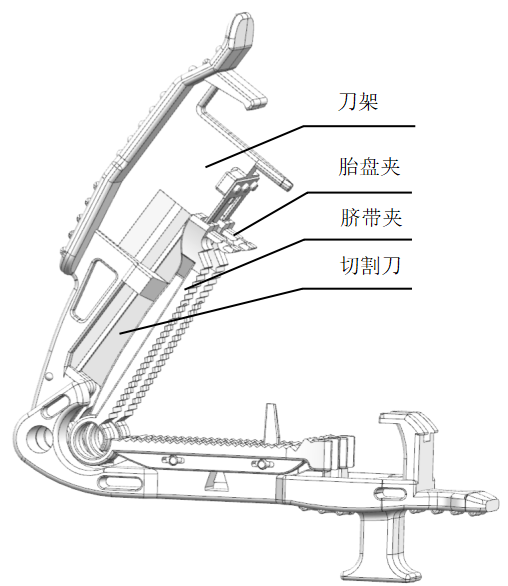
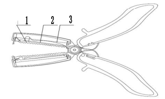
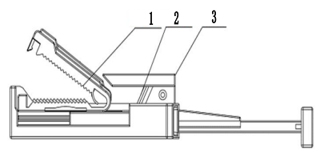

# 一次性使用脐带剪注册审查指导原则

本指导原则旨在指导注册申请人对一次性使用脐带剪产品注册申报资料的准备及撰写，同时也为技术审评部门对注册申报资料的审评提供技术参考。

本指导原则是对一次性使用脐带剪注册申报资料的一般要求，注册申请人需依据产品的具体特性确定其中内容是否适用。若不适用，需具体阐述理由及相应的科学依据，并依据产品的具体特性对注册申报资料的内容进行充实和细化。

本指导原则是供注册申请人和技术审评人员使用的指导性文件，但不包括注册审批所涉及的行政事项，亦不作为法规强制执行，需在遵循相关法规和强制性标准的前提下使用本指导原则。如果有能够满足相关法规要求的其他方法，也可以采用，但是需要提供详细的研究资料和验证资料。

本指导原则是在现行法规和标准体系以及当前认知水平下制定的，随着法规和标准的不断完善，以及科学技术的不断发展，本指导原则相关内容也将进行适时的调整。

一、适用范围

本指导原则适用于《医疗器械分类目录》中二类无源医疗器械一次性使用脐带剪，分类编码为18妇产科、辅助生殖和避孕器械-01妇产科手术器械-02妇产科用剪。带有源部件的一次性使用脐带剪可参考本指导原则适用部分。

二、注册审查要点

（一）监管信息

1.产品名称

产品名称应为通用名称，并符合《医疗器械通用名称命名规则》等相关法规、规范性文件的要求，如“一次性使用无菌脐带剪、一次性使用脐带剪、一次性使用脐带剪断器、一次性使用脐带剪夹器”等。

2.分类编码

根据《医疗器械分类目录》，产品的分类编码为18-01-02，管理类别为二类。

3.注册单元划分的原则和实例

产品注册单元的划分需符合《医疗器械注册单元划分指导原则》的要求。以产品的技术原理、结构组成、性能指标和适用范围等因素为划分依据。

例如：推切式、剪切式和纵切式脐带剪夹器可作为同一注册单元。

（二）综述资料

1.器械及操作原理描述

一次性使用脐带剪在使用过程中，脐带夹夹紧脐带的同时，利用切割刀将脐带切断，脐带夹保留在新生儿身上。脐带夹表面有锯齿状凸起，闭合时可迅速结扎脐带，阻断脐血流，闭合后为紧密的卡扣结构，可保证紧密的结扎效果。

2.产品结构及组成

一次性使用脐带剪通常由脐带夹、刀架和切割刀等组成。根据产品实际情况提供产品的结构示意图，结合结构示意图对产品的结构组成进行详尽描述。描述的内容包括结构、尺寸、材料等。常见的结构型式有推切式、剪切式和纵切式三种型式。

a) 纵切式

b) 剪切式

c) 推切式

1、脐带夹；2、切割刀；3、刀架

图1  一次性使用脐带剪结构示意图

3.原材料

描述与使用者和/或患者直接或间接接触的材料成分。明确产品所有部件组成材料的通用名称/化学名称、商品名/牌号、符合的材料标准（如适用）及材料供应商等基本信息，包括制造过程中使用的粘合剂（如适用）、着色剂（如适用）等。建议产品组成材料以列表的形式提供，并与产品结构图示中标识的部件名称一一对应。

4.型号规格

对于存在多种型号、规格的产品，应当明确各型号、规格的区别。建议采用对比表及带有说明性文字的图片、图表，对于各种型号、规格的结构组成（或配置）、功能、产品特征等方面加以描述。

5.包装说明

提供产品的包装信息，可包括包装形式、包装材料、包装工艺以及无菌屏障系统等信息。

6.研发历程

阐述申请注册产品的研发背景和目的。如有参考的同类产品或前代产品，应当提供同类产品或前代产品的信息，并说明选择其作为研发参考的原因。

明确产品设计开发立题依据，根据产品实际情况如产品特性论述产品临床使用的必需性。如通过市场调研、临床文献资料等论述注册产品较传统的断脐方法的优势。

7.与同类和/或前代产品的参考和比较

列表比较说明申报产品与同类和/或前代产品工作原理、结构组成、制造材料、性能指标、作用方式，以及适用范围等异同。

8.适用范围、禁忌证

8.1适用范围：供切断并封闭新生儿脐带残端用。

8.2预期使用环境：预期使用环境为医疗机构。

8.3禁忌证：脐带水肿者慎用，材料过敏者慎用等。

9.不良事件历史记录

申请人应跟踪整理已上市同类产品的不良事件、召回、警戒等相关信息，并将其作为风险管理的输入资料，进行风险评估和控制。常见的不良事件如下：组件缺失、脐带夹滑脱落、断裂、不能闭合或者闭合不紧、刀片不锋利等，对患者造成的伤害主要是出血、皮肤红肿感染。

（三）非临床资料

1.产品风险管理资料

注册申请人需对产品全生命周期实施风险管理，提交风险管理资料，参照GB/T 42062《医疗器械风险管理对医疗器械的应用》。注册申请人在产品注册上市前，需对风险管理过程进行评审。

审查要点包括：

1.1是否确定了风险管理的范围、规定和人员职责分工。

1.2产品风险定性定量分析是否准确。

1.3危险分析是否全面。

1.4风险可接受准则，降低风险的措施及采取措施后风险的可接受程度，是否有新的风险产生。

1.5是否确定了风险反馈的规定及信息收集情况。

产品的主要危险见附件，注册申请人还应结合产品自身特点确定其他危险。

2.产品技术要求的主要性能指标

产品技术要求建议参考 YY/T 1470《一次性使用脐带剪（切）断器》等相关标准，结合产品设计特征及临床应用来制订，同时还需符合《医疗器械产品技术要求编写指导原则》的要求。常见的技术指标包括但不限于：

2.1外观。

2.2尺寸和公差。

2.3切割刀片的性能，如表面粗糙度，硬度，耐腐蚀性能，锋利度。

2.4使用性能（切断性能、夹持性能、配合性能）

2.5灭菌产品的无菌性能。

2.6若灭菌使用的方法涉及出现残留，需对允许的残留量进行规定，如采用环氧乙烷灭菌的产品的环氧乙烷残留量的要求。

2.7 由申请人根据不同材料特性决定是否对脐带夹的化学性能（重金属、酸碱度等）提出要求。

2.8 如产品含有其他配件，应制定配件的相关性能。

3.检验报告

注册申请人应提供具有申报产品承检资质的医疗器械检验机构出具的注册检验报告，或是注册申请人的自检报告。注册申请人应提供典型性检验样品的选择说明，典型性产品的确定可以通过比较同一注册单元内所有产品的技术结构、性能指标和预期用途等相应资料，说明其能够代表本注册单元内其他产品的安全性和有效性。原则上应选取结构最复杂、功能最齐全、风险最高的型号规格作为典型性产品。若一个型号规格不能覆盖所有产品，除选择典型性产品进行全性能检验外，还需选择其他型号规格产品进行未覆盖项目的检验。

如选取推切式脐带剪夹器为典型型号，剪切式应差异化检测。

4.研究资料

4.1产品性能研究

注册申请人应根据产品的技术特征和临床使用情况来确定产品安全有效的性能指标和检验方法。对注册申请人宣称的产品的所有技术参数和功能，应在产品技术要求中予以规定。技术指标应不低于相关的国家标准或行业标准，产品技术要求中的试验方法均应为已验证的方法。一次性使用脐带剪的性能指标及试验方法应参考引用YY/T 1470《一次性使用脐带剪（切）断器》，如有不适用条款（包括国家标准、行业标准要求），注册申请人应在申报资料中说明理由。若未采用YY/T 1470中给出的试验方法，应提供所使用的试验方法的来源依据或方法学验证资料。

4.2可用性研究

医疗器械可用性工程是医疗器械设计开发的重要组成部分，注册申请人需在质量管理体系设计开发过程的框架下，参考指导原则相应内容或可用性相关标准，建立充分、适宜、有效的可用性工程过程。

基于医疗器械使用风险级别区分监管要求：中、低使用风险医疗器械可基于风险管理过程开展可用性工程生命周期质控工作，提交使用错误评估报告。

使用错误评估报告用于细化风险管理报告关于可用性的内容，包括基本信息、使用风险级别、核心要素、同类医疗器械上市后使用问题分析、使用风险管理、结论等内容。

4.3生物学特性研究

应参照GB/T 16886.1《医疗器械生物学评价 第1部分：风险管理过程中的评价与试验》进行生物相容性评价。

4.4灭菌工艺研究

描述用于保证产品无菌的质量保证体系，明确灭菌工艺（方法和参数）和无菌保证水平（SAL）。产品无菌保证水平（SAL）需达到10-6，提供灭菌验证或确认报告，报告内容应符合GB 18279 《医疗保健产品灭菌 环氧乙烷 医疗器械灭菌过程的开发、确认和常规控制要求》、GB 18280《医疗保健产品灭菌 辐射》系列标准等的规定。灭菌确认应考虑产品与灭菌过程的适应性、包装和标签与灭菌过程的适应性等内容。

残留毒性：若灭菌使用的方法容易出现残留,如环氧乙烷灭菌，应当参考GB/T 16886.7《医疗器械生物学评价第7部分：环氧乙烷灭菌残留量》等标准明确残留物信息（如EO、ECH）及采取的处理方法和条件，并提供研究资料。

4.5稳定性研究

4.5.1货架有效期

产品有效期的验证可采用实时老化或加速老化的研究。加速老化研究试验的具体要求可参照YY/T 0681系列标准。产品有效期验证试验宜采用与常规生产相同的终产品进行。验证项目需评估产品随时间老化的相关性能，包括产品自身性能验证和包装系统性能验证两方面。前者需选择与医疗器械有效期密切相关的物理、化学、微生物测试项目，涉及产品生物相容性可能发生改变的，需进行生物学评价。后者包括包装完整性、包装强度和微生物屏障性能等验证项目。其中，包装完整性验证项目可包括在设定的时间间隔点目力检测产品包装（是否污染、破损等）及标签（完整性、粘附牢固度、印刷内容清晰度等）、采用染色液穿透法测定透气包装的密封泄漏试验和气泡法测定软性包装泄漏试验等；包装强度测试项目包括软性屏障材料密封强度试验、无约束包装抗内压破坏试验等。

4.5.2运输稳定性

需要提供运输稳定性研究资料，证明在宣称的有效期内，规定的运输条件下，运输过程中的环境条件不会对医疗器械造成不利影响。根据适用情况可选择人工搬运、堆码、振动、低气压、集中冲击等模拟运输试验验证包装系统性能，并提供研究资料。

5.其他资料

提交申报产品相关信息与《免于进行临床评价医疗器械目录》（以下简称《目录》）所述内容的对比资料；提交申报产品与《目录》中已获准境内注册医疗器械的对比说明，对比说明应当包括《申报产品与目录中已获准境内注册医疗器械对比表》和相应支持性资料。若经对比，申报产品与对比产品存在差异，还应提交差异部分对安全有效性影响的分析研究资料。二者的差异不应引起不同的安全有效性问题，即申报产品未出现对比产品不存在的且可能引发重大风险和/或引起显著影响有效性的问题。提交的上述资料应能证明申报产品与《目录》所述的产品具有基本等同性。若无法证明申报产品与《目录》所述的产品具有基本等同性，则应开展临床评价。

（四）临床评价资料

该产品已列入《免于进行临床评价医疗器械目录》，申请人无需提交临床评价资料。

应充分考虑豁免情况不包括新材料、新作用机理、新功能的产品。若无法证明申报产品与《目录》产品具有等同性，则应按照《医疗器械临床评价技术指导原则》等相关指导原则开展相应工作，提供符合要求的临床评价资料。

（五）产品说明书和标签样稿

1.按照《医疗器械说明书和标签管理规定》、YY/T 1470《一次性使用脐带剪（切）断器》要求编制产品说明书和标签样稿。

2.产品说明书应当包括以下内容：

2.1注意事项：明确脐带夹使用后的注意事项：如产品使用导致新生儿皮肤红肿等如何处置、产品用后处置等。

2.2警示以及提示的内容：应当注明“一次性使用”“包装破损不得使用”等字样或符号；应当注明灭菌方式、“无菌”“失效日期”等字样或者符号。

2.3明确与人体直接或间接接触的材质信息。

（六）质量管理体系文件

1.产品生产制造相关要求

应当明确产品生产加工工艺，生产工艺可采用流程图的形式，且应结合产品实际生产过程细化产品生产工艺介绍，应能体现出外协加工部分（如有）、半成品加工过程。工艺流程图中应明示关键工序、特殊过程（如有）、过程控制点、各工序对环境的要求、使用的相关设备以及对设备精度的要求等，说明其每道工序的操作说明及接收和放行标准，并阐明其过程控制点及控制参数。对生产工艺的可控性、稳定性应进行确认。明确生产过程中加工助剂、粘合剂等添加物质的使用情况及对杂质（如残留单体、小分子残留物等）的控制情况，若对外购原材料进行改性，应提供工艺的详细过程和参数，以及相应的研究依据。

2.生产场地

应详细说明产品研制场地、生产场地地址、生产工艺布局、生产环境要求及周边情况。有多个研制、生产场地，应当概述每个研制、生产场地的实际情况。

三、参考文献

[1]中华人民共和国国务院.医疗器械监督管理条例:中华人民共和国国务院令第739号[Z].

[2]国家市场监督管理总局.医疗器械注册与备案管理办法:国家市场监督管理总局令第47号[Z].

[3]国家食品药品监督管理局.医疗器械说明书和标签管理规定:国家食品药品监督管理总局令第6号[Z].

[4]国家食品药品监督管理局.医疗器械分类规则:国家食品药品监督管理总局令第15号[Z].

[5]国家食品药品监督管理局.医疗器械通用名称命名规则:国家食品药品监督管理总局令第19号[Z].

[6]国家食品药品监督管理局.医疗器械分类目录:国家食品药品监督管理总局公告2017年第104号[Z].

[7]国家食品药品监督管理局.医疗器械注册单元划分指导原则:总局通告2017年第187号[Z].

[8]国家药品监督管理局.医疗器械临床评价技术指导原则:国家药监局关于发布医疗器械临床评价技术指导原则等5项技术指导原则的通告2021年第73号[Z].

[9]国家药品监督管理局.医疗器械可用性工程注册审查指导原则:国家药监局器审中心关于发布医疗器械可用性工程注册审查指导原则的通告（2024年第13号）[Z].

[10]GB/T 16886.1,医疗器械生物学评价第1部分：风险管理过程中的评价与试验[S].

[11]GB/T 42062,医疗器械风险管理对医疗器械的应用[S].

[12]GB 18278.1,医疗保健产品灭菌 湿热 第1部分：医疗器械灭菌过程的开发、确认和常规控制要求[S].

[13]GB 18279,医疗保健产品灭菌 环氧乙烷 医疗器械灭菌过程的开发、确认和常规控制要求[S].

[14]GB 18280.1,医疗保健产品灭菌 辐射 第1部分：医疗器械灭菌过程的开发、确认和常规控制要求[S].

[15]GB 18280.2,医疗保健产品灭菌 辐射 第2部分：建立灭菌剂量[S].

[16]GB/T 18280.3,医疗保健产品灭菌 辐射 第3部分：剂量测量指南[S].

[17]GB/T 19633,最终灭菌医疗器械的包装[S].

[18]YY/T 0681, 无菌医疗器械包装试验方法[S].

[19]YY/T 0466.1,医疗器械用于医疗器械标签、标记和提供信息的符号第1部分：通用要求[S].

[20]YY/T 0466.2,医疗器械用于医疗器械标签、标记和提供信息的符号第2部分：符号的制订、选择和确认[S].

[21]ASTM F1980,医疗器械无菌屏障系统加速老化的标准指南[S].

[22]ISO 11607，最终灭菌医疗器械的包装[S].

[23] ASTM D4169，包装检测[S].

[24]YY/T 1470-2016一次性使用脐带剪（切）断器[S].

附件

产品的主要危险（举例）

| 危险的分类 | 危险的分类 | 危险的形成因素 | 可能的后果 |
| --- | --- | --- | --- |
| 生物和化学危险 | 生物污染 | 生产环境控制不好；灭菌未确认或灭菌操作不严格；超过有效期使用； 零部件未按要求清洗； 清洗用水不符合要求； 包装不符合要求或包装破损；产品重复使用 | 产品带菌，引起患者感染 |
| 生物和化学危险 | 生物不相容性 | 选用不适当的材料； 灭菌残留超标 | 产生细胞毒性、致敏、刺激反应，引起不良反应 |
| 生物和化学危险 | 再感染和/或交叉感染 | 使用不当；标识不清 | 引起感染、交叉感染 |
| 环境 因素 | 储存或运行偏离预订的环境条件 | 储运条件（如温度、湿度）不符合要求 | 产品老化、无菌有效期缩短、产品零件生锈 |
| 环境 因素 | 意外的机械破坏 | 储运、使用过程中发生意外的机械性破坏 | 产品使用性能无法得到保证 |
| 环境 因素 | 由于废物和（或）医疗器械处置的污染 | 使用后的产品没有按照要求集中销毁 | 造成环境污染或者细菌的交叉感染 |
| 可用性 | 不适当的标记 | 标记不清晰、错误、 没有按照要求进行标记 | 错误使用、储存错误、 产品辨别错误 |
| 可用性 | 不适当的操作说明，如： 操作说明书不准确、清晰； | 包装破损无法识别； 操作要点不突出 | 无法保证使用安全性 导致操作失误 |
| 可用性 | 由不熟练/未经培训的人员使用 | 操作不熟练、操作失误 | 无法保证使用安全性 |
| 可用性 | 对产品的警告不充分 | 对操作人员警示不足 | 重复使用、二次灭菌、 包装破损的产品被使用，引起患者感染 |
| 可用性 | 对一次性使用医疗器械很可能再次使用的危害警告不适当 | 造成重复使用 | 交叉感染 |
| 可用性 | 违反或缩减说明书、程序等 | 操作方法、注意事项、储存方法、警示事项等表述不清 | 重复使用引起感染、没有集中销毁造成环境危害等 |
| 可用性 | 对医疗器械寿命终止缺少适当的决定 | 没有标识产品有效期 | 超出有效期的产品被使用，造成细菌感染或因材料老化产生而导致产品性能不符合要求 |
| 可用性 | 不适当的包装（医疗器械的污染和/或变质） | 没有进行包装确认 | 不能确保产品无菌，从而导致出现细菌感染 |
| 可用性 | 再次使用和/或不适当的再次使用 | 产品标识没有明确 | 出现细菌感染、交叉感染 |
