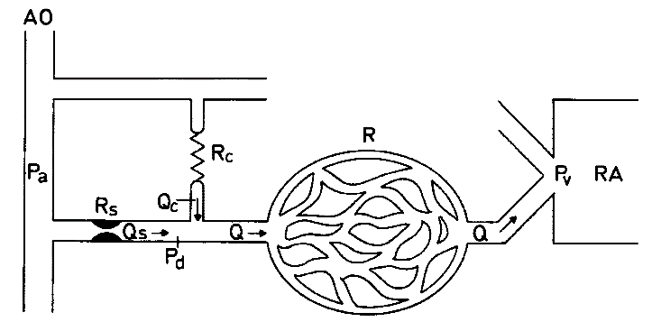

# 经皮冠状动脉介入生理功能检测产品注册审查指导原则

附件

经皮冠状动脉介入生理功能检测产品

注册审查指导原则

本指导原则旨在指导注册申请人对经皮冠状动脉介入生理功能检测产品（以下简称“产品”）注册申报资料的准备及撰写，同时也为技术审评部门审评注册申报资料提供参考。

本指导原则是对产品的一般性要求，申请人应依据其具体特性确定其中内容是否适用，若不适用，需具体阐述理由及相应的科学依据，并依据其具体特性对注册申报资料的内容进行充实和细化。

本指导原则是供申请人和审查人员使用的指导文件，不涉及注册审批等行政事项，亦不作为法规强制执行，如有能够满足法规要求的其他方法，也可以采用，但应提供详细的研究资料和验证资料，应在遵循相关法规的前提下使用本指导原则。

本指导原则是在现行法规、标准体系及当前认知水平下制定的，随着法规、标准体系的不断完善和科学技术的不断发展，本指导原则相关内容也将适时进行调整。

适用范围

本指导原则适用于预期采用经皮冠状动脉介入技术检测人体心脏冠状动脉血管生理功能参数的医疗器械，例如，压力导丝、压力微导管、冠状动脉功能测量设备、血流储备分数测量设备、微循环阻力指数测量设备、血流动力学和电生理记录系统的冠状动脉生理功能参数模块等。

产品的结构及组成分为应用部分（常见为压力导丝或压力微导管）、医用电气设备（以下简称“设备”）、附件。设备既可以是独立的医用电气设备，例如，提供血流储备分数或微循环阻力指数计算功能的主机，又可以作为经皮冠状动脉介入生理功能参数模块集成在医用电气系统中，例如，血流动力学和电生理记录系统的冠状动脉生理功能参数模块部分。

本指导原则不适用于血管内导丝、漂浮导管、有创压力传感器、病人监护仪、有创血流动力学监测产品、冠状动脉造影血流储备分数计算设备或软件、冠状动脉CT血流储备分数计算软件等。

注册审查要点

按照《医疗器械安全和性能的基本原则》并参考《医疗器械安全和性能基本原则符合性技术指南》，申请人应明确基本的设计和生产要求，应能设计和生产在医疗器械全生命周期内均能达到预期安全和性能要求的经皮冠状动脉介入生理功能检测产品。

申请人应提供满足《关于公布医疗器械注册申报资料要求和批准证明文件格式的公告》要求的注册申报资料。

监管信息

申请表

申请人应按照填表要求填写，其中产品名称、结构及组成、产品适用范围应与综述资料、产品说明书的相关内容保持一致。

术语、缩写词列表

申请人应当根据注册申报资料的实际情况，对其中出现的需要明确含义的术语或缩写词进行定义，包含但不限于表1的定义。

表1 术语或缩写词举例

| 主动脉压力 | arterial Pressure, Pa |
| --- | --- |
| 冠状动脉狭窄近端压力 | coronary pressure proximal to the stenosis |
| 冠状动脉狭窄远端压力 | coronary Pressure distal to the stenosis, Pd |
| 冠状动脉楔压 | Pressure distal to the stenosis during coronary artery occlusion, Pw |
| 中心静脉压 | central venous Pressure, Pv |
| 平均动脉压 | Mean Arterial Pressure, MAP |
| 血流储备分数 | Fractional Flow Reserve, FFR |
| 瞬时无波型比率 | Instantaneous Wave-free Ratio, iFR |
| 阻力恒定期比率 | constant Resistance Ratio, cRR |
| 静息全周期比值 | Resting Full-Cycle Ratio, RFR |
| 舒张期无充血比率 | Diastolic Hyperemia-Free Ratio, DFR |
| 微循环阻力指数 | Index of Microcirculatory Resistance, IMR |
| 冠状动脉血流储备 | Coronary Flow Reserve, CFR |
| 左冠状动脉 | Left Coronary Artery, LCA |
| 左冠状动脉主干 | Left Main Artery, LM |
| 左前降支 | Left Anterior Descending artery, LAD |
| 左回旋支 | Left Circumflex artery, LCX |
| 右冠动脉 | Right Coronary Artery, RCA |

产品列表

申请人应列明拟申报产品的型号、结构及组成、应用部分和设备的规格、附件，以及各型号规格的标识（例如，应用部分、设备、附件的型号或编号，器械唯一标识等）和描述说明（例如，应用部分的尺寸和材质、一次性使用或重复使用特征等）。

注册单元划分

参考《医疗器械注册单元划分指导原则》，若申报产品存在多个型号规格或配置，应根据产品的临床机理、技术原理及其特征、结构及组成、性能指标、适用范围等关键要素进行注册单元划分。

产品的临床机理、技术原理及特征存在较大差异的情况，例如，冠状动脉功能测量设备、血流储备分数测量设备、微循环阻力指数测量设备（详见器械及操作原理描述），应划分为不同的注册单元。

产品结构及组成的差异对安全性和有效性有影响的情况，例如，压力导丝、压力微导管（详见结构及组成），应划分为不同的注册单元。

产品的性能指标存在较大差异，导致适用范围或临床机理不同时，或者难以合理选择具有代表性和典型性的研究样品，宜划分为不同的注册单元。

产品适用范围有实质不同的情况（详见适用范围），应划分为不同的注册单元。

设备与配合使用的应用部分原则上应划分为不同的注册单元，例如，导丝、扭矩装置。设备与连接使用的附件原则上作为同一个注册单元申报，例如，连接线、电缆。

综述资料

概述

产品名称

申请人应描述申报产品的通用名称及其确定依据。按照《医疗器械通用名称命名规则》并参考《医疗器械通用名称命名指导原则》，产品通用名称由核心词和特征词组成。

根据应用部分或设备的技术特征和预期用途，申请人可适当地增加特征词，例如，压力导丝、压力微导管、血流储备分数测量设备、冠状动脉功能测量设备。

申请人不应使用未体现任何技术特征、存在歧义或误导性、夸大的、商业性的产品名称，例如，超细血流储备分数微导管、动脉生理检测仪、心血管生理数据处理软件。

产品的管理类别和分类编码

产品的管理类别为Ⅲ类。压力导丝的分类编码03-13-00，压力微导管的分类编码07-10-00，设备的分类编码07-03-00。

产品的适用范围

产品适用范围应与申请表、产品说明书的相关内容保持一致，详见适用范围和禁忌证。

背景信息概述

如适用，申请人应描述有关产品的背景信息概述或特别细节，例如，申报产品的历史概述、历次提交的信息，与其他经批准上市产品的关系等。

产品描述

器械及操作原理描述

申请人应明确采用经皮冠状动脉介入技术测量冠状动脉血管内压力并计算冠状动脉生理功能参数的临床机理、技术原理、实现方法。结合产品图示或结构示意图，描述产品的使用方法。

以血流储备分数(FFR)为例。基于冠状动脉循环的解剖和功能调节原理，按照图1，正常状态下，血流经心外膜冠状动脉传导时并不产生明显的阻力，即血管内压力由近至远保持恒定，心肌血流量的调整主要受微循环阻力变化的影响，即心肌血流量与灌注压呈正比，而与心肌内微循环阻力呈反比。

图1 冠状动脉循环示意图

血流储备分数(FFR)定义为存在狭窄病变情况下该冠状动脉提供给心肌的最大血流量与理论上无狭窄情况下心肌所能获得最大血流量的比值。

临床上采用血管扩张剂诱发心肌微循环最大程度充血，可使心肌微循环阻力小到忽略不计且恒定，此时，心肌血流量仅受灌注压的影响，由此认为狭窄使最大充血状态下灌注压的降低程度可反映狭窄使心肌血流量减少的程度。

在冠状动脉供血区域小血管最大化扩张、中心静脉压无明显升高的情况下，即忽略了微循环阻力和中心静脉压，血流储备分数(FFR)近似地等于冠状动脉狭窄远端压力(Pd)除以主动脉压力(Pa)。

临床操作者将应用部分经皮介入到冠状动脉血管内，移动到需要测量压力的部位，通过应用部分头端的传感器直接测量冠状动脉血管内压力。

结构及组成

申请人应明确产品（应用部分、设备、附件）的结构及组成，其内容应与检验报告的相关内容保持一致。

申请人提供应用部分的整体轴向剖面结构图示、头端结构图示、传感器位置结构图示，应在图示中标识各组件的名称、适用的尺寸信息及测量位置。同一组件如分为不同节段需标明各节段长度。对于头端塑形的压力导丝，需明确头端塑形形状及尺寸。对于表面有涂层的应用部分，需明确涂层的名称、组成成分、涂覆范围并描述涂层的涂覆方式。

按照应用部分的结构图示，申请人应明确压力导丝的传感器、导线、芯丝、绕丝（如有）、安全丝（如有）、护套（如有）、操控手柄、连接线缆等组件；应明确压力微导管的传感器、导线、尖端管、远端外管、远端内管、主管、套管（如有）、芯丝、快速交换接口（如有）、操控手柄、连接线缆等组件。

申请人应提供设备的图示或结构示意图（含标识、接口、操控面板、应用部分等细节），含有多个组成部分的，说明多个组成部分的连接或组装关系、区别于其他同类产品的特征等内容。申请人应提供设备的工程图、关键组件工程图，重点描述力学、光学、电学等关键组件（含传感器）的设计考量。工程图包含三维爆炸图、二维投影图。

申请人应描述设备的主要功能及其组成部件（如关键组件和软件等）的功能，以及区别于其他同类血流储备测量产品的特征等内容。如适用，申请人应提供电池的类型、容量和电池短路和超温的保护原理，应明确认证信息。

型号、规格

申请人应明确产品的型号，描述产品的规格，例如，外观、物理尺寸等。

对于存在多种型号、规格的产品，申请人应当明确各型号规格的区别，应当采用对比表或带有说明性文字的图片、图表，描述各种型号规格的结构组成（或配置）、功能、产品特征和运行模式、技术参数等内容。

组成材料

申请人应明确应用部分与使用者和/或患者直接或间接接触的材料成分，应明确产品的最长临床使用时间。

按照结构及组成，申请人应明确应用部分与使用者或患者直接或间接接触的所有部件的组成材料（涂层、添加剂、单体、引发剂、助剂、粘合剂、着色剂等），应包括：组成材料的通用名称、化学名称、商品名/牌号（若有）、CAS号（如适用）、组成比例、符合的材料标准（如适用）等基本信息，明确产品制造过程中使用的焊接剂、粘合剂、染料/颜料、润滑剂等，与产品结构图示中标识的组件一一对应。

若产品组成材料为混合物，申请人应明确各组分及其比例。对于组件结构采用分层/分段结构设计的，申请人应逐层/逐段分别进行描述。

对于首次应用于医疗器械的新材料，申请人应提供该材料适合用于人体预期使用用途、使用部位及安全性的相关研究资料。

交付状态和灭菌方式

申请人应描述灭菌实施者、灭菌方法、灭菌有效期。

包装说明

申请人应说明所有产品组成的包装信息，应说明如何确保最终使用者可清晰地辨识包装的完整性。

对于无菌的应用部分，申请人应说明与其灭菌方法相适应的无菌屏障系统的信息（含与产品直接接触的其他包装的信息）。

研发历程

申请人应阐述产品的研发背景和目的。如有参考的同类产品或前代产品，申请人应当提供同类产品或前代产品的信息，并说明选择其作为研发参考的原因。

与同类和/或前代产品的参考和比较

申请人应列表比较说明产品与同类产品和/或前代产品在工作原理、结构组成（含产品结构图示）、制造材料、性能指标、作用在人体的方式、适用范围、灭菌方式、有效期、包装等方面的异同。

如果产品与同类产品和/或前代产品存在差异，申请人应结合医疗器械安全和性能基本原则清单的要求，分析差异是否需要开展相适宜的安全性有效性评价。

适用范围和禁忌证

适用范围

生理参数、功能参数

产品测量的生理参数常见有主动脉压力(Pa)、冠状动脉狭窄远端压力(Pd)、血温(T)等。

设备计算的生理功能参数常见有平均动脉压(MAP)、血流储备分数(FFR)、微循环阻力指数(IMR)、冠状动脉血流储备(CFR)、瞬时无波型比率(iFR)、阻力恒定期比率(cRR)、静息全周期比值(RFR)、舒张期无充血比率(DFR)等。

预期用途

申请人应明确产品的预期用途，例如，冠状动脉血管的生理参数测量、功能学评价。

适用人群和适应症

申请人应明确目标患者人群、预期监测特定人群的信息，或者提供无预期监测特定人群的声明，例如，新生儿、小儿（含婴儿）、成人患者。

预期使用环境

申请人应明确产品预期使用的地点，例如，医院、医疗机构。

申请人应明确产品预期使用的环境条件，而且应重点关注可能影响产品安全性和有效性的环境条件，如温度、湿度、压力、海拔等。

对使用者/操作者要求

申请人应明确目标用户及其操作或使用产品应当具备的技能/知识/培训。

禁忌证举例

产品禁用于穿刺部位存在感染的患者、血管疾病的患者（如脉管炎等）、手术操作涉及同一部位的患者，ALLEN试验阳性者禁忌行桡动脉穿刺测压。

产品慎用于有凝血功能障碍且已使用过抗凝剂的患者。

产品用于已知出血性疾病者时，应特别注意。

适用范围举例

压力导丝在冠状动脉血管造影术、介入手术中测量患者冠状动脉病变血管的压力或温度，在医疗机构中供具有资质和经验且培训合格的医技人员使用。该产品可在冠状动脉中辅助放置导管以及其他介入器械。

压力微导管在冠状动脉血管造影术、介入手术中测量患者冠状动脉病变血管的压力，适用于冠状动脉血管造影目测为中度狭窄（按照注册申报资料规范直径狭窄率）且狭窄段参考血管直径（按照注册申报资料规范）的原发病变，在医疗机构中供具有资质和经验且培训合格的医技人员使用。

血流储备分数测量设备在冠状动脉血管造影术、介入手术中配合压力导丝或压力微导管使用，计算血流储备分数(Fractional Flow Reserve, FFR)，在医疗机构中供具有资质和经验且培训合格的医技人员用于成人患者冠状动脉病变血管的功能学评价。

冠状动脉功能测量设备在冠状动脉血管造影术、介入手术中配合压力导丝或压力微导管使用，计算血流储备分数(Fractional Flow Reserve, FFR)和微循环阻力指数(Index of Microcirculatory Resistance, IMR)，在医疗机构中供具有资质和经验且培训合格的医技人员用于成人患者冠状动脉病变血管的功能学评价。

申报产品上市历史

如适用，按照《关于公布医疗器械注册申报资料要求和批准证明文件格式的公告》附件5《医疗器械注册申报资料要求及说明》，申请人应提供产品的上市历史资料，包括上市情况，不良事件和召回（含分析评价），销售、不良事件及召回率。

其他需说明的内容

申请人应明确与产品联合使用实现预期用途的其他产品的互联基本信息，例如，造影导管、导引导丝、具有有创血压监护功能的病人监护仪、有创压力传感器、血流动力学和电生理记录系统等。

对于已获得批准的部件或配合使用的附件，申请人应提供注册证编号和国家药监局官方网站公布的注册证信息。

非临床资料

产品风险管理资料

申请人应按照GB/T 42062提供产品风险管理资料。

应用部分的风险，包括但不限于以下内容：

原材料的生物学和化学危险。例如，原材料不符合标准要求；外购件的质量指标要求偏低或控制水平较低；原材料的合成单体、增塑剂、加工过程的添加剂、粘合剂等溶出或残留可能带来的安全性风险等。

设计、生产加工过程可能产生的危险。例如，设计不良和加工缺陷可能会导致机械性溶血；生产工艺操作参数设定不合理导致微粒污染和漏液；生产净化环境不达标，导致产品具有热原反应；灭菌过程不合规，环氧乙烷残留量超标等。

产品包装可能产生的危险。例如，包装材料的密封性能及阻菌效果不合格；包装容易被腐蚀致使产品污染；包装无法满足灭菌、运输、贮藏的要求；包装标识不清等。

微生物污染。例如，灭菌过程未经确认或未进行常规控制，最终产品未达规定的无菌保证水平；运输储存过程中包装被破坏、污染，造成产品污染等。

不正确使用可能产生的危险。例如，产品被多次使用或交叉使用；接口错误、没有排尽管路中的空气、操作不当、管路破裂没有及时发现；超过产品使用时间使用；局部压力较大导致脱落、漏液等。

操作性可能产生的危险。例如，导丝碰血管壁、冠状动脉病灶通过性不好、病灶斑块破损等。

设备的风险，包括但不限于以下内容：

不正确的生理参数测量结果。例如，压力校准不准确、温度补偿错误、各压力参数的平均动脉压(MAP)不准确等。

不正确的生理功能参数计算结果。例如，血流储备分数(FFR)、微循环阻力指数(IMR)、冠状动脉血流储备(CFR)、瞬时无波型比率(iFR)、阻力恒定期比率(cRR)、静息全周期比值(RFR)、舒张期无充血比率(DFR)计算不准确等。

生理功能参数计算结果的假阳性和假阴性。例如，假阳性时，患者可能接受不必要的血运重建治疗；假阴性时，患者可能因未接受血运重建或者延迟介入治疗，导致相对更高的紧急血运重建发生率。

冠状动脉生理功能评估存在“灰区”。例如，血流储备分数FFR计算结果处于0.75至0.80之间。

考虑到产品预期使用的地点（医疗机构）和环境条件的相关风险（包括但不限于热能、温度、绝对湿度和相对湿度、海拔、压力、电磁环境、辐射环境等），申请人应在风险分析和管理过程中估计、评价并控制环境因素可能引起的相关风险。

申请人应说明提出风险控制措施的符合性证据、研究资料、临床评价资料，验证和确认产品在适用范围内的安全性、临床功能和性能。

医疗器械安全和性能基本原则清单

按照《医疗器械注册申报资料要求和批准证明文件格式》附件9并参考《医疗器械安全和性能基本原则符合性技术指南》，申请人应提供《医疗器械安全和性能基本原则清单》。

申请人应判断该清单各项的适用性，说明产品符合适用要求所采用的方法，按照确定的方法形成相应的符合性证据，明确证明其符合性的文件。对于该清单中不适用的各项要求，申请人应当说明理由。

申请人应着重明确下述项目的适用性，说明产品符合适用要求所采用的方法，提供证明其符合性的文件：

A3化学、物理和生物学特性；

A4灭菌和微生物污染；

A5环境和使用条件，例如，A5.1、A5.2、A5.4、A5.5、A5.6、A5.7、A5.8等项；

A6对电气、机械和热风险的防护，例如，A6.1、A6.4、A6.5等项；

A7有源医疗器械及与其连接的医疗器械，例如，A7.1、A7.5、A7.6、A7.7等项；

A8含有软件的医疗器械以及独立软件；

A9具有诊断或测量功能的医疗器械；

B1化学、物理和生物学特性，例如，B1.2等项。

对于包含在产品注册申报资料中的文件，申请人应当说明其在申报资料中的具体位置；对于未包含在产品注册申报资料中的文件，申请人应当注明该证据文件名称及其在质量管理体系文件中的编号备查。

产品技术要求及检验报告

申报产品适用标准情况

申报产品应当符合适用的强制性标准。若申报产品结构特征、预期用途、使用方式等与强制性行业标准的适用范围不一致，申请人应当提出不适用强制性行业标准的说明，并提供经验证的证明性资料。产品宜参考的现行有效标准见附件1。

表2 产品适用的强制性标准

| 标准编号 | 标准名称 |
| --- | --- |
| GB 9706.1 | 医用电气设备 第1部分：基本安全和基本性能的通用要求 |
| YY 0285.1 | 一次性使用无菌血管内导管 第1部分 通用要求 |
| YY 0450.1 | 一次性使用无菌血管内导管辅件 第1部分：导引器械（如适用） |
| YY 0781 | 血压传感器 |
| YY 9706.102 | 医用电气设备 第1-2部分：基本安全和基本性能的通用要求　并列标准：电磁兼容 要求和试验 |
| YY 9706.234 | 医用电气设备 第2-34部分：有创血压监护设备的基本安全和基本性能专用要求 |

产品技术要求

产品技术要求应参考《医疗器械产品技术要求编写指导原则》编制，见附件2。

产品检验报告

申请人可提交以下任一形式的检验报告：

申请人出具的自检报告。

委托有资质的医疗器械检验机构出具的检验报告。

研究资料

根据申报产品适用范围和技术特征，提供非临床研究综述，逐项描述所开展的研究，概述研究方法和研究结论。根据非临床研究综述，提供相应的研究资料，各项研究可通过文献研究、实验室研究等方式开展，一般应当包含研究方案、研究报告。

参考本指导原则附件1，申请人应详细说明安全和性能标准的适用性。

物理性能研究

申请人应提供产品物理和/或机械性能指标的确定依据、设计输入来源以及临床意义，所采用的标准或方法、采用的原因及理论基础，说明YY 0285.1、YY 0450.1、YY 0781的适用性以及开展的研究。

化学性能研究

申请人应当提供产品化学/材料表征、化学性能指标的确定依据、设计输入来源以及临床意义，所采用的标准或方法、采用的原因及理论基础。

联合使用

申请人应提供证明设备和应用部分联合使用安全有效的研究资料，包括互联基本信息（连接类型、接口、协议、最低性能）、联合使用风险及控制措施、联合使用上的限制，兼容性研究等。

电气系统安全性研究

申请人应提供医用电气设备基本安全与基本性能的通用、并列、专用要求的研究资料，说明GB 9706.1、YY 9706.102、YY/T 9706.106、YY 9706.108、YY 9706.234、YY 9706.249、YY 9706.256的适用性以及开展的研究。

软件研究

软件组件

申请人应按照“严重”安全性级别提供设备所含软件的研究资料，参考《医疗器械软件注册技术审查指导原则（2022年修订版）》。

核心算法

申请人应提供生理功能参数计算功能的算法名称、类型、用途和临床功能，例如，平均动脉压(MAP)、血流储备分数(FFR)、微循环阻力指数(IMR)、冠状动脉血流储备(CFR)、瞬时无波型比率(iFR)、阻力恒定期比率(cRR)、静息全周期比值(RFR)、舒张期无充血比率(DFR)等，如为全新算法，还应提供安全性和有效性的验证资料。

生理功能参数计算功能的验证

申请人应提供生理功能参数计算功能的验证资料，计算平均动脉压(MAP)、血流储备分数(FFR)、微循环阻力指数(IMR)、冠状动脉血流储备(CFR)、瞬时无波型比率(iFR)、阻力恒定期比率(cRR)、静息全周期比值(RFR)、舒张期无充血比率(DFR)等功能和性能应符合相应算法的需求。

生物学特性研究

申请人应提供压力导丝或压力微导管的生物学评价资料。

申请人宜参考GB/T 16886.1评定程序的框架并且在风险分析和管理的基础上，根据产品的人体接触性质（外部接入医疗器械、一般为与循环血液接触）、接触时间（一般为短期接触），考虑细胞毒性、致敏反应、刺激或皮内反应、材料介导的致热性、急性全身毒性、血液相容性等生物学评价项目，按照系统方法框图进行生物学评价。

灭菌研究

申请人应明确压力导丝或压力微导管的灭菌工艺（方法和参数）和无菌保证水平(SAL)，提供灭菌验证及确认的相关研究资料。

若压力导丝或压力微导管经灭菌可能产生残留物质，应对灭菌后的应用部分进行残留毒性的研究，明确残留物信息及采取的处理方法，提供相关研究资料。

动物试验

申请人应提供对开展动物试验研究进行科学决策论证/说明资料，宜参考《医疗器械动物试验研究注册审查指导原则 第一部分：决策原则（2021年修订版）》。

对于经过论述认为需通过动物试验研究验证产品风险控制措施有效性的，申请人应提供动物试验研究资料，研究资料应当包括试验目的、实验动物信息、受试器械和对照信息、动物数量、评价指标和试验结果、动物试验设计要素的确定依据等内容，宜参考《医疗器械动物试验研究注册审查指导原则 第二部分：试验设计、实施质量保证》。

申请人可采用试验用猪作为试验动物，试验动物的性别不限。建议申请人根据研究需要，选择科学的、可操作的方法来建立动物模型，例如，使用经皮介入球囊导管制备冠状动脉栓塞心肌梗死模型，以满足动物试验研究需要。

动物试验研究应至少包括冠状动脉的左前降支(LAD)、左回旋支(LCX)、右冠状动脉(RCA)。对于每支纳入研究的血管，申请人至少应选择具有代表性的部位开展对照研究，例如，冠状动脉三支主要血管的近端、中段、远端等。

动物试验研究的设计应保证尽量接近产品作用于人体的适用范围和禁忌证，申请人应选取已在中国获准注册的产品（推荐采用临床“金标准”技术）作为对照，应验证产品使用的安全性、应用部分的操控性能（例如，可推送性、可塑性、可扭转性、抗折性、可追踪性、射线不透性等）、测量生理参数的一致性、设备计算生理功能参数的一致性，应提供动物试验的不良事件情况、测量生理参数的平均漂移程度、产品运行的稳定性。

可用性

申请人宜提供可用性工程研究报告，宜参考《医疗器械可用性工程注册审查指导原则》。

产品的模拟使用研究

建议申请人提供产品的模拟使用研究资料，基于模拟冠状动脉血管解剖结构的模型，开展产品的模拟使用试验，验证应用部分的推送性能、追踪性能、扭转性能、回撤性能、抗弯折性能/抗扭结性能，同时，可考察产品与联合使用医疗器械（例如，鞘管、导引导管、导引导丝）的兼容性，在模拟使用试验后，可检查应用部分的完好性。

模拟冠状动脉血管解剖结构的模型应反映产品适用范围内最不利情况的血管解剖结构。当设计血管解剖模型时，制造商应考虑管腔直径、弯曲半径、弯曲走形、弯曲数量、血管长度、血管内表面摩擦系数、模型材料等。

申请人应描述模拟血管解剖结构的模型，建议明确模型的材料、图片、带有关键尺寸（如长度、管腔直径、弯曲半径等）的示意图，模拟冠状动脉血管解剖结构的模型的选择应与应用部分的预期使用部位相符，建议明确选择模拟冠状动脉血管解剖结构的模型的支持性资料，包括图像信息和适用人群的解剖数据相关文献。

证明产品安全性、有效性的其他研究资料。

溶出物质对人体风险评估资料

压力微导管使用的原材料和生产加工过程中的化学物质，例如，聚氯乙烯材料添加的增塑剂DEHP、TOTM，聚氨酯材料使用的单体MDI/TDI，热塑性弹性体(TPE)的苯乙烯单体、镍元素等，生产过程中使用的粘合剂环己酮等，会在临床使用中迁移进入人体，这些物质具有潜在毒性，应限量使用。

为保证产品使用的安全性，申请人应选择相应物质含量最高的成套使用型号作为研究样品，根据临床使用情况，采用适宜浸提溶液（如血液替代溶剂、血液等）、采用标准方法（见附件1）或经过方法学验证的试验方法，模拟临床最严格使用条件下检测其溶出或残留量，结合其人体安全限量提供人体使用安全性评估资料。

以DEHP增塑的聚氯乙烯作为原材料的产品为例，参考YY/T 0927-2014中4.2.1条款，以乙醇水混合液作为浸提溶剂制备浸提液，模拟临床最严格条件（37℃、最低和最高血液流速、最长使用时间等），测定DEHP溶出总量。

申请人应提供人体血液接触上述增塑剂、化学添加物、助剂和粘合剂的毒性分析、安全限值和来源文件，并对不同体重适用人群的生理特征分别进行安全性评价。

产品性能验证研究

申请人应提供冠状动脉生理功能测量和计算性能的研究资料。申请人应基于产品的适用范围和禁忌证，以已获准注册的同类产品（推荐采用临床“金标准”技术）为对照，针对既定的预期用途，验证产品在预期使用环境中提供适用人群的血管内压力和温度测量准确性、以及生理功能参数计算准确性、灵敏度、特异度。

稳定性研究

申请人应明确设备的使用期限，参考《有源医疗器械使用期限注册技术审查指导原则》，提供使用期限的分析验证报告。

应用部分一般为无菌包装，申请人应提供应用部分的货架有效期的分析验证报告。

在宣称的有效期内以及运输储存条件下，申请人应提供保持包装完整性的依据，可参考GB/T 4857系列标准等。

临床评价资料

申请人应提供产品的临床评价资料，按照《医疗器械临床评价技术指导原则》《医疗器械注册申报临床评价报告技术指导原则》，应选择适宜的临床评价路径。

通过同品种医疗器械临床数据进行分析、评价

按照《医疗器械临床评价等同性论证技术指导原则》，申请人宜通过分析评价同品种医疗器械的临床数据来确认心脏冠状动脉血管功能学评价的安全性和有效性。

通过临床试验数据进行分析、评价

按照《决策是否开展医疗器械临床试验技术指导原则》《医疗器械临床试验设计指导原则》《接受医疗器械境外临床试验数据技术指导原则》，申请人可通过临床试验来确认心脏冠状动脉血管功能学评价的安全性和有效性。

产品说明书和标签样稿

注意事项、警示以及提示性内容

申请人应提供介入冠状动脉生理检查操作相关的必要内容，一般以“危险”“警告”“注意”等形式体现，应关注下述内容：

潜在的安全危害及使用限制；

产品在正确使用过程中出现意外时对操作者、使用者的保护措施以及应当采取的应急和纠正措施。

产品需要同其他医疗器械一起安装或者联合使用时，应当注明联合使用器械的要求、使用方法、注意事项。

在使用过程中，与其他产品可能产生的相互干扰及其可能出现的危害。

产品使用中可能带来的不良事件或者产品成分中含有的可能引起副作用的成分或者辅料。

DEHP的警示和药物相容性信息（如适用）

所有含DEHP（邻苯二甲酸二（2-乙基己）酯）的PVC（聚氯乙烯）输注器具的标签及说明书中应至少包括以下信息：

该产品含有DEHP。临床医务人员应注意其对高风险人群（例如，青春期前的男性、怀孕期和哺乳期的妇女等）的可能毒性，尽量选用替代产品。该产品不宜用于输注脂肪乳等脂溶性液体和药物。

质量管理体系文件

申请人应按照《关于公布医疗器械注册申报资料要求和批准证明文件格式的公告》《医疗器械产品注册项目立卷审查要求》提供质量管理体系文件。

参考文献

中华人民共和国国务院.医疗机构管理条例：中华人民共和国国务院令第149号[Z].

中华人民共和国国家卫生和计划生育委员会.医疗机构管理条例实施细则：中华人民共和国国家卫生和计划生育委员会令第12号[Z].

国家市场监督管理总局.医疗器械注册与备案管理办法：国家市场监督管理总局令第47号[Z].

国家食品药品监督管理总局.医疗器械生产质量管理规范：国家食品药品监督管理总局2014年第64号公告[Z].

国家食品药品监督管理总局.医疗器械说明书和标签管理规定：国家食品药品监督管理总局令第6号[Z].

国家食品药品监督管理总局.医疗器械分类规则：国家食品药品监督管理总局令第15号[Z].

国家食品药品监督管理总局.医疗器械召回管理办法：国家食品药品监督管理总局令第29号[Z].

国家食品药品监督管理总局.医疗器械通用名称命名规则: 国家食品药品监督管理总局令第19号[Z].

国家市场监督管理总局.医疗器械不良事件监测和再评价管理办法: 国家市场监督管理总局令第1号[Z].

国家药品监督管理局.医疗器械注册申报资料要求和批准证明文件格式：国家药品监督管理局2021年第121号公告[Z].

国家药品监督管理局.医疗器械注册自检管理规定：国家药品监督管理局2021年第126号公告[Z].

国家药品监督管理局.医疗器械安全和性能的基本原则：国家药品监督管理局2020年第18号通告[Z].

国家药品监督管理局医疗器械技术审评中心.医疗器械安全和性能基本原则符合性技术指南：国家药品监督管理局医疗器械技术审评中心2022年第29号通告[Z].

国家食品药品监督管理总局.医疗器械注册单元划分指导原则：国家食品药品监督管理总局2017年第187号通告[Z].

国家药品监督管理局.医疗器械产品技术要求编写指导原则：国家药品监督管理局2022年第8号通告[Z].

国家药品监督管理局.医疗器械临床评价技术指导原则：国家药品监督管理局2021年第73号通告[Z].

国家药品监督管理局.有源医疗器械使用期限注册技术审查指导原则：国家药品监督管理局2019年第23号通告[Z].

国家药品监督管理局医疗器械技术审评中心.血管内导丝注册审查指导原则：国家药品监督管理局医疗器械技术审评中心2022年第11号通告[Z].

国家药品监督管理局医疗器械技术审评中心. 一次性使用输注器具产品注册审查指导原则（2023年修订版）：国家药品监督管理局医疗器械技术审评中心2023年第15号通告[Z].

中华医学会心血管病学分会,中华心血管病杂志编辑委员会.经皮冠状动脉介入治疗指南（2025）[J].

冠状动脉血流储备分数临床应用专家共识专家组.冠状动脉血流储备分数临床应用专家共识[J].

《中国冠状动脉血流储备分数测定技术临床路径专家共识》专家组.中国冠状动脉血流储备分数测定技术临床路径专家共识[J].

ESC Scientific Document Group, 2024 ESC Guidelines for the management of chronic coronary syndromes: Developed by the task force for the management of chronic coronary syndromes of the European Society of Cardiology (ESC) Endorsed by the European Association for Cardio-Thoracic Surgery (EACTS)[J].

Pijls NH, van Son JA, Kirkeeide RL, De Bruyne B, Gould KL. Experimental basis of determining maximum coronary, myocardial, and collateral blood flow by pressure measurements for assessing functional stenosis severity before and after percutaneous transluminal coronary angioplasty[J].

De Bruyne B, Baudhuin T, Melin JA, Pijls NH, Sys SU, Bol A, Paulus WJ, Heyndrickx GR, Wijns W. Coronary flow reserve calculated from pressure measurements in humans. Validation with positron emission tomography[J].

Pijls NH, De Bruyne B, Peels K, et al. Measurement of fractional flow reserve to assess the functional severity of coronary‑artery stenoses[J].

| 附件： | 产品宜参考的标准 |
| --- | --- |
| 附件： | 产品技术要求模板 |

附件1

产品宜参考的标准

表3 产品宜参考的标准

| 标准编号 | 标准编号 | 标准名称 | 标准名称 |
| --- | --- | --- | --- |
| GB 8368 | GB 8368 | 一次性使用输液器 重力输液式 | 一次性使用输液器 重力输液式 |
| GB 15593 | GB 15593 | 输血（液）器具用软聚氯乙烯塑料 | 输血（液）器具用软聚氯乙烯塑料 |
| GB/T 14710 | GB/T 14710 | 医用电器环境要求及试验方法 | 医用电器环境要求及试验方法 |
| GB/T 1962.1 | GB/T 1962.1 | 注射器、注射针及其他医疗器械6%（鲁尔）圆锥接头 第1部分：通用要求 | 注射器、注射针及其他医疗器械6%（鲁尔）圆锥接头 第1部分：通用要求 |
| GB/T 1962.2 | GB/T 1962.2 | 注射器、注射针及其他医疗器械6%（鲁尔）圆锥接头 第2部分：锁定接头 | 注射器、注射针及其他医疗器械6%（鲁尔）圆锥接头 第2部分：锁定接头 |
| GB/T 14233.1 | GB/T 14233.1 | 医用输液、输血、注射器具检验方法 第1部分：化学分析方法 | 医用输液、输血、注射器具检验方法 第1部分：化学分析方法 |
| GB/T 14233.2 | GB/T 14233.2 | 医用输液、输血、注射器具检验方法 第2部分：生物试验方法 | 医用输液、输血、注射器具检验方法 第2部分：生物试验方法 |
| GB/T 16886.1 | GB/T 16886.1 | 医疗器械生物学评价 第1部分：风险管理过程中的评价与试验 | 医疗器械生物学评价 第1部分：风险管理过程中的评价与试验 |
| GB/T 16886.2 | GB/T 16886.2 | 医疗器械生物学评价 第2部分：动物福利要求 | 医疗器械生物学评价 第2部分：动物福利要求 |
| GB/T 16886.3 | GB/T 16886.3 | 医疗器械生物学评价 第3部分：遗传毒性、致癌性和生殖毒性试验 | 医疗器械生物学评价 第3部分：遗传毒性、致癌性和生殖毒性试验 |
| GB/T 16886.4 | GB/T 16886.4 | 医疗器械生物学评价 第4部分 与血液相互作用试验选择 | 医疗器械生物学评价 第4部分 与血液相互作用试验选择 |
| GB/T 16886.5 | GB/T 16886.5 | 医疗器械生物学评价 第5部分：体外细胞毒性试验 | 医疗器械生物学评价 第5部分：体外细胞毒性试验 |
| GB/T 16886.7 | GB/T 16886.7 | 医疗器械生物学评价 第7部分 环氧乙烷灭菌残留量 | 医疗器械生物学评价 第7部分 环氧乙烷灭菌残留量 |
| GB/T 16886.10 | GB/T 16886.10 | 医疗器械生物学评价 第10部分：刺激与迟发型超敏反应试验 | 医疗器械生物学评价 第10部分：刺激与迟发型超敏反应试验 |
| GB/T 16886.11 | GB/T 16886.11 | 医疗器械生物学评价 第11部分：全身毒性试验 | 医疗器械生物学评价 第11部分：全身毒性试验 |
| GB/T 16886.12 | GB/T 16886.12 | 医疗器械生物学评价 第12部分：样品制备与参照样品 | 医疗器械生物学评价 第12部分：样品制备与参照样品 |
| GB/T 16886.18 | GB/T 16886.18 | 医疗器械生物学评价 第18部分：材料化学表征 | 医疗器械生物学评价 第18部分：材料化学表征 |
| GB/T 16886.19 | GB/T 16886.19 | 医疗器械生物学评价 第19部分：材料物理化学、形态学和表面特性表征 | 医疗器械生物学评价 第19部分：材料物理化学、形态学和表面特性表征 |
| GB/T 16886.23 | GB/T 16886.23 | 医疗器械生物学评价 第23部分：刺激试验 | 医疗器械生物学评价 第23部分：刺激试验 |
| GB/T 19663.1 | GB/T 19663.1 | 最终灭菌医疗器械包装 第1部分：材料、无菌屏障系统和包装系统的要求 | 最终灭菌医疗器械包装 第1部分：材料、无菌屏障系统和包装系统的要求 |
| GB/T 42062 | GB/T 42062 | 医疗器械 风险管理对医疗器械的应用 | 医疗器械 风险管理对医疗器械的应用 |
| YY 9706.108 | 医用电气设备 第1-8部分：基本安全和基本性能的通用要求 并列标准：通用要求，医用电气设备和医用电气系统中报警系统的测试和指南 | 医用电气设备 第1-8部分：基本安全和基本性能的通用要求 并列标准：通用要求，医用电气设备和医用电气系统中报警系统的测试和指南 |  |
| YY 9706.249 | 医用电气设备 第2-49部分:多参数患者监护仪的基本安全和基本性能专用要求 | 医用电气设备 第2-49部分:多参数患者监护仪的基本安全和基本性能专用要求 |  |
| YY 9706.256 | 医用电气设备 第2-56部分：用于体温测量的临床体温计的基本安全和基本性能专用要求 | 医用电气设备 第2-56部分：用于体温测量的临床体温计的基本安全和基本性能专用要求 |  |
| YY/T 0114 | YY/T 0114 | 医用输液、输血、注射器具用聚乙烯专用料 | 医用输液、输血、注射器具用聚乙烯专用料 |
| YY/T 0242 | YY/T 0242 | 医用输液、输血、注射器具用聚丙烯专用料 | 医用输液、输血、注射器具用聚丙烯专用料 |
| YY/T 0466.1 | YY/T 0466.1 | 医疗器械 用于医疗器械标签、标记和提供信息的符号 第1部分：通用要求 | 医疗器械 用于医疗器械标签、标记和提供信息的符号 第1部分：通用要求 |
| YY/T 0615.1 | YY/T 0615.1 | 标示“无菌”医疗器械的要求 第1部分：最终灭菌医疗器械的要求 | 标示“无菌”医疗器械的要求 第1部分：最终灭菌医疗器械的要求 |
| YY/T 0681.1 | YY/T 0681.1 | 无菌医疗器械包装试验方法 第1部分：加速老化试验指南 | 无菌医疗器械包装试验方法 第1部分：加速老化试验指南 |
| YY/T 0806 | YY/T 0806 | 医用输液、输血、注射及其他医疗器械用聚碳酸酯专用料 | 医用输液、输血、注射及其他医疗器械用聚碳酸酯专用料 |
| YY/T 0926 | YY/T 0926 | 聚氯乙烯医疗器械中邻苯二甲酸二（2-乙基己基）酯(DEHP)的定量分析 | 聚氯乙烯医疗器械中邻苯二甲酸二（2-乙基己基）酯(DEHP)的定量分析 |
| YY/T 0927 | YY/T 0927 | 聚氯乙烯医疗器械中邻苯二甲酸二（2-乙基己基）酯(DEHP)溶出量测定指南 | 聚氯乙烯医疗器械中邻苯二甲酸二（2-乙基己基）酯(DEHP)溶出量测定指南 |
| YY/T 1474 | YY/T 1474 | 医疗器械 可用性工程对医疗器械的应用 | 医疗器械 可用性工程对医疗器械的应用 |
| YY/T 1550.2 | YY/T 1550.2 | 一次性使用输液器具与药物相容性研究指南 第2部分：可沥滤物研究-已知物 | 一次性使用输液器具与药物相容性研究指南 第2部分：可沥滤物研究-已知物 |
| YY/T 1556 | YY/T 1556 | 医用输液、输血、注射器具 微粒污染检验方法 | 医用输液、输血、注射器具 微粒污染检验方法 |
| YY/T 1639 | YY/T 1639 | 一次性使用聚氨酯输注器具二苯甲烷二异氰酸酯(MDI)残留量测定方法 | 一次性使用聚氨酯输注器具二苯甲烷二异氰酸酯(MDI)残留量测定方法 |
| YY/T 9706.106 | YY/T 9706.106 | 医用电气设备 第1-6部分：基本安全和基本性能的通用要求 并列标准：可用性 | 医用电气设备 第1-6部分：基本安全和基本性能的通用要求 并列标准：可用性 |

附件2

产品技术要求模板

医疗器械产品技术要求编号：（宋体小四号，加粗）

压力导丝（宋体小二号，加粗）

产品型号/规格及其划分说明（宋体小四号，加粗）

产品型号（宋体小四号）

产品规格

按照随附文件，申请人应载明产品的结构示意图、规格、预期与人体接触部分的原材料、灭菌方式、一次性使用、货架有效期等。

结构示意图

产品型号的划分说明

性能指标（宋体小四号，加粗）

物理性能要求

表面

耐腐蚀性

射线可探测性

尺寸

安全丝（如适用）

破裂试验

弯曲试验

导丝峰值拉力

手柄和电缆的拔出力、连接强度

化学性能要求

还原物质（易氧化物）

酸碱度

重金属总含量

蒸发残渣

紫外吸光度

环氧乙烷残留量

生物性能要求

无菌

细菌内毒素

压力测量性能

压力传感器

应符合YY 0781标准要求。

压力测量范围、精度

零位漂移

温度测量性能（如适用）

温度测量范围和精度

电气安全和性能要求

申请人应明确产品适用的强制性安全和性能标准，例如，该产品宜符合GB 9706.1、YY 9706.102、YY 9706.234、YY 9706.256标准要求。

产品主要安全特征见附录A。

检验方法（宋体小四号，加粗）

申请人应按照2性能指标的具体条款，逐项制定检验方法。

……

电气安全和性能要求

执行2.6项的标准检验方法，应符合2.6的要求。

术语（如适用）

……

……

……

（分页）

附录A 产品主要安全特征

按防电击类型分类：

按防电击的程度分类：

按对进液的防护程度分类：

按在与空气混合的易燃麻醉气或与氧或氧化亚氮混合的易燃麻醉气情况下使用时的安全程度分类：

按运行模式分类：

设备的额定电压和频率：

设备的输入功率：

设备是否具有对除颤放电效应防护的应用部分：

设备是否具有信号输出或输入部分：

永久性安装设备或非永久性安装设备：

电气绝缘图及表格

医疗器械产品技术要求编号：（宋体小四号，加粗）

压力微导管（宋体小二号，加粗）

产品型号/规格及其划分说明（宋体小四号，加粗）

产品型号（宋体小四号）

产品规格

按照随附文件，申请人应载明产品的结构示意图、规格、预期与人体接触部分的原材料、增塑剂、灭菌方式、一次性使用、货架有效期等。

结构示意图

产品型号的划分说明

性能指标（宋体小四号，加粗）

物理性能要求

外表面

耐腐蚀性

峰值拉力

无泄漏

座（如适用）

流量（如适用）

侧孔（如适用）

末端头端

公称尺寸的标识

外径

公称有效长度

导丝适配性

射线可探测性

化学性能要求

还原物质（易氧化物）

酸碱度

重金属总含量

蒸发残渣

紫外吸光度

环氧乙烷残留量

生物性能要求

无菌

细菌内毒素

压力测量性能

压力传感器

应符合YY 0781标准要求。

压力测量范围、精度

零位漂移

电气安全和性能要求

申请人应明确产品适用的强制性安全和性能标准，例如，该产品应符合GB 9706.1、YY 9706.102、YY 9706.234标准要求。

产品主要安全特征见附录A。

检验方法（宋体小四号，加粗）

申请人应按照2性能指标（宋体小四号，加粗）的具体条款，逐项制定检验方法。

……

电气安全和性能要求

执行2.5项的标准检验方法，应符合2.5的要求。

术语（如适用）

……

……

……

（分页）

附录A 产品主要安全特征

按防电击类型分类：

按防电击的程度分类：

按对进液的防护程度分类：

按在与空气混合的易燃麻醉气或与氧或氧化亚氮混合的易燃麻醉气情况下使用时的安全程度分类：

按运行模式分类：

设备的额定电压和频率：

设备的输入功率：

设备是否具有对除颤放电效应防护的应用部分：

设备是否具有信号输出或输入部分：

永久性安装设备或非永久性安装设备：

电气绝缘图：

申请人应在电气绝缘图中标明各绝缘路径。

电气绝缘图表格：

申请人应在绝缘图表格中明确各绝缘路径的名称、绝缘类型、基准电压、试验电压、电气间隙和爬电距离。

医疗器械产品技术要求编号：（宋体小四号，加粗）

血流储备分数测量设备（宋体小二号，加粗）

产品型号/规格及其划分说明（宋体小四号，加粗）

产品型号（宋体小四号）

产品规格

按照随机文件和说明书，申请人应载明产品的示意图、物理规格、接口规格、显示规格等。

产品型号的划分说明

软件组件

软件名称

按照软件研究资料，申请人应载明软件组件的名称。

发布版本

按照软件研究资料，申请人应载明软件组件的发布版本。

版本命名规则

按照软件研究资料，申请人应载明软件完整版本的全部字段及字段含义。

性能指标（宋体小四号，加粗）

设备功能要求

测量的生理参数

例如，主动脉压力(Pa)、冠状动脉狭窄远端压力(Pd)、温度(T)等。

计算的生理功能参数

例如，平均动脉压(MAP)、血流储备分数(FFR)、微循环阻力指数(IMR)、冠状动脉血流储备(CFR)、瞬时无波型比率(iFR)、阻力恒定期比率(cRR)、静息全周期比值(RFR)、舒张期无充血比率(DFR)等。

实时显示波形和数据

压力测量性能

压力测量范围、精度

零位漂移

温度测量性能（如适用）

温度测量范围和精度

电气安全和性能要求

申请人应明确产品适用的强制性安全和性能标准，例如，该产品宜符合GB 9706.1、YY 9706.102、YY 9706.234、YY 9706.256标准要求。

产品主要安全特征见附录A。

检验方法（宋体小四号，加粗）

申请人应按照2性能指标（宋体小四号，加粗）的具体条款，逐项制定检验方法。

……

电气安全和性能标准

执行2.4项的标准检验方法，应符合2.4的要求。

术语（如适用）

……

……

……

（分页）

附录A 产品主要安全特征

按防电击类型分类：

按防电击的程度分类：

按对进液的防护程度分类：

按在与空气混合的易燃麻醉气或与氧或氧化亚氮混合的易燃麻醉气情况下使用时的安全程度分类：

按运行模式分类：

设备的额定电压和频率：

设备的输入功率：

设备是否具有对除颤放电效应防护的应用部分：

设备是否具有信号输出或输入部分：

永久性安装设备或非永久性安装设备：

电气绝缘图：

申请人应在电气绝缘图中标明各绝缘路径。

电气绝缘图表格：

申请人应在绝缘图表格中明确各绝缘路径的名称、绝缘类型、基准电压、试验电压、电气间隙和爬电距离。
