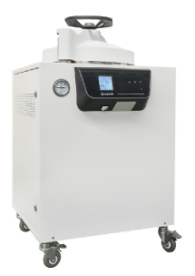
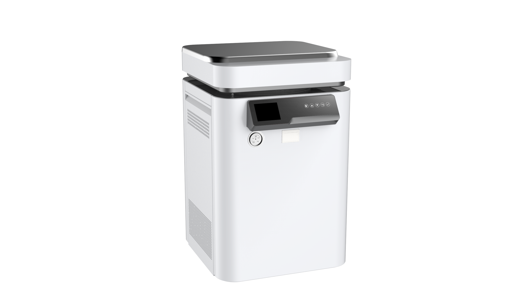
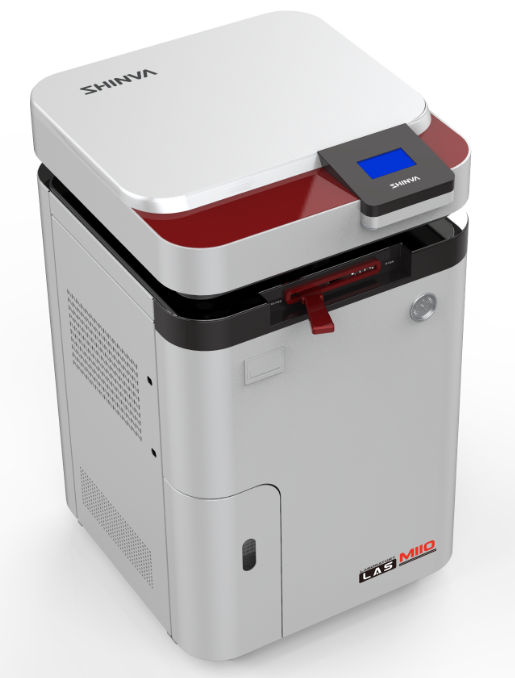
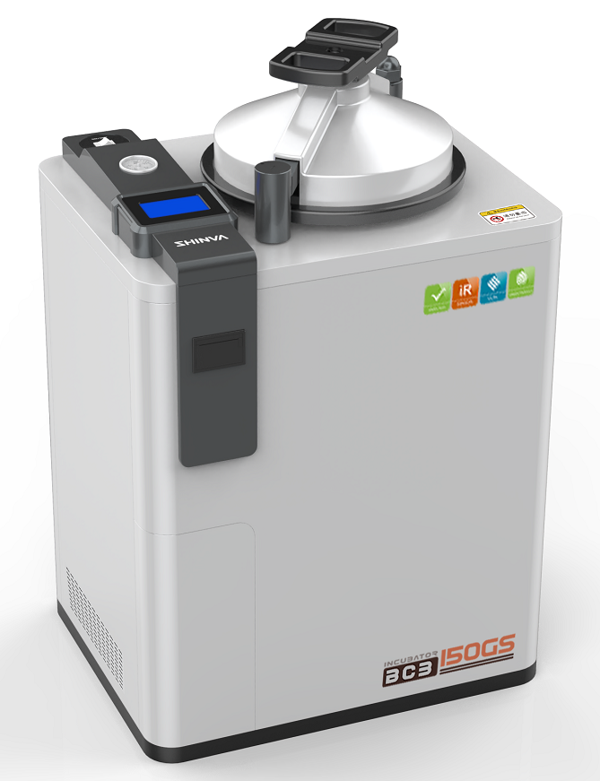
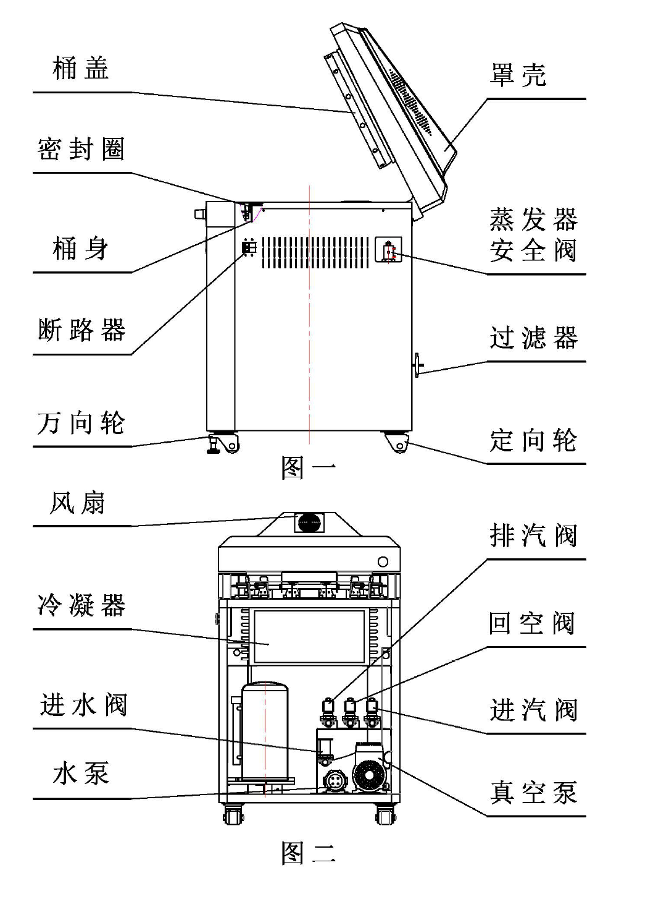
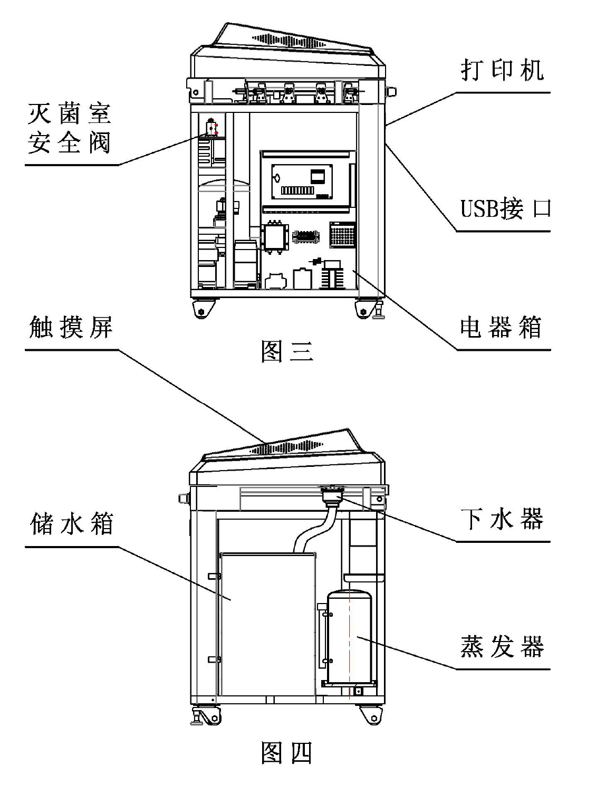

# 立式压力蒸汽灭菌器注册审查指导原则

本指导原则旨在指导注册申请人对立式压力蒸汽灭菌器注册申报资料的准备及撰写，同时也为技术审评部门审评注册申报资料提供参考。

本指导原则是对立式压力蒸汽灭菌器的一般要求，注册申请人需依据产品的具体特性确定其中内容是否适用。若不适用，需具体阐述理由及相应的科学依据，并依据产品的具体特性对注册申报资料的内容进行充实和细化。

本指导原则是供注册申请人和技术审评人员使用的指导性文件，但不包括审评审批所涉及的行政事项，亦不作为法规强制执行，需在遵循相关法规的前提下使用本指导原则。如果有能够满足相关法规要求的其他方法，也可以采用，但是需要提供详细的研究资料和验证资料。

本指导原则是在现行法规、标准体系及当前认知水平下制定的，随着法规、标准体系的不断完善和科学技术的不断发展，本指导原则相关内容也将适时进行调整。

一、适用范围

本指导原则适用于利用饱和水蒸气作用于负载上微生物一定时间，使微生物的蛋白质变性从而导致微生物死亡，以达到灭菌目的的立式压力蒸汽灭菌器产品，该产品灭菌室容积不小于30L且开口向上。该灭菌器主要用于耐湿耐热医疗器械的灭菌。

本指导原则不适用于手提式蒸汽灭菌器。

仅适用于非医疗器械灭菌的产品不按照医疗器械管理，如用于实验室器皿的灭菌。

二、注册审查要点

（一）监管信息

注册申请人（以下简称申请人）需要描述申报产品的管理类别、分类编码、产品名称及其确定依据。

1.产品名称

产品的命名需参考《医疗器械通用名称命名规则》和国家标准、行业标准上的通用名称要求。参考《医疗器械通用名称命名指导原则》《医疗器械消毒灭菌器械通用名称命名指导原则》，确定产品名称，如“立式压力蒸汽灭菌器”。产品名称由一个核心词和一般不超过三个的特征词组成，其中产品名称核心词为“压力蒸汽灭菌器”，特征词需以产品结构特点、作用对象、技术特点为依据命名。

2.管理类别和分类编码

根据《医疗器械分类目录》，分类编码为11-01-03，管理类别为Ⅱ类。

3.注册单元划分

注册单元划分需符合《医疗器械注册单元划分指导原则》的要求，原则上以产品的技术原理、结构组成、控制方式、气体置换方式、性能指标和适用范围为划分依据。

例如，常规灭菌产品与适用于以生物安全为目的灭菌产品宜划分为不同的注册单元。自动控制型和手动控制型灭菌产品宜划分为不同的注册单元。下排气式和预真空式灭菌产品宜划分为不同的注册单元。

（二）综述资料

1.概述

申请人需要描述申报产品的通用名称及其确定依据，描述产品的管理类别、分类编码。

如适用，描述有关申报产品的背景信息概述或特别细节，如：申报产品的历史概述、历次提交的信息，与其他经批准上市产品的关系等。

2.产品描述

2.1工作原理

立式压力蒸汽灭菌器通过重力置换、机械抽真空等方式将灭菌器室内冷空气排出，根据湿热灭菌的原理，以饱和湿热蒸汽为灭菌因子，在高温、高压、高湿的环境下，根据一定压力和时间的组合作用，实现对可被蒸汽穿透的耐湿耐热医疗器械的灭菌。通过特定工艺进行冷空气排出，蒸汽能够进入到物品内部，使用高温高压的湿热蒸汽使蛋白质变性，微生物死亡，从而达到灭菌的目的。

其中冷空气排除方式主要包括：

1）重力置换方式（下排气）：利用重力置换原理，热蒸汽在灭菌器中从上而下流动，使冷空气从下排气口中排出，排出的冷空气由热蒸汽代替。

2）正压脉动：利用脉动蒸汽冲压置换的原理，在大气压以上，用饱和蒸汽反复交替冲压，通过压力差将冷空气排出。

3）预排气式（脉动真空）：利用机械式抽真空原理，使灭菌器腔体内形成负压，再注入蒸汽，反复数次达到尽可能排出冷空气的目的。

产生蒸汽方式主要包括：

（1）内加热式：灭菌器腔体内有加热装置，将水加入内室中，加热即可产生蒸汽。

（2）即热式蒸发器：蒸发器处于高温状态，使用注水泵注入少量纯水，水会立即转化为蒸汽。

（3）储能式蒸发器：蒸发器有一定容积，内部有加热装置，加水之后可以产生蒸汽，并储存在蒸发器中，可达到一定的压力值。

2.2结构组成

立式压力蒸汽灭菌器产品一般由容器（灭菌室）、控制系统（包括电器箱、相应控制软件等）、管道系统（包括水泵、真空泵、冷凝器等）、加热系统（包括蒸发器等）、测量和记录系统、干燥装置（干燥板、加热板等）、安全装置（包括安全阀、密封圈、安全连锁装置等）、外罩、装载篮筐附件等部分组成（不同生产企业的产品，在结构上存在一定差异，不完全与本部分描述一致）。

立式压力蒸汽灭菌器结构组成示意图

2.3主要功能及其组成部件的功能

申请人需对整机总体构造、功能进行详细描述，包括所有组成部分，给出部件的说明（如图表、照片和图纸），关键部件/组件的功能说明、标识和图示等，其中包括充分的解释来方便理解这些图示。

关于主要结构组成（包括关键组件和软件等）及主要功能的描述举例如下：

容器（灭菌室）是灭菌器的核心承压部件，是运行灭菌过程的载体。

控制系统（包括电器箱、相应控制软件等）用于压力、温度、时间等灭菌过程的控制，达到灭菌所需的量值和精度，并对预设周期参数进行监控，实现既定的灭菌工艺要求。

管道系统用于实现灭菌介质的输送、内室真空（若有）、气体排放等灭菌工艺的要求。

测量和记录系统（若有）用于测量、记录、存储和打印灭菌过程参数。

干燥装置（若有）用于灭菌后加热干燥用途。

加热系统用于产生蒸汽供灭菌用（也可外接蒸汽）。

安全装置用于保护灭菌器自身安全和操作者安全。

外罩主要起装饰和保护设备的作用。

装载篮筐附件用于承载灭菌负载。

2.4型号规格

申请人需要说明申报产品的型号规格。若存在多个产品型号规格或配置，需采用对比表或带有说明性文字的图片、图表详述不同型号规格、产品配置之间的差异，包括：结构组成、性能指标、技术特征等。

划分在一个注册单元中的灭菌器申请人可按预期用途、结构型式、灭菌室大小、电气结构布局等不同划分为不同型号和规格。如按蒸汽供给方式分为自带蒸汽发生器、外接蒸汽式；按开门方式分为自动门灭菌器、手动门灭菌器；按气体置换方式分为下排气式灭菌器、预真空式灭菌器；按容器（灭菌室）结构形式分为可制成带夹套结构、单层结构等。

2.5包装

申请人需要描述注册单元内所有产品组成的包装情况，说明包装清单和包装方式，提供包装图示。

2.6研发历程

申请人需阐述申请注册产品的研发背景和目的。如有参考的同类产品或前代产品，需提供同类产品或前代产品的信息，并说明选择其作为研发参考的原因。

2.7与同类和/或前代产品的参考和比较

申请人需要列表比较说明申报产品与同类产品和/或前代产品在工作原理、结构组成、制造材料、性能指标以及适用范围等方面的异同。

3.适用范围和禁忌证

3.1适用范围

预期用途可描述为：用于耐湿耐热医疗器械的灭菌。对于不适用于生物安全防护水平为三级或四级的实验室或其它同等生物安全防护的场所中使用的产品需进行明确。

需明确目标用户以及操作或使用该产品应当具备的技能/知识/培训。

3.2预期使用环境

申请人需要详述产品预期使用的地点和可能影响其安全性和有效性的环境条件。

明确设备使用场所为医疗器械使用单位，如医疗机构、血站、单采血浆站、康复辅助器具适配机构等。

使用环境要求至少包括：环境温度、湿度、大气压等。

3.3禁忌证

产品无绝对禁忌证，但不能对不适合湿热灭菌的物品进行灭菌。

其中，下排气式（包括正压脉动）压力蒸汽灭菌器不适用于管腔类器械的灭菌。

4.申报产品上市历史

如适用，申请人需提供以下相关资料：

4.1上市情况。申报产品在各国家或地区的上市批准时间、销售情况。

4.2不良事件和召回。

4.3销售、不良事件及召回率。

5.其他需说明的内容

如适用，申请人需明确与申报产品联合使用实现预期用途的其他产品的详细信息，比如外接蒸汽源的接口、温度、压力等与设备安全有效直接相关的信息。

对于已获得批准的部件或配合使用的附件，申请人需提供注册证编号和国家药监局官方网站公布的注册证信息。

（三）非临床资料

1.产品风险管理资料

申请人宜参照GB/T 42062的规定，并结合产品特点对产品风险进行全生命周期的管理。风险管理活动要贯穿产品设计、生产、上市后使用及产品处理的整个生命周期。风险管理报告可包含风险分析、风险评价、风险控制、风险监测，需符合有关要求。

附表给出了产品常见的风险要素及示例。由于不同产品的工作原理、结构组成、性能指标存在差异，所以这些风险要素并不是全部，申请人还需根据产品特点确定其他风险并进行有效控制。

2.医疗器械安全和性能基本原则清单

说明产品符合《医疗器械安全和性能基本原则清单》各项适用要求所采用的方法，以及证明其符合性的文件。对于不适用的各项要求，需说明理由。

3.产品技术要求及检验报告

3.1产品技术要求

申请人需按照《医疗器械产品技术要求编写指导原则》中的规定，结合产品的技术特征和临床使用情况来确定产品的功能性、安全性指标，指标不得低于相关强制性标准、行业标准的要求。申请人如不采用的条款（包括国家标准、行业标准要求），需说明理由。

如有新版强制性国家标准、行业标准发布实施，产品性能指标等要求需执行最新版本的国家标准、行业标准。

产品技术要求中需明确型号规格及其划分的说明、产品性能指标及检验方法等。

产品技术要求需包括但不局限于以下内容：

3.1.1产品型号规格及其划分说明

对同一注册单元中存在多种型号、规格的产品，需明确不同型号、规格的划分说明，提供型号间主要差异对比表。推荐采用图示和/或表格的方式，表述文本较多的内容可以在附录中列明。

若含有软件，按照《医疗器械软件注册审查指导原则（2022修订版）》的要求，明确软件名称、型号规格、发布版本、软件完整版本命名规则，明确字段的位数、范围、含义，涵盖软件更新全部类型。软件版本命名需能区分重大软件更新和轻微软件更新。含有上位机软件和下位机软件的，或各型号规格软件版本不同的需分别进行描述。

3.1.2一般性能

申请人需根据申报产品特征确定需要符合的标准。立式压力蒸汽灭菌器适用YY/T 1007标准，性能指标、检验方法可参考YY/T 1007标准相关适用条款制定（同时，灭菌器需装有安全阀，安全阀适用GB/T 12241标准）。若产品宣称用于以生物安全为目的的灭菌，还需执行标准YY 1277。

产品的性能指标需与临床使用要求的功能相符。需根据灭菌负载的类型明确具体的检验方法。

3.1.3软件功能

需符合《医疗器械软件注册审查指导原则（2022修订版）》的要求，如软件的功能、使用限制、接口（若适用）、访问控制（若适用）、性能效率（若适用）等要求，且需与说明书中的软件功能描述一致。

3.1.4安全性能

需符合GB 4793.1、GB 4793.4的要求。

注：GB 4793系列新版标准实施后，GB 4793-2024和GB/T 42125.1-2024均部分代替GB 4793.1-2007，GB 4793-2024应与GB/T 42125系列标准配套使用。GB 4793.4即将被GB 42125.11-2025替代。

3.1.5电磁兼容

需符合GB/T 18268.1的要求。

3.2检验报告

申请人可提交注册产品的自检报告或委托有资质的医疗器械检验机构出具的检验报告。若提交自检报告，还需按照《医疗器械自检管理规定》的要求提供相关资料。

检验用典型产品需能够代表申请注册产品的安全性和有效性。需充分考虑产品工作原理、结构组成、技术指标及性能、控制方式、主要部件及产品其他风险等方面。需考虑功能最齐全、灭菌模式最全、结构最复杂以及主要元器件（如真空泵、传感器、加热部件等）的变化等。

注册单元内各型号的主要安全指标、性能指标、灭菌模式不能被典型型号全部涵盖时，则需选择涵盖安全指标、性能指标最多且灭菌效果最具有挑战性的型号作为典型产品，同时还需考虑其他型号中未被典型型号所涵盖的安全指标、性能指标灭菌模式，就不同规格型号差异性对产品安全有效性的影响做出说明。

4.研究资料

申请人需根据申报产品适用范围和技术特征，提供非临床研究综述，逐项描述所开展的研究，概述研究方法和研究结论。根据非临床研究综述，提供相应的研究资料，各项研究可通过文献研究、实验室研究、模型研究等方式开展，一般需包含研究方案、研究报告。

4.1化学和物理性能研究

申请人需要提供产品性能研究资料以及产品技术要求的研究和编制说明，包括有效性、安全性指标以及与质量控制相关的其他指标的确定依据、所采用的标准或方法、采用的原因及理论基础等。性能研究项目不局限于国家标准、行业标准中的项目。

若申报产品需要外接蒸汽源，需要提供安全性、兼容性验证资料。安全性验证宜明确蒸汽源温度、压力上限以及接口规格等参数，以便保证接口和产品安全；兼容性验证宜明确蒸汽源温度、压力下限，以便支持产品性能。

灭菌效果：

有多种灭菌程序的，需对具有代表性和典型性的灭菌程序进行灭菌效果验证。特别地，对于产品的灭菌参数设计包含标准中未明确的灭菌参数（温度、时间组合）的情况时，需提供证明产品灭菌效果的验证资料，并明确应用的场景。

需根据灭菌负载的适用类型，如多孔渗透负载、实心负载、液体负载，提供灭菌效果验证资料。对于产品说明书中声称适用的灭菌物品，特别对标准要求未覆盖的物品或抗力增加的物品，提供灭菌效果验证的资料。

4.2电气系统安全性研究

申请人需要提供电气安全性、机械和环境保护以及电磁兼容性的研究资料，说明适用的标准以及开展的研究。

4.3软件研究

注册申请人需依据《医疗器械软件注册审查指导原则（2022年修订版）》提交软件研究资料（含现成软件研究资料、互操作性研究资料、GB/T 25000.51报告等），软件研究资料需按照至少“中等”安全性级别提供。含有上位机和下位机软件的，需分别进行软件研究。同一注册单元不同型号规格的产品采用不同软件时，需分别进行软件研究。

若适用，如产品具有电子数据交换、远程访问与控制等功能，参考《医疗器械网络安全注册审查指导原则（2022年修订版）》，申请人需提供网络安全研究资料。

4.4清洁、消毒、灭菌研究

申请人宜明确推荐的清洁剂和清洗方法。该类产品本身通常不需要消毒和灭菌处理。

4.5可用性研究

注册申请人需依据《医疗器械可用性工程注册审查指导原则》，按照中使用风险医疗器械要求提交使用错误评估报告。

5.稳定性研究

5.1因各生产企业采用的原材料不同，同时考虑到使用频次的不同及一些不可预期的因素，产品的实际有效期会不同。申请人需明确立式压力蒸汽灭菌器产品的预期使用寿命，参考《有源医疗器械使用期限注册技术审查指导原则》，提供预期使用寿命的分析验证报告，补充验证关键指标。

5.2产品经环境试验和模拟运输试验验证，包装需符合运输和贮存的要求。在宣称的有效期内以及运输储存条件下，申请人需提供保持包装完整性的依据，可参考GB/T 4857系列标准。环境试验可参考GB/T 14710标准。

6.其他资料

立式压力蒸汽灭菌器产品已列入《免于临床评价医疗器械目录》，注册申请时提交免临床评价资料的要求：

6.1提交申报产品相关信息与《免于临床评价医疗器械目录》所述内容的比对资料，证明两者具有等同性。

6.2提交申报产品与《目录》中已获准境内注册医疗器械的比对说明，比对内容包括基本原理、所用材料、结构组成、性能要求、适用范围、使用方法等，并提供必要的支持性资料。需重点关注申报产品与已上市产品的异同，对于差异性需提交必要的验证资料。

6.3充分考虑豁免情况不包括新材料、新工作原理、新功能的产品。不能证明与已获准境内注册的产品具有基本等同性，需按相关指导原则进行临床评价。

7.证明产品安全性、有效性的其他研究资料。

产品说明书和标签样稿

产品说明书和标签需符合《医疗器械说明书和标签管理规定》的要求，并参照YY/T 1007等相关标准的要求进行编写。同时还需关注以下内容：

1.产品性能、主要技术参数。

2.关于灭菌原理的说明。

3.关于提醒使用者对灭菌效果进行验证的警示说明。

4.明确产品的能源需求，包括但不限于：

水源需求：电导率、PH、硬度等质量指标。

蒸汽源需求（仅适用于外接蒸汽源设备）：接口、温度、压力、干度值、非凝结性气体含量、过热度、蒸汽冷凝物的质量指标等与设备安全有效直接相关的信息。

压缩气源（若有）需求：压力、洁净度等。

电源需求。

5.明确产品安装调试的规范：

预真空（包括脉动真空）压力蒸汽灭菌器启用前需进行真空泄漏测试；

预真空（包括脉动真空）压力蒸汽灭菌器启用前需进行B-D测试并重复三次，连续监测合格；

启用前需空载连续进行三次生物监测合格。

6.对产品使用方法、产品寿命、维护保养等情况做出说明。

产品灭菌参数设计若具有标准中未明确的灭菌参数（温度、时间组合）的情况、自定义模式时，需根据研究资料明确灭菌参数和负载类型。

若灭菌器带有干燥功能，无菌物品的卸载，需检查有无湿包，湿包不应储存和发放。

若灭菌器带有记录装置或记录系统，需对灭菌过程进行监测和记录，实现过程可追溯，灭菌质量可控。

建议列出产品易损件清单，明确胶条、过滤器等耗材的更换周期。

7.对于容器的技术指标表述。

8.对于电磁兼容所声称的有关内容（预期场所、类别等）。

9.提示不要超出产品适用范围使用。说明不适用灭菌的物品种类及提示，如电子仪器、电池、电缆、光纤仪器、软式内镜、油脂类、密封性玻璃瓶、粉剂等。

10.提示对灭菌效果进行监测。

11.对于安全性方面的提醒。

12.常见故障及排除方法。

13.若申请人声称产品符合YY 1277的要求，需要说明该产品适用于以生物安全为目的的材料、器皿、培养基以及废弃物等物品的灭菌，以防止通过气溶胶等方式传播的致病因子对人员、动植物或环境造成污染。

14.若产品宣称用于消毒供应中心，还需执行WS 310系列等标准。如：预真空（包括脉动真空）压力蒸汽灭菌器需每日开始灭菌运行前空载进行B-D测试，B-D测试合格后，灭菌器方可使用。有的企业还会根据产品的特点引用一些行业外的标准和一些较为特殊的标准。

质量管理体系文件

产品的质量管理体系文件需符合《医疗器械生产质量管理规范》的要求，并按《医疗器械注册申报资料要求及说明》提交资料。

需明确产品生产工艺过程，可采用流程图的形式，并说明其过程控制点。

生产工艺需已通过验证，能够生产出质量稳定、安全有效的产品，在注册质量管理体系核查中，对此项内容进行核查。关键工序、特殊过程宜编制并执行工艺规程或作业指导书。

本类产品的关键过程一般包括焊接、水压试验、检验。但当上述过程中的一个或多个通过外包的方式来实现时，生产企业需对外包过程实施有效控制。

有多个研制、生产场地的，需概述每个研制、生产场地的实际情况。

三、参考文献

中华人民共和国国务院.医疗器械监督管理条例:中华人民共和国国务院令第739号[Z].

国家市场监督管理总局.医疗器械注册与备案管理办法:国家市场监督管理总局令第47号[Z].

国家食品药品监督管理局.医疗器械说明书和标签管理规定:国家食品药品监督管理总局令第6号[Z].

国家食品药品监督管理局.医疗器械通用名称命名规则：国家食品药品监督管理总局令第19号[Z].

国家药品监督管理局.医疗器械注册申报资料要求及说明:关于公布医疗器械注册申报资料要求和批准证明文件格式的公告2021年第121号[Z].

国家食品药品监督管理局.医疗器械分类目录:国家食品药品监督管理总局关于发布医疗器械分类目录的公告2017年第104号[Z].

国家食品药品监督管理局.医疗器械注册单元划分指导原则:总局关于发布医疗器械注册单元划分指导原则的通告2017年第187号[Z].

国家药品监督管理局.医疗器械通用名称命名指导原则:国家药监局关于发布医疗器械通用名称命名指导原则的通告2019第99号[Z].

国家药品监督管理局.医疗器械消毒灭菌器械通用名称命名指导原则:国家药监局关于发布骨科手术器械通用名称命名指导原则等5项指导原则的通告2020年第79号[Z].

国家药品监督管理局.大型压力蒸汽灭菌器注册审查指导原则（2024年修订版）:国家药监局器审中心关于发布电动摄影平床等48项医疗器械注册审查指导原则的通告2024年第19号[Z].

国家药品监督管理局.小型压力蒸汽灭菌器注册审查指导原则（2025年修订版）:国家药监局器审中心关于发布电动牵引装置注册审查指导原则（2025年修订版）等39项指导原则的通告2025年第27号[Z].

国家药品监督管理局.免于临床评价医疗器械目录:国家药监局关于发布免于临床评价医疗器械目录的通告2025年第19号[Z].

国家药品监督管理局.列入免于临床评价医疗器械目录产品对比说明技术指导原则:国家药监局关于发布医疗器械临床评价技术指导原则等5项技术指导原则的通告2021年第73号[Z].

国家药品监督管理局.医疗器械产品技术要求编写指导原则:国家药监局关于发布医疗器械产品技术要求编写指导原则的通告2022年第8号[Z].

国家药品监督管理局医疗器械审评中心.医疗器械软件注册审查指导原则（2022年修订版）:国家药监局器审中心关于发布医疗器械软件注册审查指导原则（2022年修订版）的通告2022年第9号[Z].

国家药品监督管理局医疗器械审评中心.医疗器械网络安全注册审查指导原则（2022年修订版）:国家药监局器审中心关于发布医疗器械网络安全注册审查指导原则（2022年修订版）的通告2022年第7号[Z].

国家药品监督管理局医疗器械审评中心. 医疗器械可用性工程注册审查指导原则:国家药监局器审中心关于发布医疗器械可用性工程注册审查指导原则的通告2024年第13号[Z].

YY/T 1007-2018,立式蒸汽灭菌器[S].

GB 8599-2023,大型压力蒸汽灭菌器技术要求[S].

GB 4793.1-2007,测量、控制和实验室用电气设备的安全要求 第1部分：通用要求[S].

GB 4793.4-2019,测量、控制及实验室用电气设备的安全实验室用处理医用材料的蒸压器的特殊要求[S].

GB 4793-2024,测量、控制和实验室用电气设备安全技术规范[S].

GB/T 42125.1-2024,测量、控制和实验室用电气设备的安全要求 第1部分：通用要求[S].

GB 42125.11-2025,测量、控制和实验室用电气设备的安全要求 第11部分：用于处理医用材料的灭菌器和清洗消毒器的特殊要求[S].

GB/T 14710-2009,医用电器环境要求及试验方法[S].

YY 1277-2023,蒸汽灭菌器 生物安全要求[S].

YY 0731-2009,大型蒸汽灭菌器 手动控制型[S].

YY/T 0646-2022,小型蒸汽灭菌器 自动控制型[S].

GB/T 18268.1-2025,测量、控制和实验室用的电设备 电磁兼容性要求 第1部分：通用要求[S].

WS 310.1-2016,医院消毒供应中心 第1部分：管理规范[S].

WS 310.2-2016,医院消毒供应中心 第2部分：清洗消毒及灭菌技术操作规范[S].

WS 310.3-2016,医院消毒供应中心 第3部分：清洗消毒及灭菌效果监测标准[S].

WS/T 367-2012,医疗机构消毒技术规范[S].

GB/T 42062-2022,医疗器械风险管理对医疗器械的应用[S].

YY/T 0466.1-2016,医疗器械 用于医疗器械标签、标记和提供信息的符号 第1部分：通用要求[S].

GB/T 14710-2009,医用电器环境要求及试验方法[S].

附表

产品常见的风险要素及示例

| 可能产生的危害 | 形成因素 |
| --- | --- |
| 能量危害 | 能量危害 |
| 电能 | 保护接地阻抗、可触及部件允许限值、电介质强度不符合要求； 机器外壳的防护罩封闭不良； 电磁兼容性能不符合要求。 |
| 热能 | 测温系统或装置损坏，控制失灵，设备温度低于限定值，设备温度高于限定值； 容器壳体泄漏、管路泄漏，设备正常运行时发生蒸汽泄漏； 焊接出现焊缝，发生蒸汽泄漏； 密封失效，或密封不严； 门锁机构失效； 操作不当。 |
| 机械危险 | 设备外壳粗糙、有毛刺； 设备没有足够的外壳机械强度和刚度； 门挤压伤害。 |
| 压力 | 设备压力高于规定值范围，产生爆炸风险； 设备压力低于规定值范围，达不到灭菌温度； 安全阀失效； 压力监测装置失效。 |
| 噪声 | 设备消音系统或运动部件损坏。 |
| 生物学危害 | 生物学危害 |
| 生物学 | 灭菌效果不合格。例如，前期冷空气排除不彻底，由于空气热传递性较差等原因，导致灭菌效果不合格。 |
| 环境危害 | 环境危害 |
| 运行偏离预定的 环境条件 | 有可能造成局部环境温度升高。 |
| 与医疗器械使用有关的危害 | 与医疗器械使用有关的危害 |
| 不适当的标记 | 外部和内部标记不全面、标记不正确或不能够清楚易认，以及标记不能够永久贴牢。 |
| 不适当的操作说明 | 缺少必要的警告说明和详细的使用方法； 缺少详细的日常使用维护规范。 |
| 由不熟练/未经培训的人员使用 | 使用人员操作不熟练、使用不当。 |
| 不正确的指示 | 压力或温度显示或报警不准确。 操作者开门时由压力容器余温导致的压力未被正确识别导致使用者的安全风险。 |
| 不适当、不合适或过于复杂的使用者接口（人/机交流） | 不适当、不合适或过于复杂的使用者接口（人/机交流） |
| 复杂的操作系统 | 操作过程过于复杂可用性差，人员使用操作失误。 |
| 功能性失效、维护和老化引起的危害 | 功能性失效、维护和老化引起的危害 |
| 维护规范缺少或不适当 | 说明书中有关维护、保养等内容不明确。如：清洗、预防性检查、保养以及保养周期等。 |
| 对医疗器械寿命的终止缺少适当的决定 | 对设备的使用寿命或终止使用的条件没有明确规定，未明确关键部件的使用寿命，如电磁阀、加热装置、过滤器及密封圈等。 |
